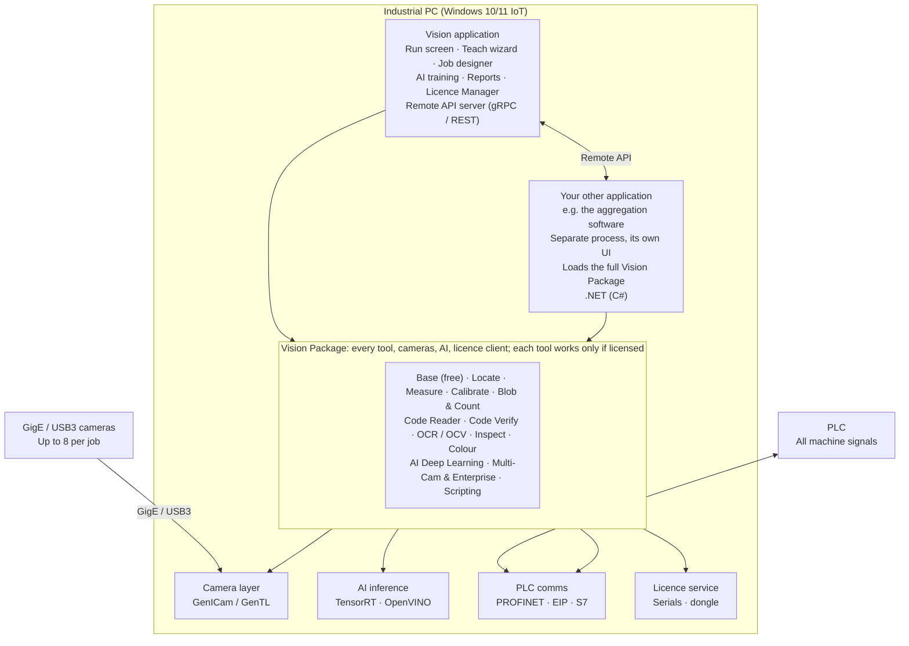

# Vision System Software – Project Requirements Document

Oct 29, 2026 · Gaurang

Living copy: https://claude.ai/artifact/9tswdE4aRB1rreSoKzgRcA

## 1. Purpose, scope and vision

The product is a 2D machine-vision platform covering everything VisionPro offers except 3D. It aims to beat Cognex on two counts: an operator with no vision training can create and run a job in under 15 minutes, and AI tools reach equal or better accuracy on the same images.

**Product name (working):** VisionStudio (to be finalised).

**In scope**

- 2D image acquisition from GigE Vision and USB3 Vision cameras only, plus file or folder sources. The industrial PC always works with a PLC, which handles every machine signal.
- A complete 2D tool library: preprocessing, location, measurement, blob analysis, barcode and 2D code reading, OCR/OCV, inspection, colour, deep learning, logic and communication.
- Single-camera and multi-camera jobs.
- A drag-and-drop job designer with auto-learn and auto-find.
- An operator run screen for unskilled users.
- 15 UI languages.
- Licensing per parent tool, using serial numbers, with add-on licences.
- A full package, the Vision Package, so other applications (first the owner's aggregation software) use every reading, AI and camera feature in their own process, licensed only through the central ERPNext licence service and updated by the host application (section 10).

**Out of scope**

- 3D tools, including laser profilers, point clouds, height maps and 3D calibration.
- Robot motion planning. Robot guidance is limited to sending 2D pose and calibrated coordinates.
- Smart cameras, fixed-mount barcode readers, CoaXPress or Camera Link frame grabbers, and any signal wired directly to the camera or PC by M8/M12 cable (hardware trigger, strobe, digital I/O, RS-232/485). The software runs on an industrial PC and exchanges all signals with the PLC over Ethernet.

**Product principles**

1. **Show, don't configure.** The user points at the image and the software proposes the tool, the ROI and the parameters.
2. **Pass/fail first.** Every screen answers "Is the part good?" before it shows any numbers.
3. **Safe by default.** The operator cannot break a running job, and every change can be undone and is versioned.
4. **One engine, many front ends.** The same Vision Package powers the vision application's runtime service and partner applications such as the aggregation software.
5. **Hardware fits the job.** The software recommends a CPU/GPU tier from the cycle time the user needs.

## 2. Users and design rules

The primary user is a shop-floor operator with little computer experience. Every screen must work for that person, and expert depth stays hidden behind an "Advanced" switch.

| Persona | Skill level | What they do | What they see |
| --- | --- | --- | --- |
| Operator | Low; may not read English, rarely uses a PC | Starts and stops jobs, changes product, reads OK/NG, clears alarms | Run screen: compact multi-panel screen, colours and icons, their own language |
| Supervisor / quality | Basic PC skills | Creates new jobs with the wizard, re-teaches a part, adjusts tolerances, checks reports | Wizard, simple job editor, statistics |
| Integrator / engineer | Vision and PLC knowledge | Builds complex multi-camera jobs, scripts, communication, calibration, licences | Full designer with Advanced mode, script editor, SDK |
| Administrator | IT skills | Users, passwords, licences, backups, updates | Admin console |

**Rules for non-technical users**

- One compact density for every role (owner, 2026-10-31: "Do not keep too big buttons and size for operators also as they also need so many things in one screen (we may provide keyboard and mouse also with touch screen). For engineers dense screen with all required option is good."). Touch, mouse and keyboard work together; controls are 32 px high and nothing is smaller than 32 × 32 px to tap. The Run toolbar groups its actions (Line, Product, View, Help) and the screen may show many panels at once.
- Every action has an icon and a text label. Status is shown by colour plus a shape (✓ / ✗ / !) so colour-blind users can read it.
- No technical terms on operator screens. For example, use "Find the part" instead of "PatMax alignment", and "Check size" instead of "Caliper".
- Each step has a short guided animation or video, and spoken guidance is available in the user's language.
- Errors explain what to do, not what went wrong internally. For example: "Image is too dark. Turn the light knob up or press Auto Light."
- Undo is available everywhere, and the software asks for confirmation only for destructive actions.
- The software starts straight into the last job in Run mode, with no login for the operator role if the plant allows it.

## 3. System architecture

The vision application and the user's other applications are separate programs that load the same Vision Package (section 10). A tool tuned in one gives identical results in the other, and neither program depends on the other running.

Cameras and the PLC connect only to the industrial PC. The Remote API is optional, for applications that drive a running vision job.

| Component | Responsibility |
| --- | --- |
| Vision application | Run, Teach and Advanced modes, AI training, reports, Licence Manager, Remote API server. The UI and the inspection runtime are separate processes, so closing or crashing the UI never stops inspection. The runtime runs as a Windows service. The application is Vision Studio, a Windows application (Windows 10/11 only, owner, 2026-10-31), and that name is used on screen, in the installer and in licences (owner, 2026-10-30). It works like Cognex VisionPro (owner, 2026-10-30), is built on Avalonia and leaves the inspection to the separate runtime service `vs-runtime` ([vision-system/ARCHITECTURE.md](vision-system/ARCHITECTURE.md) section 2). It is the one application for every tool: the code-reader Dashboard and the browser VisionStudio fold into it, and the code reader becomes its Code Reader tool (owner, 2026-10-30). |
| Your other application | Any program, such as the aggregation software, a packaging HMI or traceability software, that loads the full Vision Package and drives cameras, products and runs through its API (section 10). |
| Vision Package | Every tool (one library per parent tool, sharing a common image, ROI, result and graphics model), the camera layer, AI inference and the licence client, shipped and updated as one signed package. A tool works only when licensed. |
| Camera layer | GenICam/GenTL acquisition for GigE Vision and USB3 Vision cameras, with buffering and per-camera threads. |
| AI inference | ONNX Runtime with TensorRT (GPU) or OpenVINO (CPU/iGPU), with model encryption and caching. |
| PLC comms | PLC protocols, the handshake and the watchdog (section 12). |
| Licence service | Checks the licence with the central ERPNext licence service for both the vision application and the Vision Package in other applications (section 9). |

## 4. Tool library

The library has 12 licensable parent tools, each with its own serial number. Each parent unlocks a family of sub-tools. Free base tools ship with every installation, so that any job can acquire images, preprocess them and output results.

| # | Parent tool (licence) | Sub-tools included | Operator-facing name | Key requirements |
| --- | --- | --- | --- | --- |
| 0 | **Base (free)** | Image source, camera settings, image convert, crop/ROI, histogram, flat-field, filters (smooth, sharpen, median), morphology, threshold, image arithmetic, polar unwrap, affine transform, overlay, result logic, logging | Camera, Clean image | Auto exposure, auto focus assist, auto white balance. Live histogram with a "too dark / too bright" hint. |
| 1 | **Locate** | Normalised-correlation match, geometric (edge-based) match, multi-instance search, fixture / coordinate space, AI locator | Find the part | One-click teach. Rotation ±180°, scale 0.8–1.2, tolerates 30% occlusion, subpixel pose. Target 0.05 px / 0.05° repeatability. |
| 2 | **Measure** | Caliper (single and pair), find line, find circle/arc, find ellipse, find corner, point/line/circle geometry (distance, angle, intersection, perpendicular), edge width/gap, pin pitch, thread/count edges | Check size | Results in mm after calibration. Auto-placement of calipers from a clicked edge. Tolerance bands shown in green and red on the image. **MEA-01** Every edge of a row (pins, threads) is placed alike, the first and last too: on a soft image (1 px blur, 3.2 px between edges) the end edges lie within 0.1 px, and a pitch check holds the end spacings to the same limits as the inner ones, with no allowance (pending item from the 2026-10-31 Measure tool work, started by the owner 2026-11-03). The same 0.1 px holds for rows down to 2.4 px between edges at a 1 px blur (0.11 px at 2.2 px) and for a lone 4 px pin at a 1.5 px blur (pending item of PR #317, 2026-11-04). |
| 3 | **Calibrate** | Checkerboard and dot-grid calibration, lens distortion, N-point, pixel-to-mm scale, hand-eye 2D (robot), multi-camera stitching to a common world frame | Set real size | Wizard with an on-screen good/bad checkerboard detector. Reports residual error in µm. |
| 4 | **Blob & Count** | Blob analysis (area, centroid, perimeter, circularity, elongation, holes, bounding box), contour analysis, count, sort and filter | Count / spot | Auto threshold. Click a sample blob to set filter limits automatically. |
| 5 | **Code Reader** | 1D barcodes (Code 128, Code 39, Code 93, EAN/UPC, ITF, Codabar, GS1 DataBar, Pharmacode), 2D codes (DataMatrix ECC200, QR, Micro QR, PDF417, Aztec, DotCode), DPM (dot-peen, laser) | Read code | Auto-detect symbology, multiple codes per image, any orientation. Read rate ≥ 99.9% on graded samples. AI rescue for damaged codes. |
| 6 | **Code Verify** | ISO/IEC 15415, 15416 and 29158 (DPM) grading, GS1 data validation | Grade code | Grade report as PDF, laid out like the Cognex verifier report (owner, 2026-10-29: "Check real cognex verifier report. Add missing fields and images."). On the line the grade is kept as numbers only; the PDF is made on request, off the line (owner, 2026-10-29: "For all barcodes being inspected reports in pdf is not required."). Requires a calibrated setup. |
| 7 | **OCR / OCV** | Classical OCR with font training, deep-learning OCR (pretrained, no training needed), OCV (expected-string verification with print-quality score), date/lot/expiry format validation, dot-matrix and inkjet support | Read text / Check text | Works out of the box on printed dates and lot codes. OCV flags missing, broken or wrong characters per character. Supports Latin, Devanagari and other scripts as an option. |
| 8 | **Inspect** | Presence/absence, golden-template comparison, edge-based flaw detection, surface defect (scratch, dent, stain), bead/glue inspection, label inspection (position, skew, print), cap/seal check | Check defects | Teach from 5–20 good parts. Sensitivity slider with a live preview of what would fail. |
| 9 | **Colour** | Colour match, colour presence, colour segmentation, colour sorting, ΔE measurement (CIE Lab) | Check colour | Click a colour to learn it. Works under lighting drift via a white reference. |
| 10 | **AI Deep Learning** | Anomaly detection (good-only training), classification, object detection, segmentation, AI OCR fine-tuning, AI locator, auto-labelling | Teach by example | Train on the local GPU in under 10 minutes for typical datasets. See section 5. |
| 11 | **Multi-Camera & Enterprise** | Jobs with more than one camera, GigE Vision action-command sync, OPC UA, MQTT, MES/SQL database output, web HMI | Connect machines | The Base edition already includes one camera, all PLC protocols (section 12), TCP/IP and CSV output. |
| 12 | **Scripting & Advanced Logic** | C# / Python script tool, custom formula, state machines, data analysis / SPC (Cpk, trends) | Custom rules | Sandboxed scripts that cannot crash the runtime. |
| 13 | **Autonomous Environmental Auto-Tune & Tooling Advisor** | Inline continuous sunlight adaptation, 9-zone MTF focus uniformity, lens dust spot check, applicator lead-screw advisor (`vs_autotune`) | Auto-Tune & Advisor | Automatically trims shutter/gain to compensate for daylight shifts through roof/windows; guides operator on exact lead-screw turns for applicator cap drift; alerts on conveyor surface sweating. |

### 4.1 Specialized Next-Generation Inspection Engines (Mathematical & Algorithmic Specifications)

To eliminate specification drift across sessions and ensure zero gaps between research studies, engine prototypes, and production requirements, the following specialized engines are formally registered as core system capabilities:

1. **Computational Photometric Stereo (`vs_photometric`)**
   - **Target**: Surface defect, engraving, embossed code, and scratch inspection on shiny, curved, or reflective packaging (metal cans, glass bottles, shrink-wrap).
   - **Method**: 4-quadrant / 4-sector sequenced directional illumination strobe. Solves the Lambertian gradient equation $I_i(x,y) = \rho(x,y) (\mathbf{n}(x,y) \cdot \mathbf{s}_i)$ via linear least squares for surface normal vector $\mathbf{n} = (-p, -q, 1) / \sqrt{p^2 + q^2 + 1}$ and albedo $\rho(x,y)$.
   - **Outputs**: Reconstructed albedo (pure print/texture without relief shadow), surface gradient map ($p, q$), mean curvature $H = \frac{1}{2}\nabla \cdot \mathbf{n}$, and surface roughness RMS ($\mu\text{m}$).
   - **Performance**: $< 10\text{ ms}$ on 5 MP image tiles using AVX2 SIMD dot products.

2. **Specular Highlight Glare Inpainting (`vs_inpaint`)**
   - **Target**: Overcoming blinding glare reflections from plant ceiling LEDs and external daylight on shrink-wrapped pallets, glossy blister packs, and metallic foils.
   - **Method**: Dual-threshold specular mask generation followed by bi-harmonic Telea/Navier-Stokes gradient rebalancing and polarimetric diffuse inpainting.
   - **Safety Gate**: Replaces saturation blowout with structural texture priors; preserves barcode/character edge transitions without inventing false data. Decoders run on the inpainted buffer; if barcode parity/checksum fails, falls back to raw frame.

3. **Anti-Glare Polarimetric Decoupling (`vs_polar`)**
   - **Target**: Total extinction of direct glare from specular metallic or liquid surfaces.
   - **Method**: Synchronized acquisition with cross-polarized illumination ($0^\circ, 45^\circ, 90^\circ, 135^\circ$ Stokes polarizers). Computes Stokes parameters ($S_0, S_1, S_2$), Degree of Linear Polarization ($\text{DoLP} = \sqrt{S_1^2 + S_2^2}/S_0$), and Angle of Linear Polarization ($\text{AoLP} = \frac{1}{2}\arctan(S_2/S_1)$) to decouple diffuse reflection from specular flare.

4. **Wavelet Multiscale Scratch & Micro-Defect Filter (`vs_wavelet`)**
   - **Target**: Hairline cracks, burrs, and glass/metal micro-scratches embedded in textured or noisy backgrounds.
   - **Method**: 2D discrete stationary wavelet transform (SWT / à trous algorithm) with Daubechies/Symlet wavelets. Separates image into low-frequency background ($LL$) and high-frequency directional sub-bands ($LH, HL, HH$). Applies Bayesian adaptive soft-thresholding to isolate directional defect discontinuities.

5. **Packaging Thermal Sealing & Tooling Diagnostics (`vs_thermal`)**
   - **Target**: Continuous verification of heat-sealed pouches, thermoformed blister trays, carton hot-melt glue beads, and induction cap seals.
   - **Method**: Calibrated thermal infrared radiometry. Computes seal width profile across the seam, minimum seal width ($> 3.0\text{ mm}$), peak temperature ($140–165^\circ\text{C}$), cooling gradient ($\Delta T/\Delta t$), and leaker channel voids ($> 0.5\text{ mm}^2$).
   - **Tooling Diagnostic**: Calculates sealing jaw parallelism and pressure uniformity $\Delta P = \frac{T_{\text{left}} - T_{\text{right}}}{T_{\text{mean}}} \times 100\%$. Alerts operator if jaw mechanical tilt exceeds $4\%$, preventing upstream tooling failure before defective pouches are formed.
   - **Hot-melt glue bead gaps (2026-11-03, PR #310)**: A gap in a bead is a cold stretch between two hot stretches of that bead. Cold before the bead starts or after it ends inside the ROI is not a gap, so a short good bead in a longer ROI passes. A bead that is too short (stopped early, started late) is NG_BROKEN_BEAD through the minimum bead length; a real break longer than the allowed gap is NG_BROKEN_BEAD through the gap.

6. **Infrared Transmission & Opaque Fill-Level Inspection (`vs_infrared`)**
   - **Target**: Liquid fill level, headspace inspection, and foreign body detection inside amber glass, dark PET, or opaque HDPE containers where visible light is completely blocked.
   - **Method**: Short-Wave Infrared (SWIR 1050–1650 nm) transmission imaging. Leverages water absorption peaks at 1450 nm and alcohol absorption at 1200 nm to produce high-contrast liquid meniscus boundaries through opaque plastics.

7. **Non-Rigid Thin-Plate Spline Mesh Matcher (`vs_mesh`)**
   - **Target**: Variable, flexible, or wrinkled packaging (pouches, flow-packs, blister packs, sacks).
   - **Method**: Multi-resolution dense triangular mesh with Thin-Plate Spline (TPS) regularized warping. Energy minimization balances photometric alignment error with bending energy $\|E_{\text{bend}}\|^2$. Allows localized warping while flagging severe creases or folds as packaging defects.

8. **Conveyor-Compensated Rolling-Shutter Rectification (`vs_rectify`)**
   - **Target**: Eliminating shear, stretch, and aspect ratio distortion on high-speed lines using Sony IMX183 CMOS sensors (Hikrobot MV-CS200-10UM).
   - **Method**: Hardware line-trigger or optical flow encoder tracking. Applies per-row horizontal displacement compensation: $\Delta x(y) = v_{\text{line}} \times t_{\text{row}} \times y$, where $t_{\text{row}}$ is the sensor line read time (14.2 µs/line). Ensures barcodes and OCR characters maintain perfect 1:1 aspect ratio across conveyor speed surges ($0–250\text{ parts/min}$).

9. **Log-Polar Fourier-Mellin Phase Correlator (`vs_phasecorr`)**
   - **Target**: Instant rotation (0–360°) and scale (0.5–2.0×) invariant pattern finding on unconstrained bottles and randomly oriented components without expensive brute-force search.
   - **Method**: Fast Fourier Transform (FFT) followed by Log-Polar resampling: $(\ln r, \theta)$. Cross-spectral phase correlation $\frac{F_1(\xi) F_2^*(\xi)}{|F_1(\xi) F_2^*(\xi)|}$ produces a sharp delta peak at the exact rotation angle and scale factor, reducing computation from $\mathcal{O}(N^3)$ to $\mathcal{O}(N \log N)$.

10. **In-Memory Fast PatchCore Coreset Anomaly Engine (`vs_patchcore`)**
    - **Target**: Surface defect anomaly inspection on unlabelled components using good-only training.
    - **Method**: Feature embeddings from RepViT / WideResNet-50 backbone mapped into an in-memory Hierarchical Navigable Small World (HNSW) or Product Quantization (PQ) vector index (via embedded USearch/hnswlib). Runtime query executes in $\le 12\text{ ms}$ on CPU with AVX2 SIMD acceleration, reaching AUROC $\ge 98.5\%$.

11. **Process Stability & Outlier Map (`vs_haystack`)**
    - **Target**: Live statistical process control and drift monitoring in latent feature space.
    - **Method**: 512-dimensional latent feature projection onto 2D Principal Component Analysis (PCA) plane. Tracks Mahalanobis cluster distance $D_M = \sqrt{(\mathbf{x}-\mathbf{\mu})^T \mathbf{\Sigma}^{-1} (\mathbf{x}-\mathbf{\mu})}$ against a 3.5σ statistical process boundary. Triggers automated active learning triage on edge-case frontier samples.

12. **Autonomous Inline Environmental Auto-Tune & Upstream Tooling Advisor (`vs_autotune`)**
    - **Target**: Unsupervised real-time adaptation to plant factory realities (sunlight shifts, LED lighting changes, conveyor vibration, lens dust, camera tilt, and applicator drift).
    - **Method**: Continuous background tracking of ambient illuminance, 9-zone MTF focus uniformity, lens spot obstruction, and cap hologram center displacement. Dynamically adjusts camera exposure without stopping the running line and outputs closed-loop tooling advice to upstream machines.

Every tool, whatever its family, must provide:

- A **standard interface**: typed inputs, typed outputs, graphics overlay, a pass/fail result and a timing figure.
- **Auto-learn**: the tool proposes its own ROI and parameters from a clicked point or a drawn box.
- **Auto-tune**: it optimises parameters over a set of OK and NG sample images to maximise margin.
- A **confidence score** from 0 to 100 for every result, used for consistent pass/fail limits.
- An **explain view**: on failure it highlights the region and the reason in plain words.
- **Runs on CPU and GPU** with the same results within a stated tolerance.

## 5. AI and deep learning

AI does two jobs. It is a set of inspection tools in its own right, and it acts as an assistant that builds jobs for the user. The assistant is the main reason the product should be easier than Cognex.

**AI assistant features (in every licence)**

- **Auto-find:** after an image is grabbed, the software detects candidate features: the part outline, holes, edges, circles, codes, text blocks and labels. It shows each one as a clickable suggestion such as "Read this code?", "Measure this hole?" or "Check this text?".
- **Auto-learn:** one click on a suggestion creates the right tool, with its ROI fixtured to the located part and parameters tuned on the current image.
- **Auto-tolerance:** after 10–30 good parts the software proposes pass/fail limits as mean ± k·σ (default k = 4) and shows the expected false-reject rate.
- **Auto-light check:** it detects glare, low contrast, blur and motion blur, then tells the operator what to adjust.
- **Natural-language job hint (optional, online or local LLM):** the user types or says "check the label is straight and the date is printed", and the software drafts the tool chain for review.
- **Drift monitor:** it watches score distributions during production and warns before parts start failing, for example when the lens is dirty or the lighting has changed.

**Deep-learning tools (AI Deep Learning licence)**

| Tool | Training data needed | Typical use |
| --- | --- | --- |
| Anomaly detection | 20–100 good images, no defects needed | Unknown surface defects, contamination |
| Classification | 30+ images per class | OK/NG, product variant, orientation |
| Object detection | 50+ labelled images | Count and locate items, missing components |
| Segmentation | 20+ pixel-labelled images | Defect area and shape, measure irregular regions |
| AI OCR | None (pretrained); optional fine-tuning with 50+ images | Hard-to-read dates, embossed or etched text |
| AI locator | 5–10 images | Parts with variable appearance where geometric matching fails |

**Training workflow**

1. Collect images from the live camera with a "Save good" or "Save bad" button, or import a folder.
2. Auto-label: the software pre-labels using its current model and the user only corrects it. Box and brush tools work on touchscreens.
3. Train with one button. The software picks the model size from the GPU and the required cycle time. A progress bar shows the estimated time.
4. Validate: it shows a confusion matrix in plain words ("Missed 1 bad part, rejected 2 good parts") with a threshold slider.
5. Deploy to the job. The model is versioned, and the previous version can be restored in one click.

**Inference requirements**

- The runtime uses ONNX Runtime with TensorRT on NVIDIA GPUs and OpenVINO on Intel CPUs and iGPUs. A CPU fallback is always available.
- Supports FP16 and INT8 quantisation, with an accuracy check before deployment.
- Models are encrypted on disk and tied to the licence.

**Additional AI requirements (from the ViDi / SuaKIT study)**

These come from a study of the deep-learning software of ViDi Systems and SuaLab (both now part of
Cognex): what those products do, where they are weak, and which Cognex patents to design around.
See [RESEARCH-DEEP-LEARNING-VIDI-SUALAB.md](vision-system/RESEARCH-DEEP-LEARNING-VIDI-SUALAB.md)
for the analysis, the patent triage and the sources. DL-06 to DL-08 are patent design-arounds;
DL-22 and DL-23 are release gates.

1. **DL-01 (P3)** Every AI tool returns, besides its result, an outlier score 0–100 that measures distance from its training data. On the benchmark set with a changed light level (±40% brightness), at least 95% of images are flagged as outliers above the default limit, while no more than 1% of in-distribution images are flagged.
2. **DL-02 (P3)** Every AI tool can return "Not sure". The PLC result for "Not sure" is configurable (pass, fail, or separate bit). The expected calibration error of reported confidence is below 5% on the validation set.
3. **DL-03 (P3)** Anomaly detection trains from 20 good images in under 2 minutes on T2 and under 10 minutes on T1, and gives a heatmap at no less than 1/8 of input resolution.
4. **DL-04 (P3)** Anomaly detection detects scratches 3 px wide and 50 px long on a 5 MP image with tiling, with recall of at least 90% on the line-defect benchmark set, or the training screen recommends the segmentation tool when it cannot.
5. **DL-05 (P3)** A quick-train classification mode learns from 3 to 10 images per class, trains in under 60 s on a T1 CPU, and reaches at least 95% accuracy on the 5-class benchmark set.
6. **DL-06 (P3)** Training is started only by an explicit user action. No model, class or threshold changes while a job is running. (Design-around for US 12,361,100.)
7. **DL-07 (P3)** The labelling queue is ordered by image diversity and time by default. Confidence ordering is available only as a manual filter in Advanced view. (Design-around for US 12,315,277; subject to FTO.)
8. **DL-08 (P3)** An operator can mark a Run-screen image "for review". Marked images go to a review list for an engineer; they are never used for training until an engineer labels them and the model gate passes.
9. **DL-09 (P3)** Click-to-mask labelling: one click on a defect produces a mask that the user can accept; on the segmentation benchmark the mean IoU of one-click masks is at least 0.75. Runs on the trainer only, never in the runtime.
10. **DL-10 (P3)** A label-error check lists the 2% of labels most likely to be wrong; on a benchmark with 5% deliberately flipped labels it finds at least 60% of them in that list.
11. **DL-11 (P2)** AI OCR reads CIJ dot-matrix dates and lot codes (5×7 and 7×9 matrices) with a character accuracy of at least 99.5% on the CIJ benchmark set without customer training.
12. **DL-12 (P2)** AI OCR reports a box and a confidence for every character, so OCV can name the wrong character position.
13. **DL-13 (P2/P4)** Pretrained OCR ships for Latin and Devanagari in P2, and for Tamil, Telugu, Kannada, Bengali, Gujarati, Gurmukhi, Malayalam and Odia in P4. Each script reaches at least 98% character accuracy on its printed-label benchmark.
14. **DL-14 (P3)** Every AI tool has a CPU path. On T1, INT8 models pass the accuracy gate of AI-DEEP-LEARNING.md section 4 and the AI tools meet their T1 timing targets.
15. **DL-15 (P3)** Heatmaps and outlier scores remain available when the GPU-optimised engine is used (computed on NG images or on demand if needed). The user never has to choose between speed and explanation at export.
16. **DL-16 (P3)** Detection supports a point-count mode for dense small items, counting at least 500 items per image with count error below 1% on the dense-count benchmark.
17. **DL-17 (P3)** A synthetic defect generator (scratch, dent, stain, missing print, foreign particle) creates validation images, and the validation report shows recall on synthetic and real defects separately.
18. **DL-18 (P3)** Training offers automatic parameter search within a user time budget (default 10 minutes) and reports the chosen settings in plain words.
19. **DL-19 (P4)** A tool can take 2–4 aligned images of one part (for example different lights) as one input.
20. **DL-20 (P4)** Text-prompted pre-labelling: the engineer types a class name and the trainer proposes boxes on all images; at least 70% of proposals are accepted unchanged on the detection benchmark.
21. **DL-21 (P4)** A new product variant model can be fine-tuned from an existing model with at least 50% fewer labelled images than training from scratch for the same validation result, with no regression on the old variant.
22. **DL-22 (P3)** Every shipped model, weight file and training library is on a licence register. No AGPL/GPL code or non-commercial weights are in the runtime or the trainer installer. Release fails if the register is incomplete.
23. **DL-23 (P3)** A freedom-to-operate opinion covering US 12,315,277, US 12,361,100, US 11,568,629, US 10,937,141 and their EP/CN/JP/KR family members is obtained before the AI Deep Learning licence is sold outside India.
24. **DL-24 (P3)** The AI drift monitor tracks the outlier score and the embedding distribution, and warns when the outlier rate doubles against the baseline over 1,000 parts.
25. **DL-25 (P4)** Optional plant-server training: datasets and models can be managed centrally for several lines, with signed model packages and the same gate and approval rules as local training.
26. **DL-26 (P3)** AI tools run with no dongle requirement on the line PC (software licence), no NVIDIA-only restriction for runtime, and support virtual-machine use for training where a GPU is passed through.

### 5.1 CPU-First Edge Acceleration, Vector Indexing & Air-Gapped MLOps

To achieve Cognex-surpassing performance on Intel Core i5/i7 industrial PCs with **zero discrete GPU requirements**, the AI engine complies with the following mandatory design standards:

1. **Structurally Reparameterized Backbones (RepViT / FastViT)**
   - During training, blocks consist of multi-branch linear convolutions ($3\times 3$, $1\times 1$, and residual identity).
   - During ONNX export, mathematical reparameterization collapses convolution weights and batch-normalization parameters into an equivalent single-branch $3\times 3$ standard convolution kernel.
   - Result: Zero memory-access branch stalls on CPU, executing a $224\times 224$ crop in $< 3\text{ ms}$ with FP16/INT8 VNNI instructions.

2. **OpenVINO NNCF INT8 Quantization Pipeline with Automated Safety Gate**
   - Post-Training Quantization (PTQ) via Intel Neural Network Compression Framework (NNCF).
   - Gated validation: Automated benchmark against recorded golden validation sets (`truth/batch-baseline.csv`). If INT8 quantization drops accuracy or causes even 1 false reject on golden parts, the deployment engine automatically reverts to FP16 precision.

3. **Procedural PBR Digital Twin Generation (`ml/synth_3d.py`)**
   - Synthesizes photorealistic training and stress-testing datasets using physically-based rendering (PBR).
   - Models factory lighting disturbances: window sun angles ($0^\circ–60^\circ$), ceiling LED flicker (100Hz/120Hz), dust accumulation, and conveyor micro-vibration.
   - Used for model training and edge-case validation; never relaxes production inspection thresholds.

4. **Latent Defect Inpainting (`AnomalyDiffusion`)**
   - Generates realistic synthetic micro-defects (scratches, dents, pinholes, print voids) directly inside golden product crops to train supervised defect classifiers when physical reject samples are scarce.

5. **Mahalanobis / Energy-Based Out-of-Distribution (OOD) Drift Detection**
   - Continuous online calculation of feature energy $E(\mathbf{x}) = -T \cdot \ln \sum_i e^{f_i(\mathbf{x})/T}$.
   - Flags sudden or gradual optical drifts (e.g. ambient lux shifts $> 20\%$, lens dust obstruction, optical alignment degradation) before false rejects occur on the production line.

## 6. UI/UX requirements

The application has three modes: **Run**, **Teach** and **Advanced**. Each mode is a full-screen, compact layout for touch, mouse and keyboard together; the Engineer and Admin get a dense VisionPro-style workspace (owner, 2026-10-31). Whether the user can switch modes depends on their role.

**6.1 Run screen (operator)**

- A large live image with a green or red frame and a giant OK / NG label.
- Counters for good, bad and total parts, plus yield %. One large button each for Start, Stop and Change Product.
- Product change by picture: the operator taps a photo of the product rather than a job name. The PLC can also select the job automatically.
- The last 20 NG images as a strip. Tapping one shows the defect with its reason in plain words.
- Alarm banner with a single "What do I do?" button.
- Live panels beside the counters: a yield ring, cycle time (last and maximum), the NG reasons and the PC health (running well / getting busy / busy / overloaded), redrawn at most once a second so they never slow inspection.
- The NG image gallery shows each bad-part reason with its count, and saving images gives way first when the PC is short of memory or disk (owner, 2026-10-29, "bad images with counts"; section 12).
- **RUN-PAR-01 Shift defect Pareto from real counts** (owner, 2026-11-03, approved follow-up to the closed PR #239). The Run screen's "Shift Defect Modes (Pareto)" card shows only the running line's real NG counts per reason (the NG image store's per-reason counts of the batch), sorted most first, each with its count and its share of all NG in %, and the total NG. With no NG yet it shows an empty state, never sample numbers. It keeps the Workbench layout and its `.pareto-ribbon-*` styles; labels come from the string tables, and reason names follow the camouflage rule (no proprietary engine names). Acceptance: no fixed sample numbers on the Run page; a unit test covers the count-to-percentage mapping (zero NG, one reason, several reasons, order). The same follow-up adds the job bundle round-trip test (`JobStore.ExportBundle` → `ImportBundle` into a second store → `Load`, RUN-PAR-02). Affected: `dotnet/VisionStudio` (Run page, `ToolingDiagnostics`, `i18n/en.json`), `dotnet/VisionStudio.Tests`, `dotnet/VisionCore.Tests`.
- **RUN-LIVE-01 The Run screen shows no invented data** (owner, 2026-11-03, follow-up to AUD-07 and PR #270). Every number, image and name on the Run screen comes from live runtime data. The "Live NG Filmstrip" lists only the NG inspections seen since the screen opened (time and first failing tool or error), with an empty state when there are none. The extra tabs SplitWipe, Tooling Matrix and Process Stability Map are shown only when the runtime supplies their data (a golden/NG image pair, sealing-zone temperatures, latent-space points); today it supplies none, so the tab bar is hidden and the sample components are removed. Acceptance: no fixed sample numbers, temperatures, counts or part names on the Run page; view-model tests cover the filmstrip (empty, newest first, keep 4) and the tab list (no feed = no tab). Affected: `dotnet/VisionStudio` (Run page, `Services/RunLive.cs`, shared components), `dotnet/VisionStudio.Tests`.
- A duplicate child or case code is shown in orange with its own shape (⧉) (owner, 2026-10-23). How many codes are remembered is an Admin setting ([UI-UX-SPEC.md](vision-system/UI-UX-SPEC.md) section 4.15).
- A daily "Auto calibrate" on the Run screen for the supervisor (owner, 2026-10-23). It also learns from the good and bad images of the line and tunes the tools so they read better (owner, 2026-10-30); a tuned setting is a new job version, as in section 5.
- Every part's own result is kept and listed, also at high line speed, because the report needs it (owner, 2026-10-30). The Run screen still shows the worst result of the last 200 ms so it stays readable.

**6.2 Teach mode (the new-job wizard)**

A new job takes 5 steps, each one full screen:

1. **Camera:** choose the camera or cameras from thumbnails, then press Auto Setup for exposure, gain and focus assist.
2. **Show the part:** place a good part and press Grab. The AI outlines the part and sets the locator automatically.
3. **What to check:** auto-find marks suggestions on the image. The user taps the suggestions they want, or drags a tool from the toolbox onto the image.
4. **Teach good (and bad):** show 5–30 parts. Tolerances are proposed automatically, and a slider adjusts strictness.
5. **Output:** choose what happens on NG, such as PLC bits for reject, alarm or light tower, and whether to save the image. Then press Save & Run.

**6.3 Job designer (drag and drop)**

- A canvas based on the image: tools are dragged from an icon toolbox and dropped onto the image region they act on. The ROI is created where the tool is dropped and snaps to detected edges or features.
- A flow view, shown as a side panel or toggle, displays the tool chain as connected blocks. Outputs are wired to inputs by dragging, and the software auto-wires the fixture from the locator.
- A properties panel shows 3–5 essential settings by default, with the rest under Advanced.
- Live re-run as settings change, with per-tool timing (ms) and a total cycle-time bar against the target.
- An image set panel for testing the job against stored OK and NG images, with a pass/fail matrix.
- Templates for common jobs: "Check label and date", "Read code and verify text", "Measure part", "Count items" and "Cap and seal check".
- Copy, paste, undo and redo, and job version history with a compare view.

**6.4 Look and accessibility**

- The look is the SecureMe console look (owner, 2026-10-30): dark by default, Light and High contrast as options, panel cards and large live counters. Vision Studio and the browser dashboard use one design-token file (`design/tokens/vision-tokens.json`), so they look the same. Fonts scale from 100% to 200%. Vision Studio is a Windows 10/11 desktop application on Avalonia (owner, 2026-10-31: "yes go ahead with avalonia").
- Runs at 1366 × 768 and above. Optimised for a 15–24" touch panel PC with keyboard and mouse.
- Touch, mouse and keyboard are used together (owner, 2026-10-31). Controls are 32 px high and nothing is smaller than 32 × 32 px to tap; primary Run actions are 40 px high. No action needs hover or double-click, and every action has a keyboard shortcut ([vision-system/UI-UX-SPEC.md](vision-system/UI-UX-SPEC.md) section 7).
- A browser dashboard for supervisors on a PC or tablet: live view and reports only, never control (owner, 2026-10-30). The browser dashboard, the plant server and the mobile app are developed later (owner, 2026-10-31); they stay in the design. Running, teaching and every setting stay in the Windows application, Vision Studio; plant software controls the line only with an `operate` token.
- Browser dashboard scope (UI-UX-SPEC 4.17: "the role only limits which lines and reports they see"; PT11-11, PT11-12, PT11-14; pending item of PR #264). The runtime checks it on every web call, not only by hiding pages:
  - WEB-01 Line: a user may be limited to named lines (`vs-runtime add-user ... --lines "Line 1,Line 3"`). A user so limited whose list does not name this line PC's line (its plant id `Plant:Line`, or the report settings' line name) sees no page of it: every data call is refused (403) and the page says "You may not watch this line". A user with no line list sees every line, as before.
  - WEB-02 Pages by role, from the default rights of PART11-DESIGN.md section 4: Live and Trends for every role (`run.view`, `result.view`); Reports for Supervisor, QA, Engineer and Admin; an Operator sees the shift reports only when `Runtime:WebOperatorShiftReports` is on ("My shift", UI-UX-SPEC 4.11), never batch reports; Audit trail only for QA and Admin (`audit.view`). A page a role may not see is not shown, and its calls are refused (403).
  - WEB-03 The rights follow the user's current record: a role or line removed in `runtime-users.json` takes effect on the next call of an open dashboard, and a user removed from the file is signed out.
  - WEB-04 Idle sign-out in the browser (owner-approved 15 min rule of PT11-08): the dashboard signs the user out after 15 minutes without input in the browser itself (key, pointer, touch, scroll). Its own polling, live stream and picture refresh never count as use. A signed-out page shows the sign-in and drops its timers and stream. A shown wall display keeps its session (the server does not end it either); the idle sign-out applies to every signed-in browser, the wall-screen case is Pending for the owner (Factory display role).
  - WEB-05 Print-quality trend and grade drift in the browser: a Print quality card on the Trends page (Trends rights, line limit as WEB-01, route `/web/api/quality`) shows each graded Read code tool's grade over time (buckets: samples, mean, worst, ungraded) and its drift status (ok, drift, too few samples) using the plant server's rule (PQ-03/PQ-04: window 20, min 10, margin 0.5, lowest grade from the tool's MinGrade else C, an ungraded part counts as F). Read only; the values come from the graded parts' values (`grade`, `grade.ungraded`) kept in memory since the runtime started (last 2000 per tool). It only informs; the line's own grade check decides each part.
  - WEB-06 Grades kept across a restart (pending item of PR #299): the graded parts of WEB-05 are also written to their own file in the data folder (`grades.jsonl`, one line per graded part: tool, time, grade or ungraded, lowest grade), never to the chained results ledger. When the runtime starts it reads them back, so the trend and drift status show the earlier samples, within the same limits: the last 2000 per tool and none older than a week (the longest range shown), at most 64 tools. The file is written within a second of a part and rewritten to those limits at start and when it has grown to twice them. A torn or unreadable line is skipped, a grade outside 0..4 is read as ungraded, and a file that cannot be written only loses the history: the line never waits on it or stops for it. Showing the plant server's own drift alarm state in the browser is Pending (it needs a call from the line PC to the plant server).
  - WEB-07 Reports tabs in the browser (UI-UX-SPEC 4.11 read-only; pending item of PR #264). The Reports page has the tabs "Shift", "Find a part", "Operator flags" and "Files" (the report files, as before). Read only: nothing is changed from the browser, and the tabs read the line PC's results log and review store, never a copy.
    - Shift: good, bad, total and good % of the current shift and the 3 before it (the shifts of the report settings, counted as the shift report counts them: the PLC's part log when it has parts in the shift, else one part per inspection), with the top 5 reasons for bad parts as a bar chart with plain names. "Print" prints the tab (the browser's print, without the page's menus); "Save as PDF" and "Save as Excel" give the same shift report the line PC writes at the shift's end, made for that shift on demand (one at a time on the line PC; a second request while one is being made is answered "busy, try again", never queued behind the line).
    - Find a part: search the results log by code or text (the read text, the PLC's part id or the image name; at least 3 characters) in the last day, 7 days or 31 days, or by time (the parts inspected within a minute of a time). At most 50 inspections are shown, newest first, each with its time, batch, job, camera, OK / NG, the failing tool and reason, the read text, the cycle time and its image when the line PC still keeps it (the recent images and the saved NG images).
    - Operator flags: the bad parts reviewed at the line (the NG review and the learning sorting): time, job, camera, decision ("Was good", "Confirmed bad", "Accepted, record only"), who and the note, newest first, at most 200. "Agree" and "No" stay in Vision Studio: the browser only shows them.
    - Rights as WEB-02 and WEB-01: Shift for every role that may see Reports, so an Operator sees it only when `Runtime:WebOperatorShiftReports` is on; Find a part and Operator flags only for Supervisor, QA, Engineer and Admin (and the remote service engineer, read only); refused (403) for the others, whose page does not show them.

### 6.5 Canonical Vision Studio Workbench Specification (Operator Run & Engineer Workspace)

The permanent, canonical UI baseline across all agents and implementations is the **Vision Studio Workbench** (`design/prototypes/vision-studio/index.html` and `UI-UX-SPEC.md` section 4.1 & 4.19). All UI enhancements, HUD layers, and tools build directly on top of this structure without altering the layout geometry:

1. **Universal App Geometry (1366 × 768 Windows Frame)**
   - Designed for shop-floor industrial touch panel PCs and engineering workstations (15"–24").
   - Controls: 32 px standard height; Run actions: 40 px high; OK / NG verdict: 42 px in a 112 px high block.
   - Shared token system (`design/tokens/vision-tokens.json`): Dark mode default, Light and High contrast switchable. Fonts (17.15 NXT-02): Rajdhani for titles, buttons and the OK/NG word, Noto Sans for all text, JetBrains Mono for numbers, embedded in Vision Studio.

2. **Operator Run Screen (High-Density Shop Floor Interface)**
   - **Header & Top Bar**: Product name, batch number (`B2410-17`), job version (`v7 · released`), live Run/Stop pill, camera connection lamps (MV-CS200 / MV-CS050), live PLC IP chip (`192.168.10.5`), and real-time **Auto-Tune Status Chip** (`Auto-Tune: Sun +22% (Active)`).
   - **Dual Live Camera Streams**: Side-by-side real-time rendering of Camera 1 (Top / Carton QR) and Camera 2 (Side / EAN-13 & Laser text) with fixtured bounding boxes and verdict badges.
   - **Right Side Verdict Dock**:
     - 42px verdict block: `✓ OK` (green) / `✗ NG` (red) / `⧉ SAME` (orange duplicate).
     - Counters: Good, Bad, Total, Good % (tabular numerals).
     - Last part tools table: Cam, Tool, Value, Execution time (ms).
     - Speed & Cycle Budget: Real-time parts/min, median & p95 cycle time against the 267 ms budget (225 parts/min line target), and 60-minute yield sparkline.
     - Batch & PLC Lamps: MFG, EXP, MRP, Heartbeat, RunEnable, Trigger, Reject.
   - **Bottom Tabbed Dock**:
     - *Overview*: Parts/min column chart with speed limit marker, Pareto defect breakdown chart, and 300-part cycle time histogram.
     - *Parts*: Comprehensive tabular list of recent 60 parts with timestamps, serial codes, verdicts, and failure reasons.
     - *Last Bad Parts*: Thumbnail strip with camera badges, failure reasons, and timestamps.
     - *Alarms*: Actionable plant guidance alarms with dedicated action buttons (e.g., Applicator Lead-Screw Advisor, Conveyor Surface Sweating Wipe Notice, Lens Clean Warning, Sunlight Compensation Active).
     - *Messages*: Timestamped log of batch starts, PLC triggers, and camera events.

3. **Engineer Workspace (VisionPro-Style Station)**
   - **Top Controls**: Menu bar (File, Edit, View, Job, Run, Tools, Camera, Window, Help) and action toolbar with shortcuts (`F5 Run Once`, `F6 Try All`, `F7 Teach`, `Ctrl+S Save`, Undo, Redo, Loop, Live, Grab, Stop, Fit, Zoom 100%, Draw Area).
   - **Left Dock**:
     - *Job Tree*: Hierarchical view of Job, Camera 1 tools (`loc1`, `code1`, `autotune1`, `photometric1`), Camera 2 tools (`code2`, `text1`, `thermal1`, `haystack1`), PLC Inputs, and PLC Outputs.
     - *Searchable Toolbox*: Drag-and-drop tool palette categorized into Find, Read, Optics & Glare, Check & Seal, Auto-Tune & AI, Measure, Logic, and Output.
   - **Center Canvas**:
     - Full-resolution pan and zoom (100% to 1600%), subpixel coordinate and grey level readout ($x, y, \text{grey}$).
     - **Integrated Antigravity HUD Controls**:
       - **Split-Wipe Slider (Key `W`)**: Interactive vertical comparison slider splitting raw camera acquisition (with sunlight glare/dust) on the left from auto-tuned/inpainted defect view on the right.
       - **9-Zone MTF Grid (Key `M`)**: 3×3 dashed overlay displaying regional MTF50 sharpness values across 9 image zones to instantly detect optical tilt, lens blur, or vibration.
       - **Applicator Tooling Advisor (Key `A`)**: Cap target crosshair, actual hologram center marker, offset vector arrow, and closed-loop lead-screw adjustment guidance callout.
   - **Right Dock**:
     - *Property Grid*: Searchable two-column property editor with `Essential` vs `All` toggle, input validation, and unit labels.
     - *Tool Result & Quality Margin*: Pass/fail badge, key-value metrics, and live quality margin distribution chart comparing current part score against the 46-picture golden distribution.
   - **Bottom Dock**:
     - *Results*: Detailed tool-by-tool execution metrics, statuses, and closed-loop tooling advice.
     - *Image Set*: Thumbnail matrix of stored golden good and defect samples with pass/fail badges.
     - *Cycle Time*: Stacked horizontal bar chart of per-tool execution times and 120-part trigger-to-result trend.
     - *Stability / Haystack*: 2D latent PCA process scatter plot (with 3.5σ statistical limit) and 8-hour shift environmental lux tracking curve.
     - *PLC I/O*: Live Modbus register monitor (Heartbeat, RunEnable, Triggers, Part ID, Verdict, Reject Reason, Text Blocks).
     - *Messages*: Detailed diagnostic error and warning trace.

## 7. Languages

The UI ships in 15 languages at launch. The user switches language from a flag or script icon on every screen, without restarting the software.

| # | Language | Script | Direction |
| --- | --- | --- | --- |
| 1 | English | Latin | LTR |
| 2 | Hindi | Devanagari | LTR |
| 3 | Marathi | Devanagari | LTR |
| 4 | Gujarati | Gujarati | LTR |
| 5 | Tamil | Tamil | LTR |
| 6 | Telugu | Telugu | LTR |
| 7 | Kannada | Kannada | LTR |
| 8 | Malayalam | Malayalam | LTR |
| 9 | Bengali | Bengali | LTR |
| 10 | Punjabi | Gurmukhi | LTR |
| 11 | Odia | Odia | LTR |
| 12 | Urdu | Perso-Arabic | RTL |
| 13 | Assamese | Bengali-Assamese | LTR |
| 14 | Simplified Chinese (export) | Han | LTR |
| 15 | Spanish (export) | Latin | LTR |

**Localisation requirements**

- All strings live in external resource files (JSON or .resx). A translator can edit them without rebuilding the software, and new languages can be added as a plug-in pack.
- Embedded Noto fonts cover all scripts, with correct complex-script shaping (HarfBuzz) and right-to-left mirroring for Urdu.
- Icons and colours carry the meaning, so text is supporting, not essential.
- Spoken guidance (text-to-speech) is available in each language for wizard steps and alarms.
- Numbers, dates and units follow the locale. Measurements stay in mm or inch as the job sets them.
- Reports and exported PDFs use the operator's language, and the CSV files have English headers for machine reading.
- Each language passes review by a native speaker from the shop floor, not only a translator.

Owner, 2026-10-30: only engine and line PC work now; Vision Studio's strings are written in English first and the other 14 languages are deferred, with no order chosen yet ("not now"). The 15-language requirement stands and is not dropped.

## 8. Jobs and cameras

A job is one self-contained file holding cameras, tools, AI models, tolerances, I/O and language-independent labels. A job can use one camera or up to 8 cameras.

**Camera support**

- **GigE Vision (including PoE) and USB3 Vision cameras only**, GenICam-compliant, such as Basler, Hikrobot, Daheng, FLIR/Teledyne, Allied Vision and IDS. Vendor SDK drivers are used only where GenICam is insufficient.
- Area-scan and GigE line-scan cameras, mono and colour, up to 25 MP. Bayer demosaicing is built in.
- **No camera I/O cable is used.** Triggers arrive from the PLC over Ethernet and fire the camera with a software trigger. Free-run and timed acquisition are also supported. Trigger latency and jitter (PLC cycle plus network) are measured in Phase 1. The PLC compensates for part position using its own encoder.
- Multi-camera synchronisation uses GigE Vision action commands with PTP (IEEE 1588) where the cameras support it. Otherwise the software triggers each camera in turn on one PLC trigger.
- Lighting is switched by the PLC or an Ethernet light controller. Multi-light sequences (for example bright-field then dark-field) are steps in the PLC handshake.
- A file and folder simulator lets jobs be built and tested without a camera or PLC.
- **Reference line hardware (owner, 2026-10-22).** Top camera: Hikrobot MV-CS200-10UM, 20 MP (5472 × 3648), 1-inch Sony IMX183 rolling-shutter sensor, USB3, 19.2 fps, C-mount. Line PC: fanless industrial i7 PC (PPC-0313-065-D, 16 GB DDR3, 128 GB SSD, Windows 10 IoT), "i5 or i7 with no dedicated GPU"; "Line PC can be slightly upgraded as per your need". For other applications the owner chooses the processor and GPU from the processing time needed (owner, 2026-10-29: "I can use required processor and GPU for required application based on processing time required").
- **Camera settings per product (owner, 2026-10-22):** "for each product camera settings needs to be saved with product master."
- **Lens effects (owner, 2026-10-23):** "barcodes under camera will be visible at square and when apart from centre of case barcodes will become skew due to lens effect. Sometime barcodes in corner of the box will be blur due to lens." The reader must correct the skew and handle blur in the corners.
- **Lenses: fixed or autofocus (owner, 2026-10-31):** "I can use auto focus lens or c/cs mount lens. Option to use auto focus lens can be given which vision software can auto focus as per need. Lens models i can give if required to integrate." Both are supported: a fixed C- or CS-mount lens focused by hand, and an autofocus lens (a liquid lens or motor focus) that the software focuses. Section 16, AS-16 has the rules. The owner gives the lens models before any lens is integrated.
- **Auto calibrate (owner, 2026-10-23):** "there should be auto calibrate button on the screen, while starting new scanning daily user can auto calibrate if required. extra image can be cropped. show low resolution image on screen, process full resolution image." The PLC decides when the light goes on and for how many milliseconds (owner, 2026-10-23: "Strobe Light now we are starting through PLC"). Cases are captured standing still or moving slowly.

**Multi-camera job types**

| Type | Behaviour | Example |
| --- | --- | --- |
| Independent | Each camera runs its own tool chain and results are combined in one pass/fail | Top and side label check |
| Synchronised | All cameras trigger together and the tools can use results from any camera | Measuring a part larger than one field of view |
| Sequential | Cameras fire at different stations, and results are linked by part ID or shift register | Station 1 reads the code, station 3 inspects the same part |
| Stitched | Calibrated cameras are merged into one image in world coordinates | Wide web or panel inspection |

**Job lifecycle**

- Jobs are created in Teach mode, tested on stored images, approved by the supervisor role, and then released to Run.
- Each job keeps its version history, records who changed what and when, and can be rolled back.
- Recipes and product variants share one job, with different tolerances or expected text per variant, selected by the PLC or the operator.
- Several jobs can run at the same time on different camera groups on one PC, if the licence and the hardware allow.
- Jobs can be exported and imported as a single file, with optional password protection.
- Job saving and reload (owner, 2026-10-30: "Job saving and reload option also required."): a job is saved at any time, also under a new name, and a saved job can be opened again from the job list or a file. "Reload" drops unsaved changes and loads the last saved version. After a restart the last job is loaded by itself.
- Job load reasons and strict drafts (2026-11-03, follow-up of job file load hardening, PR #177; sections 12 and 18.5): when the PLC selects a job by number and it cannot be loaded (no job has that number, the job cannot run yet, or its file cannot be read), the answer is JobNotFound (200) with the reason in words (which job, and why); CameraNotFound (300) is only for cameras of a loaded job that do not open. The line keeps the job it had and is not ready. A job draft sent by Studio to be saved or tried is read as strictly as a job file (JOB-FILE-FORMAT.md 2.2.1): an unknown field, an integer for a named value, a field written twice or a newer schema is refused, so no setting is left at its default unseen and what is tried is what would be saved.

## 9. Licensing

Each parent tool from section 4 is unlocked by its own serial number, entered at installation or at any time later. One licence file per PC holds all the activated parent tools.

**Serial number and activation**

- The serial format is `VS-<TOOLCODE>-XXXXX-XXXXX-XXXXX`, with a checksum to catch typing errors. For example, `VS-OCR-` is OCR/OCV and `VS-DL-` is AI Deep Learning.
- During installation the installer shows a checklist of parent tools. The user enters a serial number for each one bought, or pastes or scans a QR code that holds several serials.
- **Online activation:** the PC contacts the licence server and binds the serial to a hardware fingerprint built from the motherboard, CPU and disk IDs, with tolerance for one component change.
- **Offline activation:** the PC creates a request file or QR code, the user activates it from a phone or another PC, and then loads the response file. Plant PCs are often offline, so this is mandatory.
- **USB dongle option**, so a licence can move between PCs (for example a CodeMeter or Sentinel-class dongle).
- Licences are signed (asymmetric cryptography), stored encrypted, and protected against clock rollback.

**Adding licences later**

- A Licence Manager screen shows every parent tool as active, trial or locked, and has an "Add licence" button that accepts a new serial without reinstalling or restarting.
- Locked tools are visible in the toolbox with a lock icon, and dragging one offers a 30-day trial or a purchase request.
- Licence types include perpetual, annual subscription, trial (30 days, watermark on saved images) and a developer/SDK licence.
- Licences can be moved from one PC to another by deactivating on the old PC first, either online or with an offline release file.
- The same licence covers a tool whether it is used in the vision application or through the Vision Package in another application on the same PC.
- **Vision Package in another application (owner, 2026-10-30).** The package is licensed only by the central ERPNext licence service, exactly like Vision Studio: without a licence issued there it opens no tool or camera and decrypts nothing (section 10). Each location of the host application has its own licence key, bound to its PC and cameras. Whether a package-only location has its own price is an open question in section 15.

**Parts supplied by the company only (owner, 2026-10-29)**

The owner's words: "if camera and PLC is supplied by me then only it should work. If customer directly procure from market then PLC software and Camera should not work. I also want to change firmware with Product name and the same should show in software. Even PLC original name should not show. We can show all item parts as per our ERP and generic names. Software should be locked with serial number of camera, printer, plc and all other. customer should buy parts from us only and it should verify serial number of parts, firmware and software licence from centralised database automatically." And: "periodic verification is required to verify licence server of software and serial number from erpnext server. I can create new subdomain which points to erpnext server if required."

- The software works only with parts the company delivered: cameras, PLC, printer, industrial PC and the other parts of the installation. Each part's serial number must be known in ERPNext, delivered to this customer and registered on the licence. Production does not start while any part is not.
- The check runs at start and then periodically against the company ERPNext through its own subdomain, with a signed answer. Design: [LICENCE-SERVER-ERPNEXT.md](vision-system/LICENCE-SERVER-ERPNEXT.md).
- The firmware of each part is also checked against the central database.
- Parts show the company's product names and the generic names from the company ERP, never the maker's name or model. The camera firmware carries the company's product name and the software shows it. The PLC's original name is not shown. Not designed yet.

**Enforcement rules**

- A job that uses a tool without a licence opens in read-only mode and explains which licence it needs. It must never crash or silently skip the tool.
- If a licence expires during production, the job keeps running until the next restart and the supervisor is warned 14 days in advance.

## 10. Vision Package for other applications (SDK)

Owner, 2026-10-30: other applications, first the owner's aggregation software, use the reader as one **full package** loaded in their own process, not as separate tool DLLs: "I need licensing server and licence verification to be managed as per Vision Core software only so user having full package can not run or decrypt anything without issued centralised licence from erpnext service. I also want to autoupdate newly added features and things as a full package with my aggregation application installed at multiple locations." A bare tool DLL is not enough on its own: the cameras, the AI models, the product master, the learned state per product, duplicates and the GS1 check live around the decoder, not in it.

**What the package is**

- One versioned, signed package, the **Vision Package**, that the host application references and loads. It holds everything the line runtime uses except the screens: 1D, 2D and QR reading with every feature (finder, multi-frame, DPM rescue, AI enhancer and finder models, learned state per product, serial-run matching, duplicate memory, GS1 check, grading), OCR/OCV and the other tools as they are added, the camera layer (GigE Vision and USB3 Vision, including the Hikrobot adapter), the product master, the licence client, and its own copies of the native libraries it needs.
- Every feature added to Vision_System goes into the next package build; there is no separate SDK feature list. Each parent tool is still unlocked by its own licence (section 9).
- The vision application's runtime service is built on the same package, so a part read by the package gives the same result as in Vision Studio: same code, same models, same parameters (bit-identical on CPU).
- Delivered as a NuGet package for .NET (C#) hosts on .NET 8 or newer, with the native libraries inside: the owner's aggregation software is written in .NET (C#) and runs on .NET 8 or newer (owner, 2026-10-30). The worker inside the package carries its own .NET runtime, so the host's .NET version never changes how parts are read. A C API for hosts in other languages comes later, on request, from the same build. Windows x64 only for now (owner, 2026-10-31); Linux later with section 15.

**What the host application can do through the package API**

| Area | The host can | Notes |
| --- | --- | --- |
| Cameras | List cameras (model, serial, name, interface), choose the camera for each role by serial (top camera for child codes, side camera for the parent code, more when the job has them), preview live frames, set camera settings per product, see camera health | A chosen camera must be on the licence, as in Vision Studio. One program opens a camera at a time; Vision Studio on the same PC names the program that holds it |
| Products | Create, change and remove products from its own product master: code type, codes per case (12, 24, 45, 48, 96 or any other count), GTIN, parent code type, camera settings | Refused while the line runs. Each change is checked (known code type, count in range, GTIN check digit), versioned and logged with the user name the host passes. Every result names the product version it used |
| Run | Choose the product at batch start, start and stop, trigger (software trigger or the host's own PLC signal), set inputs such as batch and expected GTIN | A product change takes effect only at the next start |
| Results | Per case: every code with its text, type, symbology identifier, GS1 fields and check, corners, grade and state (OK, NG, duplicate, missing), the parent code, count against expected, OK or NG with the reason, cycle time | Pushed to the host as each case finishes, plus events for alarms, camera lost and licence state |
| Images | Live frames with the result graphics for the host's own screen; the full image of any NG case | The host draws its own screen; the package has no UI |
| Own images | Read images the host supplies, without a camera, for checks and tests | Same reader, same result |
| Licence | Show the licence state and reasons, enter the licence key, check now | The host cannot issue or extend a licence |
| Version | Read the package version, its release notes and the result of its self-test | |

Teach, tuning, AI model training and choice, calibration and users stay in Vision Studio (owner, 2026-10-30: through the API the host changes cameras and products only). Vision Studio exports their result as an encrypted product file that the host imports through the package API and can send to every location.

**Licence (owner, 2026-10-30): the central ERPNext licence service only**

- The package checks its licence with the same licence client and the same ERPNext licence service as Vision Studio ([LICENCE-SERVER-ERPNEXT.md](vision-system/LICENCE-SERVER-ERPNEXT.md)): licence key, this PC's installation id, the package version and the camera serials, with an answer signed by the company key.
- Without a valid licence issued by the ERPNext service, the package does nothing: no tool or camera opens, nothing is decrypted, and every call returns "not licensed" with the reason (a result, if one is asked for, is NG).
- Everything in the package that holds the company's know-how is encrypted: AI models, teach and tuning data, learned state and product files exported by Vision Studio. The key reaches a PC only inside a signed ERPNext licence answer, encrypted for that PC, so copying the package or its files to another PC gives nothing that can be read.
- The package refuses to load a changed or unsigned library of its own.
- Each location is its own installation with its own licence key, bound to its PC and its cameras. The licence record sets the licensed tools and the number of cameras; ERPNext shows each location's package version at every check.
- The licence rules of section 9 apply unchanged: periodic check with offline grace, and a licence fault stops the next start, never a running batch.
- Limits are as in [LICENSING.md](vision-system/LICENSING.md) section 9: the encryption keeps models and data unreadable without a licence, while the code checks stop casual copying, not a skilled cracker.

**Updates controlled by the host application (owner, 2026-10-30)**

- The owner exports each package version from the Vision_System build and adds it to the aggregation software, which delivers it to every location and decides when each one updates. The package never downloads or installs anything by itself.
- Each package is signed with the company's code-signing key; the package's loader refuses an unsigned or changed package.
- Semantic versioning: within a major version the API only grows, so a host built against 1.2 runs with 1.5. A breaking change needs a new major version, announced in the release notes.
- A new version installs beside the old one and is switched in at a batch end or restart, never during a running batch. Product files, learned state and settings move over by themselves on first load; the old version stays so the host can roll back.
- On its first start, a new version runs a self-test: bundled synthetic images with known answers, and every AI model loads and gives its reference output. If the self-test fails, the package refuses to start production and says why, and the host rolls back.
- Each version carries release notes: new features, changed defaults, and which new features need a licence.

**Line safety in the host's process**

- Any fault (camera lost, licence missing, model not loaded, time budget exceeded, internal error) gives NG with the reason, never OK, and the host is told through the result and an event (section 12).
- A fault inside the package must not close the host application. The package runs reading, cameras and AI in a private worker process that it starts, watches and restarts by itself; the host installs, updates and calls only the package. If the worker stops, the case in flight is NG, and the package restarts the worker and reloads the product.
- The package's native libraries (OpenCV, ONNX Runtime, zxing-cpp, libdmtx, camera SDKs) are its own copies, loaded only by the package, so they never clash with the host's own libraries.

**Other ways in**

| Option | For | How it works |
| --- | --- | --- |
| Vision Package (.NET) | Applications that run the line themselves, such as the aggregation software | The main route, as above |
| Remote API (gRPC and REST) | Plant software (MES, ERP) talking to a running vision application on the same or another PC | Trigger, get results, change job, get images; an `operate` token, never setup ([SDK-API.md](vision-system/SDK-API.md) section 11) |
| Python package (pip wheel) | Python and AI pipelines | Later, with section 15 |
| PLC / OPC UA | Machines | See section 12 |

**Package requirements**

- The package's results are the same as the vision application's for every tool (bit-identical on CPU).
- Images the host supplies (raw pointer with stride, or a Bitmap buffer) reach the package's worker through shared memory, with at most one copy.
- All calls are thread-safe for separate tool instances. A failed call reports an error code and a message (a typed exception in .NET); a fault in native code never reaches the host as a crash.
- Documentation and a sample .NET (C#) host application, including camera choice, a product push, a run and an update with rollback.

## 11. Hardware sizing

The software recommends a hardware tier from the job's required cycle time, resolution and tools. A built-in benchmark runs the real job on the current PC and reports "meets" or "misses" against the target.

| Tier | Typical use | CPU | GPU | RAM | Indicative cycle time |
| --- | --- | --- | --- | --- | --- |
| T1 Entry | 1 camera up to 5 MP, classical tools, code reading, OCR | Intel Core i5 / Ryzen 5, 6+ cores | None (Intel iGPU via OpenVINO) | 16 GB | 50–200 ms |
| T2 Standard | 1–2 cameras, classical tools plus light AI (anomaly, classification, AI OCR) | Core i7 / Ryzen 7, 8+ cores | NVIDIA RTX 4060 / A2000 class, 8 GB | 32 GB | 20–80 ms |
| T3 Performance | 2–4 cameras, detection and segmentation, high-speed lines | Core i9 / Ryzen 9 | NVIDIA RTX 4070–4080 / A4000 class, 12–16 GB | 64 GB | 10–40 ms |
| T4 Training workstation | Training AI models; not needed on the line | Core i9 / Threadripper | RTX 4090 / A5000 class, 24 GB | 64–128 GB | Training in minutes |
| T5 Edge (later phase) | Compact, fanless, 1–2 cameras | NVIDIA Jetson Orin NX / AGX | Built in | 16–32 GB | 30–150 ms |

The cycle times are planning targets and must be confirmed by benchmarks during Phase 1. Other requirements:

- Windows 10/11 IoT Enterprise LTSC is the primary OS. Vision Studio supports Windows 10/11 x64 only; macOS is not supported (owner, 2026-10-31).
- Multi-camera setups need a dedicated NIC or PoE port per GigE camera, with jumbo frames and PTP enabled. A USB3 camera needs its own USB3 host controller for best bandwidth. Use passive cables up to 5 m and active cables beyond that.
- Industrial panel PCs with an IP65 front panel are recommended for the operator station.

### Installation: supporting software and hardware checked first

Owner, 2026-10-30: "all supporting software with version verification required to run this project must be first checked, installed and then only vision software to be installed. check all hardware capabilities and working/installation space also."

- **INS-01 Supporting software first.** Before any file of the vision software is copied, the installer lists every supporting component with its minimum and tested version and checks the installed version: Windows edition and build, the camera SDK runtime and drivers (Hikrobot MVS today), the GenICam/GenTL producers, the network card drivers, and the components the package carries itself (the .NET runtime, the Visual C++ runtime) or does not use (ONNX Runtime: the models run on OpenCV inside the engine).
- **INS-02 Install or upgrade, verified.** A missing or older supporting component is installed or upgraded from an installer shipped with the package or downloaded by the owner. The installer runs only if its signature is valid and from the expected maker, and its checksum matches when one is listed. The version is checked again afterwards. If a component cannot be installed, the installer stops with a clear message.
- **INS-03 Hardware and space.** The installer checks:
  - CPU cores and model, memory, and the GPU (if used);
  - free disk space for the program plus working space for images, results.db and logs, with a minimum below which it refuses, and the disk type;
  - network ports: one per GigE camera and a separate one for the PLC, 1 Gbit/s, jumbo frames possible;
  - USB3 host controllers for USB3 cameras;
  - screen resolution;
  - after the install, the cameras found and the PLC reachable when it is configured.

  Each check is a pass, a warning or a refusal against the line PC minimum. A refusal stops the install.
- **INS-04 Vision software last.** Only after INS-01 to INS-03 pass are the engine, models, runtime service and Vision Studio installed, and then the self-test runs.
- **INS-05 Report.** Every check, with versions and results, is written as text and JSON in the data folder (`install-report.txt`, `install-report.json`), for the owner to send back.

- **INS-06 Owner's Windows test build.** Owner, 2026-10-30: "I want to generate full working software exe and test on windows machine with camera in live mode at speed of 225 products per minute with 2 gig-e/USB cameras, PLC, Lighting."
  - A one-click build on a Windows 10/11 x64 PC (`tools\windows\build-windows.bat`):
    - checks the build tools and installs missing ones;
    - builds the engine and runs every engine test (`ctest`) and the line PC .NET tests;
    - publishes the runtime service, Vision Studio and the teach app self-contained for win-x64;
    - makes an installer and a zip.
  - The installer runs INS-01 to INS-05, installs the runtime as a Windows service, and sets the firewall (Modbus TCP 502 only on the PLC card), the GigE cards (jumbo frames) and USB3 power. It ends with a self-test of the engine DLLs, AI models, cameras and port 502.
  - A guide gives the install steps and the live test checklist at 225 products per minute (267 ms per product): frames missed, cycle time, NG/reject, PLC watchdog, light timing, and what to send back.
  - This build is for the owner's own test PC, with the licence check off. It is **not a customer release**. Before any package goes to a customer PC, these must be built:
    - the single dispatcher DLL instead of named tool DLLs;
    - encrypted models;
    - Native AOT or single-file publishing with symbols stripped;
    - signing;
    - the release security self-test.

    These come from section 18 and the protection rules in AGENTS.md. The build marks its package "owner test build, not for customer PCs".

How (Windows line PC): [WINDOWS-INSTALL-AND-TEST.md](WINDOWS-INSTALL-AND-TEST.md), "Pre-install check".

**Installation and dispatch (owner, 2026-10-31)**

*Hardware is chosen once, at the first installation.* Owner, 2026-10-31: "PLC and all other hardware will be selected at the time of first installation. No need to give options of hardware selection after software installation."

- HW-01 The PLC (make, model, protocol) and all other hardware (cameras and their roles, light controller, line instruments fitted, printer, line PC) are chosen in the first-installation setup only (UI-UX-SPEC 4.16).
- HW-02 After installation the software shows no option to choose or change hardware: not in Vision Studio, the aggregation Dashboard, the browser dashboard, the mobile app or the Vision Package API. Settings show the chosen hardware read-only.
- HW-03 Settings that tune the chosen hardware are not hardware choices and stay where sections 8 and 12 put them: camera settings per product, PLC signal mapping, line settings, instrument bypass by QA. Choosing which installed camera a job uses (Teach wizard, section 6) is also not a hardware choice.
- HW-04 The first-installation setup and the hardware it recorded are audit entries (Part 11, section 12).

*PLC program made for the chosen PLC.* Owner, 2026-10-31: "How PLC program will be changed as per PLC or process selection? Can it be developed by vision core software automatically as per need?" Answer approved by the owner the same day ("Yes, as proposed"):

- HW-05 Vision Core generates the PLC program source at the first installation from the PLC and instruments chosen there (HW-01), using tested templates only, one per PLC family (today `plc/delta-dvp/VisionLineDVP.st` and `plc/delta-as/VisionLine.st`; the function blocks of [PLC-INTERFACE.md](vision-system/PLC-INTERFACE.md) section 8 for other makes). Nothing outside a tested template is written.
- HW-06 Process changes need no new program: they are values Vision Studio writes to the PLC (line settings, PLC-INTERFACE 3.4: reject delay, light time, layout and the like).
- HW-07 An engineer compiles and downloads the generated program in the PLC maker's tool (ISPSoft, TIA Portal and so on) and tests it before the line runs (IQ/OQ, PT11-44). The software never downloads or changes the PLC program by itself, and never on a running line (line safety, section 12).
- HW-08 The generated program carries the station, the template and its version and the generator version; generating it is an audit entry (Part 11). The PLC checks the data layout version at start (PLC-INTERFACE error 103), so a program that does not match the software is refused and the part is NG.

*Dispatch documents.* Owner, 2026-10-31: "Administrators can download digital wiring diagram and SOP while dispatching system from plant as to give signed copy with delivery challan." Owner, 2026-10-31, later the same day: "digital copy of SOP, Wiring Diagrams etc will be printed from this Vision Studio at the time of dispatch from administrator panel only. Download option is not required or convert to pdf is also not required. It should not be printed through print pdf software but physical printer selection is only allowed."

- HW-10 At dispatch from the plant, an Admin prints the station's wiring diagrams, its SOP (standard operating procedure) and the other dispatch documents from the Admin panel of Vision Studio, and nowhere else.
- HW-11 Printing only: there is no download, no save as PDF and no export of these documents.
- HW-12 Only a physical printer may be chosen. Virtual printers (Microsoft Print to PDF, XPS, OneNote, PDF printer software, print to file) are not offered, and a print sent to one is refused.
- HW-13 The documents are made for that station's own configuration: the PLC chosen at installation, its cameras, I/O and instruments, and its settings. The wiring diagram is the one the Line & wiring page draws (section 12).
- HW-14 Each printed page names the station, its serial numbers, the software version, the document's version, the date and the page number ("page 2 of 5"), and the documents have space for hand signatures, so the signed copy goes with the delivery challan.
- HW-15 Each print is an audit entry (Part 11, PT11-21): who, when, which documents and versions, the printer and the number of copies.

## 12. Communication, data and security

**Communication**

- **The PLC is the only machine interface.** It carries trigger, job select, reject, alarm, light tower and lighting. No digital I/O, serial or M12-wired signal is used on the PC or camera.
- **Base licence:** EtherNet/IP adapter, PROFINET device, Modbus TCP, Siemens S7, Mitsubishi MC protocol, Omron FINS, and plain TCP/IP.
- **Multi-Camera & Enterprise licence:** OPC UA server, MQTT, and SQL or MES database output.
- A mapping screen sets which result goes to which PLC tag or register. It offers a "Test signal" button and shows live values.
  - **PLC-TS-01 Test signal buttons** (2026-11-03, from the Pending lists of PRs #167 and #200): the runtime contract's WhoAmI tells a client whether the user may send PLC test signals (`may_test_plc`: Engineer and Admin in Vision Studio, the same rule the runtime applies to `PlcTestSignal`). Vision Studio shows OK and NG test signal buttons only to that user: on the Avalonia Run screen's Batch and PLC card and on the PLC page. Each asks "This will send a signal to the machine. Is the machine safe?" first, is usable only in Teach with the PLC link live and RunEnable off, and shows the runtime's refusal with its reason. A test signal is no part: it is never counted, logged, sent to the plant or shown as a part's result ([PLC-INTERFACE.md](vision-system/PLC-INTERFACE.md) section 7).
  - **PLC-TS-02 PLC page settings** (2026-11-03): the PLC page sets the Modbus TCP network card address (`BindAddress`, empty for every card; a value that is not an IP address is refused before it is saved) and shows the Modbus TCP server's limits on a shared network (connections, idle time, frame time; PLC-INTERFACE.md 2.1).
- A ready-made handshake for PLC engineers covering trigger, busy, done, OK/NG, job select, error and heartbeat, with sample PLC function blocks for Siemens, Rockwell and Mitsubishi.
- A two-way heartbeat watchdog: if the link is lost, the PLC treats the part as NG and stops the line, and the software shows "PLC not connected" with a fix hint. The software never writes OK for a part whose trigger or result falls across a link or heartbeat loss; it writes NG with error 100 (PR #141, [PLC-INTERFACE.md](vision-system/PLC-INTERFACE.md) 5.6).
- **Line safety first** (project rule in AGENTS.md, adopted with the project kit at the owner's request, 2026-10-29). A change must never let a bad part pass: when the camera, the PLC link, the job or a model is in doubt, the result is NG and the line is told. When the owner says "you decide", take the safer choice for the line.
  - **RT-FW-01 Frame wait from the job** (2026-11-03, from the Pending list of the 225/min soak, PR #148): the runtime waits for a camera's frame as long as the job needs (the camera's exposure, the frame's transfer over the slower link, GigE at 100 MB/s, and a 100 ms margin, never less than the slowest of the camera's recent frames plus the margin, at most 2 s), not a fixed 2 s; the first frame after a camera opens still gets 2 s. A part whose frame does not come in that time is NG ("No picture from the camera") and the line is told. A frame later than its part is never given to a later part: after a missed frame the camera's next part first waits out twice the frame wait from the missed trigger and throws away anything that arrives meanwhile, and a frame later still is known by the camera's frame number and thrown away too. Acceptance: with a 1920 × 1200 frame and 2 ms exposure the wait is about 126 ms, so at 225/min a frame that is lost or late costs that part only; a camera that skips a trigger altogether costs that part and the next (its next frame carries the late frame's number), never more; tests in Runtime.Host.Tests.
  - **RT-SF-01 Simulated camera timed like the line's camera** (2026-11-03, from the Pending list of the 225/min soak, PR #148): a simulated camera delivers each frame after the time the line's camera would take: the job camera's exposure plus the frame's bytes over the camera link, GigE (100 MB/s) or USB3 (380 MB/s), set by the runtime option `SimulatorLink` (GigE when not set), so a soak on a PC without cameras matches the line. An explicit `SimulatorFrameMs` still sets a fixed delay instead. Acceptance: a 1920 × 1200 frame at 2 ms exposure arrives after about 25 ms over GigE and about 8 ms over USB3; tests in Runtime.Host.Tests.
- **Delta PLC first (owner, 2026-10-29):** "need to write PLC program (starting with delta PLC)." Design and program: [PLC-DELTA-DVP.md](vision-system/PLC-DELTA-DVP.md).
- **Line instruments and wiring (owner, 2026-10-29):** "show the final wiring diagram after changing and selecting PLC make and model for checking wiring. Trigger sensor, rejection sensor, rejection verification sensor, line jamming sensor, encoder, Vision light on/off, camera trigger, Vision system ready output and other we have to consider ... Monitor PLC functions and all instruments are working ok or miss sometimes and also show the conditions of each UI." The Line & wiring page draws the wiring for the chosen PLC make and model and shows each instrument as OK, misses sometimes, fault or not fitted. The camera trigger stays a bit the PLC sets over Ethernet, not a wire ([PLC-INTERFACE.md](vision-system/PLC-INTERFACE.md) 3.3–3.4). The PLC make and model are chosen in the first-installation setup only (owner, 2026-10-31; section 11, HW-01 and HW-02); the page draws the wiring for the PLC chosen there.
- **Product length, gap and touching products (owner, 2026-10-29):** "find the length of the product being tested in millimetres. gap between two products. Sometime multiple products comes together without gap at that time sensor does not trigger and it also misses counts in queue. Based on encoder and length of the sensor on/off system should identify that without physical gap product came and try to reject the cases with note/reason of rejection." Design: [PLC-INTERFACE.md](vision-system/PLC-INTERFACE.md) 3.6.
- **Build on the existing line (owner, 2026-10-29):** "I want to improve this further so whatever is developed is good and do not remove anything in that. You can add things if missing anything and change ports." Nothing the owner's current line set-up does is removed; ports may change.

**Results and data**

- Every inspection records a timestamp, job, part ID or code, result, measured values, scores and cycle time. Records are saved in a local database (SQLite or PostgreSQL) and can be exported to CSV.
- Image saving can be set to all, NG only, every Nth image, or none. Disk quotas apply with automatic clean-up.
- **One name for each image (owner, 2026-10-31):** a naming pattern "for multiple camera, date, line number, serial number, job no.", "short but identical", and "create separate folder/subfolder for each line/date/job/camera". Each camera image of a part is named `L01_C2_J045_261031-104512_000123` (`.bmp` and `.json`): line number (L + 2 digits, a station setting, default L01), camera on that line (C + 1 digit), job number as the PLC selects it (J + 3 digits, J000 when the job has none), local date and time (yymmdd-hhmmss) and the part serial (the station's part count for the day, 1-999999, back to 1 at local midnight, kept across a restart). Fixed width, only `[A-Z0-9_-]`, 32 characters. Both cameras' images of one part differ only in `C1`/`C2`. The same string is the image id in the results database, the plant events, GetImage and the reports. Images go in `<images root>/L01/2026-10-31/J045/C1/OK/` and `.../C1/NG/`. The `.json` beside each image holds what the name leaves out: product name, OK/NG, NG reasons, PLC trigger id and part id, time zone, milliseconds, batch/lot values and the image id. Images saved before this keep their old names and folders and still open in NG review and Teach. Vision Studio's Parts list shows each part's image name in its own column (from the part result's image id; blank when the runtime kept no image), so an operator can find a part's picture by name (2026-11-03, from the image-naming change note).
- **The line PC's performance comes first (owner, 2026-10-29):** "there must be option to save bad images with counts (monitor working memory and give priority to system performance). Check for memory leakage and other issues which can affect the system performance and auto clear the same if any step by step during running as such it doesn't affect" the line. Saving images and other extras give way when memory or CPU runs short; inspection never does.
  - **RT-FP-01 No new frame-size arrays per part** (2026-11-03, from the Pending list of the 30-minute runtime soak, PR #178): the simulated camera decodes each stored picture once and plays it from memory (up to 256 MB a camera; pictures beyond that are decoded as they are played), and the camera path copies frames into the intake's reused buffers (FrameIntake); a held part's image copies stay in pooled buffers given back at the PLC's verdict (PR #200). Acceptance: a simulated camera playing its pictures allocates no frame-size array per frame after the first pass; tests in Runtime.Host.Tests.
- Reports include shift summaries, yield, defect Pareto, measurement trends, and Cp/Cpk. Reports export as PDF and Excel (owner, 2026-10-29: "System should also generate all kind of smart reports in pdf and xls format"), each rejection with its note or reason.
- A traceability search finds any part by code or time and shows its image and results.

**Users and security**

| Role | Run | Change product | Adjust tolerance | Edit job | Licences and users |
| --- | --- | --- | --- | --- | --- |
| Operator | ✓ | ✓ | — | — | — |
| Supervisor | ✓ | ✓ | ✓ | Wizard only | — |
| Engineer | ✓ | ✓ | ✓ | ✓ | — |
| Admin | ✓ | ✓ | ✓ | ✓ | ✓ |

- Login can be by PIN, password, RFID card or Windows account (in Part 11 terms, see below, a PIN or a card alone is not enough).
- An audit trail records every job change, and every other change listed below.

**21 CFR Part 11 compliance (owner, 2026-10-31)**

Owner, 2026-10-31: "Full software requires 21 CFR part 11 compliance in terms of multi level user login with rights assignment like view, edit and other with log generation with old values if any to new values if any with all stamps audit trail."

"Full software" means every part: Vision Studio and the runtime on the line PC, the aggregation station Dashboard, the Vision Package (calls from the host application carry the host's signed-in user), the plant server, the browser dashboard and the mobile app. Part 11 is on in every product, not an option.

*Users and login (11.10(d), 11.100, 11.200, 11.300)*

- PT11-01 Each person has their own account. A user ID is unique and is never reused or given to someone else, even after the account is retired. Shared or group accounts are not allowed.
- PT11-02 Accounts are never deleted. They are disabled, and the audit trail keeps their name.
- PT11-03 Sign-in needs two parts: user ID and password, RFID card and PIN, or an account of the organisation's own directory. A PIN alone or a card alone is refused. Owner, 2026-10-31: "keep options for various domain login like windows and other which is being used by various organisation, also keep other login options (needs to be controlled by plant server)." The plant server supports Windows Active Directory and the common company sign-in services (Microsoft Entra ID, Google Workspace, Okta and others through OIDC, SAML or LDAP) next to its own accounts and card + PIN. Which methods are on, for which roles, is set in the plant server's admin screens only.
- PT11-04 Password rules set by Admin: minimum length and character classes, expiry (default 90 days), no reuse of the last N passwords (default 5), change on first sign-in after Admin sets or resets one.
- PT11-05 After N failed sign-ins (default 5) the account locks **on that device** for a set time (default 5 minutes, UI-UX-SPEC 4.5) and the attempt is written to the audit trail (owner, 2026-10-31, keeping the 2026-10-30 rule: nobody can lock a colleague out from another device). Repeated lockouts, on one device or across devices, raise an alert to Admin.
- PT11-06 Idle sign-out after a set time (default 10 minutes on the line PC, 15 on the server and mobile). Inspection keeps running when the operator is signed out; only changes need a signed-in user (line safety, section 12).
- PT11-07 Passwords and PINs are stored only as salted hashes. Nobody, Admin included, can read them.
- PT11-08 Plant server sessions (2026-11-03, PR #279; from the mobile PIN work, PT11-05, PT11-06; PART11-DESIGN 3). A session ends after 15 minutes without a call (PT11-06) and after 12 hours at most; an account that holds only the Factory display role (a view-only wall screen) keeps only the 12-hour limit (owner to confirm). An open live stream closes within 5 s when its session ends. The mobile app reports its PIN events to the plant server with that sign-in's own token: unlock, wrong PIN and lockout (5 wrong). A wrong PIN never counts as use; a lockout, or 5 wrong PINs reported in a row, ends the session on the server too. Sign-ins, failed sign-ins, locks (written once per lock, not per refused try), sign-outs (idle ones too), PIN events, password changes and disabling a user are entries of the plant server's audit trail in the PART11-DESIGN 5 format: append-only (the database refuses update and delete), hash-chained, checked at start and on demand (PT11-20, PT11-21, PT11-23), read by Admin. A name that matches no account is kept masked (first 2 characters and the length), since it is often a password typed in the wrong field. Acceptance: tests show the idle end, the display exception, wrong PINs not keeping a session alive, the lockout ending it, the database refusing to change an entry, and a changed, rehashed or removed entry breaking the chain check.
- PT11-08a Mobile app reports its PIN events (2026-11-03, from PT11-08's pending list; PLANT-DASHBOARD-AND-MOBILE 6). The phone sends `POST /auth/pin-events` with the sign-in's own token for each PIN unlock (`pin_unlock`), wrong PIN (`pin_wrong`) and lockout (`pin_lockout`, the 5th wrong PIN), and `device` (phone name and ID) at sign-in. A 401 to a report means the sign-in has ended: the phone drops it and asks for the password. A report that cannot be sent (offline, server error) is queued on the phone, kept across restarts, sent later in order, and never delays or blocks the unlock or the lockout; a queued report whose sign-in has ended is discarded. The PIN never leaves the phone. Acceptance: tests show each event sent with the right token and device, a 401 dropping the sign-in, an offline report queued and sent later in order, a restart keeping the queue, and the unlock opening while the server is unreachable.
- PT11-08b Phone time of a PIN event (2026-11-03, from PT11-08a's pending list). `POST /auth/pin-events` takes an optional `at`: the time on the phone when the PIN was typed, ISO 8601 with a time zone (`Z` or an offset). The server stores it, in UTC, as `phone_at` in the audit entry's detail, next to the entry's own server time, so a queued report shows both when it was typed and when it arrived. The server time stays the entry's time and keeps the chain order; idle time and the wrong-PIN count are still judged by arrival. Bounds: an `at` more than 5 minutes ahead of the server clock, or more than 5 minutes before that sign-in began (so never more than 12 h 5 min old, the session's limit), or without a time zone, is refused with 422 and nothing is recorded; 5 minutes allows for a phone clock that has drifted. A report without `at` is recorded as before. Acceptance: tests show `at` stored next to the server time, a future, too old or zone-less `at` refused without an entry, and a report without `at` still recorded.
- PT11-08c Mobile app sends the phone time of a PIN event (2026-11-04, from PT11-08b's pending list). Each PIN report the app queues (unlock, wrong PIN, lockout; PT11-08a) carries `at`, the phone's time in UTC (`Z`) when the PIN was typed, kept with the report in the offline queue so a report sent later still says when it happened. If the server answers 422 to a report that carries `at` (the phone clock is more than 5 minutes off, PT11-08b), the app sends the same report again at once without `at`, so the event is still recorded and a lockout still ends the sign-in on the server; such a report is never dropped. Any 422 to a report with `at` is treated this way (one extra request at most): a report the server would refuse for another reason is refused again without `at` and handled as before. Reports queued by an older app without `at` are sent without it. Acceptance: Flutter tests show `at` sent with each report and kept across a restart, a 422 resend without `at` that is recorded and keeps the queue order, and a report never dropped for its phone time.
- PT11-09 Plant server audit alarms and session ends (2026-11-03, PR #306; follow-ups of PT11-08). (a) Three locks of one user within an hour (sign-in locks and mobile PIN lockouts, from the `lock` audit entries) raise a high alert to the Admin role on the plant alert engine (PT11-05); it stays open until a person resolves it. (b) A break found by the audit chain check (at start and on demand) or by the anchor check (also every minute) raises a high alert to Admin and IT/OT and a log line (PT11-23); it stays open until a person resolves it. (c) The head of the server's audit chain (newest seq and hash) is kept in a file outside the database (by default next to a SQLite file; a path of its own for PostgreSQL, best on another disk or account), rewritten after each entry; a chain that no longer holds that exact entry (newest entries removed, or rewritten) is a break. The anchor never moves back and stays fixed once a break is found, so a restart finds the break again. (d) A sweep every minute ends sessions past their idle time or their 12 hours, and audits each end, so an abandoned sign-in is ended and recorded without its token being used again. (e) Disabling a user needs a reason (3 to 500 characters), stored in the audit entry (PT11-22). Acceptance: tests show the alert on the third lock in an hour and not on two, the alert on a broken chain at start and on demand, the anchor finding the newest entries removed on SQLite and PostgreSQL, the sweep ending and auditing idle and expired sessions, and a disable without a reason refused.
- PT11-09a Plant server: reasons for user changes and the Admin re-anchor (2026-11-04, PR #334; follow-ups of PT11-09). (a) Activating a user, adding a role and removing a role need a reason (3 to 500 characters), like disabling (PT11-09 e), and each is an audit entry (`edit`, with the old and new values as `changes` and the reason, PT11-21, PT11-22). (b) After a break of the server's audit chain has been investigated, an Admin re-anchors the chain: the Admin gives a reason (3 to 500 characters) and signs with the password again (PT11-31; meaning `responsibility`). The signature is a `sign` audit entry carrying the signature record, and the re-anchor itself is a `chain.reanchor` audit entry that names the signature and records the breaks it covers (the bad `seq` of each and the old anchored head). The breaks are never hidden: the entries stay, every later check still lists each break as investigated with the re-anchor that covers it, and the `chain.check` entries that found it stay in the chain. Afterwards the anchor starts again at the re-anchor entry and the check is ok while no new break appears; a new break later is found and alarmed as before. A re-anchor is refused for anyone without the Admin role and for a service key (audited as `refused`), without a reason, with a wrong password (`sign.failed`, which counts towards the sign-in lock), and when the chain has no break. Acceptance: tests show each refusal, a re-anchor after newest entries were removed and after an entry was rewritten, the check listing the investigated break afterwards, a new break after a re-anchor still found, and activate, role add and role remove refused without a reason and audited with one.

*Levels and rights (11.10(d), 11.10(g))*

- PT11-10 Multi-level users. The roles in the table above (Operator, Supervisor, Engineer, Admin; the plant server's own roles) are the defaults. Admin can add roles and change what each role may do.
- PT11-11 Rights are given per function (screen, menu or record type: jobs, products, tolerances, models, recipes, users, reports, audit trail, settings, licences): **View**, **Create**, **Edit**, **Disable or retire** (records are never deleted), **Approve or sign**, **Export or print**. A right not given is not shown, or is shown greyed out with the reason.
- PT11-12 Every change call is checked on the side that keeps the record (runtime, plant server), not only in the screen. A refused call is written to the audit trail.
- PT11-13 Changes to users, roles and rights are themselves audited and need an Admin e-signature. An Admin cannot raise their own rights or approve their own change (a second Admin signs).
- PT11-14 Rights can be limited to a plant, line or station (as the plant server's assignments do today).

*Audit trail (11.10(e))*

- PT11-20 The software writes the audit trail by itself; a user cannot turn it off, edit it or delete it.
- PT11-21 Each entry holds: date and time with time zone (from a clock synced to the plant server or NTP; a user cannot change it), user ID and full name, role, station or device and its ID, the function and record (with the record's ID and version), the action (sign-in, sign-out, failed sign-in, create, edit, disable, approve, sign, export, print, start, stop, job load, mode change, alarm acknowledge, setting change), **the old value and the new value of every changed field** (empty when there is none, as on create), and the reason.
- PT11-22 A change to a GMP record (job, product, tolerance, model, recipe, user, rights, setting) asks for a reason, chosen from a list or typed; it is stored with the entry.
- PT11-23 Entries are append-only and chained (each entry holds a hash of the one before), so a missing or changed entry is found. A check runs at start and on demand, and a broken chain raises an alarm.
- PT11-24 Audit entries made on the line PC are kept locally and sent to the plant server; while the server is away they wait, and none is lost (storage time: PT11-25).
- PT11-25 Storage (owner, 2026-10-31, see the report block below). The plant server keeps the full audit trail and records for at least 1 year (the Admin may set longer, never shorter). A line PC keeps 1–2 weeks locally (default 14 days). An entry is removed from the line only after the plant server has acknowledged it, so a server outage never loses entries; the line warns as local space runs low.
- PT11-26 A user with the View right on the audit trail can search it by date, user, station, record and action, and export it as PDF and Excel/CSV (11.10(b)). Exports carry who made them and when. Search and export run on the plant server (browser dashboard, mobile app); on the line PC a search covers the entries kept there, and a PDF comes from the plant server (PT11-28).

*Compliance report and storage (owner, 2026-10-31)*

Owner, 2026-10-31: "System should generate 21 CFR part 11 compliance report with all audit requirement for minimum 1 year storage. Local line level PC storage can be for 1-2 weeks. Full 1 year storage can be kept in server. when report is requested from line it pulls pdf report from server directly, without affecting production line."

- PT11-27 The plant server makes a Part 11 compliance report as a PDF for a chosen period and station (or all stations). It covers every audit item: users and rights, sign-ins and lockouts, changes with old and new values, e-signatures, the chain check result (PT11-23), clock status, and exports. The report itself carries who asked for it and when, and making it is an audit entry.
- PT11-28 When the report is requested on the line, the line PC fetches the finished PDF from the plant server. The server builds it; the line does no report work, and the fetch runs at low priority so inspection is never slowed (line safety and the line PC performance rule, this section). If the server cannot be reached, the line says so and offers no partial report.

*Electronic signatures (11.50, 11.70, 11.100, 11.200)*

- PT11-30 Actions that release or change product quality are e-signed: approve a job or model for production, change a tolerance, start a batch, line clearance before a new batch, release a batch, acknowledge an alarm, export or release a report, a final NG review verdict (section 12), change users or rights, and any other the Admin marks (owner, 2026-10-31, added batch start, line clearance, alarm acknowledge and report export).
- PT11-31 Signing asks again for both sign-in parts (password, or card and PIN), even in a running session.
- PT11-32 A signature shows the signer's full name, date and time, and its meaning (Author, Review, Approve, Responsibility), on screen, in reports and in exports.
- PT11-33 A signature is bound to the record version it signed (hash of that version). It cannot be copied to another record. A later change to the record ends the old approval and needs a new one.
- PT11-34 Where the Admin sets it, a change needs two people: one makes it, a second signs it (four eyes).
- PT11-35 Before a person's first e-signature the software records that they accepted that it is the legal equal of their handwritten signature (11.100(c); the company sends the letter to the FDA).

*Records and system (11.10(a), (b), (c), (f), (h), (k))*

- PT11-40 Results, reports, jobs and models are records: kept for the retention time (PT11-25), readable in the software and exportable in readable form (PDF, CSV) for an inspector. Each result keeps its image's fingerprint (hash), so a kept image can be shown to be the one inspected.
- PT11-40a Images (owner, 2026-10-31: "Each Image can not be stored in plant server for 1 year as it requires lot of space. Only 7 days NG images will be stored by default. User can increase the storage maximum 30 days. It should automatically delete old record and write new record. Store only reduced size image on server as it requires lot of space. God images can be stored as a option (setting from plant server UI module)."). The plant server keeps a reduced-size copy of each NG image for 7 days by default; the Admin may set up to 30 days. Older images are deleted automatically, oldest first, as new ones arrive; each day's deletion is one audit entry (count and time span). OK images are kept the same way only when switched on in the plant server's admin screens. Images are sent at low priority and never slow inspection; full-size images stay on the line PC under its own space limit. Images are therefore not kept for the 1-year record time; the result with its image hash is.
- PT11-41 Records can be backed up and restored with their audit trail and signatures, and the restore is audited.
- PT11-42 Steps that must come in order (for example a job approved before it runs on the line, a batch started before parts count) are enforced.
- PT11-43 Only registered stations and devices may write records (device checks).
- PT11-45 Part 11 needs a plant server (owner, 2026-10-31). A line PC without one still inspects, but is not offered as Part 11 compliant: its audit trail has no outside check and it would have to keep Admin passwords locally.
- PT11-44 Validation pack for each release: requirement and design specifications, traceability matrix, IQ/OQ test scripts and their results, and the change log, so a customer can validate the system (GAMP 5).
- Job and model files are encrypted, and the remote API needs a token and TLS.

*Changeover verification (owner, 2026-10-31: "for changes operator can change batch, text, product etc and all important things to be verified by supervisor on any other pc or mobile to activate run button. This option can be given for double check while changeover and can be activated in server admin panel. by default it is active."; design in [CHANGEOVER-VERIFY.md](vision-system/CHANGEOVER-VERIFY.md))*

- CV-01 After a changeover (the product, its job version, or any batch value such as lot, dates, MRP and the texts the print check reads), Start on the cameras is refused until a supervisor accepts the changeover on another PC (the plant server's web page) or in the mobile app.
- CV-02 The check is a plant server setting, on by default, that an Admin turns off or on per plant or per line; a line's own setting wins. Every change of the setting is kept with who and when.
- CV-03 The check covers every start path (Vision Studio, the PLC, plant software). Stored-picture runs (a try) are not checked. A running batch is never stopped by the check: a change of the setting or a decision acts at the next start.
- CV-04 The supervisor sees the station, the operator, the time, every value, what changed since the last accepted changeover of that station (old and new), and an 8-character code that the line's Run screen shows too.
- CV-05 Only a signed-in person holding admin, plant manager, production manager or quality manager for the line accepts or refuses, never the operator who made the change; a refusal needs a reason. Decisions are kept and never changed.
- CV-06 An acceptance is for exactly those values. Any change afterwards, a job saved again, or a return to earlier values is a new changeover that needs a new check. Stop and Start with nothing changed needs none.
- CV-07 After a refusal the operator corrects the values, or asks again when they are right; each ask is its own request.
- CV-08 In doubt the check is on (line safety): before the line PC has heard the setting, and while the plant server cannot be reached, Start stays refused and the Run screen says why. A line PC with no plant server set up has no check.
- CV-10 While the plant server cannot be reached, a second person (Supervisor, QA or Admin on the line PC) may accept the changeover at the line PC itself with their own PIN, password or card, never the operator who made the change; the plant server records it as their decision when it is back (owner, 2026-11-01: "Yes, allow at PC").
- CV-09 When e-signatures are built (PT11-30, PT11-34), accepting a changeover is an Approve signature.
- CV-11 The changeover record carries the job file's digest (`job_digest`, the lower-case hex SHA-256 of the job file's bytes as the station read them) and the code covers it, so a job file copied by hand with the same name and version is a new changeover that needs a new check; the supervisor sees the digest and its change (owner's Pending item of PR #213; agent claude, 2026-11-03). Additive and backward compatible: a record without a digest (an older station) keeps the code it always had, and the server reads old stored records unchanged. A station that cannot work the digest out sends none and the check is then as before.
- CV-12 At Start (camera or PLC run) the station hashes the job file on disk again and compares it with the digest of the job it loaded (CV-11); a file swapped, edited or copied over while the job is loaded refuses Start with a plain reason and asks the operator to open the job again, so the changeover is checked again (owner's Pending item of PR #292; agent claude, 2026-11-03). A job file that cannot be read at Start is a mismatch (NG side). A job with no digest (built in memory) and stored-picture runs are not checked.

### 12.6 Closed-Loop Machine Tool Communication & Upstream Process Feedback

**Status (owner, 2026-11-03, merge of PR #262): advisory only.** The vision PC writes no setpoint to another machine until the registers below are in [PLC-INTERFACE.md](vision-system/PLC-INTERFACE.md) and the owner approves that write. The OK/NG verdict and the reject never depend on these writes (line safety, zero false accepts); until then the advice is shown on the Run screen only.

To prevent defect generation rather than merely rejecting bad parts, the vision system acts as a closed-loop controller providing real-time corrective feedback to upstream production machinery via industrial PLC protocols (Modbus TCP/RTU, EtherNet/IP, Delta DVP):

1. **Hologram & Label Applicator Closed-Loop Feedback**
   - The vision system continuously measures applicator placement drift relative to target cap center: $\Delta X, \Delta Y$ (mm) and rotational skew $\Delta \theta$ (degrees).
   - If drift exceeds warning threshold ($\pm 0.5\text{ mm}$), the runtime computes the required mechanical lead-screw adjustment based on calibrated pitch ($p = 0.75\text{ mm/turn}$):
     $$N_{\text{turns}} = \frac{\Delta X}{p}$$
   - Writes directly to Modbus Holding Registers:
     - Register `40210`: Applicator Drift $\Delta X$ (signed integer, $0.01\text{ mm}$ units).
     - Register `40211`: Recommended Turns CCW/CW (signed integer, $0.01\text{ turn}$ units).
     - Register `40212`: Lead-Screw Axis Identification (1 = X-axis, 2 = Y-axis).
   - Connected stepper-driven applicators automatically adjust position without manual operator intervention. On manual machines, the operator Run screen displays an actionable tooling alarm.

2. **Packaging Sealer Closed-Loop Feedback**
   - Continuously computes packaging seal width and thermal temperature profile.
   - If sealing temperature drops toward lower limit ($140^\circ\text{C}$) or jaw pressure uniformity drifts ($\Delta P > 4\%$), writes corrective setpoint trims to Modbus temperature controllers:
     - Register `40220`: Sealer Zone 1 PID Temperature Trim ($\pm ^\circ\text{C}$).
     - Register `40221`: Sealer Zone 2 PID Temperature Trim ($\pm ^\circ\text{C}$).
     - Register `40222`: Sealing Jaw Tilt / Mechanical Wear Alarm bit.

3. **Air-Gapped Telemetry & Release Staging Portal (`SundaramTelemetryService`)**
   - Remote error and performance telemetry operates strictly within air-gapped guidelines:
     - Collects anonymous execution timings, tool failure histograms, and crash dumps.
     - Never transmits proprietary product images or customer code content.
     - Buffers diagnostic events locally; syncs via secure encrypted HTTPS only when plant maintenance gateway is explicitly authorized by factory supervisor.

## 13. Non-functional requirements and "better than Cognex" targets

The product counts as better than VisionPro only if it meets each target below, measured on the same customer image sets and the same PC.

| Area | Target | How it is measured |
| --- | --- | --- |
| Time to first job | An untrained operator builds a label, date and code check in ≤ 15 minutes | Usability test with 10 shop-floor users |
| Learning | No training course needed for Run mode, and ≤ 1 day of training for Teach mode | Usability test |
| Code read rate | ≥ Cognex read rate on the same damaged and DPM sample set | Benchmark set of ≥ 1,000 images |
| OCR accuracy | ≥ 99.5% character accuracy on industrial dates and lot codes without training | Benchmark set |
| Measurement repeatability | ≤ 0.1 px (3σ) on static parts | 100 repeat captures |
| Locator | ≤ 0.05 px and 0.05° repeatability, for small and large patterns (up to about 1000 px on a 20 MP camera, within the time budget); 100% find rate on the test set | Benchmark set |
| Defect detection | False reject ≤ 0.5% and escape ≤ 0.1% after auto-tolerance | Customer OK/NG sets |
| Speed | Within 10% of VisionPro on classical tools on the same CPU; GPU AI under 20 ms on T2 hardware for 5 MP images | Built-in benchmark |
| Reliability | 24/7 runtime with no memory growth over 7 days, automatic restart and job reload after a crash within 10 s | Soak test |
| Install | One installer, offline-capable, with drivers bundled; install to running job in under 30 minutes | Field test |
| Updates | Signed updates, rollback to the previous version, and jobs from older versions open in newer ones | Upgrade test |
| Dependencies | No component past its maker's end of support; security fixes taken at once; other releases taken monthly (patch and minor) or planned (major) | Monthly dependency report |

### Dependencies and upgrades

Owner, 2026-10-29: "Check for upgrades and new version release for all tools, methods, modules, software, bundle and databases. Need to update the same and complete testing."

- **DEP-01 Monthly check.** Every month an automatic check compares everything the product uses against the newest stable release and the end-of-support date. That covers the .NET runtime and packages, the C++ engine libraries, Python packages, the Flutter SDK and packages, server images, databases and build tools.
- **DEP-02 Reminder.** The owner is reminded by e-mail with the report. Anything near or past its end of support is listed first.
- **DEP-03 Upgrade.** Security fixes and anything within 120 days of its end of support are upgraded at once, before that date. Patch and minor releases are upgraded each month. A major release is planned within two months, or a decision to wait is recorded. A brand-new major runtime is not adopted before its first bug-fix release, unless a security fix needs it.
- **DEP-04 Testing.** Every upgrade is built and fully tested like any change before it is merged. An upgrade that can change an inspection result (image, code or OCR libraries, AI runtime) must pass the benchmark image sets with read rate, false reject and escape no worse than before.
- **DEP-05 Databases.** A database major upgrade ships with a tested migration, a backup taken first, and a way back.

How: [vision-system/DEPENDENCIES.md](vision-system/DEPENDENCIES.md).

## 14. Recommended technology stack

The recommended stack uses a C++ core for speed and a stable DLL ABI, with a .NET UI for a fast Windows interface for touch, mouse and keyboard.

| Layer | Recommendation | Why |
| --- | --- | --- |
| Vision core (tool DLLs) | C++20, OpenCV 4.x, Intel IPP, own geometric matcher, caliper and fitting code | Speed and control, with a C ABI for any language |
| Code reading | zxing-cpp and libdmtx as the baseline, plus own DPM and AI rescue layer | Proven decoders that can be extended |
| OCR | PaddleOCR / PP-OCR models (ONNX) plus own classical OCR and OCV | Strong pretrained multilingual OCR |
| AI inference | ONNX Runtime with TensorRT (NVIDIA) and OpenVINO (Intel) execution providers | One model format, best speed on each device |
| AI training | Python with PyTorch, anomalib (PatchCore, EfficientAD), Ultralytics-class detection and segmentation, exported to ONNX | Mature models that are fast to train on one GPU |
| Camera layer | GenICam / GenTL (e.g. Harvester or the vendor GenTL producers) covering GigE Vision and USB3 Vision | Vendor-neutral |
| PLC layer | libplctag (EtherNet/IP), Snap7 (S7), a PROFINET device stack, libmodbus, open62541 (OPC UA) | Covers the major PLC brands |
| UI | C# .NET (the current LTS release, .NET 10 from November 2026) with Avalonia (owner, 2026-10-30), using a node-graph control for the flow view and a GPU image viewer | Rich desktop UI for touch, mouse and keyboard; Avalonia kept for its modern rendering, docking and property-grid modules; Windows 10/11 only (owner, 2026-10-31) |
| Localisation | .resx or JSON string tables, HarfBuzz shaping, Noto fonts, Windows or Piper TTS | Supports all 15 scripts |
| Licensing | Own signed-licence service with hardware fingerprinting, or a commercial option (CodeMeter, Thales Sentinel, Cryptlex) | Supports online, offline and dongle activation |
| Data | SQLite (single PC) or PostgreSQL (line server) | Simple and robust |
| Installer and updates | WiX or Advanced Installer, with signed MSI and delta updates | Offline-capable |

Check the licence of every open-source library before release. GPL code (and AGPL code, such as some Ultralytics releases) must not be linked into commercial DLLs without a commercial licence.

## 15. Roadmap, acceptance, risks and open questions

**Phased delivery (indicative, to be sized by the team)**

| Phase | Content | Exit gate |
| --- | --- | --- |
| P1 Foundation | Tool framework and C API, GigE and USB3 acquisition, Base tools, Locate, Measure, Calibrate, Blob, PLC base protocols, licence service, English UI with the Run screen and job designer | One single-camera measuring job runs 7 days on the line |
| P2 Identify | Code Reader, Code Verify, OCR/OCV (classical and AI), Teach wizard, auto-find v1, Hindi plus 4 more languages; Vision Package v1 for the aggregation software (Code Reader with cameras, products, AI, ERPNext licence, signed updates) | Label, date and code template meets the 15-minute target; the aggregation software runs a line through the package |
| P3 AI | AI Deep Learning tools, training workflow, auto-label, auto-tolerance, drift monitor | Beats the Cognex baseline on 3 customer defect sets |
| P4 Scale | Multi-camera and Enterprise, Inspect, Colour, Scripting, the remaining languages to reach 15, Python package, web HMI | 4-camera synchronised job; package sample applications pass |
| P5 Edge | Linux and Jetson runtime, natural-language job hint | Optional |

The order in which the remaining work is built, with what "done" means for each step, is in
[vision-system/ROADMAP.md](vision-system/ROADMAP.md). Section 16 sets the goals for automatic
setup and for learning from the best products in the world.

**Acceptance for each release**

- [ ] All targets in section 13 have been met on the benchmark image sets.
- [ ] Usability test with 10 shop-floor operators in at least 3 languages.
- [ ] 7-day soak test with no crash and no memory growth.
- [ ] Licence activation tested online, offline, by dongle, by transfer and on expiry.
- [ ] Vision Package results are identical to vision-application results for every tool.
- [ ] The Vision Package refuses to run or decrypt anything without an ERPNext licence; a signed update installs, migrates and rolls back; a changed package is refused; the self-test stops a bad version.

**Key risks**

| Risk | Mitigation |
| --- | --- |
| Software trigger over the PLC adds latency and jitter compared with a hardware trigger | Measure in P1. Use short exposure and PLC encoder compensation, and GigE action commands where available |
| Measured comparison with Cognex needs licensed VisionPro and shared image sets | Buy one VisionPro licence for benchmarking and build a 5,000-image test library early |
| Scope is large for one release | Strict phasing. Each phase ships sellable parent tools |
| AI behaviour is hard to explain to operators | Use explain views, plain-word confusion results and versioned models with one-click rollback |
| Open-source licence conflicts | Legal review of the dependency list before P1 ends |
| The Vision Package runs inside another company's or team's application | Reading, cameras and AI run in the package's own worker process with its own copies of the native libraries; a fault gives NG and restarts the worker, never closes the host |
| Translation quality in 15 scripts | Native shop-floor reviewers. All terms are kept in one glossary |

**Open questions**

- [ ] Confirm the final 15 languages, including whether export languages are needed.
- [ ] Pricing for each parent tool, and whether a Vision Package location (no Vision Studio) has its own price.
- [x] Which .NET the aggregation software runs on: .NET 8 or newer (owner, 2026-10-30). The package's client library is built for both .NET 8 and .NET 10; no .NET Framework build is needed.
- [ ] Build or buy the licensing system (own service or CodeMeter/Sentinel/Cryptlex).
- [ ] Which PLC brands come first? Delta first (owner, 2026-10-29: "starting with delta PLC"). Which brands follow is open; Siemens, Rockwell and Mitsubishi were assumed before that.
- [x] ~~Is 21 CFR Part 11 (pharma) required in the first release?~~ Required in the full software (owner, 2026-10-31; section 12, PT11-01 to PT11-44). Storage and the compliance report: at least 1 year on the plant server, 1–2 weeks on the line PC, the PDF made on the server and fetched by the line (owner, 2026-10-31; PT11-25, PT11-27, PT11-28).
- [ ] What may change when hardware is replaced after installation? Hardware is chosen at the first installation only (owner, 2026-10-31, section 11). Is a faulty camera or PLC replaced by the same model found again by itself, and does a different model need the first-installation setup run again (by whom)?
- [x] ~~Is a Linux or Jetson runtime required, or is Windows only acceptable for the first two years?~~ Windows only (owner, 2026-10-31: "I want pure windows all").

**Owner inputs that do not agree (2026-10-30 audit; the owner decides, nothing is chosen here)**

- [ ] **Read speed.** Owner, 2026-10-22: "i want to decode 100 barcodes in 1 image and in 200 millisecond." Owner, 2026-10-23: "96 barcode per case 600 ms is the target" (section 17.1). Which one holds for 96 codes?
- [ ] **Learning while the line runs.** Owner, 2026-10-22: "self learning AI and deep learning also required so in running production parameters can be adjusted." DL-06 (section 5): "No model, class or threshold changes while a job is running" (a patent design-around). The reader already keeps a learned state per product. May parameters change during a run, and which ones?
- [ ] **Patents.** Owner, 2026-10-23: use the Cognex and HALCON patented methods, the reader being for the owner's own lines in India ([PATENTS.md](PATENTS.md)); owner, 2026-10-30: "worlds best software methods, patents and tools to be used in our product". DL-06 to DL-08 and DL-23 design around Cognex patents and need a freedom-to-operate opinion before sale outside India. Is the product sold, and where?
- [ ] **Line PC tier.** The owner's line uses a 20 MP camera on a fanless i7 with no dedicated GPU (section 8). Tier T1 (section 11) is sized for "1 camera up to 5 MP"; T2 adds a GPU. Is the reference line T1 with a larger camera, or a tier of its own?
- [ ] **Licensing model.** Owner, 2026-10-29: licences and part serials are checked against the company ERPNext, and the software works only with parts the company supplied (section 9). Section 9 still offers a USB dongle that moves a licence between PCs, 30-day trials, any GenICam camera "such as Basler, Hikrobot, Daheng, FLIR/Teledyne, Allied Vision and IDS" (section 8), and the open question "Build or buy the licensing system" above. Are the dongle and the commercial licensing option dropped? Does "any GenICam camera" mean "any camera the company supplies"?
- [ ] **Hardware choice after installation.** Owner, 2026-10-29: "show the final wiring diagram after changing and selecting PLC make and model for checking wiring" (section 12, Line & wiring). Owner, 2026-10-31: "No need to give options of hardware selection after software installation" (section 11, HW-02). Section 11 follows the later words. Section 10 also lets the host application "choose the camera for each role by serial" through the Vision Package API. Does the host keep that choice, or is it fixed at installation too?
- [x] ~~**PLC program per PLC and process.** How does the PLC program follow the chosen PLC and process; can Vision Core generate it?~~ Generated at the first installation from tested templates, compiled, downloaded and tested by an engineer; process changes are PLC settings, not program changes (owner approved, 2026-10-31; section 11, HW-05 to HW-08).
- [ ] **Offline plants.** Section 9 makes offline activation mandatory ("Plant PCs are often offline"); the ERPNext check stops production after the offline grace (default 7 days) without a good check. Is 7 days right for a plant with no internet?

### 15.5 Staged Version Release Lifecycle (Canary, Pilot, Staged 50%, GA)

To ensure factory line safety and eliminate deployment regressions across enterprise manufacturing facilities, all vision software updates follow a strict 4-stage release lifecycle managed by the telemetry service:

1. **Stage 1: Canary Deployment**
   - Deployed strictly to 1 isolated test station (e.g. Hosur Line 04 offline test bench).
   - Soak period: Minimum 48 hours or 100,000 continuous cycles. Zero false accepts, zero unhandled crashes.

2. **Stage 2: Pilot Deployment**
   - Deployed to 1 full production line in active manufacturing.
   - Monitored across all 3 production shifts (Shift A, B, C) under live ambient lighting and temperature variations.

3. **Stage 3: Staged 50% Deployment**
   - Deployed across 50% of plant lines across multiple facilities.
   - Automated telemetry monitoring: If reject rate variance exceeds $\pm 0.2\%$ compared to legacy version, rollout halts automatically.

4. **Stage 4: General Availability (GA)**
   - Enterprise-wide release across 100% of manufacturing lines.

## 16. Automatic setup and best-in-world methods

Owner, 2026-10-30: "Hope auto learning, auto tuning, drag and drop tools in inspection window,
auto find field and type everything is build. All possible AI tools and cognex, halcon, teledyne
dalsa, omron, national instruments and worlds best software methods, patents and tools to be used
in our product to perform best in world with almost 100% accuracy. Add this is in requirement."

This section gathers that goal in one place. Sections 4, 5 and 6 already ask for auto-find,
auto-learn, auto-tune and the drag-and-drop job designer; the requirements below make them
measurable and add the rules for learning from other products. What is built today and the order
of the remaining work are in [vision-system/ROADMAP.md](vision-system/ROADMAP.md).

**Automatic setup**

1. **AS-01 Auto-find on the whole image.** After Grab, without the user drawing anything, the
   software finds every code (with its symbology and count), every block of text (with each line's
   field type: production date, expiry date, lot or batch, time, price, serial or free text), the
   part and its labels, and, once the Measure, Inspect and Colour tools exist, holes, edges and
   colour areas. Each is offered as a suggestion ("Read this code?", "Check this text?"). On the
   owner's sample images at least 99% of codes and text blocks are found and typed correctly, and
   no suggestion becomes part of a job until the user accepts it. Design:
   [AI-DEEP-LEARNING.md](vision-system/AI-DEEP-LEARNING.md) section 2.1.
2. **AS-02 Auto-learn for every tool.** One tap on a suggestion, or dropping a tool on the image,
   creates the tool with its area, type, count, expected format and starting limits, already
   passing on the current good part. Every tool in section 4 has it, not only Read code and Read
   text.
3. **AS-03 Auto-tune on OK and NG images.** Given saved good and bad images of a product, the
   software searches each tool's settings, and the camera's exposure, gain and light, for the
   widest margin between good and bad within the line's time target. It reports the result in
   plain words ("all 40 good parts pass, all 12 bad parts fail, 35 ms") and applies it only when
   the user accepts. It never keeps a setting that lets a known bad image pass.
   - **AS-03a Read code's lowest print grade** (Claude, 2026-11-04, from the #154 pending item). Auto-tune
     also tunes the Read code tool's lowest print grade (A..D) where the tool grades every part: the
     strictest grade every good image reaches, raised to fail a bad image whose only fault is its print
     grade, never set so a known bad image passes. A code that cannot be graded fails at every grade
     (a grade in doubt is NG). A tool that grades one part in N, or has no lowest grade, is left as it is.
   - **AS-03b Time budgets** (Claude, 2026-11-04, from the #154 pending item). Auto-tune proposes for the
     Read code and Read/Check text tools the lowest time budget that keeps every good image passing: the
     slowest time the tool took with a margin (one and a half times plus 10 ms, in 5 ms steps), never more
     than now. A shorter budget reads less, and reading less could hide an extra code or extra text, so the
     budget also covers the time the tool took on every bad image, except a bad image it fails for
     finding too little (no code, too few codes, no text, a missing line), which a shorter budget still
     fails. The run with the proposal proves it (AS-12).
   - **AS-03c Learning from accepted code pictures** (Claude, 2026-11-04, from the #194 pending item). With
     AS-03a and AS-03b, Learn from reviews (AS-04) also tunes Read code tools from the accepted and
     confirmed pictures, and the near-limit good pictures the line keeps (AS-04a) include a code graded
     exactly at its lowest grade.
4. **AS-04 Learning while the line runs.** The software may learn per product (reader settings,
   code sizes, print-quality limits, models) from the parts it sees, inside guarded limits.
   Nothing that decides OK or NG changes during a running job (DL-06). A new threshold or model is
   used only after it reads at least as much as the old one on the product's golden images with no
   wrong read and no slower, and after a named person approves it; the previous version can be
   restored in one tap.
   **Supervisor NG review on the running line** (owner, 2026-10-31: "on supervisor screen there must
   be option in running line : each NG image can be selected, zoomed and practically decided that it
   is accepted or NG. based on that Ai should start auto tuning and learning to match the operator
   requirement."; and "if vision software find image is really bad can ask supervisor for double check
   and mention not to add in good records to avoid bad images teaching."):
   - A Supervisor (or QA, Engineer, Admin) opens any NG image from the Run screen while the line runs,
     zooms it, and decides **Accept** (the part was good) or **Confirm NG**. The part's full picture is
     kept with the decision; operators see the image but cannot decide.
   - When the software found the part clearly bad (wrong code or GS1 data, fewer or more codes than
     the product has, a wrong, missing or broken character or line, a size out of tolerance, a foreign
     mark), Accept asks for a double-check and lists what was found. Accepted all the same, the
     picture is kept as a record only and never teaches the job.
   - **Learn from reviews** (line stopped) runs AS-03 on the accepted and confirmed pictures: it
     proposes settings that pass the accepted parts while every confirmed bad part still fails, proved
     by a run. A setting that accepts more parts needs a confirmed bad picture it alone rejects and at
     least 5 confirmed bad pictures that only the tuned settings reject. The supervisor applies it
     with the line stopped, only while the job and the reviews are as learned; the job is saved as a
     new version (AS-04, AS-12).
   **Learning session** (owner, 2026-11-04: "learn from good image and bad image both for acceptable image
   for improving acceptable percentage and not acceptable percentage. Once supervisor, support or OEM team start
   learning with any button. Ask operator to segregate the images and show images in almost full screen mode with
   zoom, pan, accept, reject, back, next buttons. Still NG image which can not be read will ask for second
   validation from user and still can skip the learning for good to avoid wrong product accept. My old process
   will remain same but need to add additional things."; owner's choices the same day: the supervisor sorts, not
   the operator; 1 good part in 50 kept, plus near-limit ones; the idle notice only invites sorting; Supervisor,
   QA, Engineer, Admin and OEM/Support start it). Added to the review above, which stays as it is:
   - **AS-04a Good pictures kept.** Besides the NG pictures, the line keeps one OK part in 50 per camera and
     every OK part that passed close to a tuned limit (Find the part's match within 0.10 of its lowest match,
     Check text's print quality within 10 of its strictness; at most 30 an hour per camera), in their own
     store (data/learning-ok, 2000 pictures, 2 GB), never in the NG images or counts. None is kept under
     memory or disk pressure, and saving never waits the inspection.
   - **AS-04b Setting.** "Keep good pictures for learning and offer the sorting" (default on) and the idle
     minutes before the notice (2 to 60, default 5) are set by a Supervisor and above (and Support or OEM, AS-04h), kept with who and when,
     and the change is an audit-trail event. Off: no good picture is kept and no picture is offered for sorting
     (the Learning screen still opens for a supervisor, to turn it on); the NG review above is unchanged.
   - **AS-04c Sorting.** The Learning button on the Run screen's Bad parts tab (Supervisor, QA, Engineer, Admin, and Support or OEM signed in with today's code, AS-04h; the toolbar keeps its 7 actions) opens the saved good and bad
     pictures of the open job not sorted yet, newest first, nearly full screen: zoom and pan (wheel, two
     fingers, drag), the software's verdict and what it found, Accept, Reject, Back, Next and Skip (keys A, R,
     ←, →), filters All, Passed, Rejected, and a counter ("23 / 140"). Each answer is filed as the review
     above files it.
   - **AS-04d Second validation.** A bad picture the software could not read or decide (no code, part or print
     found, an unsure read, a tool error; decided on the safe side: any reason that is not a defect the tool saw,
     and no reason at all) is not accepted as good on one tap, in the sorting and in the NG review:
     the person checks it again and chooses "It is bad", "Accept, record only" (never learned from) or
     "Checked: part is good, learn from it". A part the software found clearly bad stays a record only when
     accepted, as above, and so does a bad picture whose cause was not kept with it (saved before 2026-11-04, or
     a part the PLC rejected).
   - **AS-04e Possible escape.** A picture the software passed and the person rejects teaches the job to be
     stricter, raises the plant alarm possible_escape (High; cleared when the line is next started) and is an
     audit-trail event.
   - **AS-04f Learn and Apply.** "Start learning" runs Learn from reviews on the sorted pictures of the camera
     shown and reports the acceptable % (good pictures that pass) and the not acceptable % (bad pictures that
     fail), now and with the proposal. It runs with the line stopped, or on a running line idle for the set
     minutes with the PLC's RunEnable off, its link up and heartbeat good (no PLC: idle only), and the PC not
     short of memory or disk; it stops at the next picture when a part
     comes, RunEnable comes on or the line starts or stops. Apply is unchanged: line stopped, a person, a new
     job version, the old one kept.
   - **AS-04g Idle notice.** When the setting is on, the line has had no part (or has been stopped) for the
     idle minutes and pictures wait, the Run screen shows a small closable notice in its bottom right corner,
     "Line idle: 37 pictures waiting for supervisor sorting", with Open for a supervisor. Closed, it stays
     closed until the line has worked again. It never starts learning.
   - **AS-04h OEM and Support start learning** (owner, 2026-11-04, named OEM/Support as starters; registered
     2026-11-04). Vision Studio on the line PC signs in a runtime user who holds the Service (Support) or OEM
     role with their password and today's code for this PC's licence: the Service role with the service OTP,
     the OEM role with the factory OTP (Req 17.10 MRG-09, as VisionStudio's `OemSignIn`). The code is taken
     only at the line PC with a password (never over the network, never with a PIN or a card), never logged,
     and five wrong codes in 15 minutes hold that user's codes for 15 minutes, kept on disk (`OtpAttempts`,
     MRG-09 item 5). No licence key or no secret: no code opens the role (fail closed). A user who also holds
     a customer role signs in with that role alone when the code is missing or wrong. Opened, the role may
     only: list the pictures to sort, sort them (Accept, Reject, second validation), see the reviews, start
     and stop learning (Learn from reviews; Stop cancels it) and turn the learning session setting on or off
     (AS-04b). It may not run the line (start, stop, change job, trigger, inputs), apply a proposal (a
     customer Supervisor, QA, Engineer or Admin applies it, AS-04f), design jobs or send PLC test signals.
     Every sign-in (opened, refused, held), sign-out and each of these actions by an OEM or Support session
     is an audit-trail event with the person and the role (a session ended by idle time too). A user with
     both roles opens one with each code; the code they know never clears the count of wrong guesses at the
     other. A remote Service session through the support link
     (REQ-11, PR #325) stays view-only and is unchanged. WhoAmI tells Vision Studio `may_learn`, so the
     Learning button shows; the runtime checks every call again.
   **Review follow-ups** (pending from the supervisor NG review, PR #206; UI-UX-SPEC.md 4.3 and 4.11 "Operator
   flags"):
   - **AS-04i Bad parts waiting.** For a Supervisor, QA, Engineer or Admin the Run screen's Bad parts tab always
     shows how many saved bad pictures of the open job have no review yet ("12 bad parts wait for a review", and
     "3 marked Was OK by the operator"), whether the line runs or not and whatever the learning setting. The
     count is advice only and never waits the inspection. A tap opens them in the Learning screen (only those marked
     Was OK when there are any); with the learning session off, the NG viewer on the newest bad part.
   - **AS-04j Reviewed pictures.** The Learning screen's filter "Reviewed" lists the reviewed pictures of the open
     job, whatever the learning setting, newest first, full size, with the decision (accepted and learned, accepted as a record only, confirmed bad), who
     and when. A decision can be changed (by the same rules as a first review: a part the software found clearly
     bad is still a record only when accepted, an unreadable one asks for the second validation) or removed (the
     picture goes back to the waiting ones while its saved bad picture is kept). A change or removal is an
     audit-trail event with who, the old and the new decision. A part the software passed, rejected on a change, is a
     possible escape (AS-04e), also when an older review does not say what the software decided. Learn from reviews uses only the decisions as they
     are now, and a proposal learned before a change or removal cannot be applied.
   - **AS-04k "Was OK" flag.** Anyone signed in to Vision Studio (operators too; not plant software) may mark a bad
     part with a saved picture "Was OK" in
     the NG viewer ("I think this part was good"), with who and when. The flag never changes the job and never
     teaches anything by itself: it is shown to the supervisor with the part (NG viewer, sorting with the filter
     "Was OK", the count above), who then decides as for any bad part; the flag is cleared by that decision.
5. **AS-05 Drag-and-drop tools in the inspection window.** In Vision Studio (the Windows
   application) tools are dragged from the toolbox onto the image, the area is made where the tool
   is dropped and snaps to what was found, and tools are wired in a flow view (section 6.3,
   [UI-UX-SPEC.md](vision-system/UI-UX-SPEC.md) sections 4.7 and 5).
6. **AS-06 Every result recorded.** Every test run, batch run and line run keeps its per-image
   result (OK or NG, reason, read values, time), so a change is always compared with the result
   before it. A change that reads less or slows past the line target on the recorded sets is not
   merged.

**Learning from the best**

7. **AS-07 Benchmarks and sources of ideas.** For every tool family the team studies what the
   leading products do, from their published manuals, papers, white papers and patents: Cognex
   (VisionPro, ViDi, In-Sight, DataMan), MVTec (HALCON, MERLIC), Teledyne DALSA (Sherlock,
   Astrocyte), Omron (FH series and its code readers), National Instruments (Vision Builder AI,
   Vision Development Module), and others such as Keyence, Zebra (Matrox) and SICK. The study is
   written down (as in [RESEARCH-COGNEX-HALCON.md](RESEARCH-COGNEX-HALCON.md) and
   [RESEARCH-COGNEX-PATENTS.md](RESEARCH-COGNEX-PATENTS.md)) and lists which ideas we adopt, in our
   own form.
8. **AS-08 Patents and licences respected.** We learn from published methods; we never copy,
   decompile or reuse another company's code, models or files. A method covered by a patent in
   force in India or a country we sell to is used only after a design-around or a licence, and is
   listed in [PATENTS.md](PATENTS.md); the freedom-to-operate rule of DL-23 applies before export.
   Open-source code and AI weights are used only under licences that allow a closed commercial
   product (DL-22).
9. **AS-09 Best available AI methods.** The team keeps watch on new public AI methods (for example
   for anomaly detection, segmentation, OCR and code reading) and adopts one when it beats the
   current method on our image sets within the time target on the line PC, with no wrong read.
10. **AS-10 Measured against the leaders.** At least one Cognex licence (section 15 risks) and,
    where available, evaluation copies of the others are run on the same owner images, and the
    comparison is recorded per release.

**Accuracy and safety**

11. **AS-11 "Almost 100%" measured on the owner's images.** Accuracy is measured on the owner's
    sample images (`VS_IMAGES`) at the line time targets, per product batch, and recorded per
    release: codes at least 99.9% of visible codes read with no wrong read (section 4); printed
    text at least 99.5% of characters right (section 13); and on images of bad parts, no bad part
    passes. A product batch below target is listed with its cause and a plan in the roadmap.
12. **AS-12 Line safety first.** Automatic features never weaken a check without the user's
    acceptance. When the software is unsure (a weak read, a model outside its training, a tool
    that cannot decide), the part is NG and the line is told (section 12); a missed read is never
    turned into an OK.
    - **AS-12a "Any type" is for teaching only** (Claude, 2026-11-03, from the PR #158 follow-up).
      Auto find and Teach look for every code type to learn which type the part carries, then lock
      the Read code tool to it. A Read code tool left on "any type" is refused as set up wrongly
      (its parts fail with "Pick the code type to read") and a job holding one is not saved and not
      loaded for running (the editor still opens it, to teach it again), so a line job never counts
      a stray code of a type nobody chose. An older job saved with "any" (the older values 0xFFFF
      and 0x3FFFF included) is refused the same way.

**Picture, optics and areas during job setup (owner, 2026-10-31)**

The owner gave these for the Engineer workspace of Vision Studio, where jobs are set up. They help
the engineer get a good picture before teaching. They give advice only: none of them passes a part,
and on the line a picture whose quality is in doubt gives NG, as AS-12 says. Design:
[UI-UX-SPEC.md](vision-system/UI-UX-SPEC.md) 4.19.

13. **AS-13 Picture check per corner and centre.** Owner: "If any corner of image is blur or with
    less light then show the same to engineer for adjusting lens, cleaning lens or lighting
    adjustment." On every grabbed picture the software measures sharpness and brightness in the
    four corners and the centre. It shows the engineer, on the picture, which zone is blurred or
    dark, with plain advice:
    - one corner or side blurred and the rest sharp: the lens or camera is tilted, or the part is
      not flat; or the lens is not sharp at its edge;
    - all zones blurred: focus the lens (or press Auto focus, AS-16), or the part moved;
    - all zones soft and dull with low contrast: clean the lens or the window in front of it;
    - corners darker than the centre (vignetting): open the lens aperture a little, move the
      light or use a wider light;
    - one zone dark or too bright: adjust the light, or remove the glare there.

    While the engineer turns the lens, the live view shows each zone's sharpness as it changes, so
    the best focus is easy to find. The same check runs on each good picture that is taught
    ([UI-UX-SPEC.md](vision-system/UI-UX-SPEC.md) 4.6, step 4), and a picture much worse than the first is flagged before it is taught.
    During a run, a picture clearly worse than the ones the job was taught with makes no part OK;
    the tools decide as usual, and the drift monitor (section 5) warns the line.
    - AS-13a Picture check during a run (2026-11-04, from the Pending list of PR #219's picture
      check). The runtime checks one picture in N of each camera (`Runtime:PictureCheckEvery`,
      default 50; 0 = off) after the part is inspected, on a background thread: a picture that comes
      while a check is still running is not checked, so the cycle never waits for it. The picture is
      compared with the camera's taught picture (the job camera's teach image) by the setup-check
      limits of #219 (`PictureCheckLimits`): a zone is worse when it is red now and was not red on the
      taught picture, or its sharpness fell under 0.55 of the taught zone's (RelativeBad), or its light
      under 0.6 of the taught zone's. A camera without a taught picture is judged by the limits alone
      (a red zone). After 3 checked pictures in a row are worse, the line's status carries a warning
      (code 940, level Warning) naming the camera, the zones and the AS-13 advice; 3 good checked
      pictures in a row, a job change or Stop clear it. Advice only: it never changes a part's result,
      the PLC's result or the counts. Acceptance: a test runs a job whose pictures turn blurred during
      the run and shows the warning raised while every part's result stays as the tools decided, and
      a clear run raises none.
14. **AS-14 Enough pixels for each tool.** Owner: "If camera is not getting enough pixels then ask
    engineer to increase pixels of image by changing camera or keeping camera near to product or
    change lens." Each tool knows the smallest detail it needs in pixels: pixels per module for a
    2D code, pixels per narrow bar for a 1D code, letter height for text. When a code or text line
    found on the picture is below what its tool needs, the engineer is told how much is missing and
    what to do: move the camera nearer the product, use a lens with a longer focal length, or use a
    camera with more pixels, with the factor needed (for example "1.4 times nearer, a 35 mm lens
    instead of 25 mm, or a camera with twice the pixels"). Starting values: a 2D code needs 2.5
    pixels per module (below about 1.8 the read is unsure, INDUSTRY-METHODS.md); the text tools'
    letter heights are in TOOL-SPECIFICATIONS.md. A tool may still run below its value, but it
    shows "too few pixels" until the engineer accepts it.

    **When the picture and pixel checks run (owner, 2026-11-01):** "lens, pixel and other checks to
    be done while starting job. in running job we can not disturb."; "advice only when tools are
    selected on image and before saving the job to run."; "each job load requires to capture 1-2
    images before run so lens, pixels etc checks can be done." The checks of AS-13 and AS-14 (and
    any later setup check) run at three moments, never while the line runs:
    - in job setup, when a tool is placed on the picture (dropped, accepted from auto find, or
      tried): its advice comes at once;
    - before the job is saved: the advice still open on the picture last tried is given again; the
      save goes ahead;
    - when a job is loaded on the line PC, before Run: one or two pictures are captured and checked,
      and the advice is shown.

    At every moment they only advise: they never stop a save or a Run and never decide a part
    (section 12). A running job is not disturbed: no check grabs a picture, measures or takes time
    in a running batch.

    Built at job load (2026-11-01, PR #219): the runtime grabs one picture per camera with tools
    (two when a Read code or text tool found nothing to measure) as Grab in job setup does, or
    takes its stored pictures on a replay line; the advice is on the Run screen's "Setup check"
    card while the line is stopped. Start stops a check still going and drops its pictures.
15. **AS-15 Several areas on one picture, with their values in a side panel.** Owner: "User can
    select multiple area to be inspected in one image. Values of finding must be shown in side
    collapsible bar with each tool line with suggested format if any." The engineer draws as many
    areas on one picture as needed, each a tool. An area may come from dragging a tool from the
    toolbox onto the picture (AS-05; owner, 2026-10-31: "this is required for drag n drop also"),
    from drawing a box, or from auto find (AS-01, "Find everything" or "Find in a window"); all of
    them are listed the same way. A collapsible side panel lists every tool line of the picture:
    its area number, what it found
    (the code's data, each text line's text) and the suggested format (field type and pattern, for
    example "Expiry date, MM/YYYY", or the GS1 elements of a code), which the engineer accepts or
    changes. Selecting a line selects its area on the picture and the other way round.
16. **AS-16 Autofocus lens option.** Owner: see section 8, "Lenses". A camera may have a fixed
    C- or CS-mount lens or an autofocus lens. With an autofocus lens, Auto focus finds the sharpest
    focus on the job's areas (AS-13's sharpness), and the focus position is saved with the
    product's camera settings. The lens is focused only when a job is loaded, at Auto calibrate or
    when the engineer asks, never during a running batch (DL-06). If the lens does not report that
    it reached the saved position, the camera is in doubt: parts are NG and the line is told
    (section 12). The lens models come from the owner first.
17. **AS-17 Full-size picture with zoom and pan.** Owner: "when it is settings mode engineer should
    be able to see full size image with zoom in, zoom out and slide options to check image
    clarity." In the Engineer workspace and in Teach, the picture zooms from the whole picture
    fitted to the screen, through 100 % (one camera pixel per screen pixel), up to 16 times, with
    zoom in and out buttons, a zoom slider, the mouse wheel and two fingers. It slides (pans) by
    dragging and with scroll bars, and a small overview shows which part is on the screen. When
    zoomed in, the picture shown is the camera's full-resolution picture, not a reduced one, so
    clarity is judged on real pixels.
18. **AS-18 Undo and redo in the job designer.** From the toolbox drag-and-drop follow-up (PR #195,
    [UI-UX-SPEC.md](vision-system/UI-UX-SPEC.md) principle 9 and section 5 "Undo / Redo"). In Vision
    Studio's job designer and Engineer workspace every create, move, resize, setting change and delete
    of the draft is one undo step: Ctrl+Z (Edit menu and toolbar "Undo") takes it back, Ctrl+Y or
    Ctrl+Shift+Z ("Redo") puts it back. A tool dropped from the toolbox is one step with its snapping
    and teaching, so one Ctrl+Z takes it back whole; a Teach is one step. Typing into one setting is
    one step while the typing goes on. In a text box Ctrl+Z stays the text box's own. History holds the
    last 1000 steps of the job open, is cleared when another job is opened, made or saved as, and is
    kept across a Save (undoing past a Save makes the draft "unsaved" again; the saved version number
    is never undone). Undo and redo only change the draft, never the line, until Save, and they keep
    every safety check: a dropped tool that found nothing still shows "!" and stops Save after a redo
    (AS-12). The workspace toolbar at 1366 x 768 shows Undo and Redo buttons (icons, tooltips with the keys,
    greyed when there is nothing to undo or redo) and every left button ends before the job name, PLC number
    and Save: the right-hand controls are placed first, so a narrow window clips the left buttons, never Save.
    An accepted auto-find suggestion that is undone is a suggestion again (and its tool is not on the job),
    and a redo takes it off the list; a tool added by hand never becomes a suggestion.
    The history survives a restart of Vision Studio for the draft (UI-UX-SPEC 5; from PR #285's pending
    list): the draft and its undo and redo steps, with the "!" of a dropped tool that found nothing, are
    kept for the user in one protected file per job in the user's local application data (a generic name,
    the job name hashed; Windows DPAPI, this user; no file where there is no protection), written at most
    about once a second while the history changes. Opening that job again (the line's job when Vision
    Studio starts, or from the list) brings the draft back with its steps, still "unsaved", and every
    safety check as before. The file is dropped when the job is saved, saved as, reloaded or another job
    is opened, and when the job's saved file is no longer the one the steps started from (changed outside
    Vision Studio: matched by the file as opened, or, after a Save here, by the version that Save gave, since
    a save anywhere else gives a new version): the job then opens as saved, with no steps. After a Save the
    history goes on and is kept again from its next step. A file that
    cannot be opened is dropped and the job opens as saved. A job never saved (New job) is not kept.
    The accepted auto-find suggestions are kept in the same file with the steps (from PR #321's pending
    list, 2026-11-04), so undo of Accept behaves the same after a restart: undoing an accepted tool offers
    its suggestion again and a redo takes it off, without running Find again; one that was offered again
    when Vision Studio closed is offered again when the job opens. They are dropped with the file, under
    the same rules, and forgotten as before when Find runs again or all suggestions are dismissed.

### 16.5 Comprehensive Factory Plant Disturbance Solutions Matrix

Factory production lines operate in harsh, dynamic physical environments where sunlight, ceiling illumination, conveyor vibration, and product movement fluctuate continuously. In vision inspection, every pixel matters; the line cannot stop for environmental drift. The following matrix specifies the production problem, root cause, algorithmic solution, and auto-tuning behavior:

| # | Plant Disturbance / Problem | Physical Cause | Algorithmic Solution Engine | Online Auto-Tuning Action (Line Running) | Operator Guidance / Tooling Advice |
| :-: | :--- | :--- | :--- | :--- | :--- |
| **1** | **External Sunlight Variation** | Partially transparent roof, open plant windows, doors opening/closing shifting ambient lux from 200 to 12,000 lux. | Ambient Lux Tracking & Dynamic Shutter Normalization (`vs_autotune`). | Continuous background lux tracking. Auto-trims camera shutter (120µs $\to$ 96µs) and strobe pulse width synchronously between frames without stopping line. | Status chip indicates active Day/Night profile; flags if ambient lux overwhelms strobe ceiling. |
| **2** | **Ceiling LED Lighting & Shadow** | Plant ceiling LED lights toggled on/off, 100Hz/120Hz mains flicker, partial shadows cast by overhead cranes or personnel. | Multi-Sector Polarized Strobe & Band-Stop Temporal Filter (`vs_polar`, `vs_photometric`). | Polarimetric decoupling filters unpolarized ceiling light; optical band-pass filter ($630\text{ nm} \pm 10\text{ nm}$) on lens matches narrow-band LED ring strobe, extinguishing 95% of ambient ceiling light. | Alarms if external shadow causes contrast drop below grade C threshold. |
| **3** | **Conveyor / Line Vibration** | Conveyor motor mechanical harmonics, chain chatter, belt splice bumps causing vertical/horizontal camera jitter. | Point-Spread Function (PSF) Deblur & Rolling-Shutter Rectification (`vs_rectify`). | High-speed encoder sync; Wiener deconvolution with estimated motion PSF kernel ($3\times 1$ to $5\times 1$ px) restores crisp edge sharpness. | Detects vibration amplitude; warns plant maintenance if mechanical conveyor bed vibration exceeds $0.2\text{ mm}$ RMS. |
| **4** | **Product Movement & Slight Skew** | Products wobbling, shifting, or rotating on guide rails during high-speed travel (225 parts/min). | Log-Polar Fourier-Mellin Phase Correlator & Non-Rigid Mesh (`vs_phasecorr`, `vs_mesh`). | Subpixel coordinate tracking ($\pm 180^\circ$ rotation, $0.8–1.2\times$ scale) anchors inspection ROIs rigidly to moving product within $3.1\text{ ms}$. | Advises operator if guide rail clearance is too loose ($> 3.0\text{ mm}$ lateral play). |
| **5** | **Camera Misalignment / Dust / Lens Tilt** | Improper camera mount bracket installation causing half-blurred/half-clear field of view, lens dust spots, optical tilt. | 9-Zone MTF Focus Uniformity & Dust Obstruction Check (`vs_autotune`). | Continuous MTF50 calculation across 9 image zones ($3\times 3$ grid). Checks corner-to-center delta $\Delta \text{MTF} \le 0.12$. | Displays 9-zone MTF grid overlay (Key `M`); alerts operator: *"Camera 1 lower-right blur detected (MTF 0.78) -> Inspect lens dust or tighten mount tilt screw."* |
| **6** | **Hologram Cap Off-Center Drift** | Upstream hologram applicator mechanical drift or wear causing barcode/hologram to wander off cap center. | Upstream Hologram Applicator Tooling Advisor (`vs_autotune`). | Measures cap centroid vs applied hologram centroid vector $(\Delta X, \Delta Y)$. Tracks drift trend across 50 consecutive bottles. | Closed-loop tooling banner: *"Turn Applicator Lead Screw X by 1.85 turns CCW"* (pitch: $0.75\text{ mm/turn}$). |
| **7** | **Surface Sweating / Condensation** | Cold filled beverage containers sweating in humid plant air; condensation droplets scattering light and distorting codes. | Specular Droplet Scatter Inpainting & Moisture Index (`vs_inpaint`). | Detects high-frequency circular specular reflections characteristic of moisture droplets; applies localized wavelet suppression. | Alarms operator: *"Surface sweating / moisture detected on conveyor zone B -> Wipe conveyor guide surface before inspection."* |
| **8** | **Thermal Seal Voids & Burr Faults** | Sealing heat jaws unevenly worn, carbonized film buildup, heater element aging. | Calibrated Packaging Thermal Seal Diagnostics (`vs_thermal`). | Computes continuous seal width ($3.0–5.5\text{ mm}$), peak temperature ($140–165^\circ\text{C}$), and channel leak voids ($> 0.5\text{ mm}^2$). | Diagnoses jaw parallelism ($\Delta P < 4\%$); outputs setpoint trim commands to PID temperature controllers. |

## 17. Owner requirements for the first products

Collected on 2026-10-30 from the owner's messages in every session of this project, the change notes, the history and the commits. Each line keeps the owner's words and date. The UI/UX inputs are in [UI-UX-SPEC.md](vision-system/UI-UX-SPEC.md) and are checked there by the UI/UX review.

### 17.1 Aggregation code reading (the first product)

- **Market (owner, 2026-10-22):** "this is for pharmaceutical and liquor aggregation units, track n trace project." The reader must be better than Cognex and HALCON: "study tools of cognex and halcon. I want better product then them." Results go to the company's database for further processing.
- **Product master (owner, 2026-10-22):** "code counts will be 12 / 24/ 45/ 48/96, operator will give inputs as a product mater." The operator picks the product at batch start; each product has one code type, its count per case and its camera settings.
- **Time per case (owner, 2026-10-23):** "12 barcode per case time limit is 100 ms, 24 barcode per case 250-300 ms, 45 and 48 barcode per case 500 ms, 96 barcode per case 600 ms is the target." The time covers finding and decoding the whole case.
- **Every visible code (owner, 2026-10-23):** "I need 100% result of given samples." Codes are found first, then decoded: the count, size and type from the product master guide the search, and each found code is straightened before decoding. A code physically hidden (for example under hologram foil) is reported, not counted. Every unread visible code in the owner's sample images is a software miss to fix.
- **Uneven light (owner, 2026-10-23):** "In each image lighting can be good in some region and in same case lighting will be worst in some region ... each barcode region can be calibrated / or part of the image / whole image, you decide."
- **Fixed problem regions (owner, 2026-10-23):** "in some fix region few barcodes are not decoded. Is there any tool which you can design to correct image of only some portion automatically where generally barcodes are failing? May be whole image correction is not required."
- **Wrinkled holograms (owner, 2026-10-27):** "Few holograms barcode is slightly curved due to wrinkles, in that case vision light reflection creates issue in reading as light reflection makes some part of barcode light grey coloured. You can think to correct colour of partial barcode for better reading."
- **Quality parameters (owner, 2026-10-23):** "list out barcode quality parameters for 1D, 2D, QR code. Add all possible quality parameter violations and train module to improve the same." These are an internal tool to find and fix weak reads, not a customer feature.
- **Duplicates (owner, 2026-10-23):** "showing orange when duplicate barcode child or parent comes in/on case. remember last 10000 holograms as child barcode and 1000 case barcodes. duplication count can be adjusted in admin panel." And: "only barcode which is duplicate shows in orange, other barcodes will be green or red as per standard process in a case."
- **Codes only, no printed text (owner, 2026-10-23):** the code reader never reads the printed human-readable text to fill in a code.
- **No ERP serial list (owner, 2026-10-27):** the printer's serial list from the ERP is not used; faint codes are matched against the serial run of the codes read in the same case.
- **More images (owner, 2026-10-23):** "I can give lots of images for testing and model improvement." Sample images are customer data and stay out of the repository.
- **Engine read safety and thread safety (follow-ups of PRs #158, #164, #174 and #176, registered 2026-11-03):**
  - ENG-01: `cr_stats` reports the EAN / UPC reads that the reference decode check refused, so the line and the bench see them. The field is added at the end of the struct (ABI-safe, `struct_size`).
  - ENG-02: `cr_set_lens` refuses a lens whose calibration reprojection error (`rms_px`) is over the calibration limit, so a stored poor model is never used.
  - ENG-03: an EAN-2 / EAN-5 add-on is checked on the image by the reference decode, as the main symbol is; an add-on the check does not confirm is reported as no add-on (a job that requires the add-on then gives NG).
  - ENG-04: the AI enhancer never runs one network on two decode threads at once, whatever `cr_params.threads` is.
  - ENG-05: the diagnostic `CR_CV_THREADS` variable is applied only before the first reader exists, so a reader created while another camera decodes never rebuilds OpenCV's thread pool under it.
  - ENG-06: the .NET `CodeReader` mirrors `cr_stats_ext.refused_ean` and `refused_addon` in `DecodeStats` (`RefusedEan`, `RefusedAddon`; the struct is grown under `struct_size`), and `CodeReader.SetLens` reports the engine's refusal of a lens over the RMS limit (returns false, lens cleared) instead of ignoring it; `GradingCalibration.ApplyTo` passes that on, so a refused stored lens is never silent.
- **2D grading follow-ups (pending from PRs #117 and #158, registered 2026-11-03):**
  - GRD-01: with a calibration (flat field or reflectance card), the 2D quiet-zone ring is sampled in the same units as the grading threshold (flat-field corrected grey, or reflectance), as the modules and DotCode's dot centres already are, so a clear margin is never graded dark (or a dark mark clear) by mixing raw grey with a calibrated threshold.
  - GRD-02: rMQR is graded by ISO/IEC 15415 with the rMQR fixed patterns (finder, finder sub-pattern, corner patterns, alignment patterns and timing patterns, ISO/IEC 23941) and a 2-module quiet zone, so a lowest print grade can be set on the Read code tool for rMQR jobs.
  - GRD-03: rMQR unused error correction stays zxing's value where it gives one, otherwise the approximation (M 15 %, H 30 %), with no misdecode protection taken off (owner, 2026-11-03: go ahead with leaving it). The ISO/IEC 23941 table of misdecode-protection codewords per size is not available, and a guessed value could grade a damaged symbol too high (line safety); zxing's block table gives the block structure but not that count. Taken up when the standard's table is supplied: add the rMQR cases to `isoUec` with a grading test on drawn symbols.

### 17.2 Printed text: OCR and OCV

- **Print types (owner, 2026-10-29):** "OCV OCR can be laser printed, TTO printed or CIJ printed. Some dots miss in CIJ and also image stretch and skew text." The tools must read laser, thermal-transfer (TTO) and CIJ (continuous inkjet) print, including CIJ text with missing dots, stretched or skewed.
- **Time (owner, 2026-10-29):** "processing time for TTO and Laser print required is 100 ms."
- **Every sample (owner, 2026-10-30):** "why ocv ocr results are only 92-93%? i need to read all failed samples stored in mac at 100% readable."
- **OCV-01 A Check text tool needs a line (line safety, section 12; found in the PR #195 review, 2026-10-31).** A Check text tool with no expected lines checks nothing, so it would pass any part whose print reads cleanly. It is a setup problem, like a Read text tool without a format: the job is refused at save and at load, and on the line every part it sees fails NG. Never OK.

### 17.3 Plant server, mobile app and printers (deferred)

Not built yet; the requirements stand. Owner, 2026-10-30: "other languages, mobile and plant server can be build later on" and "licensing can be also built lateron."

- **Mobile and live dashboard (owner, 2026-10-29):** "a million dollar project. Proper development, UI Design live dashboard and industry leading features required. I want mobile app also for multiple lines for plant operators and admin." Design: [PLANT-DASHBOARD-AND-MOBILE.md](vision-system/PLANT-DASHBOARD-AND-MOBILE.md), with the owner's decisions of 2026-10-29 in its section 10 (cloud relay from PI2, Android and iOS together, licence per connected line, local accounts).
- **One plant server (owner, 2026-10-29):** "Plant level single server will be installed for all kind of systems. Keep common database." and "Multiple systems and single application." The server is Python, grown from production_measurement, which now lives in `plant_server/`. Design: [PLANT-PLATFORM.md](vision-system/PLANT-PLATFORM.md).
- **App look (owner, 2026-10-29):** "Use light / dark colour mode, sound effects, charts and graphs like secureme. In future I am going to add Production measurement project also in same mobile app."
- **NG images to the server (owner, 2026-10-30):** "the station send when server asks, reduced image of 300 kb"; the full image stays on the line PC. Sign-in attempts are limited per user and device. Design: [NG-REVIEW.md](vision-system/NG-REVIEW.md).
- **Print quality trend on the plant server (pending from PR #70, 2026-10-29; registered 2026-11-03).** The line grades one part in N and sends the grades in the inspection result's `values` map (`<tool>.grade`, `<tool>.grade.<parameter>`, `<tool>.symbol_contrast_pct`, `<tool>.modulation`, `<tool>.grade.ungraded`; grades 4 = A .. 0 = F): no change to the plant event schema. Design: [PLANT-DASHBOARD-AND-MOBILE.md](vision-system/PLANT-DASHBOARD-AND-MOBILE.md) section 3.
  - **PQ-01** The server keeps each graded part's grades per station, line and tool (`vision_grade`), from the stored result, in the same transaction; a part none of whose codes could be graded is kept as ungraded.
  - **PQ-02** `GET /vision/grades/trend` gives each line and tool the caller may see the grade over time in buckets (samples, mean, worst, ungraded, mean symbol contrast and modulation) for the dashboard and the mobile app, with the drift status of the latest samples.
  - **PQ-03** Drift alarm before the lowest grade: rule type `vision_grade_drift`, on by default, on the vision alert lifecycle (open, escalate, acknowledge, resolve, notify). It opens when the mean of the latest samples falls within a margin of the lowest grade, or falls fast enough to reach it within the next window of samples. An ungraded sample counts as grade F (line safety: doubt is never read as good).
  - **PQ-04** The lowest grade is the rule's (`lowest_grade`, default C), unless the station sends its tool's own as `<tool>.grade_min` in `values`.
  - **PQ-05** The alarm only warns: the line's own lowest-grade check still decides OK or NG for each graded part; the server never commands a line PC.
  - **PQ-06** (registered 2026-11-03, owner batch 3) The plant server web dashboard (`/vision/grades`, `plant_server/dashboard/grades.html`) and the mobile app's vision module (print-quality screen, from the floor screen's app bar) show, per line, station and tool, the print-quality trend from `GET /vision/grades/trend` (mean and worst grade per bucket), the lowest-grade line (the station's own `grade_min` or the rule's `lowest_grade`), the drift status (too few samples, ok, drift) and the ungraded count. Read only; English strings only (other languages wait, section 17.3). Acceptance: the chart draws the lowest-grade line and marks drift; a bucket with ungraded parts is shown, never hidden; a server error or no data says so and shows no chart.
  - **PQ-07** (registered 2026-11-03, pending from PR #70) LineRunner (aggregation lines) grades the child codes of one case in N, as Vision Studio's Read code tool does (`CodeTool.IsSample`, `CodeTool.GradeValues`, ISO/IEC 15415 / 15416). Options: `--grade-every N` (1..10000; grades every Nth case and records the grades) and `--min-grade A|B|C|D` (a lowest grade; alone it grades every case). The reader grades only the sampled cases (switched before the decode). A graded case sends its grades in the plant result's existing `values` map under the tool name `child` (`child.grade`, `child.grade.<parameter>`, `child.symbol_contrast_pct`, `child.modulation`, `child.grade.ungraded`, and `child.grade_min` with a lowest grade): no change to the plant event schema. With a lowest grade, a sampled case with a child code below it or not gradable is NG (reasons `child_codes` `grade_low` / `not_graded`); cases between samples are not judged on their grade, while their count, extra and duplicate checks still are. The parent camera's label is graded on the same sampled cases (PQ-08). Acceptance: tests for the sampling, the values keys and the NG rules; `LineRunner` builds.
  - **PQ-08** (registered 2026-11-04, pending from PR #322) LineRunner also grades the parent (case) label of the sampled cases. Each camera keeps its own case count with the same sampling (first case, then every Nth), advanced on every frame it decodes and every frame it missed, and switches its own reader on its own thread before the next decode; frames are paired by arrival order, so the k-th child frame and the k-th parent frame are the same case and both are graded. The child count now also advances on missed frames, so the two stay in step. Each parent frame carries whether it was decoded with grading on, and only such a frame is judged. A sampled case sends the parent grades in the same `values` map under the tool name `parent` (`parent.grade`, `parent.grade.<parameter>`, `parent.symbol_contrast_pct`, `parent.modulation`, `parent.grade.ungraded`, `parent.grade_min`); no plant event schema change. With a lowest grade, a read parent label below it or not gradable is NG (reasons `parent_code` `grade_low` / `not_graded`); an unread parent is already NG (`parent_code` `no_read`). Acceptance: tests for a sampled case carrying child and parent grades, an unsampled case carrying none, and the parent reader switched per case and kept in step over missed frames; `LineRunner` builds.
- **MQTT refusals visible to the administrator (Req 17.3, PS-MQ-01; from the gateway-token follow-up, 2026-11-03):** `GET /admin/mqtt/refusals` (system administrator only, 404 when the server has no MQTT ingest) returns the messages refused at ingest by reason and the last refusal per claimed gateway (reason, topic, time). It never holds a token or a message body; the per-gateway table is bounded because senders choose the gateway id. Modules: `plant_server/backend/mqtt_ingest.py`, `api.py`, `serve.py`.
- **Live vision floor over the WebSocket (Req 17.3, LV-01..04; pending from PR #57's change note, registered 2026-11-03).** Today the dashboard pages poll `GET /vision/floor`. Modules: `plant_server/backend/vision/live.py`, `vision/api.py` (and the `mount` call in `backend/api.py`), `plant_server/dashboard/ng-review.html`, `grades.html`, `changeover.html`. The mobile app follows in LV-05.
  - **LV-01** `WS /vision/ws` checks the caller like the line stream `/stream/lines/{id}`: a session token (`?token=`) or the service key (`?api_key=`) when the server has one, else the open server's anonymous access; a wrong or missing credential is closed with 4401. An open socket rechecks the session every 5 s without counting it as use, so a sign-out, idle end, expiry or disabled account closes it with 4401, and a change of the user's roles changes what it is sent.
  - **LV-02** It sends the same lines as `GET /vision/floor` (with `?lang=` for the alarm texts), only those the caller may view; `?plant=` narrows it to a plant and `?plant=` with `?line=` to one line (a line alone is closed with 4400, as line names are per plant), and asking for a line the caller may not view is closed with 4403.
  - **LV-03** It sends the snapshot (`{"type": "floor", "lines": [...]}`) on connect and again only when it changes: soon after an event batch or heartbeat changes the floor (well under a second), and within 5 s for changes that come with time alone (a line going offline, parts per minute). An unchanged snapshot is not sent again.
  - **LV-04** The NG review, print quality and changeover pages take the floor from the socket (the line list, and their own list or trend reloaded when the floor says something changed) and fall back to polling while it is closed, reconnecting with a back-off up to 60 s. Read only: the floor never decides OK or NG.
  - **LV-05** (registered 2026-11-04, pending from PR #316's change note) The mobile app's vision floor (`mobile/plant_app/lib/modules/vision/`, the socket client in `mobile/plant_core`) takes the floor from `WS /vision/ws` with the same credential rules as its HTTP calls: the signed-in person's session (`?token=`) while one is open, else the server's key (`?api_key=`), sent only to the server's own address, over `wss` when the server is `https`, and with the certificate pinned exactly as for the app's HTTP client (MOB-TLS-01..03). While the socket is closed, not yet sending or dropped, it polls `GET /vision/floor` as before; it reconnects after 2, 4, 8 .. at most 60 s, and a ping every 10 s finds a dead link. A sign-in, sign-out, lock or ended session reconnects it with the new credential at once (a person's token is never left on an open socket after their sign-in closes); a 4401 close of a session marks that sign-in ended, as a 401 does. A poll answer that was overtaken by a push is dropped. While the socket is open the floor counts as current (the line screen's "As of" stays off). New alarms sound as before, whichever way the floor came. Read only. Acceptance: tests cover push, fallback to polling while closed, reconnect with back-off, and the credential change.
- **Mobile app trusts a plant server's private certificate by its fingerprint (pending from PR pi2 mobile foundation, 2026-10-29; registered 2026-11-03).** A plant server often runs on the plant network with a private or self-signed certificate that no phone trusts. Modules: `mobile/plant_core/lib/src/cert_trust.dart`, `modules.dart` (`PcServer`), `mobile/plant_app/lib/src/app.dart` (the shared HTTP client) and `add_server.dart`.
  - **MOB-TLS-01** Each added server keeps an optional SHA-256 fingerprint of its certificate (64 hex digits; colons, spaces and case are ignored when typed), stored with the server in the settings (it is not a secret).
  - **MOB-TLS-02** A certificate the phone does not trust is accepted only when its SHA-256 (over the DER bytes) equals the fingerprint of a server added at that same host and port. Any other untrusted certificate still fails the connection; a server without a fingerprint gets no exception.
  - **MOB-TLS-03** A certificate the phone trusts (a public or company CA) still works, with or without a fingerprint: the fingerprint only widens trust for that one certificate, it never blocks a trusted one.
  - **MOB-TLS-04** For now the fingerprint is typed on the add-server screen (optional field, checked before saving); taking it from the server's QR code comes with the QR add flow. English strings only (other languages wait, see Languages below).
  - **MOB-TLS-05** A saved server's fingerprint can be seen and changed without removing the server (for a renewed self-signed certificate): the server's menu on the home screen opens it; the current fingerprint shows shortened (first and last four bytes, as colon-separated pairs) with a way to see it in full; a new one is checked exactly as on the add-server screen (MOB-TLS-04) before it can be saved, and it can also be removed. The change is saved with the server and counts from the next connection; the server's key and sign-ins stay. English strings only (owner request via the session plan, 2026-11-04; Pending of PR #318).
  - Acceptance: tests with a local TLS server on a throw-away certificate the phone does not trust: the right fingerprint connects; no fingerprint, a wrong one, or the right one pinned for another host or port fails; a client that trusts the certificate's CA connects even with a wrong fingerprint pinned.
- **Printers (owner, 2026-10-29):** "In future I will also sell TIJ printer EuroCod. I will share integration protocols also." A printing module sends the batch values to the printer and to the vision job's text check (print and verify). [PLANT-PLATFORM.md](vision-system/PLANT-PLATFORM.md).
- **Languages:** the 15 languages of section 7 stay required; the strings beyond English wait (owner, 2026-10-30).

### 17.4 Build order (owner, 2026-10-30)

- "I mainly need 1D, QR code and datamatrix + OCV/OCR features now with basic application. I like Cognex Vision Pro kind of application so prepare UI/UX. Report generation, PLC etc can be build later on."
- "Now i want to test full module for QR, Datamtrix, 1D and ocv/ocr with laser print. Full vision application like Cognex Vision Pro and basic PLC module for sensor trigger, camera trigger, led light trigger. balance development will be done after few days. test report also required now." The report is [TEST-REPORT-2026-10-30.md](TEST-REPORT-2026-10-30.md) (PR #140).
- Deferred: other languages, the mobile app, the plant server, licensing, report generation and the full PLC module. Deferred means not built yet; their requirements above still hold.
- The first requirements asked for single tool DLLs for other applications (owner, 2026-10-29: "I also want individual tools DLL/other integration in my another applications"). The owner replaced that on 2026-10-30 with the full Vision Package (section 10): "Only DLL is not working as decided in this project initially and need to update the requirement."

### 17.5 Job setup with minimum effort (owner, 2026-10-31)

Owner: "how user will setup new job and what user will do after capturing first image? Drag a window on image, AI will understand automatically what are the parameters to be tested in image. Vision software will decode, read and show the results, user will check the results (approve templates if any), user can add more tools if required by just drag the tool and drop in window, again vision software will show the final results and then save the job. user can capture few more images and start the job while AI will learn the same and calibrate the job. Start running live on line. With minimum efforts user should be able to setup job and run the job."

The flow:

1. Grab the first picture from the camera.
2. Drag a window on it, or press Find everything. Auto find (AS-01) proposes a tool for each code and text block, with what it read and each line's field type.
3. The user checks the results and accepts each suggestion. For text, the proposed line formats are the templates to approve. Nothing is added to the job until it is accepted (AS-12).
4. The user adds more tools by dragging them from the toolbox onto the picture (AS-05).
5. The job is tried and shows the final results, then it is saved.
6. A few more good pictures are taught (UI-UX-SPEC.md 4.6 step 4).
7. The line starts and the job keeps learning.

Line safety for learning while running: learning may only make a check stricter on its own. A learned change that loosens a limit waits for a named approval or e-signature (PT11-30). Only parts that passed are learned from. A doubtful part is NG (section 12).

Where it is designed and built: [UI-UX-SPEC.md](vision-system/UI-UX-SPEC.md) 4.6 (Teach wizard) and 4.19 (Engineer workspace). PR #194 builds steps 1 to 3 in the Engineer workspace (Grab, Find everything, Find in a window, suggestions with Accept / Not this). The drag-and-drop toolbox is a separate session's pull request. Still to be built: teaching 10 to 30 good pictures with a picture check, the New job wizard, and learning during the first parts of a run.

### 17.6 Mandatory Requirement-First Protocol (Owner Directive 2026-11-03)

**Owner, 2026-11-03:** "any change, decision or request must be registered in common requirement document first before acting. Make this rule for all agents."

- **REQ-01 Mandatory Pre-Registration:** Any change, technical decision, user request, new tool, parameter update, or architecture change must be registered and documented in this common requirement document (`docs/REQUIREMENTS-VISION-SYSTEM.md` for Vision_System, `docs/SecureMe-Requirements.md` for secure_me) **before acting or writing any implementation code**.
- **REQ-02 Universal Multi-Agent Rule:** Every agent, subagent, assistant, background worker (e.g. `coordinator`, `builder`, `checker`, `docs-writer`), and script operating on the repository must verify that the requirement is registered in this document before creating or modifying code, editing project files, or opening pull requests.
- **REQ-03 Full Traceability:** Every change note (`docs/changes/`), commit message, and pull request description must reference the corresponding section and item registered in this requirements document.
- **REQ-04 No Unregistered Actions:** If an unforeseen request, edge case, or design choice arises during development, the agent must first pause, register the item and its rationale here, and only then proceed with the implementation.
- **REQ-05 Strict Prohibition on Direct Merging to Main (Owner Directive 2026-11-03):** Under no circumstances may any agent, subagent, CI script, or automation merge a branch or pull request directly into `main`, or push commits directly to `main` (owner directive: *"do not merge directly anything on main. i will check and manually update always"*). The owner will inspect, review, and manually merge/update all pull requests. All agent work must stop at the tested pull request stage, leaving the PR open for owner review and manual merge.
- **REQ-06 Single Common Document Principle & Anti-Fragmentation Rule (Owner Directive 2026-11-03):** To avoid confusion and gaps caused by multiple agents creating separate files:
  1. **Single Source of Truth:** Everything must be written in this one single document (`docs/REQUIREMENTS-VISION-SYSTEM.md`), placed directly in its specific relevant section.
  2. **No Sprawling Fragmented Files:** Agents are strictly prohibited from generating parallel specification files, competing proposals, or alternative design markdowns. All suggestions and decisions must be integrated into this master document.
  3. **Canonical UI Anchor:** The Vision Studio Workbench (`design/prototypes/vision-studio/index.html` with Operator Run and Engineer Workspace) is the final, approved layout. Claude's design is the permanent baseline; Antigravity suggestions are added on top of it, never replacing the complete layout.

### 17.7 Factory Environment Disturbances and Inline Auto-Tuning (Owner Directive 2026-11-02)

**Owner, 2026-11-02:**
"1. Scanning machines are installed in plant where roof is partialy transperent / windows may be open / doors may be open. Extranal sun light may change as per the time and it may indirectly affect the scanning results.
2. LED lights installed on ceiling may affect the scanning results based on time or on/off position, may be on partial image.
3. Line / conveyor vibration also affects scanning results.
4. Product running on line may slightely move or vibrate due to movement.
5. Some time camera is not installed properly so moving surface is visible in camera half blur and half ok and skewed (to be checked while starting job with camera dust and lens blur effect).
6. When reading multiple barcodes if hologram is not in center of cap, then suggest operator to adjust hologram applicator to improve accuracy. (running line monitoring can be done).
7. sometime water /sweating is present on inspection surface. ask operator to do needful to clear the suraface before inspection to improve results.
8. How to correct all such issues? Find out such more issues which is practically possible in production environment. See global tools available for each and every issues or what can you build to improve perfromance of Vision System. Check patents and others. AI should auto tune and learn things as per day / nigth time also if it is required. Line may not stop to correct the results so in running line such things needs to be adjusted automatically and monitor results automatically. Operator may not such things important but for vision system each pixel matters."

- **ENV-01 Translucent Roof & Sunlight Neutralization:** High-speed differential strobe-minus-ambient subtraction (`vs_strobe_minus_ambient`) neutralizing ambient sunlight leakage, open plant doors/windows, and ceiling LED changes.
- **ENV-02 Circadian Lighting & Ceiling LED Adaptation:** Real-time histogram percentile tracking and circadian lighting analyzer (`vs_lighting_analyze`) computing gain/exposure trim dynamically inline without stopping production.
- **ENV-03 Conveyor & Mechanical Micro-Vibration Mitigation:** High-speed strobe freeze (< 20 µs) and sub-pixel edge averaging to prevent blur from line jitter.
- **ENV-04 In-Flight Product Wobble & Bounce Tracking:** Multi-frame consistency tracking and sub-pixel edge compensation to eliminate false rejects from transient product movements.
- **ENV-05 Mount Tilt (Scheimpflug) & Lens Contamination Diagnostics:** 9-zone MTF Tenengrad sharpness matrix diagnostic (`vs_check_mount_tilt`) detecting half-sharp/half-blurred images caused by misaligned camera mounting brackets, providing automated directional screw adjustment advice (`Pitch down`, `Roll clockwise`). Pinhole dark spot detector (`vs_check_lens_dust`) flagging physical lens dust, optical contamination, or water sweating.
- **ENV-06 Upstream Tooling Drift & Hologram Applicator Centering Advisor:** Sub-pixel hologram/cap displacement tracker (`vs_calculate_applicator_guidance`) converting pixel drift into physical lead-screw rotations (CCW/CW) with pitch-aware metric calculation, alerting operators before out-of-tolerance rejects occur.
- **ENV-07 Cold-Fill Sweating & Refractive Droplets:** Polarimetric glare decoupling and fail-safe logic (ambiguous confidence fails safe to NG to guarantee zero false accepts).

### 17.8 Teach Studio UI Architecture & Antigravity HUD Integration (Owner Directive 2026-11-03)

**Owner, 2026-11-03:** "For option 1 i liked basic structure and old design made by claude. keep the same and add additional tools into it. I want to see how it will look before approving the same. Antigravity suggested changes can be added additionally in calude design but can not be completely replaced."
**Owner Confirmation (2026-11-03):** *"yes this is ok. I liked this design and on top of that antigravity suggested chages. based on antigravity suggestion additions can be done but do not change complete layout and keep claude design as final. Why this confusion happened, to avoid such issues in development everything must be written in one single document and again in its relevant point. All agents are creating its own file and finally after making there are gaps in final suggestion, decisions. Update this in both repository."*

- **UI-01 Canonical Workbench Baseline (Claude Design as Final):**
  - The permanent, approved UI baseline is the **Vision Studio Workbench** (`design/prototypes/vision-studio/index.html` and `UI-UX-SPEC.md` 4.1 & 4.19), supporting both:
    1. **Operator Run Mode:** Shop-floor high visibility, 42px verdict block (`✓ OK` / `✗ NG` / `⧉ SAME`), dual live cameras side-by-side, counters, speed sparkline, cycle median/p95 against budget, batch & PLC lamps, and bottom dock (Overview charts, Parts list, Last bad parts thumbnail strip, Alarms, Messages).
    2. **Engineer Workspace Mode:** Dense VisionPro-style workbench with dual login, menu bar, toolbar with shortcuts (`F5 Run Once`, `F6 Try All`, `F7 Teach`, `Ctrl+S Save`), left job tree & searchable drag-and-drop toolbox, center canvas with zoom (100–1600%) and pixel readout (`x`, `y`, `grey`), right property grid with `Essential` vs `All` toggle and quality margin distribution chart, and bottom docks for Results, Image set thumbnails, Cycle times stacked bar, and live PLC I/O.
- **UI-02 Additional Tool Integration:**
  - Expand the Toolbox and property cards to natively support all newly built specialized engines without altering the core structure:
    - Photometric Stereo (`vs_photometric`): multi-light sequence, albedo / surface gradient / normal map toggles.
    - Glare Inpainting (`vs_inpaint`): specular threshold, Navier-Stokes / Telea mode, mask preview.
    - Wavelet Scratch Filter (`vs_wavelet`): sub-band decomposition level, vertical/horizontal defect threshold.
    - Polarimetric Glare Decoupler (`vs_polar`): DoLP / AoLP / Stokes anti-glare filters.
    - Packaging Sealer & Thermal (`vs_thermal`): temperature threshold, seal profile width, burr limits.
    - Process Stability & Haystack (`vs_haystack`): 2D latent PCA projection, borderline distance score.
    - Autonomous Environmental Auto-Tune (`vs_autotune`): 9-zone MTF focus uniformity, lens dust spot check, applicator lead-screw advisor.
- **UI-03 Antigravity Additions on Top of Claude Baseline:**
  - Antigravity enhancements are integrated directly into the Workbench without changing the complete layout:
    - Split-Wipe canvas comparison slider: toggle between raw input image and defect mask / processed filter.
    - 9-zone MTF focus grid overlay on the canvas.
    - Closed-loop upstream tooling advice banners (e.g. "Turn Lead Screw X by 1.80 turns CCW") directly in the execution results table.
    - 1-click active learning triage badges.
- **UI-04 Single Prototype File Requirement:**
  - All additions must be made directly to `design/prototypes/vision-studio/index.html` so that no competing or fragmented HTML files are produced.

### 17.9 One rule file for every agent (owner, 2026-11-03)

**Owner, 2026-11-03:** "update memory as per new AI agent rules on git, for all sessions" and "there are multiple files for Ai agent including gemini. Can you make single file which must be followed by claude, antigravity and others. ask me one by one decision with effect and explanions if you stuck / conflict."

- **AGR-01 One file:** `AGENTS.md` holds every rule for every agent (Claude Code, Antigravity, Gemini, Codex and others). `CLAUDE.md` and `GEMINI.md` only import it (`@AGENTS.md`), so each tool loads the same rules. No rule is written in two places.
- **AGR-02 Owner-only merge kept:** REQ-05 (PR #261) is carried over unchanged; #261 merges before the pull request that makes the single file.
- **AGR-03 Claude-only part:** the Claude model and helper table, the `.claude/` hooks and helpers sit in one marked "Claude Code only" section of `AGENTS.md`; every other rule applies to all agents.
- **AGR-04 Branch per agent:** each agent names its branches `<agent>/<topic>`, with the agent one of `claude`, `antigravity`, `gemini`, `codex`. `scripts/coord.sh` (taken, overlap, cleanup) treats all four alike.
- **AGR-05 Testing for all:** every agent follows the scoped, test-once rule (changed and affected parts only, escalate on a shared core, never test twice, the bench and "not judged" rules). The fixed suite list of the old `AGENTS.md` is dropped.
- **AGR-06 Shared Mac for all:** the load limit for starting sessions, the heavy-test lock and archiving a session once its pull request is merged apply to every agent.
- **AGR-07 Citations:** each commit, pull request and change note cites the requirement section and item it serves (for example "Req 17.7 ENV-05"); a new request is first added here as a new item. REQ-01..04 are the rule, not the item to cite.
- **AGR-08 Rules from PR #262:** two process rules that PR #262 put into the rule files are kept in `AGENTS.md` rule 0: one common requirement document (no competing proposal files; the design documents it links are its parts) and the Vision Studio Workbench as the one UI baseline. #262's product requirements (PROT-21..37) belong in this document, not in the rule files, and no secret (such as an OTP master value) is written into the repository (owner's decision, 2026-11-03).
- **AGR-09 Scripts tested on every change:** a pull request that changes `scripts/**` runs the scripts' own tests (`scripts/rollup_test.py`, `scripts/coord_test.sh`, `scripts/deps_check_test.py`) in GitHub Actions (`.github/workflows/scripts.yml`), so a broken `coord.sh` or roll-up is caught before every agent relies on it (section 5 item "CI for this repository's scripts", 2026-11-03). The tests call no network and no real `gh`.

### 17.12 Blob outline in mm and auto-tolerance (from the Blob contour change note, 2026-11-03)

- **BLB-OUT-01 Outline in mm:** with the camera's calibration the Blob tool's "Check outline" limits and values (largest dent, largest deviation from the taught outline) can be in mm (`outlineUnit`: `Px` default, `Mm`); `Mm` without a calibration is a setup error (NG, never a guess), and without a calibration the values stay in px and the result says so.
- **BLB-OUT-02 Auto-tolerance:** from good images with the taught outline, the tool suggests the largest deviation and largest dent (the worst good value times a margin, plus a small floor). It suggests nothing when fewer than 3 good images, or any outline is cut, broken or not found. It never applies the limit itself; the engineer accepts it (loosening needs approval, section 17 line safety).
- Built in `dotnet/VisionCore/Tools/BlobTool.cs`; design in [TOOL-SPECIFICATIONS.md](vision-system/TOOL-SPECIFICATIONS.md) 4.2.
- **BLB-OUT-03 Blob tool in Vision Studio (owner, 2026-11-03: "Full build with new call"; follow-up of PR #281):** the Avalonia Vision Studio (`dotnet/Studio`) job designer offers the Blob tool ("Count / spot"): a toolbox tile (click, or drag onto the picture: its area is centred on the drop point, no snapping), and a panel for the settings of VisionCore's `BlobToolConfig`: threshold (Auto, Fixed, Band, Local with their levels), polarity, connectivity, fill holes, edge blobs, clean-up; filters (area, circularity, elongation, sort, keep first); pass rules (presence, count, spot area, total area); outline check (on/off, largest dent, lowest convexity, largest deviation, smallest dent listed, smoothing, edge level). Every edit, and every taught or accepted value, is one step of the designer's undo (AS-18). A new Blob tool asks for a spot (`Presence: Present`), so a freshly added tool never passes every picture. The retired Blazor `dotnet/VisionStudio` is not changed.
- **BLB-OUT-04 Teach the outline:** Teach (button, F7) on a Blob tool turns the outline check on and teaches the outline of the first counted spot on the picture shown (`BlobTool.TeachOutline`); a deviation limit not yet set starts at 2 px (or its mm), and a rule with no part required gets `Present`, so the taught tool is never one that passes any shape (the runtime's setup check). Nothing found (no spot, a cut or broken outline) is refused with the reason. With a Locate tool on the camera the spot is found where Locate puts the part.
- **BLB-OUT-05 Outline unit:** the panel's unit (px / mm) offers mm only when the camera has a calibration (`Cameras[].Calibration` in the job file, with `MmPerPx`); without one it says "needs calibration". Changing the unit converts the limits already set (largest dent, largest deviation) with the camera's mm per px, so a limit never changes its meaning.
- **BLB-OUT-06 Auto tolerance over stored pictures (runtime contract):** one new call `SuggestBlobTolerance(job json, camera, tool, pictures[])` in `proto/visionstudio/remote/v1` answers `BlobTool.AutoTolerance` over stored pictures of the camera (3 to 30), in the tool's unit, with the worst good values and the camera's lens calibration as the runtime uses it (fx, fy, cx, cy, k1, k2, p1, p2, k3, mm per px, rms). Job designers only (Engineer, Admin in Vision Studio; PERMISSION_DENIED otherwise), refused while the line runs, and it never changes the job. Studio's "Auto tolerance" button sends the pictures that passed the last "Try all pictures" (all stored pictures when none was run) and shows the suggestion with Accept / Not this; Accept sets the largest deviation and largest dent as one undo step. Backward compatible: fields only added; an older runtime answers UNIMPLEMENTED and Studio says the runtime is too old.
- **BLB-OUT-07 Teach from a clicked spot (follow-up of PR #307, from its change note's Pending):** besides Teach on the first spot, the Blob panel's "Teach a spot" lets the engineer click one of the tool's numbered spots on the tried picture; the outline of that spot is taught. The runtime contract carries it as `teach_spot` on `TryJobRequest` (the spot's number as drawn, 1 = first; 0 = the first spot, as before) and each TryJob graphic names its tool (`Graphic.tool`), so Studio knows which outline belongs to which tool. A click beside every spot of the selected tool teaches nothing and says so; a spot number that is not there is refused with the reason (never another spot taught). Backward compatible: fields only added; an older runtime ignores `teach_spot` and teaches the first spot, and its sentence names the spot it taught ("Outline taught from spot 1").
- **BLB-OUT-08 Dent and deviation marks on the picture:** on a try in the job designer, every spot of a Blob tool with the outline check gets a cross at its deepest dent and, with a taught outline, at its largest deviation from the taught outline, labelled with the value in the tool's unit ("dent 0.8 px", "dev 1.2 mm"). A value over its limit is marked NG (red); within it, information. They are advice for setting the limits only and change no verdict; the line's own result graphics are not changed.

- **MISS-EV-01 Code evidence for the miss list (owner batch 2, 2026-11-03; from the 2026-10-31 notes "module-scaled local contrast" and "PSF deblur"):** the diagnosis (`engine/src/diagnose.cpp`) keeps a region in the miss list (`cr_miss_count`, `--misses`) with the reason LOW_CONTRAST or BLUR only when it shows code evidence: a finder pattern (QR three finders, Data Matrix L), or module texture (edge share of the code area at least the texture limit, and a measured module size within 0.6..1.6 times the product's module size when that is known). Background (shrink wrap, label edge, can rim, carton edge) with neither is left out, so it is not counted as LOW_CONTRAST or BLUR.
- **MISS-EV-02 Unread codes only:** a region whose code was read in another region of the same image, or in another frame of the same part, is left out of the miss list (a read code's centre lies within half the region's code side of the region's centre). BLUR then counts only unread codes.
- **MISS-EV-03 Diagnostics only:** neither rule changes what is read or decided; a region without a measurement (time cap) stays listed, UNKNOWN. The numbers of the causes in [INDUSTRY-METHODS.md](vision-system/INDUSTRY-METHODS.md) section 1 are re-counted with these rules.

### 17.13 Pharma required-AI preset on the Teach page (from the GS1 association change note, 2026-11-03)

- **GS1-PH-01 Pharma preset:** the Teach page's "Must have AIs" field (Read code tool, GS1 check on) offers a one-click "Pharma" preset that fills the existing required-AIs setting with AIs 01 (GTIN), 17 (expiry), 10 (batch), 21 (serial), the set pharmaceutical serialisation needs. It only fills the same field (`Gs1.Required`); the engineer can still edit it, and the GS1 check, association rules and NG behaviour are unchanged. English string first; the 15 languages follow.
- Built in `dotnet/VisionStudio` (Teach page, `Services/Gs1RequiredPresets.cs`) and the Vision Studio (Avalonia) code tool panel (`JobDraft.Gs1Required`); tests in `dotnet/VisionStudio.Tests`.

### 17.14 VisionCore test hygiene (owner batch 3, 2026-11-03)

- **TST-HYG-01 Failing and load-flaky VisionCore.Tests:** four tests named as failing on main or under load in the change notes of 2026-11-03 (`BlobToolTests.OutlineCutByTheAreaIsNotChecked`, `CameraChannelTests.CamerasAtDifferentPlacesTriggerIndependently`, `RenderedFontTests.LightPrintOnADarkPart...`, `SecureAssetVaultTests.SecureAssetVault_TamperedPayload_ThrowsCryptographicException`) get their cause found and fixed, each passing 10 runs in a row. A test is fixed when the test is wrong; a product bug is fixed carefully (never one that could pass a bad part); no check that guards line safety is loosened.
- **TST-HYG-02 Runtime.Host tests independent of the development disk (owner, 2026-11-04: "Add test seam (a)"):** `ImageNameLineTests` failed from 2026-11-04 because the Mac's disk was over 90% full: the runtime's resource guard (disk "High" at 10% free) deletes the oldest NG images toward 15% free, and the test's saved image went first. The guard is right for a line PC and stays as it is. An internal seam in `RuntimeHost` lets the test fixture pass the disk guard and NG image store thresholds; production defaults and behaviour do not change, and it is not a Studio setting. The fixture sets the disk marks to 0 so a full development disk never deletes a test's images, and `ImageNameLineTests` dates its saved image relative to today. Done when all `ImageNameLineTests` and the rest of Runtime.Host.Tests pass with the disk below 10% free (PR #344).

### 17.10 Shop-floor protection, roles and diagnostics (PR #262, owner, 2026-11-03)

Product items from PR #262 (Antigravity), moved here from section 17.6 with their wording and IDs unchanged (owner, 2026-11-03, merge decision; AGR-08). Their protection items are PROT-20..37 in section 18.9.

- **REQ-07 IP Protection & Outcome-First UI Camouflage (Owner Directive 2026-11-03):** To prevent competitors (Cognex, Keyence, MVTec, Hikrobot, local system integrators) from learning or copying our proprietary algorithms and methods when visiting customer plants, all complex processing (autonomous environmental adaptation, 9-zone MTF focus uniformity, hologram centroid calculation, polarimetric inpainting, latent PCA) must work silently in the background and auto-tune without line stoppages. Customer-facing UI must display only clean commercial names and actionable mechanical guidance (e.g., "Turn Applicator Screw X by 1.8 turns CCW", "Clean lens"). Raw mathematical terms, formulas, and deep diagnostic charts are strictly isolated inside Tier-3 OEM Service Mode.
- **REQ-08 Complete Physical Screen De-Identification & Remote Diagnostic Decoupling (Owner Directive 2026-11-03):** Even in Engineer or OEM service tabs on the physical line PC, exact process and branded feature names must NEVER be displayed on the line monitor because competitors physically present in the plant can observe the screen while support works remotely. All physical screens use strictly neutral, generic industrial step names (e.g. "Step 1: Position", "Step 2: 2D Code", "Step 3: Quality Check", "Step 4: Seal Check", "Machine Alignment"). Deep mathematical diagnostic plots (MTF curves, Stokes decomposition, 2D latent PCA scatter) are decoupled from the line monitor and rendered exclusively on the remote support engineer's private authenticated workstation session.
- **REQ-09 Target Surface Moisture Inspection on Labels, Barcodes & Bottles (Owner Directive 2026-11-03):** Moisture inspection is specifically targeted directly on the inspected product surfaces—detecting water droplets, cold-fill condensation, or sweat on bottle surfaces, labels (preventing label bubbling/peeling), and barcode/QR areas (preventing optical refraction reading failures). This is an inline target product inspection tool, not a conveyor guide alarm.
- **REQ-10 Upstream Machine Tooling Heatmap, Golden Sample Wizard & Hardware Health HUD (Owner Directive 2026-11-03):**
  1. *Upstream Tooling Cavity Heatmap:* Correlates rejected parts directly to multi-cavity molds or rotary capper/filler heads (e.g., 8-head capper: Head #1 through #8), pinpointing failing mechanical tooling in real time on the Overview screen.
  2. *Golden Sample Challenge Wizard:* Shift start handover wizard verifying sensor sensitivity against known good and NG challenge test artifacts before enabling line run.
  3. *Hardware Health Indicators:* Real-time status indicators tracking strobe lumen output (LED aging), conveyor encoder synchronization lock, and optical system transmission.
- **REQ-11 Zero-Software Remote Support Portal (Owner Directive 2026-11-03):** Remote service support without requiring third-party remote desktop software (no AnyDesk, TeamViewer, or VNC). The Line PC hosts an embedded secure HTTPS / WebRTC portal (`https://support.sundaramtech.com` or LAN `https://line-pc:5443`). Remote engineers connect via any web browser on their private workstation, rendering the full OEM service console off-screen. The physical factory monitor remains locked to the de-identified Operator/Supervisor view, completely eliminating competitor espionage.
  - *Owner decisions, 2026-11-04 (how REQ-11 is built; [vision-system/REMOTE-SUPPORT.md](vision-system/REMOTE-SUPPORT.md)):*
    1. *Route:* each line PC connects **directly and outbound** to the relay at `https://support.sundaramtech.com/<machine number>/` (one WebSocket; no inbound port at the plant). The relay passes the engineer's browser requests to the line PC's own dashboard; it does not go through the plant server.
    2. *Sign-in:* the engineer signs in on the relay with their own account, then on the line PC with **today's Service code** for that machine (REQ-14). The code alone starts a session: there is **no approval on the line screen**. Through the relay only the Service code is taken, never a customer's password; the code is never taken on the plant network.
    3. *Line screen:* shows only a neutral **"Remote service active"** badge while a session is open; never who is connected nor what they look at (REQ-08). The line's audit trail records each session with the engineer's account name.
    4. *First step read-only:* the engineer sees Live, Trends, Reports and the Audit trail and changes nothing. Changing settings remotely comes in a later step, with the operator's confirmation where line safety needs it.
    5. *One module (2026-11-04):* the engineer may use only the capabilities the remote-service module lists (files in declared folders, diagnostics, named actions, read-only data views; uploads, signed software installs and corrections only with the operator's or supervisor's confirmation). Direct database edits are never allowed. Every remote action goes into the line's tamper-evident log, and each session goes to ERPNext as a Remote Service Log and a draft Timesheet. The module is its own repository (Gaurang1979/remote-service), taken into Vision_System as a git submodule. Software packages are signed with the existing PackageSign key.
- **REQ-12 Three-Tier Role Navigation & 4-Eyes Dual-Control Approval Workflow (Owner Directive 2026-11-03):**
  1. *Operator Tab:* Dedicated to line running, part counting, live streams, non-critical warning acknowledgement, and Golden Sample shift challenge. Standard operators see zero raw vision tools or algorithms. High-impact changes (recipe change, tolerance adjustments, inspection bypass, batch reset, Golden Sample failure override) strictly require Supervisor authorization via an on-screen Supervisor Approval Modal (PIN/RFID + justification note, logged to 21 CFR Part 11 audit trail).
  2. *Supervisor Tab:* Supervision by the customer's senior person. Responsible for production scheduling, recipe assignment, pending operator approvals queue, Golden Sample shift compliance log, OEE/Pareto batch stats, upstream cavity heatmap, safe narrow-band threshold nudging (±5% light trim), and 21 CFR Part 11 electronic audit trail. Supervisors do not manage or configure notification text.
  3. *OEM Tab:* Deep commissioning and service support accessible only via dynamic Daily Rolling OTP (REQ-14) or secure remote web portal. Hardware calibration (strobe duration, exposure, gain, encoder divider), generic tool pipeline setup (`Position`, `2D Code`, `1D Barcode`, `Text Line`, `Image Check`, `Surface Check`, `Seal Check`, `Batch Monitor`), hardware health diagnostics, and PLC I/O mapping.
- **REQ-13 Fixed OEM Notification Dictionary with Multi-Language Localization (Owner Directive 2026-11-03):**
  1. *Fixed OEM Hardcoding:* Notification text, severity, and actionable mechanical guidance are fixed and hardcoded once by the OEM in the master dictionary. No ongoing configuration or supervisor setting is required.
  2. *Standardized Multi-Language Localization (i18n):* The dictionary carries pre-built, verified translations across plant languages (English, Hindi, Gujarati, Tamil, etc.).
  3. *1-Click Operator Language Switch:* Operators on the shop floor can switch their display language with 1 click; live alarms and actionable machine guidance immediately render in their native language.
- **REQ-14 Time-Based Daily Rolling OTP for OEM Authentication (Owner Directive 2026-11-03):**
  1. *Dynamic Daily OTP:* OEM service login is protected by a dynamic OTP that rotates daily with calendar date and time. It is generated by a fixed deterministic algorithm using the machine's License ID, current date (`YYYY-MM-DD`), and Sundaram master key.
  2. *Central ERPNext & Mobile App Synchronization:* The same fixed script runs in the central ERPNext licence server and the Sundaram Mobile App. Authorized OEM engineers and support team members look up today's valid OTP by entering the customer's License ID.
  3. *Tamper-Proof Customer Isolation:* Customer operators and customer senior supervisors cannot open the OEM service tab or access internal engineering tools because they do not have the daily rolling OTP, preventing unauthorized parameter changes or reverse engineering.
- **REQ-15 Dual-Head Independent Concurrent Remote Collaboration (Owner Directive 2026-11-03):**
  1. *Active Operator Screen (No Blank Screen):* When a Sundaram OEM engineer connects remotely via `support.sundaramtech.com`, the physical factory line monitor does NOT go blank and does NOT lock out the operator.
  2. *Independent Dual Sessions:* The remote engineer on their private workstation views the full OEM Engineering Console with deep diagnostic settings, while the shop-floor line PC simultaneously displays the active Operator Run view with live camera streams, part counting, and product adjustment feedback.
  3. *Shop-Floor Assisted Maintenance:* The operator can physically assist the remote engineer (adjusting product alignment, wiping lens glass, turning lead screws) with real-time visual feedback on their screen, while proprietary algorithms and tools remain completely invisible to factory floor observers.
- **REQ-16 Zero-Knowledge Line Database Security & Tamper-Evident Ledger (Owner Directive 2026-11-03):**
  1. *Zero-Cleartext Password Policy:* Database credentials, encryption keys, and connection strings are strictly prohibited from plaintext configuration files (`.json`, `.config`, `.ini`, or registry keys).
  2. *OS Service-Level NTFS Isolation:* The database directory (`%ProgramData%\Sundaram\VisionSystem\data\`) is owned by the local service account (`NT SERVICE\SundaramVisionSvc`) with `SYSTEM` rights. The Windows user account assigned to operators is explicitly denied NTFS Read/Write access; operators cannot browse or copy the raw database file.
  3. *AES-256 Encryption at Rest (DPAPI / TPM 2.0):* The local database is encrypted on disk with AES-256-GCM via SQLCipher. The encryption key is derived dynamically using Windows DPAPI machine keys, License ID, and TPM 2.0 hardware bindings.
  4. *Authenticated Named Pipe IPC:* Front-end screens (Operator, Supervisor) possess zero direct database access, communicating exclusively through an authenticated named pipe (`\\.\pipe\vs_secure_ipc`).
  5. *HMAC-SHA256 Cryptographic Hash Chain:* Every inspection counter, batch record, and audit entry is chained with HMAC-SHA256 digital signatures. If any cell is modified out-of-band by an operator, the system fails closed at startup, signals PLC alarm `ALM-801: Database Tampering Detected`, and halts line start per PROT-05.
- **REQ-17 Four-Tier Segregated Navigation: Service Support vs. OEM Factory Setting (Owner Directive 2026-11-03):**
  The vision software enforces a strict four-tier role and login segregation across four dedicated tabs:
  1. *Operator Tab / Login:* Dedicated strictly to running the production line, live camera streaming, real-time parts counting, non-critical warning acknowledgement, and Golden Sample shift-start verification. Operators are completely isolated from vision tools, algorithm trees, and raw parameters. Any high-impact change (recipe change, counter reset, tolerance nudge, bypass) strictly triggers the 4-eyes Supervisor Approval Modal.
  2. *Supervisor Tab / Login:* Dedicated to the customer's senior person (e.g., Senior Supervisor V. Patel). Responsible for daily production scheduling, recipe assignment, pending 4-eyes operator approval requests, Golden Sample compliance audits, batch OEE & Upstream Cavity Pareto heatmaps, safe narrow-band tolerance nudging (±5% trim), and 21 CFR Part 11 electronic audit trail sign-offs. Customer supervisors cannot edit notification text or access internal service/OEM settings.
  3. *Service Tab / Login:* Dedicated to Sundaram field service engineers and remote support team. Accessible via dynamic Time-Based Daily Rolling OTP (REQ-14) or secure remote web portal (`support.sundaramtech.com`). Used for on-site/remote plant support, optical focus verification, lens cleanliness check, camera exposure/gain trim, strobe trim, diagnostics, recipe fine-tuning, and live assisted line adjustments (while the shop-floor monitor stays active in Operator Run mode). Service engineers are strictly barred from factory manufacturing settings.
  4. *OEM Tab / Login (Manufacturing & Factory Settings):* Dedicated exclusively to Sundaram factory assembly and machine manufacturing builders while assembling the machine at the factory. This login is strictly NOT available to the field service team, remote support team, or customer personnel. Authenticated via Factory Master Hardware Provisioning Certificate / Hardware Dongle. Used for:
     a. *Hardware Selection & Mapping:* Selecting the physical hardware used for this machine build—camera brand & model (Basler, Hikrobot, Daheng), sensor trigger types, strobe controller model, PLC brand & model (Delta AS/DVP, Siemens, Rockwell), and conveyor encoder divider.
     b. *Software Features Selection & Entitlements:* Selecting and locking the software features and inspection modules enabled on this machine build (1D Barcode, 2D DataMatrix, OCR/OCV, Thermal Seal Inspection, 3D Photometric, Anti-Glare Polarimetric, Cavity Heatmap, 21 CFR Part 11). Once locked at the factory, service engineers cannot toggle hardware types or licensed features without factory re-licensing.
     c. *One-Time Hardcode Settings:* One-time factory hardcoding of master notification dictionaries, machine serial numbers, hardware part serial number bindings, and customer License ID provisioning.
- **REQ-18 Unified Expandable Notification Hub & Cross-Process IPC Publisher Bus (Owner Directive 2026-11-03):**
  1. *Unified Expandable Notification Drawer:* All hardware notifications (lighting imbalance, camera tilt, lens dust, encoder slippage, speed sag) and software/printer diagnostics (TTO burnout, CIJ nozzle clog, TIJ head away/touching, format errors, duplicate codes, surface water droplets) are aggregated into a single, cohesive expandable notification drawer in the main UI.
  2. *Operator Interaction Controls:* Each notification card features clear status badges (`CRITICAL`, `WARNING`, `ADVISORY`), localized shop-floor guidance in the active language (`EN`, `हिन्दी`, `ગુજરાતી`, `தமிழ்`), and standardized action buttons: `[Acknowledge]` (records operator ID + timestamp), `[Ignore / Snooze]` (silences alarm for configurable duration), and `[Diagnostic Guide]` (step-by-step visual resolution instructions).
  3. *Cross-Process IPC Publisher Bus (Reusable across Vision & External Software):* To allow other packaging software (e.g. Track & Trace, serialization engines, feeder PLCs, SCADA) to publish into the exact same notification panel, the vision system exposes a common notification bus over standard high-speed local IPC:
     - Windows Named Pipe: `\\.\pipe\SundaramNotificationBus` (Unix Socket: `/tmp/sundaram_notif_bus.sock` on Linux/macOS).
     - Localhost HTTP REST Endpoint: `http://127.0.0.1:52199/api/v1/notifications/publish` for cross-language compatibility (Python, Node.js, C#, C++, Java).
     - Standard JSON Envelope Schema (`NotificationEnvelope`): Includes `notification_id`, `source_process`, `facility`, `line`, `station`, `camera_id`, `category`, `severity`, `code`, `title`, `guidance` (multilingual dictionary), `metrics`, `remediation` (tool, screw turns, estimated downtime), `ack_required`, and `state`.
     - External processes and internal vision modules push to this bus; the front-end dynamically renders all incoming alerts with a source badge (e.g., `[VisionCore]` vs `[External: Track & Trace]`).
- **REQ-19 OEM Hardware-Assigned Camera Inspection Mapping & Sliding-Window Duplicate Code Detection (Owner Directive 2026-11-03):**
  1. *Sliding-Window Duplicate Code Checking per Camera:* In the OEM Factory Tab, each camera channel possesses an independent sliding-window buffer setting for duplicate code detection (e.g., check last 50, 100, 250, 500, 1,000, or 5,000 counts). If any barcode/DataMatrix/QR code matches a previous code within that window, an immediate duplicate alert is raised (`ALM-501: Duplicate Code Detected`) with configurable reject and line-pause behavior.
  2. *Camera-to-Issue Master Inspection Mapping:* Since distinct physical cameras inspect different parts of the product (e.g., Camera 1 = Top Flap TTO/QR, Camera 2 = Side CIJ Batch/Date, Camera 3 = Shipper TIJ/1D, Camera 4 = Hologram/Seal), the OEM panel provides a master mapping matrix assigning specific defect detectors to specific camera channels. Detectors not relevant to a camera channel are bypassed to optimize CPU/cycle time.
  3. *Inspection Trigger Scheduling Mode:* For intensive diagnostic tools (e.g. microscopic TTO printhead resistor gap checks, full GS1 AI syntax validation, optical MTF analysis), the OEM panel provides configurable inspection frequency:
     - `Continuous (100% of parts)`: Inspects every single cycle on running line.
     - `Periodic Interval (Every N Counts / Random)`: Randomly inspects 1 in every N parts (e.g., every 50 or 100 counts) during continuous high-speed production.
     - `Start-of-Job Baseline (One-Time Audit)`: Executes a 20-point diagnostic audit during job start / changeover (first 10 parts), verifies baseline quality, and locks normal high-speed operation.
- **REQ-20 Comprehensive Vision-Driven Diagnostic Suite for Industrial Printers, Motion Encoders, Substrate Moisture & Optical Alignment (Owner Directive 2026-11-03):**
  Defect signatures, physical causes, and actionable recommendations:
  1. *Thermal Transfer Overprinter (TTO):*
     - *Printhead Element Burnout / Dead Resistor:* Continuous horizontal white void (1-2 dot rows) across barcode/text. Suggestion: *"Replace TTO thermal printhead (Dead element row Y=xx mm)"*.
     - *Printhead Dirty / Paraffin Buildup:* Soft edge fade / contrast loss across lines. Suggestion: *"Clean TTO printhead with 99% IPA wipe"*.
     - *1D Barcode Missing / Half Line / Truncation:* Guard bars clipped, quiet zone violated. Suggestion: *"Adjust TTO head platen angle & check ribbon alignment"*.
     - *Over-Darkness / Thermal Bleed:* Bar dilation > +35%, modulation grade drops to D/F. Suggestion: *"Reduce TTO darkness/burn energy by 10-15%"*.
     - *Under-Darkness / Faint Print:* Symbol contrast < 40%, gray broken print. Suggestion: *"Increase TTO darkness or check ribbon-substrate formulation"*.
     - *Half Print / Pressure Imbalance:* Left-to-right or top-to-bottom intensity gradient. Suggestion: *"Level TTO head mount or inspect platen roller for groove wear"*.
     - *Missed Print / Phantom Trigger:* Blank ROI with 0% contrast despite trigger. Suggestion: *"Check TTO sync photocell cable, ribbon break sensor, or print delay"*.
     - *Ribbon Wrinkle / Crease:* Diagonal lightning-shaped voids across text. Suggestion: *"Adjust ribbon take-up tension mandrel and peel guide"*.
     - *Barcode Syntax & Format Errors:* GS1 DataMatrix/QR missing FNC1 delimiter `[)>`, wrong AI sequence, illegal trailing chars, checksum mismatch. Suggestion: *"GS1 Syntax Error: Missing FNC1 delimiter or invalid AI separator"*.
  2. *Continuous Inkjet (CIJ):*
     - *Head Mounted in Angle:* Non-zero angle (theta > 1.5°) relative to carton edge. Suggestion: *"Square CIJ printhead to 90° against conveyor guide rail"*.
     - *Product Movement in Angle (Crabbing / Skew Print):* Rotational displacement of moving carton. Suggestion: *"Narrow conveyor side guides to match product width ±1 mm"*.
     - *Nozzle Clog / Satellite Droplets:* Vertical raster dot displacement, stray satellites. Suggestion: *"Perform automated CIJ nozzle backflush & wipe electrode face"*.
     - *Line Speed / Velocity Mismatch:* Elongated or compressed dot pitch along belt. Suggestion: *"Calibrate CIJ encoder pulse scaling or sync to vision tachometer"*.
  3. *Thermal Inkjet (TIJ):*
     - *Head Away (> 2.0 mm):* Blurred characters, satellite misting, fuzzy halo. Suggestion: *"Move TIJ cartridge closer to product (target gap 1.0 mm)"*.
     - *Head Touching (< 0.5 mm):* Smudged ink, horizontal drag tails, scraped cartridge face. Suggestion: *"Back off cartridge bracket 1 mm; check flap kickers"*.
     - *Tilted Guides / Wedge Print:* One side sharp and dark, opposite side blurry, faint and skewed. Suggestion: *"Re-align conveyor guide rails parallel to belt centerline"*.
     - *Decap Dry-Out:* Crisp horizontal gap along cartridge orifice rows after line stop. Suggestion: *"Purge TIJ cartridge and wipe with lint-free cloth"*.
  4. *Encoder, Belt & Motion Diagnostics:*
     - *Aspect Ratio Distortion (Non-Square 2D / Stretched 1D):* DataMatrix cells rectangular (W/H != 1.00 ± 0.05) or 1D pitch stretched. Suggestion: *"Encoder Calibration Mismatch: Correct encoder divider in OEM Factory Settings"*.
     - *Encoder Wheel Slipping:* Intermittent stretching during conveyor acceleration, erratic trigger timing. Suggestion: *"Inspect encoder spring-loaded arm & replace worn traction O-ring"*.
     - *Conveyor Load Variation / Motor Speed Sag:* Cyclic belt velocity drops > 8% when product cluster enters infeed. Suggestion: *"Conveyor Speed Sag Under Load: Belt velocity dropped 12%. Check drive motor/VFD & belt tension"*.
  5. *Applicator, Substrate & Optical Diagnostics:*
     - *Hologram Off-Center / Skewed / Poor Adhesion:* Centroid offset > tolerance, corner dog-ear. Suggestion: *"Adjust applicator peel blade timing & check 6-bar pneumatic supply"*.
     - *Water / Condensation on Inspecting Surface:* Specular highlights and refraction rings on label/bottle. Suggestion: *"Target Surface Moisture Detected: Engage air knife blower before inspection station"*.
     - *Lighting Sector Falloff:* Asymmetric quadrant intensity drops > 20%. Suggestion: *"Non-Uniform Vision Illumination: Check LED ring segment / clean diffuser"*.
     - *Camera Optical Axis Tilt:* Keystoning > 1.5°, depth-of-field split. Suggestion: *"Camera Mount Tilted: Re-level camera articulated bracket with spirit level"*.
- **REQ-21 Dual-Tier Dynamic Rolling OTP Authentication & ERPNext Factory Audit Governance (Owner Directive 2026-11-03):**
  1. *Elimination of Physical Dongle for Field-Shipped Machines:* Because machine configuration adjustments (hardware mapping, lens changes, encoder divider tuning, module licensing) are frequently required after shipping to customer sites where a physical factory key is not accessible, Tier-4 OEM Factory (Build) mode authenticates via a secure dynamic rolling OTP.
  2. *Cryptographically Segregated OTP Domains:*
     - *Service Support OTP (Tier 3):* Generated with the service secret, held outside the repository. Accessible to certified field service engineers and remote support personnel for optical trims, recipe fine-tuning, and assisted line adjustments.
     - *OEM Factory Setting OTP (Tier 4):* Generated with a separate factory secret, held outside the repository. Unlocks hardware component selection, encoder pulses, inspection mapping matrix, and software module entitlements.
  3. *ERPNext Doctype Role Governance:*
     - A dedicated doctype/permission in ERPNext (`Vision Factory Setting OTP`) restricts factory OTP generation exclusively to selected senior factory manufacturing engineers (`"OEM Factory Admin"`). Standard field service engineers and customer personnel have zero access.
  4. *Mandatory User Security Warning & Value-Level Audit Logging:*
     - Displays the explicit mandatory warning on both the ERPNext OTP generation portal and the Line PC OEM Factory login modal:
       **"Do not share OTP with other users as change log is generated with values, It will be audited in your name - Risky."**
     - Any parameter change in OEM Factory mode records a cryptographically signed audit log containing the operator name, previous parameter value, new parameter value, and timestamp.
- **REQ-22 Two-Camera Multiple Barcode Reading Suite, Standalone Offline Installer Generation, and Synchronized Dual-Camera Strobe / Hardware Trigger PLC Interface (Owner Directive 2026-11-03):**
  1. *Multi-Camera Multi-Barcode Pipeline (~100% Read Rate Target):*
     - Concurrently decodes multiple symbologies across two high-speed cameras (Camera 1: Top/Front primary DataMatrix ECC 200 + 1D batch/serial barcode; Camera 2: Side/Bottom case QR + 1D Pharmacode/EAN).
     - Robust multi-stage decoding combining ZXing-C++ native decoding (`codereader.dll`), CLAHE local contrast normalization, Otsu multi-thresholding, tensor gradient DPM binarization (`NativeDpm.cs`), specular glare inpainting (`vs_inpaint`), polarimetric decoupling (`vs_polar`), rolling shutter geometric rectification (`vs_rectify`), neural barcode region proposals (`CodeNet` ONNX), and circular duplicate checking (`DuplicateMemory.cs`).
  2. *Unified Offline Self-Contained Setup Executable Packaging:*
     - Generates a single, offline-capable setup wizard (`VisionStudio_Setup_v2026_x64.exe`) via Inno Setup (`tools/installer/VisionStudio_Installer.iss`) and automated batch build script (`tools/windows/package-installer.bat`).
     - Embeds the self-contained .NET 10 runtime, all 20+ native C++ vision DLLs, ONNX neural models, Hikrobot MVS GigE/USB3 camera runtimes, Delta PLC templates, initial SQLite database, and i18n JSON tables. Requires zero external runtime or SDK installation on the target Windows 10/11 Line PC. Automatically configures Windows Firewall exceptions (port 502 Modbus TCP, port 5000 Web Dashboard, UDP GigE) and registers the background Dashboard service.
  3. *Synchronized Dual-Camera Hardware Trigger & Microsecond Strobe PLC Control:*
     - Implements hardware triggering via high-speed transistor outputs (`Y4` for Camera 1, `Y5` for Camera 2) wired directly to camera Hirose opto-isolated LineIn (< 2 µs exposure latency jitter) perfectly synchronized with microsecond optical strobe pulses (`Y1` / `Y2`).
     - FIFO tracking ring keyed to incremental conveyor encoder (`C251`) providing deterministic part tracking to the rejection solenoid (`Y0`) and verification beam (`X4`), coordinated over Ethernet Modbus TCP.

**Decisions at the merge of PR #262 (owner, 2026-11-03, asked one at a time).** These override the wording above where they differ.

- **MRG-01 OTP secrets outside the repository (REQ-14, REQ-21, PROT-29, PROT-36):** the service and factory OTP secrets are never in the repository, the shipped app or the mobile app. ERPNext reads them from `site_config.json` (`vision_service_otp_secret`, `vision_factory_otp_secret`); the line PC from its service account's environment (`VS_SERVICE_OTP_SECRET`, `VS_FACTORY_OTP_SECRET`), set at commissioning. A missing or short (< 16 bytes) secret issues no code and refuses every code (fail closed). The values written in PR #262's first commits are exposed and are never used.
- **MRG-02 OTP algorithm:** HMAC-SHA256 over `vs-otp-v1|<tier>|<licence>|<YYYY-MM-DD>` (tier `service` or `factory`, UTC day), cut to 6 digits as RFC 4226 does; constant-time compare. The C# and Python code share test vectors. ERPNext issues a service code only to `OEM Service`, `OEM Factory Admin` or `System Manager`, a factory code only to `OEM Factory Admin` or `System Manager`, and logs each issue.
- **MRG-03 Mobile app holds no secret:** it asks ERPNext for the code (`OemOtpSource`); without an ERPNext sign-in it shows no code. The design prototype uses a labelled demo key only.
- **MRG-04 Results ledger key (REQ-16, PROT-31):** a random per-installation key (`VS_LEDGER_KEY`, base64, at least 32 bytes) set at commissioning, not in the source and not tied to the PC's name. Without it rows are still written (no result lost, line not stopped) but not chained, and a `ledger_off` event says so.
- **MRG-05 Two-camera PLC trigger (REQ-22 item 3, PROT-37):** PR #262's `VisionLineDualCameraTrigger.st` is not taken (it did not compile, let a part with no vision result pass, and matched results by queue position, not part ID). The two-camera trigger is to be built on `VisionLineDVP.st`'s handshake: no result in time is NG, results are matched by part ID, the reject is checked (X4). Every rejected part is checked on its own (one X4 edge each, within the verification window), and in time mode (reject sensor + delay) every NOT OK part gets its own firing, also when the next one arrives inside the delay (owner's line-safety rule, section 12).
- **MRG-06 Installer (REQ-22 item 2):** PR #262's `tools/installer/VisionStudio_Installer.iss` and `package-installer.bat` are not taken; `tools/windows/VisionSystem.iss` stays the one installer, under the camouflage rules (no named `vs_*.dll`, AOT and stripped publish).
- **MRG-07 Closed-loop writes (section 12.6):** advisory only until a register map in PLC-INTERFACE.md and the owner's approval.
- **MRG-08 Results ledger chain v2 (REQ-16 item 5, PROT-31; pending from the #262 merge review):**
  1. *Every recorded field is chained.* A new row's HMAC-SHA256 covers every column it records: for an inspection the time, batch, job, camera, part number, verdict, `fail_tool`, `reason`, both read texts, the time taken, the PLC's part text and the image name; for a part the time, batch, job, part number, verdict, flags, length, gap, group, cameras answered and OK, `category`, `reason` and image name. Each field is written with its length (`<len>:<value>`, a null as `-`) after a fixed `vs-ledger-v2|<table>` prefix, so no value can shift into its neighbour.
  2. *Versioned, old rows still verify.* Each row stores its chain version (`chain_ver`: empty = v1, the first formula, `2` = this one). Verification uses the row's own version, so rows written before keep verifying. A v1 row after a v2 row in the same table is tampering (a version cannot go back), and so is a row whose version is not known.
  3. *Two writers, one chain.* The runtime, Vision Studio or a second station may write the same `results.db`. Each append opens a write transaction (`BEGIN IMMEDIATE`), reads the newest chained hash from the file inside it, and inserts in the same transaction, so SQLite's file lock serializes all writers into one chain in row order; no writer keeps the chain head in memory. Chosen over one chain per writer: one order, one check, nothing to merge.
  4. *Unchained rows.* A row written without a ledger key (MRG-04) has no hash and is counted, not checked; the chain links over it. Verification reports how many rows of each version and how many unchained rows it saw.
  5. *Chain head outside the file (2026-11-03):* the newest chained row of each table (its id and hash) is kept in `results.ledger-head` beside `results.db`, signed with the ledger key (HMAC-SHA256), written whole and renamed into place after each append's commit. The check needs the head's row still in the chain with the head's hash, so deleting the newest rows, deleting all rows or blanking or changing the newest hash fails; a head that is missing while chained rows exist, or not signed by this key, fails too. The file may be ahead of its head (a crash after the commit, a failed head write, two writers racing): rows after the head are chained by the key and verify. A log with no chained row starts its head when opened; a missing head is never made again by the next row (the evidence stays). A `results.db` chained before the head was kept is anchored once at commissioning (`AnchorHead`), which writes the head only when the whole chain verifies.
  6. *Checked before production (REQ-16 item 5):* the runtime checks the whole ledger when it starts (alarm 801 shows before anyone presses Start) and again at every production start (cameras or PLC; stored pictures are not production). A failed check, or a check that cannot run (file unreadable), refuses the start with `ALM-801: Database tampering detected`, shows alarm 801 in the runtime status (the operator screen and the status error code) and raises the plant alarm `ledger_tampered`. Without a ledger key nothing is chained and the line runs (MRG-04). The engineer clears it by putting right results.db and its head (a backup of both, or both moved aside so a new ledger starts); the next start checks again.
  7. *Limits (open):* someone with the files can put back an older copy of both results.db and its head, or delete both; v1 rows stay unprotected in the fields v1 did not cover.
  8. *Commissioning and recovery commands (2026-11-03, Pending of PR #303):* `VisionStudio ledger check|anchor|new [--data <folder>]` works on the data folder's `results.db` with the ledger key from the commissioning store (MRG-09). Nothing in Vision Studio or the runtime runs `anchor` or `new` by itself: an alarm 801 clears only when a person runs one of them and the next start's check passes. Each needs the person's name (`--by <name>`) and a typed confirmation on standard input; without them nothing changes.
     - `check` runs the same check as the start (item 6) and says what it saw or why it failed; it changes nothing.
     - `anchor` is the one-time commissioning step for a `results.db` chained before the head was kept (item 5): it runs only when a ledger key is set, the log has chained rows, no `results.ledger-head` exists and the log has never been anchored (no `ledger_anchored` event); it writes the head only when the whole chain verifies (`AnchorHead`), and records a `ledger_anchored` event with the name and the row counts. An existing head is never overwritten, so a head that names deleted rows stays evidence.
     - `new` is the guided "start a new ledger" after alarm 801: it runs only when the check fails (a ledger that verifies is never set aside), shows why it failed, and asks for the name, a reason (`--reason`) and the typed words `new ledger`. It never deletes: `results.db`, its `-wal` and `-shm` files and `results.ledger-head` are moved together into `ledger-archive/<UTC time>/` in the data folder with a `why.txt` (time, name, reason, the failure), and the new `results.db` starts with a `ledger_new` event naming the same. A file that cannot be moved (Vision Studio or the runtime still has it open) stops the command with nothing moved or with what was moved put back.
     - Acceptance: tests anchor an older chain and the start check then passes; a changed chain is not anchored; an existing head is not overwritten; a second anchor is refused; `new` refuses a ledger that verifies, refuses without the name, reason or the typed words, keeps every old file in the archive with `why.txt`, records the `ledger_new` event, and the next check passes; a failing ledger stays failing until a person runs `new`. Module: `dotnet/VisionStudio` (`Services/LedgerCommand.cs`, `Program.cs`).
  - Acceptance: a test changes `fail_tool` and `reason` of a chained row and verification fails; two logs on one file write in turn and at the same time from several threads, and every row verifies; old v1 rows verify, and a v2 row set back to v1 fails. Deleting the newest inspection or part, deleting all inspections, or blanking the newest hash fails; a missing, changed or rolled-back head fails; a head one row behind verifies; a log chained before the head is anchored only when it verifies; the start check lets a clean log start and refuses a changed row, a deleted newest row and a changed head. Module: `dotnet/VisionReports` (`DatabaseSecurity.cs`, `ResultLog.cs`), `dotnet/VisionStudio` (`LedgerGate.cs`, `Station.cs`), `dotnet/Runtime.Host` (`LineRuntime.cs`, `RuntimeHost.cs`).
- **MRG-09 Commissioning secrets kept protected on the line PC (MRG-01, MRG-04, REQ-16 item 1; requested 2026-11-03 from the Pending of the PR #262 merge):** the service OTP secret, the factory OTP secret and the results ledger key are stored at commissioning in a protected store, never in the repository, a log, a job file or a plain config file.
  1. *One protected file.* The three values live together in one file in the data folder with a generic name (`station.dat`); the whole file is one protected blob, so neither the names nor the values can be read from it. On Windows the blob is protected with DPAPI, machine scope, with a fixed extra entropy: Vision Studio and the line runtime run as different service accounts and both need the values, the data folder's NTFS rights (REQ-16 item 2) keep other users out, and a copy taken to another PC cannot be opened. The protection is behind an interface (`ISecretProtector`); tests use a test double. Where no platform protection exists (macOS, Linux bench PCs) the store neither writes nor reads.
  2. *Where a value comes from.* The store first, then the service account's environment (`VS_SERVICE_OTP_SECRET`, `VS_FACTORY_OTP_SECRET`, `VS_LEDGER_KEY`; bench PCs and older installations). A store that exists but cannot be opened (copied from another PC, damaged) gives no value at all, not the environment's: fail closed, and the reason (never a value) is shown.
  3. *Setting values.* `VisionStudio secrets set <name>` reads the value from standard input (never the command line, which other users and the shell history can see), checks it (OTP secrets at least 16 bytes, ledger key base64 of at least 32 bytes) and stores it. `VisionStudio secrets new-ledger-key` makes a random 32-byte ledger key. An existing ledger key is replaced only with `--replace`, because a new key leaves the rows chained before it unverifiable. `VisionStudio secrets status` says which values are set and where from, never a value.
  4. *Service and OEM sign-in.* A user's `Service` role is granted only with today's service OTP (MRG-02) for this PC's licence key, the `OEM` role only with today's factory OTP; the user's other roles need only the password. Without a valid code the user signs in without that role, and with no other role the sign-in is refused. No licence key or no secret: no code is accepted (fail closed). The sign-in page shows the OTP field and the REQ-21 item 4 warning. Each Service or OEM sign-in, granted or refused, is logged with the user and the tier, never the code.
  5. *Wrong codes limited.* After 5 wrong Service or OEM codes within 15 minutes, no code of that user is checked until the 15 minutes have passed (the user may still sign in with the other roles); a right code clears the count. So a known password cannot be used to try the million codes. The count is kept on disk so a restart keeps the lock (owner, 2026-11-03, from the Pending of PR #296): the wrong-code times and any hold are written, after each change, to one protected file in the data folder with a generic name (`signin.dat`), DPAPI machine scope like item 1, so the user names and times cannot be read or edited. Deleting or editing the file cannot clear a lock unseen: a missing file (first start, or deleted), one that cannot be opened (edited, damaged, copied from another PC), or one that differs from what Vision Studio last wrote is logged as an error and holds every user's Service and OEM codes for 15 minutes, which is at least as long as any lock it could have held; the hold itself is written to the file, so a restart does not end it. A file that cannot be written holds the codes the same way. The other roles are never held. An unreadable file is kept beside it (`signin.dat.bad`) for inspection. Where no platform protection exists (bench PCs) the count is kept in memory only. Out of scope: an administrator of the PC putting back an older copy of the file, or moving the clock (an administrator can also replace the program).
  - Acceptance: tests with the test double: values round-trip through the store; the file holds neither names nor values in plain text; short values are refused; the store wins over the environment; an unreadable store gives no value; the ledger key is not replaced without `--replace`; a Service user without the code, with a wrong code or with yesterday's code is not given the role, and with today's code is; after 5 wrong codes even the right code is refused for 15 minutes. The lock survives a restart; a deleted, edited, foreign or replaced attempts file, or one that cannot be written, holds all Service and OEM codes for 15 minutes across a restart and is logged; other roles still sign in. DPAPI itself is tried once on a Windows line PC. Modules: `dotnet/VisionCore/Licensing` (`CommissioningSecrets.cs`), `dotnet/VisionStudio` (sign-in, `secrets` command), `dotnet/Runtime.Host` (ledger key).

### 17.11 Audit of the merged Antigravity pull requests (owner, 2026-11-03)

**Owner, 2026-11-03:** asked whether `main` is a single, error-free, up-to-date copy after the Antigravity pull requests #240–#261 were merged (GitHub Actions has not tested anything since, for billing). A Claude audit session built and tested `main` (3c9c020) and reviewed each pull request. The owner approved each fix below, one at a time. Every fix keeps the line rule: in doubt, NG (sections 12 and 18.5).

The tools those pull requests added are registered here, against the Antigravity suggestion items in [ANTIGRAVITY-SUGGESTIONS.md](vision-system/ANTIGRAVITY-SUGGESTIONS.md) and the tool families of section 4: golden template and variation model (#245, family 8), PatchCore anomaly (#246, AG-02, family 10), thermal seal (#247, family 8), infrared sub-surface (#248, family 8), polarimetric glare decoupler (#249, 17.7 ENV-07, family 0), photometric stereo (#250, family 0), wavelet scratch filter (#251, family 8), glare inpainter (#252, AG-07, family 0), rolling-shutter rectifier (#253, AG-06, family 0), optical drift detector (#254, AG-12, AS-13), non-rigid mesh matcher (#255, family 1), log-polar phase correlator (#256, family 1), metamorphic robustness harness (#257, AG-10), process stability map and `.vsrecipe` bundle (#258), environmental auto-tune and mount tilt (#259, section 17.7 ENV-01..07), and the IP-protection, telemetry and operator-screen work of #240–#244.

- **AUD-01 Taught reference only (#254, #255, #256):** Pouch Alignment (deform), phase correlation and the drift detector never take their reference or baseline from a part on the line. With no taught reference, or one whose size does not match the area, the result is NG ("not taught"). The reference is taught in Teach and saved with the job; `Job.Validate` refuses these tools without one.
- **AUD-02 The camera image is never changed (#253, #255):** a tool works on a copy of the image. Later tools and the saved NG image always see what the camera took; "Try again" on the same image gives the same result.
- **AUD-03 Only tools that check the part decide (#249–#259):** image-correction and advisory tools (inpaint, rectify, photometric in virtual-light mode, auto-tune, drift with "fail on drift" off, metamorphic with "fail on non-robust" off) do not count as deciding OK/NG, so a camera with only those tools is refused. A tool whose engine call fails gives NG (auto-tune included). An unknown mode value gives NG and is refused by `Validate`. The process stability map never falls back to a made-up projection: without the engine its verdict is NG.
- **AUD-04 New tools follow the part (#245–#259):** every inspection area is mapped through the Locate fixture, as Blob, Measure and Code already do.
- **AUD-05 Auto-tune tests restored (#259):** the 16 tests of the AS-03 auto-tune (`AutoTune.cs`) that #259 deleted are restored; #259's own tests move to their own file.
- **AUD-06 Recipe bundle import is safe (#258):** the job name is checked before any file is written; a bundle must carry a valid plant-key signature (PackageSign) or it is refused; entry sizes are capped; the golden image is stored per job version; the audit trail records the signed-in engineer, not "Importer".
- **AUD-07 The operator screen shows only real numbers (#242):** cycle time, yield, NG total and the NG filmstrip come from real results, and show "–" until there are any. (The defect Pareto is RUN-PAR-01, PR #266.)
- **AUD-08 Inspect models load after a restart (#245):** the .NET call to `vs_inspect_get_params` passes the struct size and checks the result, and the model size is saved and restored.
- **AUD-09 Asset encryption is AES-256-GCM in native and .NET alike (#240):** one envelope format with a random nonce, a constant-time tag check and no fall-back to another format; a failed decrypt is a failed load, which gives NG. The process stability map is labelled "Process Stability Map" on every screen (AGENTS.md IP rule 4). Folding the 17 separate engine libraries into `corert64` (IP rule 2) is a pending item.
- **AUD-10 Engine timing tests run one at a time:** the unit tests with a wall-clock budget (anomaly, polar, rectify, phase, locate) are marked `RUN_SERIAL`, so a parallel `ctest -j` does not fail good code.
- **AUD-11 Process findings, reported only:** two commits reached `main` without a pull request on 2026-11-02 (123ed92, 042d254), against REQ-05; branch protection on `main` is the owner's setting. Most Antigravity pull requests cited no requirement item, and #255 and #256 cite AG-05 and AG-04, which are other suggestions (defect-image synthesis, digital twin); this section registers them.
- **AUD-12 A bundle carries what was taught (Pending of #270 and #268):** a `.vsrecipe` carries each taught Find the part pattern and each taught reference picture (AUD-01) as its own entry (`pattern-<tool>.bmp`, `reference-<tool>.bmp`, by the tool's place in the job), inside the plant-key signature and the bundle's size caps. On import every picture is checked before anything is written: signed and unchanged, a readable picture, for a tool of that kind that was taught, and a reference the size of its area. A bundle that leaves out a picture an enabled tool needs, or holds one that matches no taught tool, is refused, and the store stays as it was. A bundle made before this (no picture entries) still reads: a job without taught tools imports as before, and one whose enabled tools need a pattern or reference is refused, to be taught on the new PC. A disabled tool's missing picture is dropped and it stays untaught.
- **AUD-13 Engine time budgets judged only in an optimized build (Pending of #295):** a unit test's wall-clock budget is a line-speed limit of the shipped (optimized) build, so it is judged only when the tests are built with `NDEBUG` (Release, RelWithDebInfo, MinSizeRel), through `VS_TIME_BUDGET` in `engine/tests/check.h`. An unoptimized Debug build prints the time and does not judge it, so its `ctest` passes on good code. Every correctness check stays on in every build, and a Release run still fails a test that is over its budget.

### 17.15 Vision Studio Next: look, sound and motion (owner, 2026-11-03)

**Owner, 2026-11-03:** approved the interactive sketch "Vision Studio Next UI" (reference copy `design/prototypes/vision-studio-next/index.html`) and asked for the final build: the product feels technical and advanced, with hover effects and sound effects; the operator screen is easy for a non-technical person; supervisor settings are almost non-technical. It adds look, sound and motion on top of the Workbench layout (17.8 UI-01, AGR-08) and never changes that layout. Built in four steps, one pull request each: (1) the look base (NXT-01..06, this section), (2) the operator Run screen, (3) supervisor settings in plain words, (4) engineer polish and snapshots in all themes. Steps 2 and 3 start after step 1 merges.

- **NXT-01 Instrument colour:** one colour token `color.hud` (dark #38BDF8, with light and high-contrast values of at least 3:1 against the surface; 7:1 text in high contrast) and its dim variant `color.hudDim`. It is for keyboard focus, hover and scan lines only, never a status: OK, NG, warning, duplicate and stopped keep their own colours and shapes (UI-UX-SPEC principle 5).
- **NXT-02 Fonts:** three font roles, embedded in Vision Studio (no download at run time): display Rajdhani (titles, buttons, the OK/NG word), body Noto Sans (all 15 languages, falling back to the system font for scripts it does not hold) and mono JetBrains Mono (every number, with tabular figures). All three are SIL Open Font License 1.1; their names and licence stay with them (AGENTS.md IP rule 8) and they are listed in the dependency licences.
- **NXT-03 Control states, app-wide:** hover shows corner brackets in `hud` and a soft glow; pressed moves the control down 1 px; keyboard focus shows a visible `hud` ring; a disabled control stays faded and keeps its reason (tooltip); panels use thin 1 px frames. No action needs hover: touch and keyboard do everything (section 6.4).
- **NXT-04 Sounds with one meaning each, made in code (no audio files):** bad part (196 Hz square, two 120 ms beeps), alarm (660/880 Hz alternating at 2 Hz), start (rising sweep), stop (falling sweep), saved (three rising notes), good part (short tick), tap (blip) and hover (tick, mouse only). Settings: master volume and each sound on or off; the good-part tick is off by default (good parts are silent). Sound never decides anything and a sound failure is silent: no audio device, or a failed output, never stops or slows the screen or the line. Tests run with a null output.
- **NXT-05 Spoken alarms:** an alarm's text can be read aloud through the platform's speech (Windows first) behind one interface; on by default for alarms, with its own setting. A missing or failing voice is silent, never an error on screen.
- **NXT-06 Reduce motion:** a "Reduce motion" setting turns off non-essential animation (glows, sweeps, pulses); the operating system's own reduce-motion setting is honoured too. Flashing is never faster than 2 Hz, and each part has at most one short animation (under 300 ms, UI-UX-SPEC section 7).
- Affected: `design/tokens/vision-tokens.json`, `tools/tokens/gen_tokens.py`, `dotnet/Studio` (Theme, fonts, sound, settings), `dotnet/Runtime.Host/Web/tokens.g.css` (generated), `dotnet/Studio.Tests`. Acceptance: tests of the token generation (hud in every theme, contrast), the sound service on a null output (each sound's tones, volume, on/off, failure is silent), the settings (defaults, saved and read back) and the reduce-motion switch; the 1366 × 768 layout tests still pass.

### 17.16 Antigravity master handover compared with this document (owner, 2026-11-04)

**Owner, 2026-11-04:** "i added requirement in MASTER-HANDOVER-REQUIREMENTS-ANTIGRAVITY-TO-CLAUDE.md. Check the document and in detail compare with requirement document on git. Ask me one by one point in detail and add in git requirement so it can be developed." The handover (version 2026.11-MASTER) restates REQ-07..22 (17.10) and PROT-20..37 (18.9), which are already here. A Claude session compared the two, and the owner decided each difference below, one at a time. These decisions override the handover wherever the two differ. The handover file itself is not a requirement source (AGR-08).

- **HND-01 OTP stays as MRG-01/02:** service and factory OTPs use HMAC-SHA256 with secrets kept outside the repository (MRG-01, MRG-02, MRG-09). The handover's FNV-1a formula and the two fixed salts written in it are not used. Those salts were written in a document, so they count as exposed, like the values in MRG-01.
- **HND-02 Notification bus stays as REQ-18:** the pipe is `\\.\pipe\SundaramNotificationBus` and REST is `http://127.0.0.1:52199/api/v1/notifications/publish`. The handover's port 5000 is the Web Dashboard's port and is not used for the bus. The handover's pipe name `SundaramVisionNotificationBus` is not used either.
- **HND-03 Two-camera hardware trigger and strobe outputs on the DVP (REQ-22 item 3, MRG-05):** the DVP12SE11T has only Y0–Y3, and the DVP16SP11T expansion has Y20–Y27, so the handover's Y4/Y5 do not exist. The existing outputs keep their meaning (PLC-DELTA-DVP.md: Y0 rejector, Y1 light on/off, Y2 vision ready, Y3 line stop, Y20–Y26). When a machine uses hardware triggering, the PLC drives both the camera triggers and the strobes through one more output expansion card after the DVP16SP11T (for example a DVP08SN11T): camera 1 trigger, camera 1 strobe, camera 2 trigger and camera 2 strobe, by default Y30, Y31, Y32 and Y33. Confirm the numbering for the card order in ISPSoft. Each trigger goes to the camera's trigger input as wired in HND-14 (Hirose pin 4, ground on pins 5 and 6). Strobe pulse width is 50–200 µs and set in the OEM tab. Sensor triggering (X2/X24) stays the default. Line safety stays as MRG-05: results are matched by part ID, no result in time is NG, and every reject is verified on X4.
- **HND-04 Operator badge to run, two parts to change (REQ-12, REQ-17, PT11-03):** an RFID badge or PIN on its own only identifies who is running the line: start/stop, view, acknowledging a non-critical alarm, and the Golden Sample run. Any change that is recorded, any approval and any electronic signature still needs two parts (card + PIN, ID + password, or the organisation's directory account), as PT11-03 says. When a badge-only operator asks for a change, the screen asks for the second part, or opens the Supervisor Approval Modal.
- **HND-05 Factory default camera-to-defect mapping (REQ-19 item 2):** a two-camera build starts in the OEM Factory tab with this table, and the builder can change it per machine:

  | Channel | Place | Detectors | Schedule |
  |---|---|---|---|
  | Camera 1 | Top / overhead | 2D DataMatrix, 1D serial, target-surface water, cap hologram centring, camera mount tilt | Continuous (every part) |
  | Camera 2 | Side | Case QR, 1D Pharmacode, TTO print lines, TIJ skew and smear, CIJ droplet scatter | Continuous (every part) |
  | Cameras 1 and 2 | Both | Duplicate code buffer (sliding window 50–5,000, REQ-19 item 1) | Continuous (every part) |
  | Encoder | Conveyor shaft | Non-square aspect, encoder slip, speed sag under load | Every 100 ms |
  | Tooling cavity | Overhead IR/NIR | Upstream mould cavity heatmap, sealer thermal width | Shift start / batch run |

- **HND-06 Diagnostic thresholds: git values are the defaults, OEM-adjustable, and the handover values are kept on record (REQ-20):** the values in REQ-20 stay the defaults: CIJ head angle 1.5°, DataMatrix aspect 1.00 ± 0.05, speed sag 8%, TIJ head-away 2.0 mm, TTO bar dilation +35%. The guidance text gives the handover's TIJ nominal gap of 1.0–1.5 mm. Every REQ-20 threshold can be adjusted per machine in the OEM Factory tab, and each change is logged with its old and new value (REQ-21 item 4). The handover's different values are kept in [DIAGNOSTIC-THRESHOLD-REVIEW.md](vision-system/DIAGNOSTIC-THRESHOLD-REVIEW.md). Once a month, and whenever someone works on REQ-20, the owner is asked whether to change any default. Each answer is recorded in that file, and a changed default is written into REQ-20.
- **HND-07 Diagnostic signatures added to REQ-20 (defaults, OEM-adjustable, in the review record of HND-06):**
  - *CIJ satellites / partial clog:* high-frequency speckles in the quiet zone, SNR < 18 dB.
  - *TIJ decap dry-out:* first character faint or missing after a line stop longer than 30 s. Guidance: "TIJ Decap Dry-Out: Enable auto-spit routine on line restart."
  - *TIJ wedge print (tapered guide rails):* Tenengrad sharpness falls across the text line, with MTF_left / MTF_right > 2.5 (or its inverse).
  - *TIJ head-away blur:* edge transition wider than 6 px, or dot blur diameter more than 40% above the taught value.
  - *Hologram off-centre:* radial offset √((x − x0)² + (y − y0)²) > 1.2 mm from the cap centre.
  - *Water on the inspected surface:* specular point I_peak > 250 surrounded by a dark ring I_ring < 40 (8-bit), on a label, a barcode or the bottle.
  - *Camera mount tilt:* in the 9-zone Tenengrad map, zones 1–3 have MTF > 80 while zones 7–9 have MTF < 35.
  These signatures give guidance and alarms (REQ-18). They decide a part only through the tools that check the part (AUD-03), and in doubt the part is NG.
- **HND-08 Two-frame exposure bracketing, optional per job (section 8, REQ-22 item 1):** a per-camera job setting, off by default. On each trigger the camera takes Frame A (short exposure, default 30 µs, for shiny foil) and then Frame B (standard exposure, default 120 µs, for matte or faint print). Frame A is decoded first, and Frame B only if Frame A fails. Both frames belong to the same part ID. If neither decodes within the cycle budget, the part is NG. Teach measures the cycle time with bracketing on and refuses the setting if the time does not fit the line rate. The saved NG image holds both frames.
- **HND-09 Auto-tune numbers for ENV-02 (17.7):** the tuner tracks brightness percentiles P10, P50 and P90 over the last 100 parts. When P90 leaves 180–220 (8-bit), it trims exposure and gain inline without stopping the line. The window and the band are OEM-adjustable. Each trim stays inside limits set when the job is taught (default ±20% exposure and ±20% gain from the taught value), and every trim is logged. If it cannot bring P90 back into the band within those limits, it raises an alarm (REQ-18). Parts keep being judged as usual, and in doubt the part is NG. Auto-tune never decides a part (AUD-03).
- **HND-10 Sealer cold spot rejects now, PID trim stays advisory (12.6, MRG-07):** an LWIR seal reading below the taught limit (default 140 °C, OEM-adjustable) gives NG. The PID temperature trim for registers 40220/40221 is shown as advice only. Writing to the PLC waits for MRG-07: a register map in PLC-INTERFACE.md and the owner's approval.
- **HND-11 Network defaults (section 11, INS-06):** the topology stays as git specifies: one NIC per GigE camera and a separate NIC for the PLC (the handover's single unmanaged switch is not taken). Default addresses: PLC 192.168.1.10, the line PC's PLC card 192.168.1.20, and each camera on its own card's subnet (camera 1 192.168.101.10, camera 2 192.168.102.10, with the PC card at .1 on each). These are commissioning defaults and can be changed. The installer opens Modbus TCP 502 only on the PLC card and GigE Vision GVCP UDP 3956 only on the camera cards, and sets jumbo frames (9000 MTU) on the camera cards.
- **HND-12 Clean-ups:** the support portal is `support.sundaramtech.com` everywhere (corrected in REQ-11 and 18.9). The OEM Factory (Tier 4) login is the factory OTP (REQ-21, MRG-02, MRG-09), not the "Factory Master Hardware Provisioning Certificate / Hardware Dongle" that REQ-17 item 4 still names. No dongle login is built.
- **HND-13 PLC families: DVP first, others when needed (owner, 2026-11-04):** "I can use different PLC and all will be integrated in future as per need. mostly DVP is used with extension module." The Delta DVP slim CPU with expansion modules is the main PLC, and HND-03 is specified and built for it first. Other PLCs (Delta AS, Siemens, Rockwell and others) are integrated when a machine needs one. Each gets its own terminal and output map in its PLC document, under the same handshake and line-safety rules (MRG-05, section 12). No AS-specific two-camera hardware trigger is specified until an AS machine needs it.
- **HND-14 Camera 6-pin Hirose wiring (owner, 2026-11-04):** the cameras are wired as follows:

  | Pin | Use |
  |---|---|
  | 1 | Camera power (+12 to +24 V DC) |
  | 4 | Hardware trigger from the PLC output (HND-03) |
  | 5 | Ground (trigger return), to SMPS 0 V |
  | 6 | Ground (power), to SMPS 0 V |

  The handover's pin 2 trigger and pin 3 return are not used. Pin use can differ between camera models, so the commissioning sheet records the camera model and its datasheet pinout. The camera's trigger source is set in software to the input line on pin 4. If a trigger is wired but the camera doesn't see it, no image arrives in time and the part is NG (MRG-05). PLC-DELTA-DVP.md gets this table when HND-03 is built.
- Affected: `dotnet/VisionCore` (diagnostics REQ-20, auto-tune, camera mapping, bracketing), `dotnet/VisionStudio` (OEM tab thresholds and mapping, sign-in HND-04), `plc/delta-dvp/` (two-camera trigger on VisionLineDVP.st, HND-03), `docs/vision-system/PLC-DELTA-DVP.md` (output table, HND-03), `tools/windows/VisionSystem.iss` (firewall and NIC, HND-11). Acceptance: tests for each new signature on synthetic images (a pass and a fail at the threshold); threshold edits are logged with old and new values; bracketing gives NG when neither frame decodes in time; auto-tune never goes past its limits and raises the alarm; a badge-only operator cannot save a change; the DVP program triggers and strobes both cameras on the new outputs and still meets MRG-05.

## 18. Software protection against reverse engineering and copying

Owner, 2026-11-01: "whatever software and parts we develop should not be reverse engineered or copied by anybody. Each and every part should be protected." The shipped software — the C++ engine, the .NET line-PC software, the Vision Package (section 10), the AI models and the product and learned data — must resist being read, copied or rebuilt by a competitor who holds it. This section is the source of truth for that protection. The threat model, the attacker, what each defence stops and what it does not, and how the build items fit together are in [THREAT-MODEL.md](vision-system/THREAT-MODEL.md). The licence-side measures are in section 9 and [LICENSING.md](vision-system/LICENSING.md); the package-side measures are in section 10 and [SDK-API.md](vision-system/SDK-API.md).

### 18.1 The realistic bar (stated plainly)

- **Software that runs on a machine we do not control cannot be made truly impossible to reverse engineer or decrypt.** Code that executes must, at some moment, be in a form the CPU runs; a key that decrypts a model must, at some moment, be in the machine's memory. A skilled, determined attacker with physical access to the line PC can eventually reach both. No software-only scheme changes this, and the design never claims otherwise. **The word "impossible" is not used anywhere in this product's protection claims, specifications, UI or marketing.**
- **The goal is to raise the attacker's cost above the cost of rebuilding the engine from scratch.** Protection succeeds when copying the know-how off a delivered PC takes more skill, time and money than a competent competitor would spend building their own reader. It is an economic bar, not an absolute one.
- **Every bypass should be slow, visible and local.** A bypass should take real reverse-engineering effort, leave a trace that support can see (the licence check history, the installation record, the job and support files that carry the serial), and work on at most the one PC it was done on — never yield a clean, redistributable copy of the engine, the models or the data.
- This widens, with the owner's 2026-11-01 decision, the earlier licence-only stance in [LICENSING.md](vision-system/LICENSING.md) section 9 (which deliberately used no obfuscation or anti-debug, to avoid support cost and antivirus false positives). Obfuscation, binary hardening and an anti-tamper runtime are now in scope — but only built in the fail-safe form section 18.5 requires, so they can never turn into a silent wrong read or a line stop. Where section 18 and LICENSING.md section 9 differ on scope, section 18 (the later owner decision) governs; the anti-tamper build item reconciles LICENSING.md section 9 to it.

### 18.2 What is protected

| Asset | Why it is worth stealing | Primary defence |
| --- | --- | --- |
| The C++ engine logic (finder, DPM rescue, deskew, grading, decoders) | The years of reading know-how that beats Cognex on the owner's images | Build and package hardening (18.3), anti-tamper runtime (18.3) |
| The .NET decision logic (duplicate memory, serial-run matching, GS1 check, OK/NG rules, job flow) | How a case is judged OK or NG | Build and package hardening (18.3) |
| The AI models — codenet (finder), ocrnet (OCR), the enhancer, and any later model | The trained weights, costly to reproduce and the core of the accuracy | Model encryption (18.3); keys released only by a valid licence |
| The product master and the learned state per product (teach, tuning, serial-run and duplicate memory) | A customer's own recipes and a competitor's shortcut to our tuning | Model encryption (18.3); encrypted product files (section 10) |
| The licence and part-binding scheme itself | Running unlicensed, or on parts not bought from the company | Licence measures (section 9, LICENSING.md section 9) |

### 18.3 The three protection build items this section specifies

This section is the spec; the work is three separate build items with their own pull requests, each of which must honour the line-safety rule in 18.5 and the realistic bar in 18.1.

1. **Model and data encryption.** The AI models (codenet, ocrnet, enhancer), the product master, the learned state and the product files Vision Studio exports are encrypted at rest (AES-256-GCM, as [LICENSING.md](vision-system/LICENSING.md) sections 7.3 and 7.4 already specify). The content key is never stored on the PC in the clear: it reaches a PC only inside a signed licence answer, wrapped for that installation's own key pair (section 10). A copy of the files on another PC decrypts to nothing. The key lives in memory only while a licensed worker is running, for no longer than the job needs and the offline grace allows.
   - **ENC-HOST-01 Every host that loads models holds the key the same way** (2026-11-03, from the PR #222 Pending list). Every process that loads a model or a product — Vision Studio and the vs-runtime worker, `LineRunner` and the `Dashboard` station — installs the licence content-key source before it loads anything. A host that does not check the licence itself (LineRunner, Dashboard) reads the licence answer Vision Studio keeps on this PC (`licence.json`, the installation key, checked against `licence-public.pem` in the program folder only, never one from the data folder) and holds the key only while that answer is Active or in offline grace and is for this installation. When the host is set to need a licence and the key is not available, it refuses to start an inspection: no model, product or plaintext fallback is loaded, the start is NG with the reason, and the line is told (plant alarm and line state Fault for LineRunner; the Live page, the station error and the audit trail for the Dashboard). Acceptance: tests show the key is held for an active answer and withheld for a forged, expired, other-installation or missing answer, and a host without the key refuses to start (PROT-01, PROT-04, PROT-05).
2. **Build and package hardening.** The shipped native and .NET binaries are built to resist casual and moderate reading and copying: release builds with debug symbols stripped and kept only in a private symbol store; .NET assemblies protected against trivial decompilation (for example renaming/obfuscation of the decision logic); every shipped binary and the Vision Package Authenticode-signed, with the loader refusing an unsigned or changed binary (sections 9 and 10); and the self-test (section 10) confirming the signed, expected build is the one running. Hardening must not break the self-test, the Part 11 validation pack, or crash-report symbolication from the private store.
3. **Anti-tamper runtime.** At run time the software detects tampering with itself — a patched or unsigned binary, a swapped model or data file whose signature or hash does not match, a failed decrypt, a debugger attached to the licensed worker, or an invalid/missing licence — and responds in the single fail-safe way of 18.5. This reconciles [LICENSING.md](vision-system/LICENSING.md) section 9 to the owner's 2026-11-01 decision; the anti-tamper checks run in the licensed worker, and their cost must stay within the per-case time budgets of section 17.1.

### 18.4 Protection must never weaken reading or the line

- Protection runs outside the inspection path, or on its own cadence, so it never adds to the per-case time budget (section 17.1) in a way that makes a good part time out. A check that cannot finish within budget is scheduled off the hot path, not skipped.
- Protection never changes a reading result. The same part gives the same OK/NG on a licensed, untampered system as it would with no protection at all; protection only decides whether the system is allowed to run, never what it reads.
- Antivirus false positives and support cost (the reasons section 9 of LICENSING.md first avoided obfuscation) are managed, not ignored: shipped binaries are code-signed, the hardening is chosen to avoid heuristics that trip common endpoint protection on plant PCs, and the private symbol store keeps support able to read a crash.

### 18.5 Line safety on a protection failure (hard requirement, non-negotiable)

Line safety is the project's first rule (section 12; AGENTS.md; owner, 2026-11-01). A protection mechanism must never let a bad part pass and must never stop the line in a way that hides a result. Therefore, for **every** protection failure — a bad or missing signature, a failed decrypt, a tamper or debugger detected, an invalid, expired or missing licence, a model or data file that does not match its hash, or a worker that cannot prove it is the signed build:

- **PROT-01 Clean NG, never a silent wrong read.** The case in flight is **NG with a clear, specific reason** (for example "model signature invalid", "licence not valid", "tamper detected"). The software never reports OK, and never a read, for a case it could not fully and honestly inspect on a verified system.
- **PROT-02 Never a crash that could pass a part.** A protection failure must not crash the process or the host in a way that leaves the line running with no verdict, or that a machine could read as "no NG, so OK". A fault is turned into an NG result and an event, not an unhandled exception (section 10, line safety in the host's process).
- **PROT-03 Tell the line.** The failure is signalled to the PLC as NG with its error code (section 12 handshake) and raised as an alarm/event to the operator, the supervisor and — where a plant server is present — the plant events and audit trail (section 12, Part 11). The light tower and reject follow the normal NG path so the part is physically handled as NG.
- **PROT-04 No silent degrade.** The software never quietly falls back to an unprotected model, an unlicensed tool, or a reduced check to keep running. If it cannot run the verified, licensed, untampered configuration, it produces NG and says why; it does not pretend to inspect.
- **PROT-05 Fail closed, never fail open.** When protection state is in doubt (a check cannot complete, a key is unavailable, a signature cannot be verified), the safe answer is NG and the line is told — the same rule as for a doubtful camera, PLC link, job or model in section 12.
- **PROT-06 Running batch rule unchanged.** As with licensing (section 9, LICENSING.md section 7.2), a protection fault that is about entitlement rather than integrity (for example a licence that expires) takes effect at the next start or product load and does not stop a batch already running; but any **integrity** failure (tamper, bad signature, failed decrypt of the model actually in use) makes the affected case NG at once, because a part cannot be trusted to have been inspected correctly.

### 18.6 Honesty of claims

- No document, specification, UI string, alarm text or marketing material for this product says protection is "impossible to break", "impossible to decrypt", "uncrackable" or "unbreakable". The limits are stated plainly, as in [LICENSING.md](vision-system/LICENSING.md) section 9 and [THREAT-MODEL.md](vision-system/THREAT-MODEL.md).
- Large-scale misuse is answered commercially and legally as well as technically: serials are tied to customers and parts (section 9), and the job and support files record which serial and installation built and ran a job.

### 18.7 Claude self-test for hacking before every release (owner, 2026-11-01)

Owner, 2026-11-01: "Claude Self Test for hacking before final version release each time without fail. If finds any gap then repair the gaps and issues... Claude can select appropriate model as per need."

- **PROT-10 Mandatory pre-release security self-test.** Before every final-version release of the shipped package, without fail, a security self-review / penetration test is run against this threat model ([THREAT-MODEL.md](vision-system/THREAT-MODEL.md)) and this section. It attacks the actual build the way the attacker of 18.2 and the threat model would: read the engine and the .NET decision logic, lift the AI models and the product/learned data, run unlicensed or on parts not bought from the company, and defeat the anti-tamper runtime. It also confirms the fail-safe behaviour of 18.5 (any protection failure gives a clean NG and tells the line, never a silent wrong read).
- **PROT-11 Repair before release.** Any gap or issue found is repaired before the release ships. The self-test and its result — gaps found, repairs made, or none — are recorded with the release (and in the validation pack, PT11-44).
- **PROT-12 Release gate tied to line safety.** A release may not ship while a known protection gap is open that could let a bad part pass (a protection failure that is not fail-safe per 18.5) or leak the protected IP of 18.2. This is a hard release gate, alongside the test gates of the project process.
- The person or tool running the self-test chooses the capability it needs for the job ("Claude can select appropriate model as per need"). The process rule for how it runs in this project is in AGENTS.md (rule 14), and the same rule is kept in the secure_me repository's AGENTS.md.

### 18.9 IP Protection, Physical Screen De-Identification & Remote Decoupling (Owner Directives 2026-11-03)

**Owner Directive (2026-11-03):** *"few tools name and charts show how we are processing images like autonomous environmental adaptation, hologram positioning, MTF zone etc. Is it good to show the same? or can work in back ground and auto tune and only show warning/suggestion. But how we are doing it should not go to competitors. make this rule for future also. now change the same as suggested in Vision System Software."*
**Owner Directive (2026-11-03):** *"1. there is no need to show exact process and feature names in engineer or oem service tab also. Support team may be working remotely and physically competitor can see what is happening on production line. 2. antigravity suggested many upgrades and changes and product improvement but all are not shows in UI/UX. now suggest what can be done (no changes now). 3. Do not process Secure_Me in this chat now onwards. This session is only for Vision System 4. such instructions can be considered user requirements. and normal chatting can give many inputs as user requirements. can be saved in docuements for future need."*
**Owner Clarification (2026-11-03):** *"1. i think there is some confusion. i dont need conveyor Moisture Alarm feature but moisture on inspecting surface like, label, barcode, bottle etc is required. 2. For Part 1 using generic names is ok. 3. For Part 2, i like Upstream Tooling Cavity Heatmap, Golden Sample Wizard, Hardware Health Indicators."*

To protect proprietary innovations and trade secrets while preventing competitor reverse engineering from physical factory floor observation:

1. **PROT-20 Silent Background Execution (Autonomous Auto-Tune)**
   - All complex optical compensation, continuous ambient lux normalization, focus evaluation, polarimetric diffuse/specular separation, wavelet filtering, and process stability tracking run **autonomously in the background**.
   - Shutter, gain, and illumination adapt dynamically between frames without line stoppages and without requiring operator intervention.

2. **PROT-21 Complete Physical Screen De-Identification (Generic Neutral Tool Names Across All Screens)**
   - To eliminate any leak to competitors physically standing next to the production line while support works remotely, **exact process, mathematical, and proprietary branded feature names are strictly prohibited from all physical line monitors** (including Operator Run, Engineer Workspace, and OEM tabs).
   - All tools, tree nodes, and properties on the physical line PC use generic, neutral industrial terminology:
     * *Locate carton* $\to$ `Position 1`
     * *Read code 1 (QR)* $\to$ `2D Code`
     * *Read code 2 (EAN-13)* $\to$ `1D Barcode`
     * *Check text 1* $\to$ `Text Line`
     * *Auto-Tune / MTF* $\to$ `Image Check` (`Status: Pass / Normal`)
     * *Photometric Surface* $\to$ `Surface Check` (`Status: Pass / Clean`)
     * *Thermal Seal Profile* $\to$ `Seal Check` (`Status: Pass / 151°C`)
     * *Haystack Process Stability* $\to$ `Batch Monitor` (`Status: Normal / Stable`)
     * *Hologram Centroid Guidance* $\to$ `Machine Alignment` (`Action: Turn Lead Screw X by 1.85 turns CCW`)
     * *Target Surface Moisture Inspection* $\to$ `Surface Moisture Check` (Inspects bottle, label, and barcode surfaces directly)
     * *Ambient Light Adaptation* $\to$ `Light: Balanced ✓`
     * *Optical Focus & Cleanliness* $\to$ `Optics: 95% Sharp ✓`

3. **PROT-22 Target Surface Moisture Defect Inspection (Label, Barcode, Bottle Surfaces)**
   - Moisture inspection is explicitly performed **directly on the inspected part surfaces**, not on conveyor guides:
     * *Bottle Surface Moisture:* Detects cold-fill sweating, condensation droplets, and liquid splash.
     * *Label Moisture:* Flags moisture under/over labels causing blistering, bubbling, skew, or detachment.
     * *Barcode/QR Moisture:* Detects refractive droplets covering barcode/QR modules that cause optical scatter or decode failures.
   - When detected, the alarm triggers actionable product quality guidance (e.g. *"Product Moisture Alert: Condensation on bottle label area"*).

4. **PROT-23 Actionable Mechanical Machine Guidance**
   - Warnings and alarms must surface only direct physical shop-floor actions, never algorithmic error terms or internal pixel coordinates.
   - For hologram applicator drift: state exact lead-screw turns (e.g. *"Turn Lead Screw X by 1.85 turns CCW"*).
   - For optical blur/dust: state maintenance action (e.g. *"Clean Camera 1 outer lens element"*).

5. **PROT-24 Remote Support Diagnostic Decoupling (Air-Gapped Telemetry)**
   - Deep diagnostic visualizers (Split-Wipe comparative slider, 9-zone MTF decimal grid, raw polarimetric decomposition, 2D latent PCA scatter plot) are **completely decoupled from the factory line PC display**.
   - When Sundaram support engineers connect remotely, deep diagnostic math is transmitted over a secure, encrypted sidecar tunnel (`127.0.0.1:5005/diag`) and rendered **exclusively on the remote support engineer's private authenticated workstation**.
   - The physical line screen remains completely sterile of technical clues, preventing competitors walking the plant floor from observing our methods.

6. **PROT-25 Upstream Tooling Cavity Heatmap, Golden Sample Wizard & Hardware Health HUD**
   - **Upstream Machine Cavity Heatmap:** Correlates defect occurrences to multi-cavity blow molds or rotary capper/filler heads (e.g. Head 1 through Head 8), displaying a clear visual Pareto heatmap in the Overview screen (e.g., `Head #3: 84% NG`) so operators immediately identify failing upstream mechanical tooling.
   - **Golden Sample Challenge Wizard:** Structured shift-handover protocol (06:00, 14:00, 22:00) requiring operators to pass 1 known good challenge bottle and 1 known NG test sample before line running is unlocked, fulfilling ISO 17025 and 21 CFR Part 11 compliance.
   - **Hardware Health HUD:** Continuous background monitoring of strobe illumination output (detecting LED aging before failure), conveyor encoder synchronization lock (detecting belt speed slip), and optical transmission.

7. **PROT-26 Zero-Software Remote Support via Decoupled Web Console (No AnyDesk/TeamViewer)**
   - **Elimination of Third-Party Remote Software:** Third-party screen-sharing utilities (AnyDesk, TeamViewer, UltraViewer, VNC) are banned from production line PCs because they duplicate the physical monitor, exposing confidential troubleshooting sessions to anyone on the plant floor, while introducing security vulnerabilities, licensing costs, and IT network barriers.
   - **Decoupled Browser Architecture:** The Line PC background service hosts an embedded, encrypted HTTPS / WebSocket / WebRTC server (`https://support.sundaramtech.com` or local subnet `https://line-pc:5443`). Remote OEM engineers log into the service via standard web browsers (Edge, Chrome, Safari) on their private workstations using 2FA credentials or mutual TLS. As built (owner, 2026-11-04, REQ-11 decisions): the line PC dials out to the relay `support.sundaramtech.com`; engineers sign in on the relay with an account and password, then with today's Service code on the line PC; two-factor sign-in on the relay and mutual TLS for the line PC's link are open items.
   - **Independent Display Isolation:** While the remote engineer inspects raw image feeds, runs calibrations, and views mathematical diagnostics on their private workstation browser, the physical factory monitor remains locked to the generic Operator or Supervisor screen. Factory floor workers and visiting competitors see zero changes, preserving trade secrets.

8. **PROT-27 Three-Tier Role Architecture (Operator, Supervisor, OEM) & 4-Eyes Dual-Control Approval Matrix**
   - **Tier 1 — Operator Tab:** Line execution only. Standard operators can view live part results, start/stop inspection, trigger manual test cycles, acknowledge non-critical line warnings, and execute shift-start Golden Sample challenges. Operators are completely isolated from vision tools, algorithm trees, and raw parameters. Any sensitive operation (recipe changes, tolerance nudges, inspection check bypass, batch counter resets, or clearing critical line-stop interlocks) triggers the **Supervisor Approval Modal** requiring supervisor authorization (PIN or RFID badge) and a mandatory reason code before execution.
   - **Tier 2 — Supervisor Tab:** Customer senior supervisor console. Supervisors manage recipe assignments, review and sign off on pending operator requests, verify Golden Sample shift logs, inspect OEE batch trends and the Upstream Tooling Cavity Heatmap, adjust safe narrow-band process trims (±5% light trim), and export 21 CFR Part 11 electronic audit logs. Notification texts are fixed and not configured here.
   - **Tier 3 — OEM Service Tab:** Sundaram commissioning & tier-3 engineering. OEM engineers access hardware calibration (strobe duration, camera exposure, gain, encoder divider), generic tool pipeline commissioning (`Position`, `2D Code`, `1D Barcode`, `Text Line`, `Image Check`, `Surface Check`, `Seal Check`, `Batch Monitor`), and low-level PLC I/O mapping. Accessible locally only via dynamic Daily Rolling OTP (PROT-29) or remotely via the decoupled web portal.

9. **PROT-28 Fixed OEM Notification Dictionary with Multi-Language Localization Engine**
   - **One-Time Fixed OEM Hardcoding:** Notification text, categories, severity levels, and actionable mechanical guidance (e.g., *"Turn Lead Screw X by 1.85 turns CCW"*, *"Target Surface Moisture: Wipe bottle neck"*) are fixed and hardcoded once by the OEM in the master application dictionary. No runtime configuration or supervisor editing is required.
   - **Pre-Built Multi-Language Support (i18n):** The dictionary carries permanent, verified translations for factory regional languages (English, Hindi, Gujarati, Tamil, etc.).
   - **Operator Language Selection:** Operators switch display language via a 1-click control (`EN`, `हिन्दी`, `ગુજરાતી`, `தமிழ்`), and all active alarms, warnings, and machine guidance render immediately in their native language.

10. **PROT-29 Daily Rolling OTP Challenge-Response Authentication for OEM Mode**
    - **Time-Based Rolling OTP:** Access to the OEM Service Tab on any Line PC is protected by a dynamic One-Time Password (OTP) that changes every 24 hours at 00:00:00 local time.
    - **Deterministic Generation Algorithm:** The OTP is computed via a fixed deterministic algorithm: `OTP = Hash(LicenseID + ":" + Date + ":" + SecretSeed) % 1000000`, producing a 6-digit rolling code unique to that machine's License ID for that calendar day.
    - **Central ERPNext & Mobile App Synchronization:** The exact same generation script is deployed to the central ERPNext licence portal and the Sundaram Support Mobile App. When an OEM field engineer or remote support person needs access to a machine, they select the customer's License ID in ERPNext or their mobile app to view today's valid OTP.
    - **Customer Lockout:** Customer operators and customer senior supervisors have no access to the secret seed or generation algorithm, ensuring that internal engineering tools and algorithm parameters cannot be accessed by unauthorized plant personnel.

11. **PROT-30 Dual-Head Independent Concurrent Sessions (Remote Web Console + Active Operator Screen)**
    - **Active Operator Display (No Blank Screen):** Remote troubleshooting via `support.sundaramtech.com` runs as an independent concurrent session. The physical factory floor monitor does NOT blank out, lock up, or disconnect during remote support.
    - **Live Assisted Physical Adjustment:** The line PC monitor remains live in Operator Run mode, rendering real-time camera streams, part verdicts, and mechanical alignment guidance (`Machine Alignment: Turn Lead Screw X by 1.85 turns CCW`). The shop-floor operator can physically assist the remote engineer by adjusting products, re-aligning guides, or wiping optics while observing immediate live visual feedback.
    - **Competitor Screen Shielding:** The physical monitor continues to display generic neutral DIN/IEC terminology (`Position 1`, `2D Code`, `Image Check`). Only the remote engineer's private browser window on `support.sundaramtech.com` renders the VisionPro engineering workbench, tool tree, and raw calibration sliders.

12. **PROT-31 Zero-Knowledge Database Security & Cryptographic Audit Ledger**
    - **Zero-Cleartext Password Policy:** Database passwords, encryption keys, and connection credentials are never saved in plaintext configuration files, registry values, or memory dumps.
    - **Windows Service Account Isolation (NTFS Security):** Database files are restricted to `NT SERVICE\SundaramVisionSvc` and `SYSTEM`. The Windows interactive desktop user (`Operator`, standard non-admin) has zero NTFS Read/Write permissions to `%ProgramData%\Sundaram\VisionSystem\data\`, preventing direct file inspection or external tool attachments.
    - **Hardware-Bound AES-256-GCM Encryption:** Database files are encrypted on disk via SQLCipher using a key derived dynamically through Windows DPAPI machine keys, the machine's License ID, and TPM 2.0 hardware state.
    - **Cryptographic Hash Chain (Ledger Tamper Evident):** Inspection records, batch counters, and audit logs are chained with HMAC-SHA256 signatures. Any direct manual edit of database records invalidates the chain hash, causing startup verification failure, raising `ALM-801: Database Tampering Detected`, and failing closed per `PROT-05` to prevent falsified batch reporting.

13. **PROT-32 Four-Tier Role Segregation: Service Support vs. OEM Factory Setting**
    - **Service Tab (Support & Service Team):** Field service engineers and remote support personnel troubleshoot machines on-site or via `support.sundaramtech.com`. Unlocked exclusively via dynamic Daily Rolling OTP (generated in ERPNext/Mobile app). Provides calibration, focus check, strobe trim, diagnostic error log export, and assisted live line adjustments (physical monitor remains active in Operator mode). Service personnel are strictly isolated from factory build settings.
    - **OEM Tab (Factory Manufacturing & Assembly):** Used exclusively at Sundaram manufacturing facilities during machine assembly. Unlocked via Factory Master Provisioning Certificate / Hardware Dongle. Configures hardware architecture (camera make/model, PLC brand/model, strobe specs), locks software feature entitlements (1D, 2D, OCR, Thermal, Photometric, Part 11), provisions customer License ID, and hardcodes one-time factory dictionaries. Field service personnel and plant operators have no credentials to access this tab.

14. **PROT-33 Unified Expandable Notification Hub & Cross-Process IPC Publisher Bus**
    - **Expandable Notification Hub UI:** Aggregates hardware, software, printer, and motion alerts into a persistent expandable drawer with severity filtering, native language localization, and operator actions (Acknowledge, Ignore/Snooze, Step-by-Step Diagnostic Guide).
    - **Cross-Process Notification Publisher Bus:** Exposes standard local IPC Named Pipe (`\\.\pipe\SundaramNotificationBus` on Windows, `/tmp/sundaram_notif_bus.sock` on Unix) and localhost HTTP REST endpoint (`http://127.0.0.1:52199/api/v1/notifications/publish`). Allows external processes (Track & Trace, cartoner PLCs, feeder controllers) to publish alerts into the same UI panel alongside Vision System alarms.

15. **PROT-34 OEM Hardware-Assigned Camera Inspection Mapping & Sliding-Window Duplicate Detection**
    - **Per-Camera Duplicate Buffer:** OEM Factory mode configures independent sliding-window duplicate code history buffers (50–5,000 counts) per camera channel with immediate duplicate alarms (`ALM-501`).
    - **Camera-to-Issue Master Inspection Mapping:** Maps specific physical cameras to relevant defect detectors (TTO, CIJ, TIJ, Hologram, Surface Water, Encoder) based on what the camera inspects, optimizing compute cycles.
    - **Configurable Inspection Trigger Scheduling:** Supports Continuous (100% parts), Periodic Interval (Every N counts / Random), or Start-of-Job Baseline (One-time audit) per detector in the OEM panel.

16. **PROT-35 Comprehensive Vision-Driven Diagnostic Suite for Printers, Encoders, Moisture & Optics**
    - Comprehensive diagnostic signatures, physical root cause correlation, and actionable recommendations for:
      - TTO (element burnout void line, paraffin fade, quiet zone clipping, over/under darkness, platen pressure, ribbon wrinkle, GS1 syntax & FNC1 missing).
      - CIJ (head angle skew, product crabbing skew, nozzle clog flush, line speed mismatch).
      - TIJ (head away blur, head touching smear, guide rail taper wedge print, decap dry-out).
      - Motion Encoders (non-square 2D aspect ratio, wheel slippage, conveyor speed sag under load).
      - Optics & Applicators (hologram centering & adhesion, target surface water droplets, lighting sector falloff, camera tilt keystoning).

17. **PROT-36 Dual-Tier Dynamic Rolling OTP & OEM Factory Audit Governance**
    - **Factory Setting OTP:** Eliminates physical dongle lock for shipped machines. Tier 4 OEM Factory Mode authenticates via a dynamic 6-digit rolling code derived with the separate factory secret, held outside the repository.
    - **ERPNext Role Isolation:** Restricted exclusively to authorized factory manufacturing personnel holding the `"OEM Factory Admin"` role in ERPNext.
    - **Prominent Audit Warning Notice:** Displays `"Do not share OTP with other users as change log is generated with values, It will be audited in your name - Risky."` on both ERPNext and Line PC.
    - **Parametric Change Ledger:** Logs all parameter changes with old vs new values tied to the authenticated employee identity.

18. **PROT-37 Standalone Installer Packaging Specification & Dual-Camera Industrial Wiring Standard**
    - **Offline Setup Bundle:** Inno Setup script (`tools/installer/VisionStudio_Installer.iss`) and automated build generator (`tools/windows/package-installer.bat`) producing `out/installer/VisionStudio_Setup_v2026_x64.exe`. Includes self-contained .NET 10, all 20+ native C++ engines, ONNX neural models, camera drivers, Delta PLC templates, and automatic firewall/service provisioning.
    - **Synchronized Hardware Strobe & Camera Trigger Program:** Delta DVP Structured Text POU (`plc/delta-dvp/VisionLineDualCameraTrigger.st`) supporting high-speed hardware triggers (`Y4` / `Y5` to Hirose LineIn) synchronized with optical strobes (`Y1` / `Y2`) and encoder FIFO part tracking (`C251`).
    - **Physical Wiring Specification:** Full terminal layout for Delta DVP12SE11T + DVP16SP11T and Delta AS228T/AS332T, 24V DC SMPS distribution, PNP sensor connections, Hirose 6-pin camera pinouts, and dual-NIC industrial network architecture.

### 18.8 Cross-references

- Licence file, hardware and part binding, clock-rollback, signed tool DLLs, and the stated tamper limits: section 9 and [LICENSING.md](vision-system/LICENSING.md) (sections 7.3, 7.4, 9).
- Daily rolling OEM OTP cross-platform implementations: ERPNext (`erpnext/vision_licence/vision_licence/core.py`, `api.py`), Mobile App (`mobile/plant_core/lib/src/oem_otp.dart`, `mobile/plant_app/lib/modules/vision/oem_otp_screen.dart`), and .NET C# (`dotnet/VisionCore/Licensing/Licence.cs:OemOtpVerifier`).
- Zero-knowledge line database cryptographic ledger & tamper protection: `dotnet/VisionReports/DatabaseSecurity.cs` and `dotnet/VisionReports/ResultLog.cs:VerifyLedgerIntegrity`.
- Fixed OEM hardcoded notification dictionaries across 4 plant languages: `dotnet/VisionStudio/i18n/` (`en.json`, `hi.json`, `gu.json`, `ta.json`).
- The Vision Package: nothing runs or decrypts without a central ERPNext licence, the content key arrives wrapped for the installation, the loader refuses an unsigned or changed package, and a fault in the package is NG, never a host crash: section 10 and [SDK-API.md](vision-system/SDK-API.md).
- ERPNext licence service and periodic part-serial verification: [LICENCE-SERVER-ERPNEXT.md](vision-system/LICENCE-SERVER-ERPNEXT.md).
- The Windows line-PC package, its code-signing and self-test, which carry the hardening and anti-tamper measures to the delivered PC: PR #146 (adds `docs/WINDOWS-INSTALL-AND-TEST.md`; the one-click build, installer, first-run setup and self-test).
