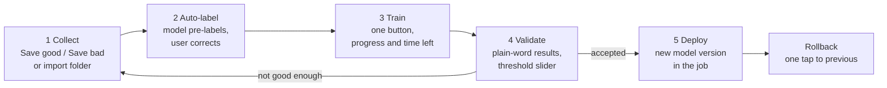

# AI and Deep Learning – Design

This document designs the two kinds of AI in the vision system: the AI assistant that builds and watches jobs for the user (in every licence), and the deep-learning inspection tools sold under the AI Deep Learning licence (`VS-DL-`). It follows section 5 of [the requirements](../REQUIREMENTS-VISION-SYSTEM.md#5-ai-and-deep-learning) and reuses what the aggregation reader in this repository already does with its AI locator, enhancer, tuning agent and retraining agent. All timings and accuracies below are targets to be confirmed by benchmarks in Phase 1 and Phase 3, not measured results.

Related documents: [ARCHITECTURE.md](ARCHITECTURE.md) (processes and services), [TOOL-SPECIFICATIONS.md](TOOL-SPECIFICATIONS.md) (tool inputs and outputs), [JOB-FILE-FORMAT.md](JOB-FILE-FORMAT.md) (how models sit inside a job), [UI-UX-SPEC.md](UI-UX-SPEC.md) (the screens named here), [LICENSING.md](LICENSING.md) (licence binding), [TEST-ACCEPTANCE-PLAN.md](TEST-ACCEPTANCE-PLAN.md) (benchmark sets).

## 1. Principles

1. **AI proposes, the user decides.** Every assistant output is a suggestion the user can accept, change or ignore. Nothing the assistant does changes a running job without a person pressing a button.
2. **Explain every AI decision in plain words and pictures.** Each AI result carries a reason sentence and, where it makes sense, a heatmap or outline on the image.
3. **One gate for every model change.** No model, threshold or learned value goes to the line unless it passes the accuracy gate in section 5.4. This is the rule the retraining agent already follows (`ml/retrain.py`) and that [RESEARCH-NEXT-GENERATION.md](../RESEARCH-NEXT-GENERATION.md) writes down as "one rule written once".
4. **Works offline.** The plant PC is often not on the internet. All models, training and inference run locally. The only optional online part is the natural-language job hint.
5. **Learned state stays per job and per product.** The aggregation reader measured that settings learned on one product harm the next. The same rule holds for every learned value here.
6. **Classical first where classical is right.** AI is used where appearance varies or the rule is hard to write. Geometric location, calipers and code decoding stay classical, with AI as a rescue or a proposal layer.

## 2. AI assistant features

The assistant runs inside the vision application (UI process) for proposals and inside the runtime service for monitoring. It uses small fixed models shipped with the product, plus classical image analysis. It needs no AI Deep Learning licence.

### 2.1 Auto-find

| Item | Design |
| --- | --- |
| Inputs | One grabbed image (any size up to 25 MP), optional calibration, the list of licensed tools |
| Approach | Two layers. (a) A general "feature proposal" detector: a small one-stage detector (YOLO-class nano or RT-DETR-class small, Apache- or MIT-licensed weights only) trained on synthetic and public industrial scenes for the classes part outline, hole, circle, straight edge, 1D code, 2D code, text block, label, connector/pin row. Runs on a downscaled copy (long side 1024 px). (b) Classical confirmers per class: Hough and edge fitting for circles and lines, the existing code locator (CodeNet, `engine/src/ai_locator.cpp`) for codes, PP-OCR text detection for text blocks, contour analysis for the part outline. A proposal is shown only if a confirmer agrees, which removes most false suggestions. |
| Ranking | Proposals are scored by detector confidence × confirmer quality × size, deduplicated (IoU > 0.5), and limited to 12 on screen. Codes and text rank first, as they are the commonest operator checks. |
| Output to UI | Numbered outline on the image, with a question bubble in the user's language: "Read this code?", "Measure this hole?", "Check this text?", "Check this label is straight?". Locked tools show the bubble with a lock icon. |
| Speed target | ≤ 1.5 s on T1 (CPU) for a 5 MP image; ≤ 400 ms on T2 |
| Failure behaviour | If no proposal passes, the screen says "I could not find anything to check. Drag a tool onto the image." and opens the toolbox. If the image is too dark or blurred, auto-light check (2.4) runs first and its message replaces the auto-find message. Auto-find never blocks the user. |

### 2.2 Auto-learn

| Item | Design |
| --- | --- |
| Inputs | One accepted suggestion (or a tool dropped on the image), the current image, the job's locator (fixture) if one exists |
| Approach | Each tool family implements `Propose(image, seedRegion) → (roi, parameters, confidence)` (see [TOOL-SPECIFICATIONS.md](TOOL-SPECIFICATIONS.md)). Proposals are rule-based searches over a small grid of parameters, scored on the current image: e.g. for a caliper, edge polarity and filter width that give the strongest single edge pair; for a code reader, symbology from the decoded result and a ROI of 1.5× the code bounds; for OCR, the font class and expected-string format from the read text. The ROI is attached to the locator's coordinate space automatically. When more images exist, auto-tune ([section 4 of the requirements](../REQUIREMENTS-VISION-SYSTEM.md#4-tool-library)) re-runs the grid over all OK and NG images to maximise margin. |
| Output to UI | The new tool appears in the flow view and on the image, already passing, with a short line: "Reads QR code. Found 1 code." Essential settings show their chosen values. |
| Failure behaviour | If no parameter set gives a pass on the current image, the tool is created in a "needs help" state (yellow, "!") with the reason, for example "No clear edge here. Move the box onto the edge of the part." |

### 2.3 Auto-tolerance

| Item | Design |
| --- | --- |
| Inputs | Measured values from 10–30 good parts (Teach step 4), optionally some bad parts |
| Approach | For each numeric output, compute mean μ and standard deviation σ with a robust estimate (median and 1.4826 × MAD) so that one mis-placed part does not widen the band. Proposed limits are μ ± k·σ, default **k = 4**. Where a drawing tolerance exists (entered by an engineer), the tighter of the two is used and the user is told. If bad parts were shown, the limit is moved to the midpoint between the nearest good and bad value when that is tighter. Scores (0–100) use a one-sided lower limit. |
| Expected false-reject rate | Shown for each limit, from a normal model: for k = 4 about 63 per million parts for a two-sided band (32 per million for a one-sided limit). If a Shapiro-Wilk check on ≥ 20 samples rejects normality, the rate is estimated from the empirical tail instead and labelled "rough estimate". |
| Output to UI | A "strictness" slider (k from 2 to 6, labelled "Loose", "Normal", "Strict") with the expected rejects in words: "About 1 good part in 16,000 may be rejected." The band shows in green on the value chart, with each taught part as a dot. |
| Failure behaviour | With fewer than 10 samples: "Show me at least 10 good parts." If σ is zero (identical values, e.g. a count), the limit is the taught value exactly. If a bad part falls inside the good band: "This bad part looks like a good one for this check. Add another check or choose the bad area." |

### 2.4 Auto-light check

| Item | Design |
| --- | --- |
| Inputs | Each grabbed image in Teach mode; every Nth image (default 50) in Run mode |
| Approach | Classical measurements, no model: histogram (clipped dark and bright pixel share), Michelson and RMS contrast in the part ROI, saturated blob detection for glare, variance of Laplacian and edge-width for focus, directional blur estimate (ratio of gradient energy along the two principal axes) for motion blur, mean brightness drift against the taught image. These extend the measurements already in `LineAdvisor.cs` and `MissDiagnosis.cs` (Glare, LowContrast, Blur, TooSmall). |
| Output to UI | One message at a time, the worst first, with what to do: "Image is too dark. Turn the light up or press Auto Light.", "Shiny spot on the part. Move the light to the side.", "Picture is not sharp. Turn the focus ring slowly until the bar is full.", "The part moves while the photo is taken. Ask the engineer to shorten the exposure." Focus has a live bar for the operator. The "Auto Light" button runs auto-exposure on the part ROI towards target brightness. |
| Failure behaviour | Measurements that cannot be computed (no part ROI yet) use the whole image. The check never stops production; in Run mode it raises a yellow advice banner, not an alarm. |

### 2.5 Drift monitor

| Item | Design |
| --- | --- |
| Inputs | Per-inspection scores and measured values (already recorded, [section 12](../REQUIREMENTS-VISION-SYSTEM.md#12-communication-data-and-security)), image brightness, sharpness and cycle time |
| Approach | Per signal, a two-sided CUSUM against the baseline from the first 500 parts after release (or the taught set), plus a margin watch: the share of parts within 25% of a limit. For deep-learning tools, the distribution of anomaly scores and class confidences is tracked the same way. A Kolmogorov-Smirnov test on a 1,000-part window confirms a CUSUM alarm before the user is told, to cut false warnings. |
| Output to UI | A yellow "!" banner on the Run screen: "Parts are getting close to the limit for Check size 2. The lens may be dirty or the light may have changed." A "What do I do?" page lists the likely causes ranked by which signals moved (brightness down → light or lens; sharpness down → focus or dirt; one measurement only → the process). Supervisors see a trend chart on the Reports screen. |
| Failure behaviour | Drift never changes a pass/fail result or a limit. If the baseline is not ready yet, the monitor stays silent and shows "Learning normal values (230 of 500 parts)" in the job status. |

### 2.6 Natural-language job hint (optional)

| Item | Design |
| --- | --- |
| Inputs | Typed or spoken text in any of the UI languages, the current image and the auto-find proposals |
| Approach | Speech goes through the offline speech-to-text model (Whisper-class small, local). The text and the auto-find proposals (as a JSON list of class, position and label) are sent to an LLM with a fixed tool-schema prompt. The LLM may only return a draft job: a list of tool types from the licensed toolbox, each bound to an auto-find proposal ID, plus expected text values. It cannot write scripts or PLC mappings. Two back ends: a local small model (on T3/T4 hardware) or an online model when the plant allows internet; the setting is off by default. |
| Output to UI | The draft appears in the flow view greyed out, with one line per tool ("Check the label is straight → Find the label + Check angle"), and Accept / Change / Cancel. |
| Failure behaviour | If the request cannot be mapped ("I did not understand. Tap what you want to check on the picture instead."), nothing is created. No image is sent online unless the admin has enabled it, and the online path never sends the user's name or plant data. |

## 3. Deep-learning tools

All six tools share one runtime (section 6), one training worker (section 5.5) and one model file format. Model sizes are chosen automatically from the hardware tier ([section 11 of the requirements](../REQUIREMENTS-VISION-SYSTEM.md#11-hardware-sizing)) and the job's cycle-time target.

### 3.1 Summary

| Tool | Operator name | Training data (from the requirements) | Architecture | Output |
| --- | --- | --- | --- | --- |
| Anomaly detection | Check defects (AI) | 20–100 good images, no defects needed | PatchCore (default) or EfficientAD (fast) | Anomaly score 0–100, heatmap, defect regions |
| Classification | Sort by picture | 30+ images per class | EfficientNet-B0/ConvNeXt-Atto/MobileNetV3 backbone + linear head | Class, confidence, class scores |
| Object detection | Find and count items | 50+ labelled images | YOLO-class detector (permissively licensed implementation) or RT-DETR-class | Boxes with class and confidence, count |
| Segmentation | Find defect area | 20+ pixel-labelled images | U-Net with a pretrained lightweight encoder; SegFormer-B0 on T3 | Mask per class, area, shape metrics |
| AI OCR | Read text (AI) | None; optional fine-tune with 50+ images | PP-OCR detection (DB) + recognition (SVTR-class), ONNX | Text lines, per-character confidence |
| AI locator | Find the part (AI) | 5–10 images | Keypoint/heatmap network with a pose head | Pose (x, y, angle, scale), confidence |

### 3.2 Anomaly detection

- **PatchCore** (default, T1–T3): a frozen ImageNet backbone (WideResNet-50 layers 2–3 on T2+, ResNet-18 on T1) gives patch features from good images. A coreset of 1–10% of the patches forms the memory bank. At run time the distance of each patch to its nearest neighbour gives the heatmap; the maximum is the image score. Training is feature extraction only, so it takes seconds to a few minutes and needs no labels.
- **EfficientAD** (high-speed option, T2–T3): student-teacher plus autoencoder, trained for a fixed number of steps on good images. It is selected when the cycle-time target is below what PatchCore meets on the tier.
- Scores are normalised so that the 99.9th percentile of the good validation images maps to 50 and the threshold defaults to 50. The user adjusts it with the strictness slider.
- Small defects on large parts are handled by tiling: the part ROI is cut into tiles at the native resolution, each tile scored, and the heatmap stitched.
- Implementation reference: anomalib (Apache 2.0). Weights for backbones must have a licence that allows commercial use.

### 3.3 Classification

- Transfer learning from an ImageNet backbone, input 224–384 px by tier, crop from the fixtured ROI.
- Two-stage training: head only for a few epochs, then the whole network with a lower rate.
- An "unknown" option: images whose confidence is below the threshold, or whose feature is far from every class centre, report "Not sure" rather than a wrong class.

### 3.4 Object detection

- One-stage anchor-free detector. The implementation must not be AGPL inside the shipped product (see the licence note in [section 14 of the requirements](../REQUIREMENTS-VISION-SYSTEM.md#14-recommended-technology-stack)); candidates are an Apache-licensed YOLO-class code base or RT-DETR from PaddleDetection. This choice is an open question (section 9).
- Rotated boxes as an option for parts in any orientation.
- Count checks ("expect 12") reuse the slot-lattice idea from the aggregation reader (`engine/src/slots.cpp`): when items sit on a grid, empty grid nodes are reported as "missing at row 2, column 3".

### 3.5 Segmentation

- U-Net with a pretrained encoder (ResNet-18 or EfficientNet-B0); SegFormer-B0 when the GPU allows.
- Loss: Dice + focal, because defect pixels are rare.
- Outputs feed the Blob & Count tool, so area, length and position limits use the same auto-tolerance as classical blobs.

### 3.6 AI OCR

- PP-OCRv4 (or later) detection and recognition models from PaddleOCR (Apache 2.0), exported to ONNX. Pretrained Latin and Devanagari recognisers ship; other scripts are optional packs.
- Works with no training. Fine-tuning of the recogniser only (detector frozen) is offered with 50+ labelled line images for dot-matrix, embossed or etched text.
- Labels come from OCV: when the expected string is known (date, lot), every read that matches is a free label. This is the "every read is a label" idea from [RESEARCH-NEXT-GENERATION.md](../RESEARCH-NEXT-GENERATION.md#2-the-thesis-how-this-reader-thinks-differently).
- Format validation (date, lot, expiry patterns) is classical and runs after recognition.

### 3.7 AI locator

- A small fully convolutional network predicts a centre heatmap plus angle (as sin/cos) and scale maps at 1/4 resolution, followed by sub-pixel refinement with the classical geometric matcher on the best candidate. AI gives robustness to appearance change; the classical refinement gives the 0.05 px / 0.05° target.
- Trained from 5–10 images by heavy augmentation (rotation over ±180°, scale 0.8–1.2, occlusion, lighting) of the taught part pasted on its own background.
- Builds on CodeNet (`ml/model.py`, 25k parameters), which already proposes code regions on a 1/8-size image in the aggregation reader.

### 3.8 Augmentation

Augmentations are chosen per tool and limited to what the camera and process can really produce. The user can switch off any that do not apply (for example "parts are never rotated").

| Augmentation | Anomaly | Classification | Detection | Segmentation | OCR | Locator |
| --- | --- | --- | --- | --- | --- | --- |
| Brightness/contrast ±20% | Yes | Yes | Yes | Yes | Yes | Yes |
| Gaussian blur, defocus | Mild | Yes | Yes | Yes | Yes | Yes |
| Sensor noise | Yes | Yes | Yes | Yes | Yes | Yes |
| Shift a few px | Yes | Yes | Yes | Yes | Yes | Yes |
| Rotation | Only if the part rotates | Yes | Yes | Yes | ±5° | ±180° |
| Flip | Only if symmetric | Option | Option | Option | No | No |
| Scale 0.9–1.1 | No | Yes | Yes | Yes | Yes | 0.8–1.2 |
| Glare spots, haze | No | Yes | Yes | Yes | Yes | Yes |
| Cut-out / occlusion | No | Yes | Yes | No | No | Yes |
| Synthetic defects (paste, scratches) | For validation only | Option | Option | Option | No | No |

Synthetic scenes follow the approach of `ml/synth.py`, which already mixes real codes with glare, shrink-wrap texture, defocus and under-exposure for the code locator.

### 3.9 Model sizes per hardware tier

Inputs are the fixtured ROI resized to the size shown. Times are planning targets for one 5 MP image with one ROI, to be confirmed by the built-in benchmark.

| Tool | T1 Entry (CPU, OpenVINO) | T2 Standard (RTX 4060 class) | T3 Performance (RTX 4070–4080 class) | Target time T2 |
| --- | --- | --- | --- | --- |
| Anomaly | PatchCore ResNet-18, 256 px, small coreset | PatchCore WRN-50 or EfficientAD-S, 256–512 px | EfficientAD-M or PatchCore WRN-50, 512 px, tiling | ≤ 15 ms |
| Classification | MobileNetV3-S, 224 px | EfficientNet-B0, 224–320 px | ConvNeXt-Atto/Femto, 384 px | ≤ 5 ms |
| Detection | Nano, 640 px | Small, 640–960 px | Medium, 960–1280 px | ≤ 15 ms |
| Segmentation | U-Net ResNet-18, 256–512 px | U-Net EffNet-B0, 512 px | SegFormer-B0, 768 px | ≤ 20 ms |
| AI OCR | PP-OCR mobile det + rec | PP-OCR mobile, GPU | PP-OCR server rec | ≤ 15 ms per label |
| AI locator | CodeNet-sized (≈ 25–100k params), 1/8 scale | ≈ 0.5M params, 1/4 scale | ≈ 2M params, 1/4 scale | ≤ 5 ms + refine |

T4 is the training workstation: it trains every tool and produces models for T1–T3. T5 (Jetson) is a later phase and uses TensorRT on the same ONNX files.

The training screen chooses the size: it benchmarks each candidate on the target PC (or a stored profile of the target tier) and picks the largest model that leaves the job's total cycle time under target, with a 20% margin.

## 4. Export, quantisation and the accuracy gate

1. Train in PyTorch, export to ONNX (opset 17 or later, static input shape per job, dynamic batch only where tiling needs it).
2. Check the ONNX file against PyTorch on the validation set: maximum output difference below 1e-3 for FP32.
3. Build FP16 on GPU tiers by default. Offer INT8 for T1 and for high-speed jobs, calibrated with 100–500 images from the job's own set (OpenVINO NNCF post-training quantisation, TensorRT entropy calibration).
4. **Accuracy gate.** A reduced-precision model is accepted only if, on the validation set at the deployed threshold: missed bad parts do not increase, rejected good parts increase by no more than 0.1 percentage points, and every score moves by less than 2 points on the 0–100 scale for 99% of images. If it fails, the next precision up is used and the user is told in plain words: "Fast mode lost accuracy on 3 parts, so the normal mode is used."
5. Record precision, gate results and the exact runtime version in the model manifest.

## 5. Training workflow

### 5.1 Steps



| Step | What happens | What the user sees |
| --- | --- | --- |
| 1 Collect | Images come from the live camera ("Save good", "Save bad", or tap an NG image on the Run screen and "Use for teaching") or a folder import. Images are stored at native resolution with the fixture pose, so the ROI crop is re-made if the ROI changes. Duplicates (perceptual hash) are skipped. | Counters per class with the minimum needed: "Good: 14 of 20". A tick appears when there is enough. |
| 2 Auto-label | The current model (or a generic one for a new tool) pre-labels new images. Boxes and masks with confidence below 0.6 are marked "check me". For anomaly detection no labels are needed. OCR uses OCV-matched strings as labels. | Image grid with the labels drawn. The user only taps "Correct" or fixes with the box or brush tool (touch). A filter shows "check me" first. |
| 3 Train | The training worker (5.5) splits the data 80/20 stratified (time-ordered when images have timestamps, so validation is newer than training), trains, exports and runs the gate. | One progress bar with time left. "Train" button only. Advanced shows epochs, learning rate and model size. Training can run while the line runs (it uses the GPU at low priority) or be scheduled after the shift. |
| 4 Validate | Results on the held-out images at the chosen threshold. | Plain words: "Found 18 of 19 bad parts. Missed 1 bad part. Rejected 2 of 120 good parts." Each word links to the images. A threshold slider updates the sentence live. A heatmap or outline shows on every image. |
| 5 Deploy | A supervisor or engineer presses "Use this model". The model is copied into the job as a new version and the job is re-validated on the job's image set. | "Model version 4 is now in use. Version 3 is kept." |
| Rollback | One tap on an older version in the model history. Needs the same role as deploy. | "Back to model version 3." The audit trail records who and why. |

Deploy follows the job lifecycle ([section 8](../REQUIREMENTS-VISION-SYSTEM.md#8-jobs-and-cameras)): in plants that use approval, a new model version waits for supervisor approval, with an e-signature in 21 CFR Part 11 mode. This is the same pattern as the Dashboard's AI models page and `ModelRegistry.Promote` today.

### 5.2 Plain-word confusion results

| Matrix cell | Words shown | Colour and shape |
| --- | --- | --- |
| Bad called bad | "Found N bad parts" | Green ✓ |
| Bad called good | "Missed N bad parts" | Red ✗ (shown first if N > 0) |
| Good called bad | "Rejected N good parts" | Yellow ! |
| Good called good | "Passed N good parts" | Green ✓ |
| Class A called class B | "Called N 'Variant A' parts 'Variant B'" | Yellow ! |

For detection and segmentation, the sentence is per image ("Found every item on 48 of 50 pictures"), with a per-item count in Advanced. The full matrix with precision and recall is in Advanced only.

### 5.3 Dataset storage layout

Datasets live beside the job, not inside it, so that the job file stays small. A job references a dataset by ID; exporting a job can include its dataset as an option.

```text
D:\VisionData\
  datasets\
    <dataset-id>\                 one per AI tool instance
      dataset.json                tool type, classes, ROI, fixture, schema version
      images\
        <yyyymmdd>\<image-id>.png native image (lossless), 16-bit kept when the camera gives it
      labels\
        <image-id>.json           class, boxes, polygons/RLE masks, OCR text, who labelled, when
      splits\
        <split-id>.json           train / validation lists and seed
  models\
    <job-id>\<tool-id>\
      v0003\
        model.vsm                 encrypted package (ONNX + manifest)
        report.json               gate results, confusion counts, timings per tier
        thumbs\                   heatmaps of validation errors
      history.jsonl               deploy and rollback log with user and reason
  cache\
    engines\                      TensorRT / OpenVINO compiled engines (section 6.2)
```

Disk quotas follow the image-saving rules of [section 12](../REQUIREMENTS-VISION-SYSTEM.md#12-communication-data-and-security); dataset images are never deleted automatically, only NG archive images are.

### 5.4 The model gate

A trained model is offered for deployment only if:

- It meets or beats the deployed version on the frozen validation set: missed bad parts not higher, rejected good parts not higher by more than 0.1 percentage points.
- Its run time on the target tier leaves the job within its cycle-time target.
- The reduced-precision check in section 4 passes.
- For a retrained model, it also passes on the job's stored OK/NG image set used by the job designer's image set panel.

This mirrors the retraining agent's rule today (`ml/retrain.py`: a candidate passes only with no regressions, then needs a named approver).

### 5.5 The training worker process

- A separate process (`vs_trainer.exe`, embedding a Python runtime with PyTorch), started on demand by the vision application and never by the runtime service. If it crashes, inspection is not affected.
- It talks to the UI over a local named pipe with a small job protocol: `start(datasetId, tool, options)`, `progress`, `cancel`, `result(reportPath)`.
- One training at a time per GPU. A queue holds the rest.
- GPU priority: on a line PC, the worker caps GPU memory and yields between batches when the runtime's inference latency rises above target. If the line's cycle time is at risk, training pauses and the UI says "Training paused while the line is busy."
- On a PC without a suitable GPU, training of PatchCore, classification heads and AI OCR fine-tune runs on CPU (slow, with an honest time estimate). Detection and segmentation require T2 or better, or a T4 workstation; the user can export the dataset to a T4 PC and import the trained model.
- Fixed seeds and logged library versions make retraining reproducible within normal GPU non-determinism (section 6.4).

## 6. Inference runtime

### 6.1 Execution providers

| Hardware | Provider | Precision default |
| --- | --- | --- |
| NVIDIA GPU (T2, T3, T5) | ONNX Runtime + TensorRT EP, CUDA EP as fallback | FP16 |
| Intel CPU / iGPU (T1) | ONNX Runtime + OpenVINO EP | FP32 or INT8 |
| Any x64 CPU | ONNX Runtime default CPU EP | FP32 |

The provider is chosen at job load from the PC's hardware and the model manifest. The CPU EP is always available as a fallback.

### 6.2 Engine caching and warm-up

- TensorRT and OpenVINO compile a model for the exact device on first use, which can take minutes. Compiled engines are cached in `cache\engines\` keyed by model hash, provider version, GPU model and driver version.
- Compilation runs when a model is deployed, not when the line starts. The deploy step shows "Preparing the model for this PC (about 2 minutes)."
- At job start, every model runs 5 warm-up inferences on a blank or stored image before the job reports "Ready" to the PLC. Warm-up time is shown in the job status.
- If the cache is invalid (driver update), the job falls back to the CPU or CUDA provider at once, reports "AI running in slow mode" as advice, and rebuilds the engine in the background.

### 6.3 CPU fallback

If the GPU is missing, out of memory or fails, the tool runs on the CPU provider with the FP32 model shipped in the same package. Results stay within the stated tolerance (6.4). If the slower time breaks the cycle-time target, the job raises the alarm "AI is running slowly. Ask the engineer to check the graphics card." and the PLC handshake still receives a result for every trigger.

### 6.4 Determinism

- CPU FP32 results are bit-identical between the vision application and the SDK on the same PC (requirement in [section 10](../REQUIREMENTS-VISION-SYSTEM.md#10-vision-package-for-other-applications-sdk)): same ONNX Runtime version, thread count fixed per tool, deterministic kernels.
- GPU results (FP16/INT8, TensorRT kernel selection) are not bit-identical across GPUs or driver versions. The stated tolerance is: scores within ±1 point on 0–100, box corners within 0.5 px, masks IoU ≥ 0.98 against CPU FP32. The deploy step checks this on the validation set.
- Pass/fail decisions near a threshold can still differ between devices. The validation report lists parts within 2 points of the threshold as "close calls".

### 6.5 Model encryption and licence binding

- A model package (`.vsm`) holds the ONNX graph, the manifest (tool type, input size, normalisation, classes, threshold, precision, gate report hash, training dataset ID, creating software version) and the FP32 fallback.
- The package is encrypted with AES-256-GCM. The content key is wrapped by a key derived from the licence (see [LICENSING.md](LICENSING.md)): models trained on a PC are bound to that customer's licence ID, so they load on any PC with the same customer licence and the AI Deep Learning parent tool active, and not elsewhere.
- Decryption happens only in memory inside the runtime. ONNX Runtime receives the model as a byte buffer; no decrypted file is written to disk.
- Shipped base models (auto-find, PP-OCR, CodeNet, enhancer) are encrypted with a product key and load under any licence, including the free Base edition where the assistant needs them.
- A job opened on a PC without the AI Deep Learning licence opens read-only for its AI tools and says which licence is needed ([section 9](../REQUIREMENTS-VISION-SYSTEM.md#9-licensing)).

## 7. Reuse from this repository

| Today | Where | Reused as |
| --- | --- | --- |
| CodeNet code locator (25k params, ONNX, OpenCV DNN) | `ml/model.py`, `ml/train.py`, `engine/src/ai_locator.cpp` | Code proposals in auto-find; the starting design for the T1 AI locator |
| Code enhancer (U-Net, about 60k params) | `ml/enhance.py`, `engine/src/ai_locator.cpp` | AI rescue in the Code Reader tool; template for small image-to-image nets (e.g. OCR pre-clean) |
| Engine auto-labelling | `ml/autolabel.py` | Pattern for auto-label from classical results (codes, OCV text) |
| Synthetic scene generator | `ml/synth.py` | Synthetic data for auto-find and locator training |
| Retraining agent with no-regression gate and approver | `ml/retrain.py`, `dotnet/Dashboard/Services/ModelRegistry.cs`, AI models page | The model gate (5.4), deploy and rollback, history log |
| Tuning agent (Thompson-sampling bandits per product) | `dotnet/CodeReader/TuningAgent.cs` | Auto-tune of tool parameters on the line, frozen for released jobs |
| Line advisor and miss diagnosis | `dotnet/CodeReader/LineAdvisor.cs`, `MissDiagnosis.cs` | Auto-light check messages and the "What do I do?" texts |
| Slot lattice from read codes | `engine/src/slots.cpp`, `ml/experiments/slots.py` | Missing-item reports in detection count checks |
| Experiments (PSF fitting, soft decoding, known-content decoding) | `ml/experiments/` | Code Reader tool internals; PSF estimate as a sharpness signal for the drift monitor |

Change needed: the engine runs ONNX through OpenCV DNN today. The new runtime moves to ONNX Runtime with TensorRT and OpenVINO providers; CodeNet and the enhancer are re-exported and re-checked under the gate.

## 8. Keeping AI decisions understandable

| Need | Design |
| --- | --- |
| Why was this part rejected? | NG viewer shows the image with the heatmap (anomaly), outline (segmentation), missing-item box (detection) or wrong characters in red (OCR), plus one sentence: "Unusual mark here, much stronger than on good parts." |
| How sure is the AI? | Confidence 0–100 as a bar, with the threshold line. "Not sure" results are shown in yellow with "!" and can be set to count as NG or to raise an alarm. |
| What did the AI learn? | "Show what good looks like": a grid of the training images. For classification, the 3 most similar training images to the current part. |
| Did the model change? | Model version and date on the tool, and in every inspection record. |
| Can I undo it? | One-tap rollback (5.1). |
| Heatmap method | Anomaly: native patch-distance map. Classification: Grad-CAM on the last convolution layer. Detection and segmentation: the boxes and masks themselves. Computed only for NG images and on demand, so it does not cost cycle time. |

## 9. Risks

| Risk | Effect | Mitigation |
| --- | --- | --- |
| Too few or unrepresentative good images | Good parts rejected after a material or lighting change | Minimum counts enforced; drift monitor; "Use for teaching" from NG strip makes adding images easy |
| Training on the line PC slows the line | Missed cycle times | GPU capping, pause on load, offer scheduled or T4 training |
| Driver or GPU change breaks cached engines | Slow start or CPU mode | Cache keyed by driver; immediate CPU fallback; background rebuild |
| Licence of model code or weights (AGPL, non-commercial weights) | Cannot ship | Legal review of every model and weight file before P3; prefer Apache/MIT |
| Operators do not trust AI rejects | AI tools switched off | Explain view, plain-word validation, version history, rollback |
| INT8 loses accuracy on rare defects | Escapes | Accuracy gate in section 4 with missed-bad-part rule |
| LLM drafts a wrong job | Wrong checks | Draft only, greyed out, user must accept; restricted tool schema |
| Results differ between GPU and CPU | Disputes between SDK and application | Stated tolerance, close-call list, CPU FP32 as reference |

## 10. Open questions

- Which detection code base and weights to ship (Apache-licensed YOLO-class, RT-DETR, or own), given the AGPL rule.
- Whether the natural-language hint ships in P5 only, or as a P3 preview with the online back end.
- Whether models trained by a system integrator can be sold to other customers (licence binding per customer versus per integrator).
- Whether a cloud or plant-server training option is wanted in addition to the T4 workstation.
- Which scripts beyond Latin and Devanagari need pretrained AI OCR in the first release.
