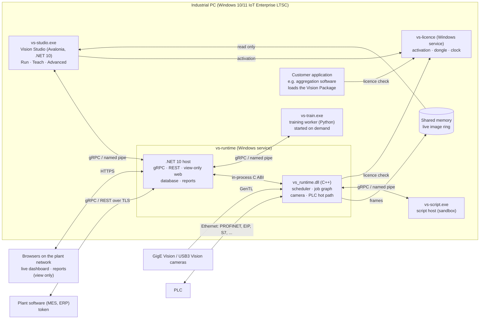
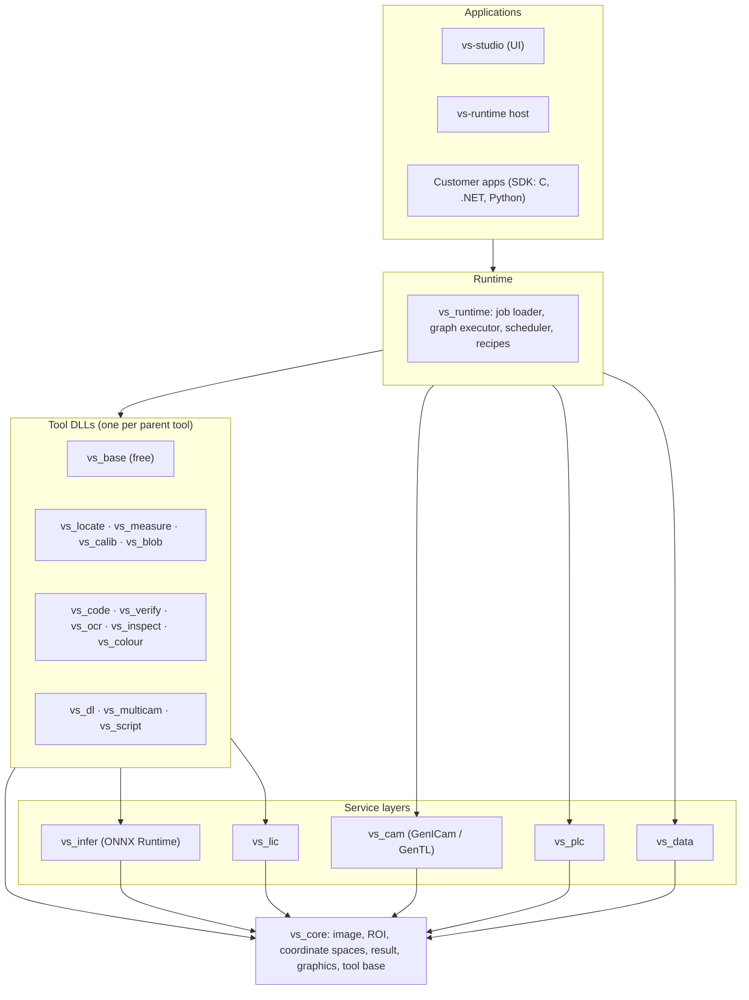
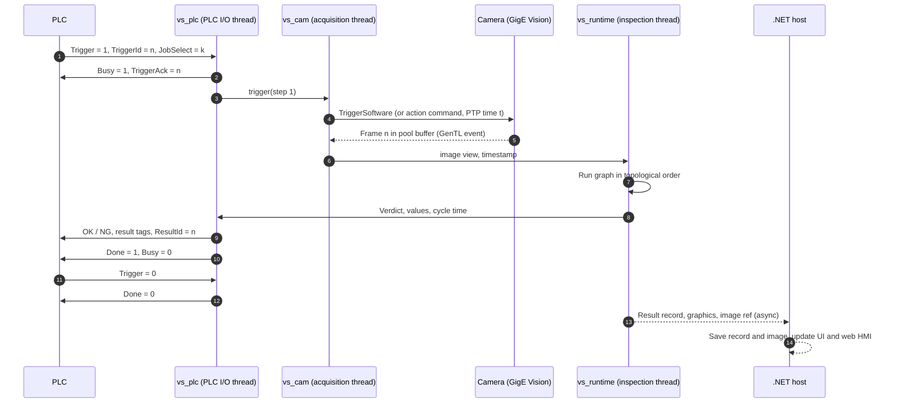

# Vision System – Software Architecture

This document decides how the vision system is built: which processes run on the industrial PC
and how they talk, how the code is split into libraries, the contract every tool follows, how a
job executes from PLC trigger to PLC result, how the system recovers from failure, and how
today's aggregation code reader becomes the first parent tool. It implements section 3 of the
[requirements](../REQUIREMENTS-VISION-SYSTEM.md#3-system-architecture) and is the reference for
the other design documents. The job file is specified in [JOB-FILE-FORMAT.md](JOB-FILE-FORMAT.md),
the tools in [TOOL-SPECIFICATIONS.md](TOOL-SPECIFICATIONS.md) and the PLC handshake in
[PLC-INTERFACE.md](PLC-INTERFACE.md).

## 1. Decisions in brief

| Topic | Decision |
| --- | --- |
| Processes | Four: UI, inspection runtime (Windows service), licence service, training worker. A fifth, the script host, runs user scripts. |
| Applications (owner, 2026-10-30) | Hybrid, like VisionPro and most camera products: one Windows application, Vision Studio (`vs-studio.exe`, Avalonia), is the only place to run, teach and set up; the runtime service does the inspection; a browser shows the live dashboard and reports and nothing else. One application and one service for every tool: the code-reader Dashboard and today's browser Vision Studio both fold into them. |
| Look | The SecureMe console look in the application and the browser: dark by default with Light and High contrast, panel cards, design tokens shared by both (section 2.3). |
| IPC | gRPC (protobuf) over Windows named pipes on the PC; the same contract over TLS on TCP for the Remote API. Live images through shared memory. |
| Real-time path | Native C++ only, from PLC trigger to PLC result. No managed code, no IPC, no disk I/O on it. |
| Libraries | `vs_core` plus one DLL per parent tool, each with a C ABI. Camera, inference, PLC, licence and data are separate layers. |
| Tool contract | One C++ interface (`vs::Tool`) and one C ABI pattern (`vs_tool_*`) for every tool. |
| Execution | A job is a typed DAG. One acquisition thread per camera, a shared worker pool, a fixed topological order. |
| Determinism | Results on CPU are bit-identical between runs, thread counts and the SDK, unless a time budget cut a tool short (then the result says so). |
| Triggering | Every trigger comes from the PLC over Ethernet and fires a GenICam software trigger or a GigE Vision action command. No camera I/O wiring. |
| Recovery | The service restarts within 10 s (target, PRD §13) and reloads the last released job and variant. |
| Other applications (owner, 2026-10-30) | They load the full Vision Package ([SDK-API.md](SDK-API.md) section 0): one signed package with every tool, the cameras, AI and the licence client, licensed only by the ERPNext licence service and updated by the host application. Inside it, the package starts `vs-runtime` in private mode as its own worker process, so a native fault never closes the host and the results are the same as Vision Studio's. |
| Migration | `engine/` becomes the Code Reader tool DLL `vs_code`; `codereader.h` stays as a compatibility shim for one major version. |

## 2. Process model

The UI and the inspection runtime are separate processes, so closing or crashing the UI never
stops inspection (PRD §3). Each process has one job.



| Process | Runs as | Language | Responsibility | If it dies |
| --- | --- | --- | --- | --- |
| `vs-studio.exe` (Vision Studio) | Desktop app, user session; starts with Windows sign-in on the line PC and can run full screen | C# .NET 10, Avalonia (owner, 2026-10-30) | Every screen that runs or changes anything: Run, Change product, Teach wizard, job designer, tool properties, calibration, AI training, PLC signals, reports, users, settings, Licence Manager | Inspection continues. The UI reconnects on restart and resumes the live view. |
| `vs-runtime` (inspection runtime) | Windows service, auto start, LocalService account | .NET 10 host plus native `vs_runtime.dll` | Loads and runs jobs, owns cameras and the PLC link, stores results, serves the Remote API and the view-only web dashboard. Also runs as a plain program (`vs-runtime --console`) for benches, demos and development | The PLC heartbeat stops, so the PLC treats the part as NG and stops the line (PRD §12). The service restarts and reloads the job. |
| `vs-licence` | Windows service | C++ | Activation, dongle access, clock-rollback guard, licence file | Already-loaded tools keep running until restart (PRD §9). New loads fail with a clear message. |
| `vs-train.exe` (training worker) | Child of the runtime host, below-normal priority | Python, PyTorch, exported to ONNX | Trains AI models, writes versioned ONNX files | Training fails with a message. Inspection is not affected. |
| `vs-script.exe` (script host) | Child of the runtime, one per job that has scripts | .NET 10 (C#) and embedded Python | Runs Scripting tools in a sandbox (PRD §4, tool 12) | The script tool returns an error result. The runtime restarts the host. |

**Why the runtime has a .NET host around a native core.** The real-time path (PLC trigger,
acquisition, tools, PLC result) runs only in native threads inside `vs_runtime.dll`, so it never
sees a garbage-collection pause. Everything that is not time-critical — gRPC, REST, the web HMI,
the database, reports — sits in the .NET host, which reuses ASP.NET Core and the Dashboard code
we already have. The host talks to the core through the same C ABI the SDK uses.

### 2.2 Who may control what (owner, 2026-10-30)

| Client | Sees | May change |
| --- | --- | --- |
| Vision Studio (the Windows application) | Everything its user's role allows ([UI-UX-SPEC.md](UI-UX-SPEC.md) section 3) | Everything its user's role allows: start, stop, change product, teach, jobs, products, settings, users |
| Browser (signed in, any role) | Live dashboard and reports ([UI-UX-SPEC.md](UI-UX-SPEC.md) section 4.17) | Nothing. No start, stop, product change or setting, whatever the role. The web pages have no such controls and the host refuses such calls from a browser session. |
| Plant software with a token (the API key) | Status, results, images, reports | `operate` only: start and stop, change job or product, trigger, inputs. Never jobs, products, tool settings, users or settings ([SDK-API.md](SDK-API.md) section 11.3). |
| PLC | Its signal map | Job number, trigger, inputs ([PLC-INTERFACE.md](PLC-INTERFACE.md)) |

The rule is enforced in the runtime host, not only by hiding buttons: every changing call needs
a Vision Studio session (named pipe, signed-in user) or an `operate` token.

### 2.3 One look for the application and the browser

Vision Studio and the web dashboard share one set of design tokens (colours, type, spacing,
status colours with their shapes), kept in one file and generated into Avalonia resources and CSS.
The look is the SecureMe console look: dark by default, Light and High contrast as options,
panel cards, large live counters, and the status colours of [UI-UX-SPEC.md](UI-UX-SPEC.md)
principle 5 (green ✓ OK, red ✗ NG, yellow ! warning or reading, orange for a duplicate code,
grey ‖ stopped, blue i information).

### 2.4 Windows only (owner, 2026-10-31)

Owner, 2026-10-31: "I want pure windows all with browser based dashboard monitoring and mobile
app, plant server. browser support, server app, mobile app will be developed later on." and
"Current design platform to work on mac and windows is not upto mark so drop that idea."

| Item | Decision |
| --- | --- |
| Platform | Vision Studio and the runtime run on Windows 10/11 x64 only. The installer is win-x64. |
| Runtime link | The gRPC transport is a named pipe only. |
| Windows features | Vision Studio may use Windows-only features, such as the Windows touch keyboard and per-monitor DPI. |
| macOS | Not a supported or tested platform. Nothing is released or accepted on it. |
| Development aid | While no Windows PC is available, the Mac may still build and run the app with the runtime in console mode. The link is then a Unix domain socket, the camera is the simulator or a replay folder, and the Windows service wrapper is not used. This is a development aid only. |
| Later work | The browser dashboard, the plant server and the mobile app are not removed from the design. They are built later, not now. |
| Browser dashboard (owner, 2026-11-03) | "I want hybrid application for this project ... use a browser UI to view dashboard." vs-runtime serves the view-only dashboard on its own port (`Runtime:WebPort`, HTTPS); that port serves the pages only, never the gRPC contract (Hybrid 4). |

Cameras, the PLC, the service, the installer and the live-image shared memory are verified on
the line PC.

### 2.1 IPC choice

| Option | Typed contract | Streaming | Local security | Remote use | Verdict |
| --- | --- | --- | --- | --- | --- |
| **gRPC over named pipes / TCP** | Yes (protobuf, code generation for C#, C++, Python) | Yes, both ways | Named-pipe ACLs; no open port | Same contract over TLS on TCP | **Chosen** |
| REST / JSON over localhost | Weak (OpenAPI) | Poor (polling or SSE) | Open TCP port on loopback | Yes | Kept only for the public REST façade |
| Raw shared memory and events | No | Custom | Section ACLs | No | Used only for live images |
| COM / WCF | Yes | Limited | Yes | Legacy, Windows only | Rejected |

Reasons for gRPC:

- **One contract for inside and outside.** The UI uses the same service definitions as the
  Remote API (PRD §10), so the UI is the first and best-tested client of the Remote API.
- **Named pipes on the PC.** No firewall rule, no port conflict, and Windows ACLs limit access to
  the local UI and service accounts. .NET 10 Kestrel listens on named pipes natively.
- **Streams.** Results, alarms and log events stream from the runtime to the UI without polling.
- **Large images do not go through gRPC.** The runtime writes downscaled live frames and overlays
  into a shared-memory ring that the UI reads. A full-resolution image is fetched on request
  (for example, a tapped NG image) as a gRPC byte stream.

The service definitions live in `proto/` and are versioned with the Remote API
([SDK-API.md](SDK-API.md)). Remote access needs a token and TLS (PRD §12).

## 3. Layers and modules



Dependency rules: a layer may call only layers below it. Tool DLLs never call each other; they
exchange data only through `vs_core` types on graph wires. Tools never touch cameras, the PLC or
the database. That keeps every tool usable alone in the SDK (PRD §10).

| Module | Contents | Licence (PRD §4) |
| --- | --- | --- |
| `vs_core.dll` | Image and image view, pixel formats, ROI shapes, coordinate spaces and transforms, result and value types, graphics list, tool base interface, parameter schema, error codes, thread pool, logging hooks | Free |
| `vs_base.dll` | Image source, convert, crop, histogram, flat-field, filters, morphology, threshold, arithmetic, polar unwrap, affine, overlay, result logic | Base (free) |
| `vs_locate.dll` | Correlation and geometric match, multi-instance, fixture, AI locator (through `vs_infer`) | Locate |
| `vs_measure.dll` | Calipers, find line/circle/ellipse/corner, geometry, edge width, pitch | Measure |
| `vs_calib.dll` | Checkerboard and dot-grid, lens distortion, N-point, hand-eye 2D, multi-camera world frame | Calibrate |
| `vs_blob.dll` | Blob, contour, count, sort, filter | Blob & Count |
| `vs_code.dll` | 1D, 2D and DPM decoding, AI rescue; grown from today's `engine/` | Code Reader |
| `vs_verify.dll` | ISO/IEC 15415, 15416, 29158 grading, GS1 validation | Code Verify |
| `vs_ocr.dll` | Classical OCR, AI OCR, OCV, date/lot format validation | OCR / OCV |
| `vs_inspect.dll` | Presence, golden template, flaw, surface, bead, label, cap/seal | Inspect |
| `vs_colour.dll` | Colour match, presence, segmentation, sorting, ΔE | Colour |
| `vs_dl.dll` | Anomaly, classification, detection, segmentation, AI OCR fine-tune | AI Deep Learning |
| `vs_multicam.dll` | Multi-camera graph features, stitching, OPC UA, MQTT, SQL/MES outputs | Multi-Camera & Enterprise |
| `vs_script.dll` | Script tool proxy (talks to `vs-script.exe`), formula, state machine, SPC | Scripting & Advanced Logic |
| `vs_cam.dll` | GenTL consumer, device discovery, feature access, buffer pool, action commands, PTP status, file/folder simulator | Free |
| `vs_infer.dll` | ONNX Runtime session cache with TensorRT, OpenVINO and CPU providers; model decryption | Free (models need a licence) |
| `vs_plc.dll` | Protocol drivers, tag map, handshake state machine, heartbeat | Base; OPC UA and MQTT under Enterprise |
| `vs_lic.dll` | Licence-file verification, client of `vs-licence` | Free |
| `vs_data` (.NET) | Result database (SQLite or PostgreSQL), image store with quotas, reports, CSV/PDF/Excel export | Free; SQL/MES output under Enterprise |

The AI and inference design is in [AI-DEEP-LEARNING.md](AI-DEEP-LEARNING.md). Licence checks are
in [LICENSING.md](LICENSING.md).

## 4. The common tool contract

Every tool, in every DLL, implements one interface (PRD §4, "Every tool ... must provide"). The
UI, the runtime and the SDK all drive tools only through it, which is how a tool tuned in the GUI
behaves the same in a customer application.

### 4.1 C++ interface sketch

```cpp
namespace vs {

enum class PortType { Image, Region, Pose, Fixture, Point, Line, Circle, Number, Text,
                      Bool, CodeList, TextList, BlobList, Calibration, Table, Any };

struct PortSpec  { std::string id; PortType type; bool optional; std::string labelKey; };
struct ParamSpec { std::string id; ValueType type; Value def, min, max;
                   bool advanced; std::string labelKey, unit; };

struct ToolInfo {
    std::string typeId;          // "code.read", "locate.geometric"
    std::string parent;          // licence code: "COD", "LOC", ... (LICENSING.md)
    SemVer version;
    std::vector<PortSpec> inputs, outputs;
    std::vector<ParamSpec> params;
};

enum class Verdict { Pass, Fail, Error, NotRun };

struct ToolResult {
    Verdict verdict;
    float confidence;            // 0..100, comparable across tools (PRD §4)
    Outputs outputs;             // values keyed by output port id
    GraphicsList graphics;       // shapes in a named coordinate space
    Explanation explain;         // region + reason key + measured values, filled on Fail
    Timing timing;               // total and per stage, microseconds
    uint32_t flags;              // TimedOut, Degraded, UsedGpu, ...
};

struct RunContext {
    const CancelToken& cancel;   // checked at stage boundaries
    Deadline deadline;           // optional time budget
    ThreadPool& pool;            // shared worker pool, deterministic partitioning
    Inference* infer;            // null when no model is needed
    Log& log;
};

class Tool {
public:
    virtual ~Tool() = default;
    virtual const ToolInfo& info() const = 0;
    virtual Status setParams(const ParamSet&) = 0;          // validated against ParamSpec
    virtual ParamSet params() const = 0;
    virtual Status run(const Inputs&, RunContext&, ToolResult& out) = 0;

    // Auto-learn: propose ROI and params from a click or a box on the current image.
    virtual Status learn(const Inputs&, const LearnHint&, Proposal& out) { return Status::NotSupported; }
    // Auto-tune: maximise margin over labelled OK and NG samples.
    virtual Status tune(const SampleSet&, const TuneGoal&, Proposal& out) { return Status::NotSupported; }

    // Trained state (templates, fonts, learned code geometry) as an opaque blob for the job file.
    virtual Status saveState(Blob& out) const { return Status::Ok; }
    virtual Status loadState(const Blob&) { return Status::Ok; }
};

} // namespace vs
```

Rules for every tool:

- `run()` is re-entrant for separate instances and never throws across the DLL boundary.
- `run()` does not allocate full images on the hot path; it takes scratch buffers from the pool.
- Every `Fail` fills `explain` with a region, a reason key (for example `explain.code.blur`)
  and the numbers behind it. Wording comes from the localisation pack ([LOCALISATION.md](LOCALISATION.md)).
- `confidence` is defined per tool in [TOOL-SPECIFICATIONS.md](TOOL-SPECIFICATIONS.md) but always
  maps the tool's margin to 0–100, so one "minimum confidence" slider works for every tool.
- Graphics are vector shapes in a named coordinate space (section 5), never burned into pixels.

### 4.2 C ABI pattern

Each DLL exports the same small set of functions, prefixed by the DLL. The pattern follows
`codereader.h`: opaque handles, plain structs, integer status codes, UTF-8 strings, a last-error
string per handle.

```c
typedef struct vs_tool vs_tool;              /* opaque */
typedef int32_t vs_status;                   /* 0 = OK, < 0 = error (VS_E_*) */

VS_API vs_status   vs_code_create(const char* type_id, vs_tool** out);   /* "code.read" */
VS_API void        vs_tool_destroy(vs_tool* t);
VS_API const char* vs_tool_info_json(const vs_tool* t);                  /* ports and params */
VS_API vs_status   vs_tool_set_params_json(vs_tool* t, const char* json);
VS_API vs_status   vs_tool_set_input_image(vs_tool* t, const char* port, const vs_image_view* img);
VS_API vs_status   vs_tool_set_input_value(vs_tool* t, const char* port, const vs_value* v);
VS_API vs_status   vs_tool_run(vs_tool* t, const vs_run_opts* opts);
VS_API vs_status   vs_tool_result(const vs_tool* t, vs_result* out);     /* verdict, confidence, timing */
VS_API vs_status   vs_tool_output(const vs_tool* t, const char* port, vs_value* out);
VS_API int32_t     vs_tool_graphics(const vs_tool* t, vs_shape* buf, int32_t cap);
VS_API const char* vs_tool_explain_json(const vs_tool* t);
VS_API vs_status   vs_tool_save_state(const vs_tool* t, uint8_t* buf, int32_t* size);
VS_API vs_status   vs_tool_load_state(vs_tool* t, const uint8_t* buf, int32_t size);
VS_API const char* vs_tool_last_error(const vs_tool* t);
```

- `vs_image_view` is a pointer, width, height, stride and pixel format. The caller keeps
  ownership, so camera buffers, NumPy arrays and .NET bitmaps pass without copying (PRD §10).
- Pointers returned by a tool stay valid until the next `run` or `destroy` on that handle, as in
  `codereader.h` today.
- Shared functions (`vs_tool_*`) live in `vs_core.dll`; each tool DLL exports only its
  `vs_<dll>_create` and a `vs_<dll>_tools_json` listing.
- `vs_tool_create` fails with `VS_E_UNLICENSED` when the parent tool is not licensed.
- A `.vstool` file (PRD §10) is the tool's `typeId`, version, params JSON and state blob, in the
  same layout as one node of a job file ([JOB-FILE-FORMAT.md](JOB-FILE-FORMAT.md)).

The .NET and Python wrappers are generated over this ABI ([SDK-API.md](SDK-API.md)).

## 5. Coordinate spaces, fixturing and calibration

Every geometric value carries the name of the space it is in. Transforms between spaces are
explicit objects in `vs_core`, so a tool cannot mix pixels and millimetres by mistake.

| Space | Origin and units | Produced by |
| --- | --- | --- |
| `image` | Top-left pixel of the full sensor image, pixels, y down | Camera |
| `roi` | Top-left of a tool's ROI, pixels | The tool, internally |
| `fixture:<id>` | The located part: origin and axes from a locator pose, pixels | Locate tools (Fixture output) |
| `undistorted` | Image after lens-distortion correction, pixels | Calibrate (lens model) |
| `world` | Calibration plate or machine frame, mm | Calibrate (pixel-to-world) |
| `world:<frame>` | Shared multi-camera or robot frame, mm | Calibrate (multi-camera, hand-eye) |

**Fixturing.** A locator outputs a pose. Downstream tools take that pose on their `Fixture`
input and define their ROI in `fixture:<id>`. At run time the ROI is mapped to `image` through the
pose, so the ROI follows the part. The designer wires the fixture automatically from the first
locator (PRD §6.3).

**Calibration chain.** Results move up the chain only as far as the job is calibrated:

```
image (px) --lens model--> undistorted (px) --fixture pose--> fixture (px)
          \--homography or plate fit-------------------------------------> world (mm)
                                                         world --hand-eye--> robot (mm)
```

- Calibration objects are job resources (`calib/` in the job file) with a residual error in µm
  and the date they were made.
- A measurement reports both pixel and world values when calibration exists. Tolerances are
  stored in the unit the user chose (PRD §7: mm or inch).
- Tools compute in `undistorted` pixel space and convert results to `world` at the end, rather
  than warping the image. This keeps the hot path cheap and avoids interpolation error.
- Code Verify requires a calibrated setup (PRD §4, tool 6); the job validator enforces it.

## 6. Execution model

### 6.1 Job graph

A loaded job is a directed acyclic graph. Nodes are tool instances; wires connect typed ports
(section 4.1). The loader checks types and cycles, then sorts the graph once into a fixed
topological order. Each acquisition step (section 7) is a source node.

Branches that do not depend on each other may run in parallel. Results are always written in
topological order, so parallel runs do not change the output.

### 6.2 Threads

| Thread | Count | Priority | Job |
| --- | --- | --- | --- |
| PLC I/O | 1 per PLC connection | Time-critical | Reads trigger and job-select, writes results, heartbeat |
| Acquisition | 1 per camera | Highest | Fires the trigger, waits for the GenTL buffer event, hands the frame to the inspection |
| Inspection | 1 per camera group (job) | Above normal | Walks the graph for one trigger |
| Worker pool | Cores minus reserved | Normal | Parallel work inside tools and parallel graph branches |
| Host threads (.NET) | As needed | Normal / below | gRPC, database, image saving, reports |

One core is reserved for PLC I/O and acquisition on T1 and T2 hardware (PRD §11). Several jobs on
different camera groups share the worker pool; the scheduler gives each job a fair share and
never lets one job's long tool block another job's trigger.

### 6.3 Image buffers and zero copy

- `vs_cam` allocates a pool of aligned buffers per camera at job load (default 8, set per job)
  and announces them to the GenTL producer, so frames land directly in our memory.
- An image is a reference-counted view of a pool buffer. When the last reference drops, the
  buffer goes back to the GenTL queue.
- Tools receive views, not copies. A tool that changes pixels writes into a new pool buffer.
- If the pool runs dry (inspection slower than triggers), the frame is not acquired, the
  trigger is answered with an "overrun" error to the PLC, and an alarm is raised. Frames are
  never silently dropped.
- Saving images is done by the host from a separate copy taken after the result is sent, so
  disk speed never delays the PLC answer.

### 6.4 Determinism

On CPU the same image and the same job give bit-identical results, in the vision application and
in the SDK, at any thread count (PRD §10). The rules:

- Work is split into fixed tiles whose size does not depend on the number of threads.
  Reductions combine tiles in a fixed order.
- No `-ffast-math`. Intel IPP runs in conditional numerical reproducibility mode. Library
  versions are pinned per release.
- Random numbers (for example in RANSAC fits) use a fixed seed per tool instance and per run.
- Adaptive state that changes with history — such as today's per-zone step order in the code
  reader (`cr_get_learned`) — is frozen in Run mode for released jobs and saved in the job file.
  Learning happens only in Teach mode or under the supervisor's explicit "Learning" setting.
- A time budget can cut a tool short. Then the result carries the `TimedOut` flag and
  determinism is not claimed for that result. Benchmarks and the acceptance tests run with
  budgets that do not trigger ([TEST-ACCEPTANCE-PLAN.md](TEST-ACCEPTANCE-PLAN.md)).
- GPU results match CPU results within a tolerance stated per tool (PRD §4), not bit for bit.

### 6.5 Timing budget

Each job has a target cycle time. The designer shows per-tool time and a total bar against it
(PRD §6.3). Indicative split for a 1-camera, 5 MP job on T1 with a 100 ms target (planning
figures, to be confirmed by the Phase 1 benchmark):

| Stage | Target |
| --- | --- |
| PLC trigger received to camera trigger sent | ≤ 1 ms |
| Exposure and transfer (5 MP Mono8 over GigE) | ≈ 50 ms, set by the camera and link |
| Tool graph | ≤ 40 ms |
| Result to PLC tags written | ≤ 2 ms |
| Spare | ≥ 7 ms |

Per-tool timeouts are set from the budget. The built-in benchmark (PRD §11) runs the real job
against stored images and reports "meets" or "misses".

## 7. Triggering and acquisition

The industrial PC has no camera I/O wiring (PRD §1, §8). Every trigger reaches the PC from the
PLC over Ethernet. The PLC also switches the lights, directly or through an Ethernet light
controller.

- **Single camera.** The PLC sets the trigger bit with a trigger counter. `vs_plc` sees the edge,
  and the camera's acquisition thread executes the GenICam `TriggerSoftware` command.
- **Multi-camera, synchronised.** Where the cameras support it, `vs_cam` sends one GigE Vision
  action command, scheduled a few hundred microseconds ahead on the PTP (IEEE 1588) clock, so all
  cameras expose together. PTP lock is checked at job start and shown in the UI. Without action
  commands, cameras are software-triggered one after another on the same PLC trigger, and the
  delay between them is logged.
- **Light sequences.** Bright-field then dark-field is two acquisition steps. For each step the
  PLC switches the light, then raises the trigger with the step number; the runtime acquires and
  answers "step done" before the next step (PRD §8). The handshake is in [PLC-INTERFACE.md](PLC-INTERFACE.md).
- **Free-run and timed** acquisition are supported for live view and for continuous web
  inspection without a PLC trigger.
- **Not supported:** camera `TriggerSource = Line*`, strobe outputs, digital I/O on the camera or
  PC, serial triggers. The job validator rejects these features
  ([JOB-FILE-FORMAT.md](JOB-FILE-FORMAT.md)).
- **Latency and jitter** of the PLC-plus-network path are measured in Phase 1 (PRD §15 risks).
  The PLC compensates part position from its encoder; the runtime timestamps each frame with the
  camera's PTP or device clock and returns it so the PLC can check.



Steps 1–12 are the hot path, entirely native. Steps 13 and 14 are asynchronous and can never
delay the next trigger.

## 8. Errors, watchdogs, recovery and logging

### 8.1 Error handling

- Every C ABI call returns a status and keeps a last-error string; nothing throws across DLLs.
- A tool error gives the verdict `Error`, never `Pass`. The job's result is NG unless the job
  explicitly maps that tool's error otherwise, and the PLC receives an error code.
- Errors shown to users are message keys with a plain-language fix (PRD §2), for example
  `alarm.camera.lost` → "Camera 1 is not answering. Check its cable and power."

### 8.2 Watchdogs

| Watchdog | Watches | Action |
| --- | --- | --- |
| PLC heartbeat (two-way) | PLC link | PLC treats the part as NG and stops the line; UI shows "PLC not connected" (PRD §12) |
| Acquisition timeout | Frame not received within the job's timeout after trigger | NG with error code, alarm, camera reconnect in background |
| Tool deadline | A tool past its deadline | Cancel token set; the tool stops at its next check and returns `TimedOut` |
| Hung-thread monitor | Inspection thread makes no progress for N × cycle time | Runtime writes a dump and exits; the service restarts it |
| Camera link | GigE heartbeat, device lost events | Auto-reconnect, reapply the job's feature set |
| Memory and handles | Working set and handle growth over time | Warning, then planned restart between parts (PRD §13: no growth over 7 days) |
| Service recovery | Process exit | Windows SCM restarts the service |

### 8.3 Crash recovery

- The runtime persists the active job, variant, counters and PLC mapping on every change.
- On start it reloads them, reconnects cameras and the PLC, and resumes. Target: running again
  within 10 s of a crash (PRD §13).
- Crashes write a minidump to `logs/dumps/` with the job ID and the last trigger ID.
- Tools that run third-party or user code (scripts) run out of process, so their crashes cannot
  take down the runtime.

### 8.4 Logging

| Log | Format | Where | Retention |
| --- | --- | --- | --- |
| Inspection records | Database rows (PRD §12) | SQLite or PostgreSQL | Plant policy |
| Images | Raw or PNG plus a JSON sidecar | Image store with quota | Quota with clean-up |
| Application log | JSON lines, one per event, with trigger ID and job ID | `logs/` | Rolling, size-capped |
| Audit trail | Append-only, hash-chained | Database | Permanent; Part 11 mode optional |
| Diagnostics | Per-tool timings, PTP status, PLC round-trip times | Metrics stream, exported on request | Rolling |

The hot path only pushes log events into a lock-free ring; the host writes them to disk.

## 9. Migration from today's repository

Today's repository is a working single-purpose system: a C++17 engine with a C API, a .NET
wrapper, a Hikrobot adapter, a station runner and a web dashboard. Most of it carries over.

| Today | Becomes | What changes |
| --- | --- | --- |
| `engine/` (`codereader`, C++17, OpenCV, zxing-cpp) | `vs_code.dll`, the Code Reader parent tool | Wrapped in the tool contract: `cr_params` become node params, `cr_code` becomes the `CodeList` output, corners become graphics in `image` space, `cr_miss_info` becomes the explain view, `cr_stats` becomes timing. Moves to C++20 with `vs_core`. |
| `engine/src/quality.cpp`, `grade1d.cpp` | Shared grading code; ISO reports in `vs_verify.dll` (Code Verify) | Code Reader keeps the cheap quality measures it needs for miss diagnosis. Full ISO grading and the PDF report need the Code Verify licence and a calibrated setup. |
| `engine/src/ai_locator.cpp` (OpenCV DNN) | Same models, run through `vs_infer` (ONNX Runtime) | One inference stack for all tools, with TensorRT and OpenVINO providers. |
| `engine/src/pool.hpp` | `vs_core` thread pool | Adds deterministic tiling (section 6.4). |
| `cr_get_learned` / `cr_set_learned` | Tool `saveState` / `loadState`, stored in the job file | Frozen in Run mode for released jobs. |
| `codereader.h` | Compatibility shim over `vs_code` | Kept for one major version so existing line software keeps working. |
| `dotnet/CodeReader` (`ReaderSettings`, `Gs1Data`, `Native`) | .NET SDK package (`VisionSystem.Tools.Code`) | Generated over the new ABI. The GS1 parser moves into `vs_code` so C and Python users get it too; GS1 validation rules go to `vs_verify`. |
| `ProductMaster`, `ProductStore`, `history/` | Job variants and job version history | One job with variants replaces one JSON per product ([JOB-FILE-FORMAT.md](JOB-FILE-FORMAT.md)). |
| `TuningAgent` | Auto-tune for Code Reader | Runs in Teach mode or under the supervisor's Learning setting. |
| `LineAdvisor`, `MissDiagnosis` | Explain view and auto-light check (PRD §5) | Advice text becomes message keys. |
| `Calibration`, `CalibrationSearch`, `TestBurst` | Camera Auto Setup (Teach step 1) | Light timing moves from camera strobe to the PLC light sequence. |
| `DuplicateMemory`, `DuplicateGuard` | A Code Reader aggregation option and a data-layer check | Unchanged logic. |
| `dotnet/HikCamera` (MVS SDK, Line0 trigger, Line1 strobe) | Optional vendor driver behind `vs_cam` | Hardware trigger and strobe are removed: triggers come from the PLC as software triggers, light is switched by the PLC. GenTL is the default path; the MVS SDK stays only for features GenICam cannot reach (PRD §8). |
| `dotnet/LineRunner` | Replaced by `vs-runtime` | Its two-camera station becomes a two-camera job. Kept as a command-line test harness until then. |
| `dotnet/Dashboard` (ASP.NET Core, Blazor, REST, users, audit) | The `vs-runtime` .NET host: view-only web dashboard, REST façade, users and audit trail; its operating pages (Live start and stop, Products, Tuning, Calibrate, AI models, Admin) move into Vision Studio | Already a Windows service with roles and e-signatures. Gains gRPC and the new job model. The code reader becomes the Code Reader tool of Vision Studio, not a separate product. |
| `dotnet/VisionStudio` (ASP.NET Core, Blazor: Run, Teach, Jobs, Batch, Test) | Its `Station`, cameras, jobs and plant link move into the `vs-runtime` host; its pages are rebuilt in the Avalonia application | The browser keeps only the live dashboard and reports. |
| `ml/` (train, autolabel, retrain) | `vs-train` training worker | Same pipeline, generalised from the code locator to the AI tools. |
| `tools/bench`, `truth/` | Benchmark harness for all tools | Extended per [TEST-ACCEPTANCE-PLAN.md](TEST-ACCEPTANCE-PLAN.md). |

### 9.1 Target repository layout

| Path | Contents |
| --- | --- |
| `native/core/` | `vs_core`: image, ROI, spaces, result, graphics, tool base, C ABI |
| `native/tools/base/` … `native/tools/script/` | One folder per parent tool DLL (`vs_base` … `vs_script`) |
| `native/tools/code/` | `vs_code`, moved from `engine/` with history kept |
| `native/cam/` | `vs_cam`: GenTL consumer, buffer pool, action commands, simulator |
| `native/cam/drivers/hikrobot/` | Optional vendor driver |
| `native/infer/` | `vs_infer`: ONNX Runtime wrapper |
| `native/plc/` | `vs_plc`: protocol drivers, handshake |
| `native/lic/` | `vs_lic` and the `vs-licence` service |
| `native/runtime/` | `vs_runtime`: job loader, graph executor, scheduler |
| `native/compat/codereader/` | `codereader.h` shim |
| `proto/` | gRPC service definitions (UI, Remote API, training, scripts) |
| `dotnet/Runtime.Host/` | `vs-runtime` host, grown from `dotnet/Dashboard/` |
| `dotnet/Studio/` | `vs-studio`, Vision Studio (Avalonia) |
| `dotnet/Sdk/` | .NET SDK wrappers, one package per parent tool |
| `dotnet/Data/` | `vs_data`: database, image store, reports |
| `dotnet/ScriptHost/` | `vs-script` sandbox |
| `python/vs/` | Python SDK wheel |
| `ml/` | `vs-train` training worker |
| `schemas/` | JSON Schema for job files and `.vstool` files |
| `locales/` | String tables and glossary ([LOCALISATION.md](LOCALISATION.md)) |
| `tests/`, `tools/bench/`, `truth/` | Unit, integration and benchmark tests |
| `installer/` | WiX projects, driver bundles |

The move is done in steps so the aggregation reader keeps shipping:

1. Create `native/core` and the C ABI pattern; wrap the existing engine as `vs_code` without
   changing its algorithms; keep `codereader.h` working through the shim.
2. Add `vs_cam` with GenTL and the PLC software trigger; run today's two-camera station as a job.
3. Turn the Dashboard into the runtime host, add gRPC, start the UI process. Owner, 2026-10-30,
   in pull requests in this order:
   1. Runtime service: move `Station`, cameras, jobs, the plant link and the code-reader station
      out of the two web apps into one `vs-runtime` host (Windows service or `--console`), with
      the gRPC service on a named pipe (a Unix socket only as a development aid on the Mac, section 2.4).
   2. Vision Studio shell (Avalonia): theme from the shared tokens, sign-in, link to the runtime
      with reconnect, Run screen with live image and OK / NG.
   3. The setup screens in Vision Studio: Change product, Teach, Jobs, Batch, Test, Products,
      Tuning, Calibrate, AI models, Users, Settings.
   4. The browser becomes view-only: live dashboard, trends, reports, audit trail; control over
      REST only with an `operate` token.
   5. One installer for the service and the application, with a tray icon showing the service
      state.
4. Add the remaining parent tools by phase (PRD §15).

## 10. Open questions

- Should the runtime core be a pure C++ service with C++ gRPC instead of a .NET host? The .NET
  host is recommended for reuse of the Dashboard; to be confirmed after the Phase 1 latency test.
- ~~WPF or Avalonia for the UI (PRD §14).~~ Avalonia (owner, 2026-10-30; confirmed 2026-10-31:
  "yes go ahead with avalonia"): kept for its modern rendering, its docking and property-grid
  modules and the work already built. The target is Windows only (section 2.4).
- How many cores to reserve for I/O on T1 hardware, once trigger jitter is measured.
- Whether multiple jobs on one PC run in one runtime process or one process per camera group,
  trading memory for isolation.
