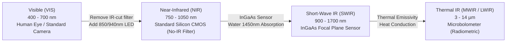
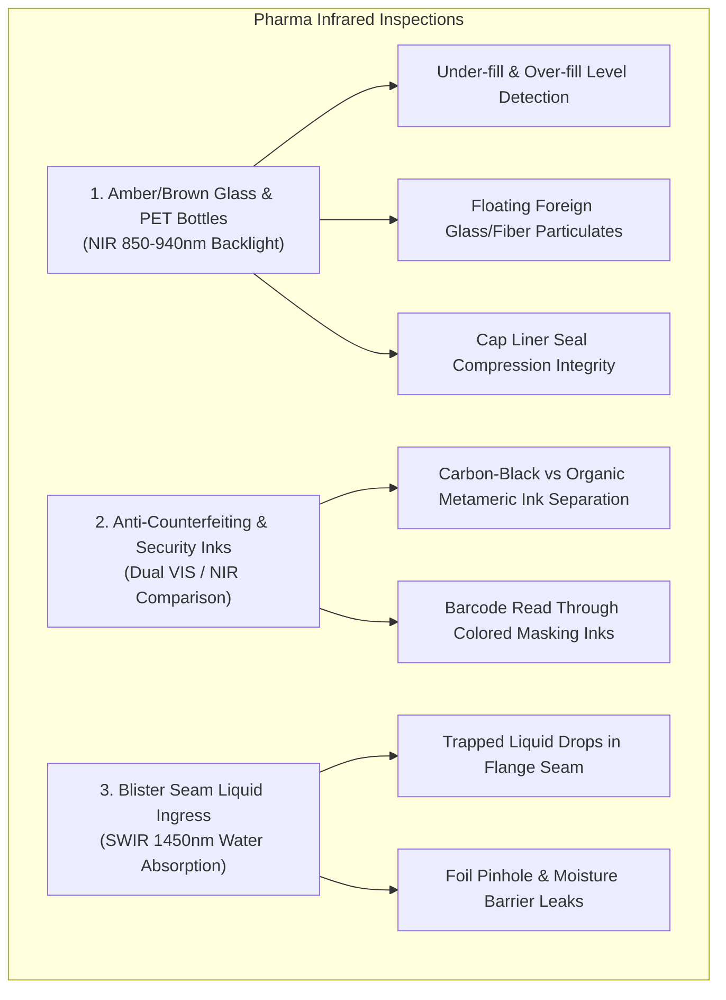
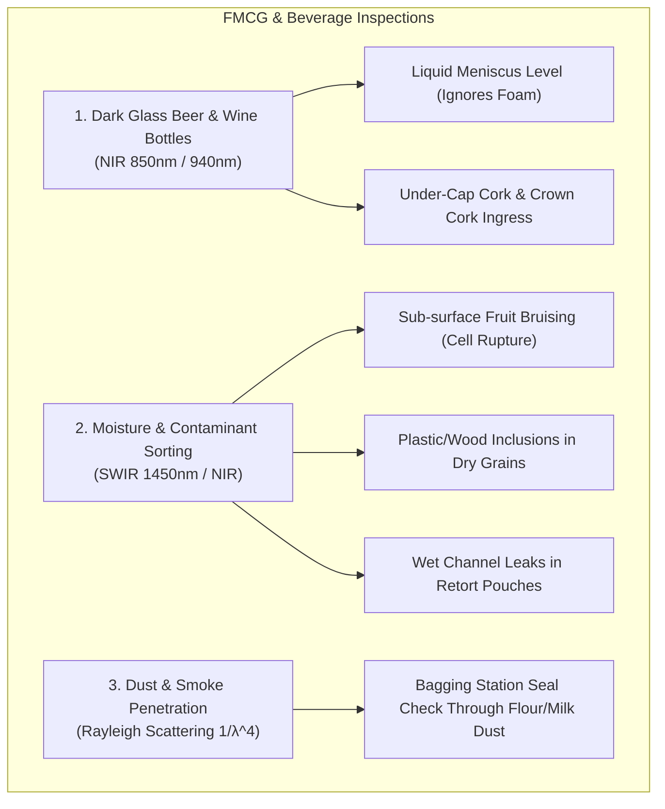
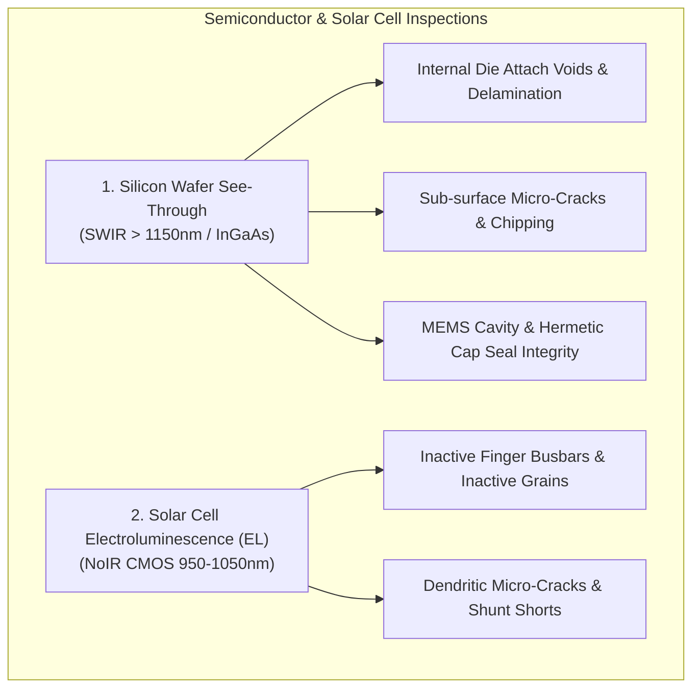
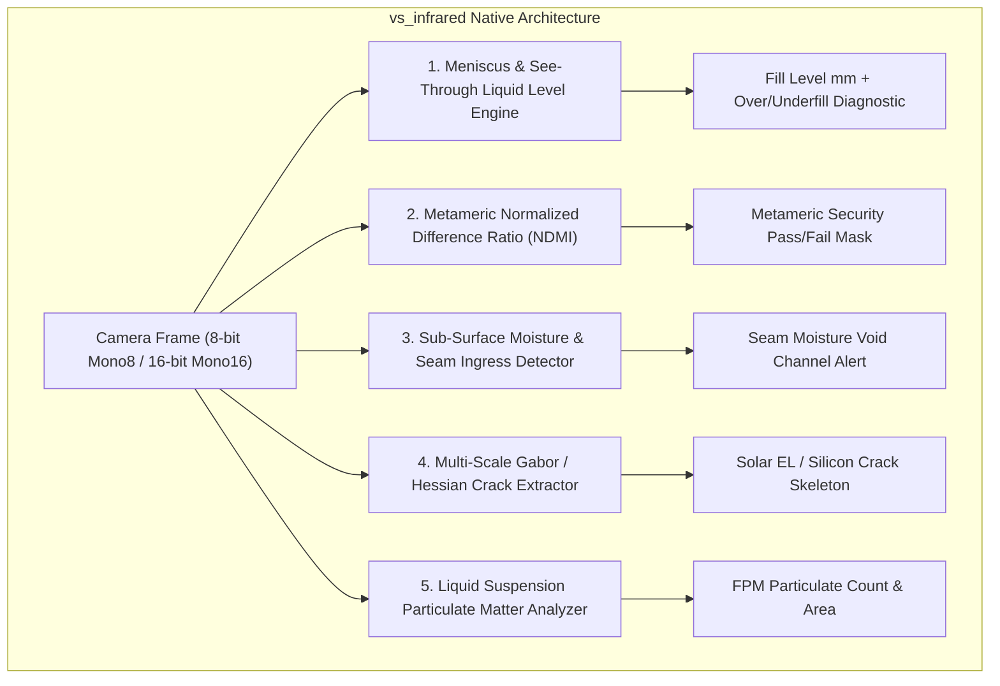

# Master Guide: Infrared Vision Inspection & Defect Analysis
## Near-Infrared (No-IR-Filter CMOS) & Short-Wave Infrared (SWIR) Industrial Applications

This master engineering guide details industrial infrared machine vision using:
1. **CMOS Cameras with IR-Cut Filter Removed ("NoIR" / NIR 750 nm – 1050 nm)** paired with active 850 nm / 940 nm LED strobe illumination.
2. **Dedicated Short-Wave Infrared (SWIR 900 nm – 1700 nm)** InGaAs sensor cameras.
3. **Mid-Wave & Long-Wave Thermal Infrared (MWIR / LWIR 3 – 14 $\mu\text{m}$)** cameras.

---

## 1. Optical Physics & Spectrum Overview

### Physical Principles

| Spectral Band | Wavelength Range | Typical Sensor | Optical Transmission / Absorption Phenonemon | Cost Profile |
|---|:---:|:---:|---|:---:|
| **Visible (VIS)** | $400 - 700\text{ nm}$ | Standard Silicon CMOS | Human color perception; blocked by dark dyes, amber glass, smoke | Standard ($\$200 - \$600$) |
| **Near-IR (NIR / NoIR)** | $750 - 1050\text{ nm}$ | Silicon CMOS with IR-cut glass removed | **High transmission through amber/green/dark PET/glass**; penetrates smoke/haze ($1/\lambda^4$); organic dyes transparent; carbon black absorbs | **Very Low ($\$250 - \$800$)** |
| **Short-Wave IR (SWIR)** | $900 - 1700\text{ nm}$ | InGaAs (Indium Gallium Arsenide) | **Massive water absorption peak at $1450\text{ nm}$**; **silicon wafers 100% transparent**; polymer hydrocarbon discrimination | Moderate-High ($\$3,500 - \$9,000$) |
| **Thermal (LWIR)** | $8 - 14\ \mu\text{m}$ | VOx / a-Si Microbolometer | Sub-surface thermal conduction, platen heater seal profiles, frictional hotspots | Moderate ($\$1,500 - \$4,500$) |

---

## 2. Comprehensive Defect Analysis by Industry

### A. Pharmaceutical & Medical Packaging

#### 1. Amber / Dark Glass & PET Medicine Bottles
- **The Problem**: Cough syrups, injectables, and vitamin tinctures are packaged in dark amber or cobalt blue glass to protect photo-sensitive active pharmaceutical ingredients (APIs) from ultraviolet degradation. In visible light, the container is nearly opaque, making optical fill-level and particulate inspection impossible.
- **The Infrared Solution**: Amber glass and brown PET transmit **$> 85\%$ of Near-Infrared light** ($850\text{ nm} - 940\text{ nm}$). By positioning an 850 nm NIR flat back-light behind the bottle, the container turns completely translucent.
- **Defects Detected**:
  - **Fill Level**: Sub-millimeter meniscus detection.
  - **Foreign Particulate Matter (FPM)**: Glass shards, rubber stopper cores, cellulose fibers, and hair block NIR light, appearing as sharp black silhouettes inside the bright liquid.
  - **Cap Liner Seating**: Detects folded or missing inductive liners through the plastic cap threads.

#### 2. Metameric Security Inks & Tamper-Evident Anti-Counterfeiting
- **The Problem**: Counterfeiters replicate commercial packaging using consumer inkjet/toner printers that match visible colors perfectly.
- **The Infrared Solution**: Metameric ink pairs look identical in visible light (e.g. both look dark black or deep red), but under 850/940 nm NIR:
  - **Carbon-black pigment** strongly absorbs NIR (stays jet black).
  - **Organic synthetic dyes** become completely transparent in NIR.
- **Defects Detected**:
  - Missing anti-counterfeit micro-text.
  - Barcodes printed beneath decorative colored logos decoded with $100\%$ contrast without removing outer graphics.

#### 3. Blister Pack Seam Liquid Ingress (SWIR 1450 nm)
- **The Problem**: Liquid oral dosage forms or high-viscosity gels trapped in the perimeter knurled flange ruin the hermetic moisture barrier.
- **The Infrared Solution**: Liquid water has a massive absorption spike at **$1450\text{ nm}$**. Under SWIR backlighting, trapped liquid turns pitch black against the bright reflective aluminum lidding foil.

---

### B. Food, Beverage & Fast-Moving Consumer Goods (FMCG)

#### 1. Fill-Level & Foam/Headspace Separation in Green & Amber Bottles
- **The Problem**: Dark green wine bottles, amber beer bottles, and dark brown soy sauce containers cannot be inspected reliably with white light. Furthermore, high-speed bottling lines generate surface foam that confuses visible edge detectors.
- **The Infrared Solution**:
  - Dark green/amber glass is transparent to NIR (850 nm / 940 nm).
  - Foam consists of thin microscopic air bubbles that scatter NIR light diffusely, while pure liquid absorbs NIR predictably.
  - The software extracts the true liquid-gas meniscus interface, completely ignoring up to $25\text{ mm}$ of surface foam!

#### 2. Sub-Surface Fruit & Produce Bruising (NIR 850 nm Reflection)
- **The Problem**: Impact bruises on apples, avocados, peaches, and citrus do not show skin discoloration until 12–24 hours after the drop, long after packing.
- **The Infrared Solution**: Healthy plant cellular structures create strong diffuse NIR backscattering (the *Wood Effect*). When an impact ruptures internal plant cell walls, fluid leaks into intercellular voids, drastically increasing NIR absorption. Bruises appear as distinct dark blotches within minutes of impact.

#### 3. Dust & Steam Penetration in Bagging Stations (Rayleigh Scattering)
- **The Problem**: Powdered milk, flour, cement, and detergent filling stations create airborne clouds of dust and steam that blind visible cameras.
- **The Infrared Solution**: Scattering cross-section is inversely proportional to the 4th power of wavelength ($\propto 1/\lambda^4$). NIR ($940\text{ nm}$) scatters significantly less than blue/green visible light ($450\text{ nm}$), penetrating heavy particulate dust to inspect seal integrity before cartons close.

---

### C. Electronics, Semiconductor & Solar Cells

#### 1. Silicon Wafer Internal Inspection (SWIR $> 1150\text{ nm}$)
- **The Physics**: Pure crystalline silicon has an indirect optical bandgap of $1.12\text{ eV}$, corresponding to a cut-off wavelength of $\lambda \approx 1100\text{ nm}$. At wavelengths above $1150\text{ nm}$, silicon becomes as transparent as clear glass!
- **Defects Detected**:
  - Sub-surface micro-cracks before slicing into dies.
  - Solder void ratio under bonded silicon flip-chips.
  - Hermetic cavity seal width on MEMS pressure and gyroscopic sensors.

#### 2. Photovoltaic (PV) Solar Cell Electroluminescence (EL)
- **The Physics**: When a DC forward bias current is driven through a silicon solar cell, radiative recombination of electron-hole pairs emits near-infrared photons peaking at $\approx 1150\text{ nm}$ with a tail extending down to $950 - 1050\text{ nm}$.
- **Hardware**: A standard high-sensitivity monochrome CMOS camera without an IR-cut filter (equipped with a 950 nm long-pass filter) captures this electroluminescence in a darkened enclosure.
- **Defects Detected**:
  - Micro-cracks appear as stark black cracks (isolated regions cannot conduct current and stay dark).
  - Broken front finger grid lines.
  - Potential-Induced Degradation (PID) and crystal dislocation clusters.

---

## 3. Vision Software Engine Architecture (`vs_infrared`)

To address all these industrial applications on standard CPU industrial fanless PCs without requiring external GPU hardware, we design the **`vs_infrared`** engine with 5 core modules:

### Module 1: See-Through Liquid Fill Level & Meniscus Peak Profiler
- **Algorithm**:
  1. Computes vertical average intensity profile across ROI: $P(y) = \frac{1}{W} \sum_{x} I(x, y)$.
  2. Applies 1D Gaussian smoothing derivative $\partial P / \partial y$.
  3. Locates global inflection peak corresponding to the liquid-gas meniscus.
  4. Filters out foam layer by asserting contrast boundary sharpness $S = \max(\partial P / \partial y) / \sigma_{\text{foam}}$.
  5. Converts detected pixel position to physical millimeters via factory calibrated scaling factor: $H_{\text{mm}} = (y_{\text{datum}} - y_{\text{meniscus}}) \cdot \text{scale}$.

### Module 2: Normalized Difference Metameric Index (NDMI)
- **Algorithm**:
  Computes pixel-wise normalized difference between NIR and VIS strobe frames:
  $$\text{NDMI}(x, y) = \frac{I_{\text{NIR}}(x, y) - I_{\text{VIS}}(x, y)}{I_{\text{NIR}}(x, y) + I_{\text{VIS}}(x, y) + 1.0}$$
  - Pixels with $\text{NDMI} > +0.35$ represent organic dye inks that disappear in NIR (decorative graphics).
  - Pixels with $|\text{NDMI}| < 0.15$ represent carbon-black pigment or genuine security ink.

### Module 3: Moisture Barrier Breach & Seam Contamination
- **Algorithm**:
  1. Evaluates seal seam flange along package perimeter.
  2. Measures localized absorption dip $D(u) = I_{\text{nominal}} - I_{\text{measured}}(u)$.
  3. Verifies continuous intact barrier width: if any cold moisture channel reduces residual seal width below minimum specification (e.g. $< 2.0\text{ mm}$), triggers immediate fail-safe NG.

### Module 4: Multi-Scale Tubeness / Hessian Crack Extractor
- **Algorithm**:
  For solar cell EL and silicon wafer fracture detection, constructs the 2D Hessian matrix at each pixel:
  $$H(x, y) = \begin{bmatrix} \frac{\partial^2 I}{\partial x^2} & \frac{\partial^2 I}{\partial x \partial y} \\ \frac{\partial^2 I}{\partial x \partial y} & \frac{\partial^2 I}{\partial y^2} \end{bmatrix}$$
  The maximum eigenvalue $\lambda_{\max}$ responds specifically to 1D curvilinear dark veins (cracks), completely rejecting flat crystal grain intensity shifts.

---

## 4. Hardware Selection & Strobe Lighting Recipes

| Application | Recommended Camera | Wavelength Filter | Illumination Technique |
|---|---|:---:|---|
| **Amber Liquid Fill Level** | Standard Industrial Mono CMOS (No IR filter) | $850\text{ nm}$ Bandpass ($\pm 25\text{ nm}$) | $850\text{ nm}$ High-Power LED Backlight |
| **Dark Beer/Wine Foam Check** | Standard Industrial Mono CMOS (No IR filter) | $940\text{ nm}$ Bandpass | Collimated $940\text{ nm}$ NIR Backlight |
| **Metameric Security Inks** | Dual-Strobe Mono CMOS or Color camera | Dual: VIS Strobe + $850\text{ nm}$ NIR Strobe | Coaxial On-Axis $850\text{ nm}$ + White LED |
| **Pouch Seam Moisture Ingress** | SWIR InGaAs Camera ($640 \times 512$) | $1450\text{ nm}$ Narrow Bandpass | $1450\text{ nm}$ SWIR High-Power Strobe Bar |
| **Solar Cell EL Micro-Cracks** | High-QE NIR Mono CMOS (Sony IMX990 / Pregius) | $950\text{ nm}$ Long-Pass Filter | Forward Electric Bias (Dark Chamber) |
| **Silicon Chip Internal Bonding** | SWIR InGaAs Camera ($1280 \times 1024$) | $1200\text{ nm}$ Long-Pass Filter | Transmissive Tungsten-Halogen or $1300\text{ nm}$ LED |
