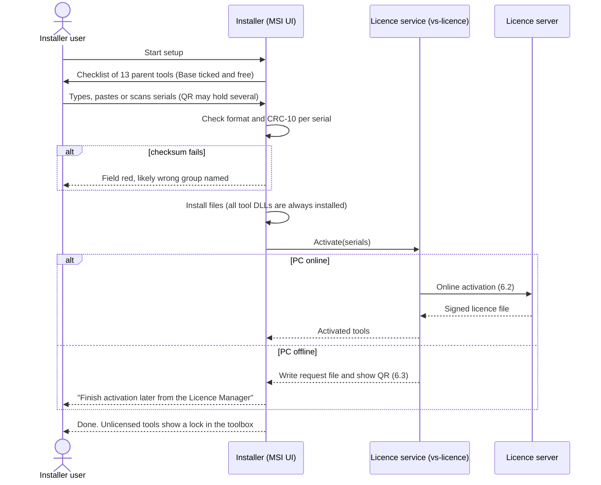
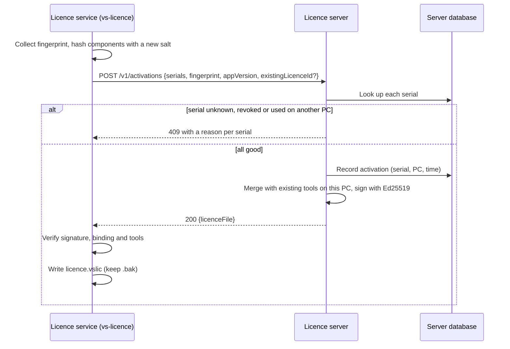
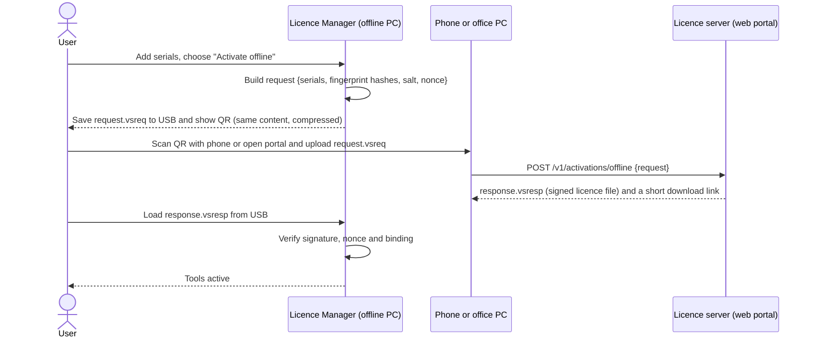
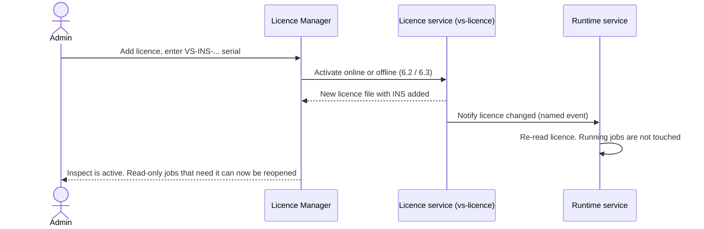
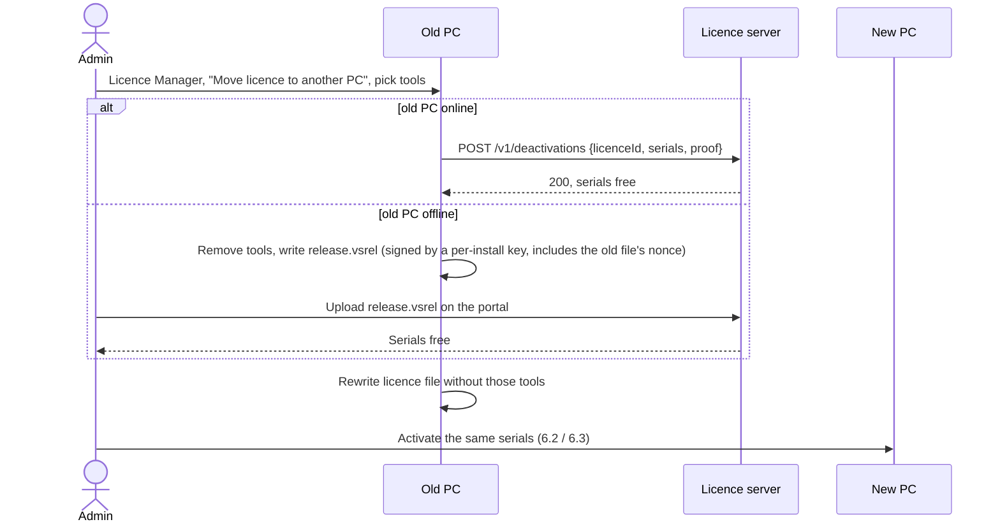
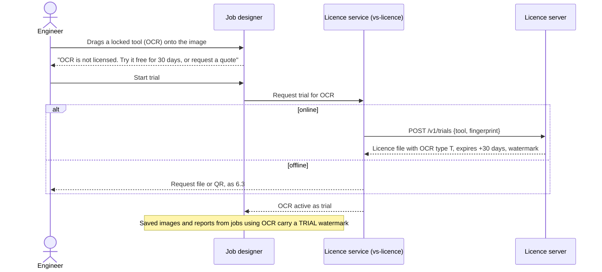
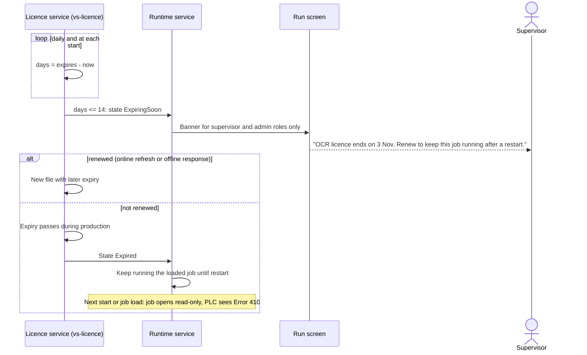
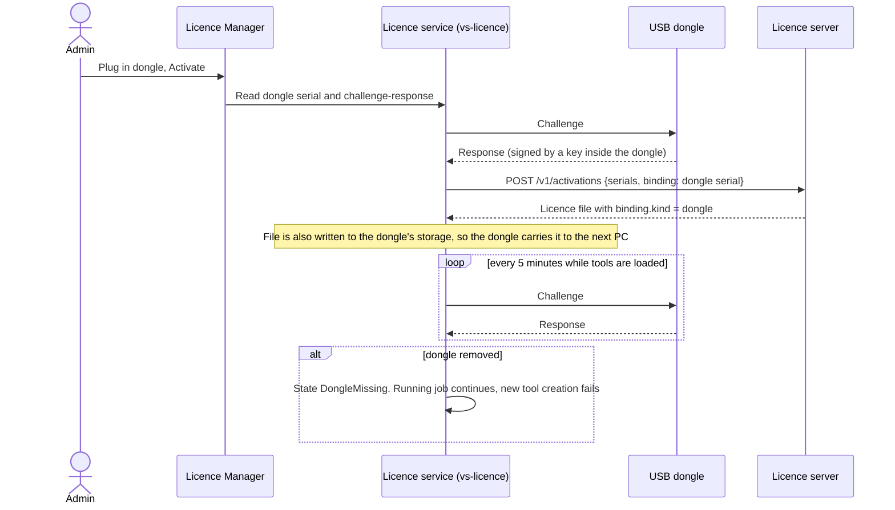

# Licensing design

This document describes how VisionStudio is licensed: one serial number per parent tool, one
signed licence file per PC, online and offline activation, an optional USB dongle, and a small
licence server. The same licence file unlocks a tool in the vision application and in the SDK.
It implements [section 9 of the requirements](../REQUIREMENTS-VISION-SYSTEM.md#9-licensing)
and answers the build-or-buy question in [section 15](../REQUIREMENTS-VISION-SYSTEM.md#15-roadmap-acceptance-risks-and-open-questions)
with a recommendation. How tool DLLs check the licence is in [SDK-API.md](SDK-API.md); the
Licence Manager screen is in [UI-UX-SPEC.md](UI-UX-SPEC.md); where the licence service sits in
the process layout is in [ARCHITECTURE.md](ARCHITECTURE.md).

## 1. Goals and limits

| Goal | How |
| --- | --- |
| Sell each parent tool on its own | One serial per parent tool; one licence file per PC lists every activated tool |
| Work on offline plant PCs | Offline activation by request file or QR code is mandatory, not an extra |
| Add a tool later without reinstalling | The Licence Manager accepts a serial at any time; the tool DLL loads at the next tool creation, no restart |
| Never stop a running line because of licensing | Expiry and licence faults take effect only at the next start or job load; a running job keeps running |
| Same rules in the app and the SDK | One verification library, `vs_lic.dll`, loaded by `vs_core.dll` in every process, app and SDK alike |
| Keep honest customers honest | Signed licence file, hardware binding, clock-rollback check. Not a defence against a skilled cracker (section 9) |

Out of scope: floating network licences (a licence server on the plant network that lends
seats). The dongle covers moving a licence between PCs. Floating licences are listed as an open
question.

## 2. Parent tools and serial prefixes

| # | Parent tool | Tool code | Serial prefix | DLL | Notes |
| --- | --- | --- | --- | --- | --- |
| 0 | Base (free) | BASE | `VS-BASE-` | `vs_core.dll`, `vs_base.dll` | Not sold. A free serial is still issued so every PC has a licence file and an activation record (needed for updates and support) |
| 1 | Locate | LOC | `VS-LOC-` | `vs_locate.dll` | |
| 2 | Measure | MEA | `VS-MEA-` | `vs_measure.dll` | |
| 3 | Calibrate | CAL | `VS-CAL-` | `vs_calib.dll` | |
| 4 | Blob & Count | BLB | `VS-BLB-` | `vs_blob.dll` | |
| 5 | Code Reader | COD | `VS-COD-` | `vs_code.dll` | Built from today's `codereader` engine |
| 6 | Code Verify | VER | `VS-VER-` | `vs_verify.dll` | Needs COD |
| 7 | OCR / OCV | OCR | `VS-OCR-` | `vs_ocr.dll` | Prefix given in the requirements |
| 8 | Inspect | INS | `VS-INS-` | `vs_inspect.dll` | |
| 9 | Colour | COL | `VS-COL-` | `vs_colour.dll` | |
| 10 | AI Deep Learning | DL | `VS-DL-` | `vs_dl.dll` | Prefix given in the requirements. Also releases the model decryption key |
| 11 | Multi-Camera & Enterprise | MCE | `VS-MCE-` | `vs_multicam.dll` | Unlocks more than one camera per job, OPC UA, MQTT, SQL/MES, web HMI |
| 12 | Scripting & Advanced Logic | SCR | `VS-SCR-` | `vs_script.dll` | |

Tool codes are two to four letters matched against the fixed list above, not decoded as Base32,
so codes such as `LOC` and `COL` may contain `L` and `O`. The input field accepts a tool code in
any case and offers the list as a drop-down. The tool code is still part of the checksum input
(3.3).

Dependencies between tools (for example Code Verify needs Code Reader) are enforced when a job
or tool is created, not at activation. A customer may activate VER first and COD later.

## 3. Serial number format

### 3.1 Layout

```
VS-<TOOLCODE>-AAAAA-BBBBB-CCCCC
              \_______________/
               15-character body; the last 2 characters are the checksum
```

The 15 characters after the tool code are the body (positions counted from the first `A`,
ignoring dashes):

| Position | Characters | Bits | Meaning |
| --- | --- | --- | --- |
| 1 | 1 | 5 | Format version (`1` today). Lets the layout change without breaking old serials |
| 2 | 1 | 5 | Licence type: `P` perpetual, `S` annual subscription, `T` trial, `D` developer/SDK, `R` SDK runtime (reserved, see open questions), `N` not-for-resale (demo, partner) |
| 3–13 | 11 | 55 | Random serial identity from a CSPRNG. Unique per serial across all tools |
| 14–15 | 2 | 10 | Checksum (3.3) |

Example: `VS-OCR-1P7K3-9QXHT-M4W2R` (illustrative; the checksum in this example is not real).

The serial is an identifier, not a key. It carries no entitlement the PC can trust: the
expiry, the tool and the customer come from the signed licence file the server issues. A
correct checksum only means "no typing error".

### 3.2 Alphabet

Crockford Base32: `0123456789ABCDEFGHJKMNPQRSTVWXYZ` (32 characters). It leaves out `I`, `L`,
`O` and `U`. On input:

- Lower case is accepted and upper-cased.
- `O` is read as `0`, `I` and `L` as `1` (inside the body).
- Spaces, extra dashes and a leading or trailing space are ignored, so a serial pasted from an
  email or a PDF works.
- The installer and Licence Manager print serials in a monospace font with the dashes.

### 3.3 Checksum

- Algorithm: CRC-10 with polynomial 0x233 (CRC-10/ATM: initial value 0, no reflection, no final
  XOR).
- Input: the ASCII bytes of `VS-<TOOLCODE>-` followed by body positions 1–13, after input
  normalisation, without dashes.
- Output: the 10-bit CRC written as two Base32 characters (high 5 bits first) in positions 14
  and 15.
- Including the tool code means a serial typed into the wrong tool's field (an OCR serial under
  Measure) fails the check.

Why CRC-10: one wrong character changes at most 5 consecutive bits and two swapped adjacent
characters change at most 10, so both are always detected (a CRC with a degree-10 polynomial
detects every burst of 10 bits or fewer). A random error passes with a probability of about
1 in 1,024. Damm or Luhn mod-N would also work but detect fewer double errors.

When the checksum fails, the field turns red and says which group is most likely wrong. To find
that group the software tries every single-character change and reports the group only if exactly
one change fixes the checksum. It never corrects silently.

### 3.4 Multi-serial QR code

One order can be delivered as one QR code holding several serials. Content (plain text, so a
phone camera shows it as readable text):

```
VSLIC1;VS-LOC-1P...;VS-MEA-1P...;VS-OCR-1S...
```

`VSLIC1` is the format tag. The installer and Licence Manager accept the QR from a USB webcam,
from any connected GigE/USB3 camera (the Code Reader engine reads it, even without a COD
licence, because this read is internal), or as pasted text.

## 4. Licence file

### 4.1 Location and protection

| Item | Value |
| --- | --- |
| Path | `C:\ProgramData\VisionStudio\Licence\licence.vslic` |
| Readers | The runtime service, the UI, every SDK process on the PC |
| Writer | Only the `vs-licence` Windows service (see [ARCHITECTURE.md](ARCHITECTURE.md)). The Licence Manager and the installer ask the service to activate; no other process writes the file |
| ACL | SYSTEM and Administrators full control; Users read |
| At rest | AES-256-GCM, key derived (HKDF-SHA256) from the PC fingerprint and a product constant. This is obfuscation against casual reading and copying; the signature is the real protection |
| Backup | The last good file is kept as `licence.vslic.bak`. A corrupt file falls back to it |

### 4.2 Content

The decrypted content is UTF-8 JSON. The signature covers the canonical form of the `licence`
object (RFC 8785 JSON Canonicalisation Scheme), so whitespace and key order do not matter.

```json
{
  "format": 1,
  "licence": {
    "licenceId": "L-2026-000123",
    "issued": "2026-11-04T09:12:00Z",
    "issuer": "licence.visionstudio.example",
    "keyId": "2026-a",
    "customer": { "id": "C-0042", "name": "Example Packaging Pvt Ltd" },
    "binding": {
      "kind": "fingerprint",
      "salt": "q8l1Zr0b9w4=",
      "components": {
        "board": "6f1c...e2",
        "cpu": "a90b...17",
        "disk": "33d4...9c",
        "nic": "c1aa...05"
      },
      "minMatch": 3
    },
    "tools": [
      { "code": "BASE", "serial": "VS-BASE-1P...", "type": "P" },
      { "code": "OCR",  "serial": "VS-OCR-1S...",  "type": "S",
        "expires": "2027-11-03T23:59:59Z", "graceDays": 0 },
      { "code": "DL",   "serial": "VS-DL-1T...",   "type": "T",
        "expires": "2026-12-04T23:59:59Z", "watermark": true }
    ],
    "limits": { "maxCameras": 1, "sdk": true },
    "refreshAfter": "2027-10-20T00:00:00Z",
    "minAppVersion": "1.0.0"
  },
  "signature": "base64(Ed25519 signature over JCS(licence))"
}
```

| Field | Meaning |
| --- | --- |
| `keyId` | Which server signing key signed the file. The software ships with the public keys for the current and the next `keyId`, so keys can be rotated without breaking installed PCs |
| `binding.kind` | `fingerprint` (bound to this PC) or `dongle` (bound to a dongle serial; see 6.8) |
| `binding.components` | SHA-256(salt + raw component value), hex. Raw hardware IDs never leave the PC |
| `minMatch` | How many components must match (4.4) |
| `tools[].type` | Same letter as the serial's licence type |
| `expires` | Only for `S`, `T` and time-limited `D`. Perpetual tools have no expiry |
| `watermark` | Saved images and reports from this tool carry a "TRIAL" watermark |
| `limits.maxCameras` | 1 without MCE. With MCE, the number bought (default 8 per job) |
| `refreshAfter` | After this date the software asks for an online refresh (only matters for subscriptions; offline PCs ignore it until the expiry warning) |

### 4.3 Signature

- Algorithm: Ed25519 (RFC 8032). 32-byte public key, 64-byte signature, fast to verify and no
  parameter choices to get wrong.
- Library: libsodium (ISC licence) in `vs_lic.dll`. The .NET and Python wrappers do not verify
  licences themselves; they call `vs_core`, which uses `vs_lic`, so there is one implementation.
- Private keys live only on the licence server, in a hardware security module or a cloud KMS
  that supports Ed25519. They are never on a developer PC or in CI.
- Public keys are compiled into `vs_lic.dll` and `vs_core.dll`, in more than one place each, and checked against each
  other at load (section 9).

### 4.4 Hardware fingerprint

| Component | Source on Windows | Notes |
| --- | --- | --- |
| `board` | SMBIOS system UUID plus baseboard serial (WMI `Win32_ComputerSystemProduct.UUID`, `Win32_BaseBoard.SerialNumber`) | Some cheap boards report all-zero or `To be filled by O.E.M.`; such values are treated as missing |
| `cpu` | `Win32_Processor.ProcessorId` plus brand string | Not unique between identical PCs; it only helps the match |
| `disk` | Serial number of the physical disk holding the Windows volume (IOCTL_STORAGE_QUERY_PROPERTY) | Not the volume serial, which changes on reformat |
| `nic` | Permanent MAC address of the first non-removable, non-virtual Ethernet adapter, by PCI location | Camera NICs are excluded (they are often replaced or added) |

Rules:

- A licence matches when at least `minMatch` (default 3) of the 4 components match. So one
  component can change (a new disk, a replaced NIC) and the licence still works. The
  requirements name board, CPU and disk; the NIC is the fourth component that makes "one change"
  possible without accepting a PC where two of three changed.
- A missing component counts as not matching. A PC with an all-zero board UUID therefore has no
  room for a change; the Licence Manager warns at activation and suggests the dongle.
- When one component no longer matches, the software keeps working and the next online contact
  (or the next offline refresh) re-anchors the file to the new set. Without this, two single
  changes a year apart would lock the PC.
- Virtual machines: the board UUID of a VM changes when it is cloned. Activation inside a VM is
  allowed for SDK development (licence type `D`) but production use in a VM needs the dongle.
  Detection uses the SMBIOS manufacturer string and the hypervisor CPUID bit.

### 4.5 Clock-rollback protection

Only time-limited tools (types `S`, `T` and time-limited `D`) depend on the clock. Perpetual
tools never stop because of the clock.

- The `vs-licence` service keeps a "last seen" UTC time in two places: a small signed state file
  next to the licence (`licence.state`, HMAC-SHA256 with a key derived from the fingerprint) and
  a registry value under `HKLM\SOFTWARE\VisionStudio\Licence`. It writes the later of the two
  plus the current time every hour and at shutdown.
- At start, if the system clock is more than 48 hours behind "last seen", the time-limited tools
  go to the state `ClockProblem`. Perpetual tools are unaffected. The 48-hour margin covers time
  zone mistakes, a flat RTC battery corrected by NTP soon after, and DST.
- `ClockProblem` is shown in the Licence Manager with the fix: "Set the PC clock to today's date
  and restart, or connect to the internet once." An online refresh with the server's time clears
  it.
- If the state file and registry value are both deleted, the service uses the file
  times of the newest logs, saved images and the licence file itself as the "last seen" floor.
- A running job is never stopped by this check (section 7).

## 5. Licence states

| State | Shown as | Tool can be created | Job using it |
| --- | --- | --- | --- |
| Active | green tick | yes | runs |
| Active, expiring in ≤ 14 days | amber "!" with the date | yes | runs; supervisor warning each start and daily |
| Trial | blue "T" with days left | yes, with watermark | runs; saved images and PDFs watermarked |
| Expired | grey lock | no (`VS_E_LICENCE_EXPIRED`) | opens read-only at next load |
| Locked (never activated) | grey lock | no (`VS_E_NOT_LICENSED`) | opens read-only |
| Hardware mismatch | red "!" | no (`VS_E_LICENCE_BINDING`) | opens read-only |
| ClockProblem | red clock | no for time-limited tools only | read-only at next load |
| Dongle missing | red plug | no (`VS_E_DONGLE_MISSING`) | read-only at next load; a running job keeps running |

## 6. Flows

### 6.1 Installation with serials



All tool DLLs are always installed, so adding a licence later never needs the installer.

### 6.2 Online activation



TLS 1.2 or later with certificate pinning to the issuing CA. A proxy can be set in the
Licence Manager; it is often needed in plants.

### 6.3 Offline activation by request file or QR



- The request is about 300 bytes before compression, so it fits a QR code version 15 to 20 at
  error correction level M. Phone scanning needs no app: the QR holds a portal URL with the
  request in the fragment (`https://activate.example/#r=...`). The fragment is not sent in
  server logs by the browser.
- The response is too large for a QR the PC could read back reliably, so it comes back as a
  file on USB. A typed fallback (about 40 characters of a "response code" that the PC expands
  using the request it remembers) is an open question.
- The nonce stops an old response file being loaded on the same PC after a deactivation.

### 6.4 Adding a licence later



No reinstall and no restart. A job that opened read-only because of this tool shows a "Reopen"
button.

### 6.5 Transfer and deactivation



- The old PC removes the tools from its licence file before the release is produced, so a copy
  of the release file cannot be used to keep both PCs running.
- Policy: three self-service transfers per serial per 12 months. More need support (a dead PC
  is the common case; support can release a serial without a release file after checking).

### 6.6 Trial



- One trial per tool per PC fingerprint, recorded on the server. Offline trials still go through
  the server, so they cannot be repeated by reinstalling.
- The watermark goes on saved images, exported PDFs and the web HMI image, not on the image the
  tools process. Results are the same as with a full licence.
- At day 30 the trial behaves like an expired subscription (6.7).

### 6.7 Subscription expiry with a 14-day warning



Operators do not see licence banners. They see the effect only if the job will not start after a
restart, and then the message tells them to call the supervisor.

### 6.8 Dongle



- The dongle-bound licence works on any PC; no fingerprint is used.
- The licence file is stored on the dongle so that moving the dongle moves the licence without a
  server call.
- Dongle choice: see section 10. The service talks to the dongle through one small
  interface (`present`, `serial`, `challenge`, `read blob`, `write blob`) so the vendor can change.

## 7. Enforcement

### 7.1 Where the check runs

- Two parts, as in [ARCHITECTURE.md](ARCHITECTURE.md): the `vs-licence` Windows service does
  activation, dongle access and the clock guard, and is the only writer of the licence file;
  `vs_lic.dll`, loaded by `vs_core.dll` in every process, verifies the file (signature, binding,
  expiry, the clock state the service records). The vision application, the runtime service and
  SDK applications all use `vs_lic`. If the service is stopped, verification still works on the
  last good file; only activation and dongle checks wait for it.
- Each tool DLL asks `vs_core` when a tool instance is created (`vs_tool_create`,
  `vs_tool_load`) and when a job is loaded. It does not check on every image: the check costs
  nothing at run time and cannot cause a cycle-time spike.
- The result is cached per process and refreshed when the Licence Manager signals a change
  (named event `Global\VisionStudioLicenceChanged`) or once an hour.
- The same licence file covers the app and the SDK on the same PC (requirements section 9). A
  separate SDK runtime licence is reserved as type `R` and not used until section 15's open
  question is decided.

### 7.2 What happens when a tool is unlicensed

| Situation | Behaviour |
| --- | --- |
| Toolbox in the designer | Tool shown with a lock. Dragging it offers "Try 30 days" or "Request a quote" |
| Job opened that uses an unlicensed tool | Opens read-only. A banner names each missing licence by its operator name and serial prefix ("Read text — needs VS-OCR"). The job can be viewed and exported, not run or saved |
| Job loaded by the PLC (JobSelect) | Job load fails; previous job stays active; PLC gets `Error` with code 410 (see [PLC-INTERFACE.md](PLC-INTERFACE.md)) |
| Licence expires while running | Job keeps running until the next restart or job load |
| Dongle removed while running | Same as above; an alarm tells the supervisor |
| SDK `vs_tool_create` | Returns `NULL` with status `VS_E_NOT_LICENSED` and a message naming the serial prefix. Never crashes, never returns a tool that silently does nothing |
| SDK call on an existing tool after expiry | Keeps working for the life of the tool instance |

The rule in the requirements is "never crash or silently skip the tool". The software never
runs a job with a tool removed, and never reports OK for a step that did not run.

### 7.3 AI models

Deep-learning models in a job are encrypted (AES-256-GCM). The key for a model is wrapped with a
key that `vs_lic` derives only when the DL licence is valid. Without DL the model cannot be
decrypted, so the check cannot be bypassed by patching the tool's licence check alone.

### 7.4 Vision Package in another application (owner, 2026-10-30)

The owner's words: "user having full package can not run or decrypt anything without issued
centralised licence from erpnext service". The Vision Package ([SDK-API.md](SDK-API.md) section 0)
is therefore licensed only through the ERPNext licence service, with the same client and the same
Vision Licence record as Vision Studio:

| Rule | How |
| --- | --- |
| Nothing runs without an ERPNext licence | The package's worker checks the licence key, installation id, package version and camera serials with ERPNext before it opens any tool or camera. Until a good, signed answer for this request arrives, every call returns "not licensed" with the reason |
| Nothing decrypts without it | Models, teach and tuning data, learned state and product files from Vision Studio are encrypted with AES-256-GCM. Their content key is never in the package: the ERPNext answer carries it encrypted for this installation's own key pair (made at first start, private key kept with Windows DPAPI), and the signature covers it. A copy of the package or its data on another PC has no key |
| One licence per location | Each location of the host application is its own installation and licence key, bound to its PC (installation id) and its cameras (parts). The record sets the licensed tools and the number of cameras |
| Offline | The check interval and offline grace of the licence record apply; the content key is kept, protected, only for the grace period |
| Never stop a running batch | As section 7.2: a licence fault takes effect at the next start or product load |
| The host cannot license | The host shows the licence state and can enter the key and ask for a check through the package API; it cannot issue, extend or move a licence |
| Versions | Every check reports the package version, so the Vision Licence Check list in ERPNext shows which location runs which version |

To build on the ERPNext side: the content key in the verify answer, wrapped for the
installation's public key, which the client sends with its first check.

## 8. Licence server

> **First implementation: ERPNext.** The licence server now runs as a Frappe app on the company ERPNext
> ([LICENCE-SERVER-ERPNEXT.md](LICENCE-SERVER-ERPNEXT.md)): periodic verification of a licence key, the
> PC (installation id) and the serial numbers of the installation's parts against ERPNext Serial No
> records, with signed answers, an offline grace period and a log of every check. Licensed tools are a
> list on the licence record for now; the per-tool serials, licence files, offline request files and
> dongle of this design are still to be built on top of it.

### 8.1 API

Base URL `https://licence.<domain>/v1`. JSON over HTTPS. Client calls are authenticated by the
serials and the fingerprint (no user account needed on a plant PC). Admin calls use the portal's
login (OIDC with MFA).

| Method | Path | Caller | Request | Response |
| --- | --- | --- | --- | --- |
| POST | `/activations` | Licence service | `{serials[], binding{kind, salt, components{} or dongleSerial, dongleProof}, appVersion, existingLicenceId?}` | `200 {licenceFile}` or `409 {errors[{serial, reason}]}` |
| POST | `/activations/offline` | Portal (on behalf of the offline PC) | `{request}` (the decoded `.vsreq`) | `200 {responseFile}` |
| POST | `/refresh` | Licence service | `{licenceId, binding, appVersion}` | `200 {licenceFile}` (new expiry, re-anchored binding) or `304` |
| POST | `/deactivations` | Licence service | `{licenceId, serials[], proof}` | `200` |
| POST | `/releases` | Portal | `{releaseFile}` | `200 {serialsFreed[]}` |
| POST | `/trials` | Licence service | `{tool, binding}` | `200 {licenceFile}` or `409 trial_used` |
| GET | `/serials/{serial}/status` | Portal, support | – | `{tool, type, state, activations[], expires}` |
| GET | `/time` | Licence service | – | `{utc}` signed, used to clear `ClockProblem` |
| GET | `/keys` | Licence service | – | Current and next public keys, signed by the root key |

Reasons in `409`: `unknown_serial`, `checksum`, `revoked`, `in_use_elsewhere`,
`transfer_limit`, `expired`, `trial_used`, `app_too_old`.

Rate limit: 10 activation attempts per serial per hour, 100 per source IP per hour, to stop serial
guessing (55 random bits already make guessing impractical).

### 8.2 Admin portal

| User | Needs |
| --- | --- |
| Sales / order desk | Create serials for an order (tool, type, expiry, customer, reseller); print or email the multi-serial QR; extend a subscription |
| Support | Look up a serial or a customer; see activations and the fingerprint match history; release a serial from a dead PC; issue a one-off extension; revoke a serial |
| Reseller | See and create serials for their own customers only, within their quota |
| Customer admin (later) | See their own serials, which PC each is on, and expiry dates; download offline response files |
| Finance | Export of active subscriptions and renewals due |
| Engineering | Rotate signing keys, set `minAppVersion`, see error rates |

Every portal action is audited (who, what, when, before and after).

### 8.3 Data stored

| Table | Fields | Notes |
| --- | --- | --- |
| customers | id, name, country, reseller id, contact email | Minimum needed for support |
| orders | id, customer, date, reference | Link to the ERP order number |
| serials | serial, tool, type, order, created, expires, state, transfer count | The serial is stored in full; it is not a secret |
| activations | id, serial, licence id, binding hashes and salt or dongle serial, app version, time, source IP (truncated /24), state | No raw hardware IDs, no PC name, no user name |
| licences | licence id, current file hash, issued, key id | The full file can be re-generated from the tables |
| trials | tool, fingerprint hash, started | One per tool per PC |
| audit | actor, action, object, before, after, time | Retained 7 years |

Personal data is limited to customer contact details. Hosting is in a region chosen for the main
markets (India first); see the open questions.

### 8.4 Availability

Plants work offline, so the server is not on the production path. A 99.5% monthly availability
target is enough. If the server is down, online activation fails with a message that suggests
offline activation, which then waits for the portal.

## 9. Tamper resistance and its limits

Target level: stop casual copying and simple patching, and make every bypass visible to support.
Not a defence against a skilled, determined attacker; no software-only scheme is.

| Measure | What it stops |
| --- | --- |
| Ed25519 signature over the licence | Editing the licence file (adding tools, changing expiry) |
| Hardware binding with salted hashes | Copying the licence file to another PC |
| Encrypted file at rest | Reading the file with a text editor |
| Clock-rollback check | Extending a trial or subscription by setting the clock back |
| Public key compiled in more than one place, cross-checked | Replacing the key with one byte patch |
| Authenticode signature check of tool DLLs by `vs_core` and of `vs_lic.dll` at load | Swapping in a patched tool DLL (the check refuses unsigned DLLs in Run mode; the SDK logs a warning) |
| Model keys derived only with a valid DL licence | Running DL models without DL |
| Server-side single activation per serial | Using one serial on many PCs |

Limits stated plainly:

- A cracker who patches `vs_lic.dll` or `vs_core.dll` to skip the checks can run unlicensed tools on one PC. Code
  obfuscation and anti-debug tricks are not used: they slow down support, raise antivirus false
  positives on plant PCs and only delay a determined attacker.
- The dongle raises the bar (the key never leaves it) but the same patch on the calling side
  still works.
- The answer to large-scale misuse is commercial and legal: serials are tied to customers, and
  the job file and support records show which serial built a job.
- No kernel drivers, no services that phone home without the customer's consent, no remote kill.
  The software never stops a running line for a licensing reason.

## 10. Build or buy

| Criterion | Own service (Ed25519 file + small server) | Wibu CodeMeter | Thales Sentinel LDK | Cryptlex |
| --- | --- | --- | --- | --- |
| Per-parent-tool serials and add-later | Yes, as designed here | Yes (product items per firm code) | Yes (features) | Yes (feature flags / product versions) |
| Offline activation by file | Yes | Yes (WibuCmRaC files) | Yes (C2V / V2C files) | Yes (offline request/response) |
| Offline by phone QR | Yes, designed in | Not out of the box; would need own wrapper | Not out of the box | Not out of the box |
| Dongle | Needs a third-party dongle anyway | Yes, strong (CmStick) | Yes, strong (Sentinel HL) | No own dongle |
| Hardware fingerprint with one-change tolerance | Yes, our rules | Yes (CmActLicense, vendor rules) | Yes (SL, vendor rules) | Yes (configurable) |
| Runtime installed on customer PC | Own `vs-licence` service (no third-party runtime) | CodeMeter Runtime service | Sentinel runtime (LDK) service | Small library, no service |
| Tamper resistance | Moderate (section 9) | High (AxProtector encryption, dongle) | High (Envelope, dongle) | Moderate |
| Same check in C, .NET, Python SDK | Yes, one C library | Yes, C API | Yes, C API | Yes, C API |
| Licence server and portal | Must build and run (estimate 2–3 developer-months plus hosting) | Included (CodeMeter License Central, extra cost) | Included (Sentinel EMS) | Included (SaaS) |
| Cost | Development and hosting; no per-seat fee | Per-seat and per-dongle fees plus licence-central licence | Per-seat and per-dongle fees plus EMS | Subscription by activations; no dongle |
| Lock-in | None | High (file formats, runtime) | High | Medium |
| Fit to "never stop a running line" | Full control | Needs care (runtime service loss stops checks) | Needs care | Full control in client code |

Prices are not listed because they depend on volume; get quotes before the decision.

**Recommendation.** Build the licence file, activation flows and server in-house for P1, as
designed here, because the needs are narrow (one file, signed tools list, offline QR flow), the
behaviour on the line must be fully under our control, and there is no per-seat cost. Buy the
dongle only: use CodeMeter CmStick (or Sentinel HL) behind the small dongle interface in 6.8,
for the customers who need it. Keep the whole licence check behind one interface (`vs_lic` and `vs-licence`) so
a switch to a commercial system later changes one library and the server, not the tools or the
SDK.

**Open question for this decision.** Does the business accept the cost and risk of running its
own licence server (key custody in a KMS or HSM, 24/7-ish availability, support tooling) in
exchange for no per-seat fees? If not, Cryptlex is the closest fit for software activation, with
CodeMeter for dongles. This needs a decision before P1 starts, because the server is on the P1
exit path (activation must work for the 7-day line run).

## 11. Testing

Licence tests are listed in [TEST-ACCEPTANCE-PLAN.md](TEST-ACCEPTANCE-PLAN.md) (test IDs
`LIC-*`): every flow in section 6, each state in section 5, one-component change, two-component
change, clock rollback, corrupt file, VM detection, dongle removal during a run, and the same
results in the app and the SDK.

## 12. Open questions

- [ ] Build or buy (section 10).
- [ ] Is a separate SDK runtime licence needed for SDK-only deployments (type `R` is reserved)?
      (2026-10-30: a Vision Package location uses the same ERPNext Vision Licence record as
      Vision Studio, section 7.4; only its price is open.)
- [ ] Should a free Base serial be required, or should Base work without any activation? (This
      design issues one so every PC is known to support and updates.)
- [ ] Floating network licences for plants with many PCs: needed, and in which phase?
- [ ] Transfer limit: is three per serial per year right for integrators who move PCs between
      sites during commissioning?
- [ ] Typed response code for offline activation where no USB stick is allowed on the plant PC.
- [ ] Hosting region and data-protection rules for the licence server (India DPDP Act, export
      customers).
- [ ] Licensing of existing `codereader` aggregation customers when they move to `vs_code.dll`
      (see the compatibility plan in [SDK-API.md](SDK-API.md)).
- [ ] VM policy: dongle only, or allow fingerprinted production VMs with a stricter re-anchor rule?
