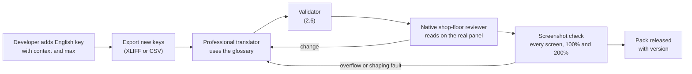

# Localisation Specification

This document specifies how the vision application ships in 15 languages: the language list and fonts, the string resource format and key names, how plurals and placeholders work, how strings are translated and reviewed, how Indic and Urdu text is rendered, how spoken guidance works, and what is deliberately left in English. It implements [section 7 of the requirements](../REQUIREMENTS-VISION-SYSTEM.md#7-languages) for users described in [section 2](../REQUIREMENTS-VISION-SYSTEM.md#2-users-and-design-rules). The screens and English labels it refers to are in [UI-UX-SPEC.md](UI-UX-SPEC.md).

Related documents: [UI-UX-SPEC.md](UI-UX-SPEC.md) (wording guide, screens), [ARCHITECTURE.md](ARCHITECTURE.md) (where resources load), [JOB-FILE-FORMAT.md](JOB-FILE-FORMAT.md) (language-independent labels in jobs), [SDK-API.md](SDK-API.md) (API stays English), [PLC-INTERFACE.md](PLC-INTERFACE.md) (tag names), [TEST-ACCEPTANCE-PLAN.md](TEST-ACCEPTANCE-PLAN.md) (language tests).

## 1. Languages

| # | Language | Native name | Script | Direction | Language tag | Formatting locale | Font (embedded) |
| --- | --- | --- | --- | --- | --- | --- | --- |
| 1 | English | English | Latin | LTR | `en` | `en-IN` | Noto Sans |
| 2 | Hindi | हिन्दी | Devanagari | LTR | `hi` | `hi-IN` | Noto Sans Devanagari |
| 3 | Marathi | मराठी | Devanagari | LTR | `mr` | `mr-IN` | Noto Sans Devanagari |
| 4 | Gujarati | ગુજરાતી | Gujarati | LTR | `gu` | `gu-IN` | Noto Sans Gujarati |
| 5 | Tamil | தமிழ் | Tamil | LTR | `ta` | `ta-IN` | Noto Sans Tamil |
| 6 | Telugu | తెలుగు | Telugu | LTR | `te` | `te-IN` | Noto Sans Telugu |
| 7 | Kannada | ಕನ್ನಡ | Kannada | LTR | `kn` | `kn-IN` | Noto Sans Kannada |
| 8 | Malayalam | മലയാളം | Malayalam | LTR | `ml` | `ml-IN` | Noto Sans Malayalam |
| 9 | Bengali | বাংলা | Bengali | LTR | `bn` | `bn-IN` | Noto Sans Bengali |
| 10 | Punjabi | ਪੰਜਾਬੀ | Gurmukhi | LTR | `pa` (script `pa-Guru`) | `pa-IN` | Noto Sans Gurmukhi |
| 11 | Odia | ଓଡ଼ିଆ | Odia | LTR | `or` | `or-IN` | Noto Sans Oriya |
| 12 | Urdu | اردو | Perso-Arabic (Nastaliq) | RTL | `ur` | `ur-IN` | Noto Nastaliq Urdu (text), Noto Naskh Arabic (dense tables, fallback) |
| 13 | Assamese | অসমীয়া | Bengali-Assamese | LTR | `as` | `as-IN` | Noto Sans Bengali (covers ৰ and ৱ) |
| 14 | Simplified Chinese (export) | 简体中文 | Han | LTR | `zh-Hans` | `zh-Hans-CN` | Noto Sans SC |
| 15 | Spanish (export) | Español | Latin | LTR | `es` | `es-ES` or `es-419` (open) | Noto Sans |

**Open question:** the two export languages, Simplified Chinese and Spanish, are to be confirmed ([section 15 of the requirements](../REQUIREMENTS-VISION-SYSTEM.md#15-roadmap-acceptance-risks-and-open-questions)). If Spanish stays, the target variant (Spain or Latin America) also needs a decision. The design does not depend on the answer, because every language is a plug-in pack (section 2.8).

Notes:

- English source strings are written in British spelling ("colour", "licence") and Indian English usage for the `en-IN` locale. A US English pack is not planned.
- The phase plan ships English in P1, Hindi plus 4 more in P2 and the rest by P4 ([section 15](../REQUIREMENTS-VISION-SYSTEM.md#15-roadmap-acceptance-risks-and-open-questions)). The proposed P2 set is Hindi, Marathi, Gujarati, Tamil and Telugu, to be confirmed against the first customers' plant locations.
- Fonts are embedded in the application and in exported PDFs. All Noto fonts are under the SIL Open Font Licence 1.1, which allows embedding. Noto Sans SC adds about 10–16 MB per weight; it is installed only with the Chinese pack.

## 2. String resources

### 2.1 Format

- One JSON file per language per area, UTF-8 without BOM, in `lang/<tag>/<area>.json`, for example `lang/hi/screen.run.json`.
- Values are ICU MessageFormat strings (section 2.3). The UI loads them through one string service shared by WPF or Avalonia, the web HMI and PDF reports.
- JSON was chosen over `.resx` so that translators and the plug-in pack (2.8) need no Visual Studio and no rebuild, which the requirements ask for. A build step can still generate typed C# accessors (`Strings.Screen.Run.Button.Start`) from the English files so missing keys fail at compile time.
- Each entry can carry metadata for translators in a parallel `_meta` object in the English file only:

```json
{
  "screen.run.button.start": "Start",
  "screen.run.button.change_product": "Change product",
  "screen.run.counter.good": "Good",
  "alarm.plc_lost.title": "PLC not connected",
  "alarm.plc_lost.fix": "Check the network cable to the PLC.",
  "teach.step4.good_progress": "{count, plural, one {# good part of {needed}} other {# good parts of {needed}}}",
  "_meta": {
    "screen.run.button.start": { "max": 12, "context": "Run screen action bar, starts inspection", "screenshot": "run-idle.png", "tts": true },
    "teach.step4.good_progress": { "max": 32, "context": "Counter while teaching good parts" }
  }
}
```

### 2.2 Key naming convention

Keys are lower case, dot-separated, ASCII only, in the form `<area>.<screen or object>.<element type>.<name>`.

| Area prefix | Used for | Example |
| --- | --- | --- |
| `screen.<screen>.button.*` | Action bar and other buttons | `screen.run.button.start` |
| `screen.<screen>.title`, `.hint.*`, `.label.*` | Titles, instruction lines, field labels | `screen.change_product.title` |
| `teach.step<n>.*` | Teach wizard | `teach.step2.hint.grab` |
| `tool.<tool-id>.name`, `.desc`, `.param.*` | Operator names and settings of tools | `tool.caliper.name` = "Check size" |
| `result.<tool-id>.reason.*` | Plain reasons for NG | `result.ocv.reason.wrong_char` |
| `alarm.<code>.title`, `.fix`, `.step<n>` | Alarm catalogue | `alarm.cam_lost.step1` |
| `advice.*` | Auto-light check and drift messages | `advice.too_dark` |
| `ai.*` | AI training and validation sentences | `ai.validate.missed_bad` |
| `report.*` | Report and PDF text | `report.shift.title` |
| `common.*` | Shared words (OK, NG, Back, Next, Cancel) | `common.button.back` |
| `glossary.*` | Fixed terms (section 3) referenced by other strings | `glossary.find_the_part` |

Rules:

- A key names the meaning, not the English text, so English can be reworded without changing keys.
- Never reuse a key in two places with different context, even if the English is the same today. Hindi, for example, may need different forms for a button and a title.
- Removed keys are kept for one major version, marked `"deprecated": true` in `_meta`, so older plug-in packs still load.

### 2.3 Plurals, gender and placeholders

- All counts use ICU plural rules from CLDR. Hindi, Marathi, Gujarati and Bengali have `one` and `other`; Chinese has only `other`; Urdu and Spanish have `one` and `other` (Spanish also `many` in recent CLDR for large numbers). Translators must fill every category CLDR defines for their language; the validator (2.6) checks this.
- Gender: Hindi, Marathi, Gujarati, Urdu and Punjabi verbs and adjectives agree with the noun's gender. Strings that combine a noun from elsewhere (e.g. a tool name) with a verb use ICU `select` on a gender attribute stored with that noun in the glossary: `{gender, select, masc {...} fem {...} other {...}}`. Better still, sentences are written so the inserted noun does not need agreement ("Check: {tool}" rather than "{tool} failed").
- Placeholders are named, never positional: `{count}`, `{tool}`, `{value}`, `{limit}`, `{unit}`, `{time}`. Translators may move them but not rename or drop them.
- Numbers, dates and times inside messages use ICU argument types (`{value, number, ::.00}`, `{time, time, short}`) so they format per locale (section 4.3).
- No string is built by joining fragments in code. Every sentence the user sees is one message.
- User-entered text (product names, expected text) is inserted as-is and wrapped in Unicode directional isolates (U+2068 … U+2069) so that Latin or numeric content does not break RTL Urdu sentences.

### 2.4 Length rules

Indic translations run 20–60% longer than English and some scripts are taller. Layout must not depend on English lengths.

| Element | Max visible characters (guide) | Rule if longer |
| --- | --- | --- |
| Action bar button label | 12, two lines allowed at > 150% text size | Wrap to two lines; never truncate. Translator must shorten if it needs three. |
| Small button / chip | 10 | Wrap to two lines |
| Product tile name | 18 | Ellipsis allowed (full name on long press) |
| Screen title | 30 | Wrap |
| Instruction line (wizard) | 80 | Wrap to two lines |
| Alarm title | 30 | Wrap |
| Alarm step | 100 | Wrap |
| Table column header | 16 | Wrap |

The `max` value in `_meta` is checked by the validator against rendered width using the real font (not character count), at 100% and 200% text size.

### 2.5 Glossary of fixed terms

All languages use one glossary (section 6) for terms that appear on many screens. A translated term, once approved, is used everywhere; translators cannot vary it per screen. Tool operator names (`tool.*.name`) are glossary terms. The glossary also records gender and plural forms where the language needs them, and a "do not translate" flag for terms such as "PLC" and "QR".

### 2.6 Validation

A string validator runs in the build and when a plug-in pack is loaded. It checks: every English key exists in the pack (missing keys fall back to English, with a warning in the language report); placeholders match; ICU syntax parses; plural categories are complete; glossary terms are used where the English uses them; rendered width fits `max`; no control characters except directional isolates.

### 2.7 Translation workflow



| Step | Who | Output |
| --- | --- | --- |
| 1 Write English | Developer, with the wording guide in [UI-UX-SPEC.md](UI-UX-SPEC.md) | Key, English text, context, max length, screenshot name |
| 2 Translate | Professional translator, with glossary and screenshots | Translated JSON or XLIFF |
| 3 Validate | Automatic | Validator report |
| 4 Native shop-floor review | An operator or supervisor from a plant who speaks the language daily, not a translator. Reads every operator-facing string on the real touch panel, and listens to the spoken version. | Approved or change list. Typical changes: everyday words instead of formal ones ("पार्ट" instead of "पुर्जा"). |
| 5 Screenshot check | QA, using automated screenshots of every screen in every state, in the language, at 100% and 200% | Overflow, clipping, wrong shaping, wrong direction |
| 6 Release | Release manager | Pack version, reviewer names, date |

The requirement that each language passes review by a native speaker from the shop floor ([section 7](../REQUIREMENTS-VISION-SYSTEM.md#7-languages)) is a release gate: a pack without a recorded shop-floor review is marked "preview" and is hidden from the language picker unless an admin enables it.

### 2.8 Language plug-in packs

A language pack is one signed file `vs-lang-<tag>-<version>.vslang` (a zip) holding:

```text
manifest.json        tag, native name, script, direction, font family names, pack version,
                     minimum application version, reviewer sign-off, TTS voice ids
lang/<tag>/*.json    strings
glossary.json        glossary terms for the language
fonts/*.ttf          only if the font is not already embedded
tts/                 recorded prompts and/or voice model (section 5)
help/                localised help videos subtitles and pictures with text
```

- Packs install from Settings, from the installer, or by copying into the packs folder. No rebuild and no restart: the language picker shows the new language at once.
- Packs are signed by the vendor. An unsigned pack (for example a customer's own translation) loads only when an admin allows unsigned packs, and shows "Customer translation" in the language picker.
- A newer application with a pack that lacks new keys still works; missing strings show in English and are listed in Settings, "Language", "Missing words".

### 2.9 Pseudo-localisation testing

Three pseudo-languages are built automatically from English and are available in Engineer builds:

| Pseudo-language | What it does | Finds |
| --- | --- | --- |
| `qps-ploc` (long) | Replaces letters with accented look-alikes, adds 50% length with padding, wraps in `[` `]` | Hard-coded strings (no brackets), truncation, fixed-width layouts |
| `qps-plocm` (mirrored) | Same as above, right-to-left, with directional marks | Layouts that do not mirror, icons that should or should not flip |
| `qps-tall` (tall) | Uses Devanagari and Malayalam test sentences with stacked conjuncts and the tallest glyphs | Clipped tops and bottoms, line-height faults |

Automated screenshot tests run every screen and every state in the three pseudo-languages on each pull request that changes UI.

## 3. Rendering

### 3.1 Complex-script shaping

- All Indic scripts and Urdu need complex shaping: conjuncts, reordering of pre-base matras (e.g. Hindi ि), reph, split vowels in Tamil, Malayalam and Odia, and contextual joining and Nastaliq positioning in Urdu.
- The UI must render through HarfBuzz. On Windows, WPF uses DirectWrite, which shapes Indic scripts correctly with Noto fonts; Avalonia uses Skia with HarfBuzz. Either way the image canvas overlays (text drawn on images) must also go through HarfBuzz, not OpenCV `putText` (which does not shape). The C++ overlay renderer links HarfBuzz and FreeType for this.
- Line height is set per script from the font's metrics, not one value for all. Malayalam, Odia and Nastaliq Urdu need about 1.4–1.8 times the Latin line height. Buttons size to content height.
- Line breaking uses ICU break iteration (or the platform's), never breaking inside a grapheme cluster.
- Text is never drawn letter-spaced, condensed or synthesised bold, which breaks shaping. Bold uses the real bold font file.
- Exported PDFs embed fonts and use the same shaping path.

### 3.2 Urdu right-to-left mirroring

| Element | Rule |
| --- | --- |
| Screen layout | Mirrored: menu on the right, action bar order reversed, side panels swap sides, wizard steps run right to left. |
| Back / Next arrows | Mirrored (Back points right). |
| Progress bars, sliders | Fill from right to left. Strictness slider: "Loose" on the right. |
| Camera image and overlays | **Not mirrored.** The image is the real world. |
| Charts with time axis | Not mirrored; time runs left to right, as operators read machine charts. Labels are in Urdu. |
| Cycle-time bar | Not mirrored (it is a measurement). |
| Icons with direction (undo, redo, play) | Undo/redo mirrored; play/start triangle not mirrored (it follows media convention). |
| Numbers, codes, product codes, PLC addresses | Left-to-right inside isolates. |
| Status shapes ✓ ✗ ! | Not mirrored. |
| Keyboard input fields | Direction follows the text typed (first strong character). |

### 3.3 Numbers, dates and units

| Item | Rule |
| --- | --- |
| Digits | Latin digits (0–9) by default in every language, because operators read machine displays and labels in Latin digits. A per-language option shows native digits (e.g. Devanagari ०–९, Bengali, Extended Arabic-Indic for Urdu) in counters and reports, not in measurement fields. |
| Grouping | Indian grouping for Indian locales (12,34,567); Western for `zh-Hans` and `es` (`es` uses "." grouping and "," decimal). |
| Decimal separator | From the locale for display; input fields accept both "." and the locale separator. |
| Dates | Indian locales: `dd-MM-yyyy` with month as number on operator screens (e.g. 29-10-2026), month name in reports. `zh-Hans`: `yyyy-MM-dd`. `es`: `dd/MM/yyyy`. |
| Times | 24-hour clock on operator screens by default (shift work); setting for 12-hour. |
| Units | Measurements stay in mm or inch as the job sets them, in every language. Unit symbols (mm, µm, ms, °) are not translated. |
| Percentages | Locale format (e.g. "99.7 %" spacing per CLDR). |
| Expected text in OCV | Never formatted or localised; compared exactly as configured (a date on a label is data, not UI). |

## 4. Spoken guidance (text-to-speech)

### 4.1 What is spoken

| Content | When | Source |
| --- | --- | --- |
| Wizard step instruction | On entering a step (setting), and on tapping the speaker | Recorded prompt |
| Alarm title and current step | When the alarm is raised (setting "Speak alarms aloud") and on "Read aloud" | Recorded prompt |
| Error and advice messages | On tapping the speaker | Recorded prompt, or TTS if the message has values |
| NG reason | On tapping the speaker in the NG viewer | TTS (has values) |
| Validation sentence in AI training | On tapping the speaker | TTS (has counts) |
| Counters, product name | On tapping the speaker | TTS |

Long reports, tables and settings pages are not spoken.

### 4.2 Voice options

All speech must work offline on the line PC.

| Option | Coverage | Notes |
| --- | --- | --- |
| Recorded prompts by native speakers | All 15 languages, fixed strings only | Best clarity and accent. Recorded during the shop-floor review step. About 300–500 fixed prompts per language (estimate). Stored as Opus files in the pack. |
| Windows built-in voices (OneCore / SAPI) | Some Indian languages and both export languages; coverage varies by Windows edition and must be checked on IoT LTSC | No extra licence; quality varies |
| Offline neural TTS (e.g. Piper, or AI4Bharat Indic TTS-class models exported to ONNX) | Most Indian languages, to be verified per language | Runs on CPU; voice and model licences must allow commercial use |

Design: recorded prompts for every fixed message; for messages with values, the chosen offline TTS voice for that language; if no voice exists, the speaker button plays the recorded prompt for the fixed part only and shows the values larger on screen. Voice speed is a setting (slow, normal). Speech never blocks the UI and stops on the next tap.

## 5. Not translated

| Content | Stays as | Why |
| --- | --- | --- |
| CSV export column headers | English, fixed names (e.g. `timestamp`, `job`, `part_id`, `result`) | Read by machines ([section 7](../REQUIREMENTS-VISION-SYSTEM.md#7-languages)) |
| Log files, audit-trail internal fields | English | Service and support; the audit viewer shows a translated description beside them |
| PLC tag names, addresses, protocol names | As in the PLC | Must match the PLC program ([PLC-INTERFACE.md](PLC-INTERFACE.md)) |
| SDK, C API, .NET and Python names, REST and gRPC fields, error identifiers | English | API stability ([SDK-API.md](SDK-API.md)); error messages from the SDK are English with a stable code, which the UI maps to translated text |
| Job file internal identifiers | Language-independent IDs | Jobs open in any language ([JOB-FILE-FORMAT.md](JOB-FILE-FORMAT.md)) |
| User data: product names, expected text, user names, notes | As entered | Data, not UI. Product names can have an optional name per language in the job. |
| Code content, OCR results | As read | Data |
| Units and symbols (mm, µm, ms, px, °, %) | Symbols | Universal |
| Brand and standard names (GigE Vision, USB3 Vision, GS1, ISO/IEC 15415, QR, Data Matrix) | As is | Standard names; operator screens avoid them where possible |
| Advanced-mode technical parameter names | English with translated tooltip | Engineers search documentation in English |
| Licence serial numbers, PC ID | As is | Data |

## 6. Starter glossary

All translations below are **draft and need native shop-floor review** before use. Hindi, Marathi and Gujarati are filled in; other columns are marked "TBT" (to be translated). Everyday shop-floor words are preferred over formal ones (for example "पार्ट" for part, which operators use, rather than the formal "पुर्जा"). "OK" and "NG" are shown with the ✓ / ✗ shape in every language; plants may choose to show the Latin "OK" / "NG" beside the translation, since many operators know them.

| Key | English | Hindi (hi) | Marathi (mr) | Gujarati (gu) | ta | te | kn | ml | bn | pa | or | ur | as | zh-Hans | es |
| --- | --- | --- | --- | --- | --- | --- | --- | --- | --- | --- | --- | --- | --- | --- | --- |
| `glossary.ok` | OK | ठीक | ठीक | બરાબર | TBT | TBT | TBT | TBT | TBT | TBT | TBT | TBT | TBT | TBT | TBT |
| `glossary.ng` | NG | खराब | खराब | ખરાબ | TBT | TBT | TBT | TBT | TBT | TBT | TBT | TBT | TBT | TBT | TBT |
| `common.button.start` | Start | शुरू करें | सुरू करा | શરૂ કરો | TBT | TBT | TBT | TBT | TBT | TBT | TBT | TBT | TBT | TBT | TBT |
| `common.button.stop` | Stop | रोकें | थांबवा | રોકો | TBT | TBT | TBT | TBT | TBT | TBT | TBT | TBT | TBT | TBT | TBT |
| `glossary.change_product` | Change product | प्रोडक्ट बदलें | प्रॉडक्ट बदला | પ્રોડક્ટ બદલો | TBT | TBT | TBT | TBT | TBT | TBT | TBT | TBT | TBT | TBT | TBT |
| `glossary.product` | Product | प्रोडक्ट | प्रॉडक्ट | પ્રોડક્ટ | TBT | TBT | TBT | TBT | TBT | TBT | TBT | TBT | TBT | TBT | TBT |
| `glossary.part` | Part | पार्ट | पार्ट | પાર્ટ | TBT | TBT | TBT | TBT | TBT | TBT | TBT | TBT | TBT | TBT | TBT |
| `glossary.good_part` | Good part | अच्छा पार्ट | चांगला पार्ट | સારો પાર્ટ | TBT | TBT | TBT | TBT | TBT | TBT | TBT | TBT | TBT | TBT | TBT |
| `glossary.bad_part` | Bad part | खराब पार्ट | खराब पार्ट | ખરાબ પાર્ટ | TBT | TBT | TBT | TBT | TBT | TBT | TBT | TBT | TBT | TBT | TBT |
| `tool.locate.name` | Find the part | पार्ट ढूँढें | पार्ट शोधा | પાર્ટ શોધો | TBT | TBT | TBT | TBT | TBT | TBT | TBT | TBT | TBT | TBT | TBT |
| `tool.measure.name` | Check size | साइज़ जाँचें | आकार तपासा | માપ તપાસો | TBT | TBT | TBT | TBT | TBT | TBT | TBT | TBT | TBT | TBT | TBT |
| `tool.code.name` | Read code | कोड पढ़ें | कोड वाचा | કોડ વાંચો | TBT | TBT | TBT | TBT | TBT | TBT | TBT | TBT | TBT | TBT | TBT |
| `tool.ocr.name` | Read text | लिखावट पढ़ें | मजकूर वाचा | લખાણ વાંચો | TBT | TBT | TBT | TBT | TBT | TBT | TBT | TBT | TBT | TBT | TBT |
| `tool.ocv.name` | Check text | लिखावट जाँचें | मजकूर तपासा | લખાણ તપાસો | TBT | TBT | TBT | TBT | TBT | TBT | TBT | TBT | TBT | TBT | TBT |
| `tool.blob.name` | Count | गिनती करें | मोजा | ગણતરી કરો | TBT | TBT | TBT | TBT | TBT | TBT | TBT | TBT | TBT | TBT | TBT |
| `tool.inspect.name` | Check defects | खराबी जाँचें | दोष तपासा | ખામી તપાસો | TBT | TBT | TBT | TBT | TBT | TBT | TBT | TBT | TBT | TBT | TBT |
| `tool.colour.name` | Check colour | रंग जाँचें | रंग तपासा | રંગ તપાસો | TBT | TBT | TBT | TBT | TBT | TBT | TBT | TBT | TBT | TBT | TBT |
| `tool.calibrate.name` | Set real size | असली माप सेट करें | खरे माप सेट करा | સાચું માપ સેટ કરો | TBT | TBT | TBT | TBT | TBT | TBT | TBT | TBT | TBT | TBT | TBT |
| `tool.dl.name` | Teach by example | उदाहरण से सिखाएँ | उदाहरणाने शिकवा | ઉદાહરણથી શીખવો | TBT | TBT | TBT | TBT | TBT | TBT | TBT | TBT | TBT | TBT | TBT |
| `glossary.teach` | Teach | सिखाएँ | शिकवा | શીખવો | TBT | TBT | TBT | TBT | TBT | TBT | TBT | TBT | TBT | TBT | TBT |
| `glossary.camera` | Camera | कैमरा | कॅमेरा | કેમેરા | TBT | TBT | TBT | TBT | TBT | TBT | TBT | TBT | TBT | TBT | TBT |
| `glossary.light` | Light | लाइट | लाईट | લાઇટ | TBT | TBT | TBT | TBT | TBT | TBT | TBT | TBT | TBT | TBT | TBT |
| `glossary.alarm` | Alarm | अलार्म | अलार्म | એલાર્મ | TBT | TBT | TBT | TBT | TBT | TBT | TBT | TBT | TBT | TBT | TBT |
| `alarm.button.what_to_do` | What do I do? | मैं क्या करूँ? | मी काय करू? | હું શું કરું? | TBT | TBT | TBT | TBT | TBT | TBT | TBT | TBT | TBT | TBT | TBT |
| `teach.button.grab` | Grab (take picture) | फ़ोटो लें | फोटो घ्या | ફોટો લો | TBT | TBT | TBT | TBT | TBT | TBT | TBT | TBT | TBT | TBT | TBT |
| `glossary.strictness` | Strictness | सख़्ती | काटेकोरपणा | કડકાઈ | TBT | TBT | TBT | TBT | TBT | TBT | TBT | TBT | TBT | TBT | TBT |
| `common.button.save` | Save | सेव करें | सेव्ह करा | સેવ કરો | TBT | TBT | TBT | TBT | TBT | TBT | TBT | TBT | TBT | TBT | TBT |
| `common.button.back` | Back | पीछे | मागे | પાછળ | TBT | TBT | TBT | TBT | TBT | TBT | TBT | TBT | TBT | TBT | TBT |
| `common.button.next` | Next | आगे | पुढे | આગળ | TBT | TBT | TBT | TBT | TBT | TBT | TBT | TBT | TBT | TBT | TBT |
| `common.button.cancel` | Cancel | रद्द करें | रद्द करा | રદ કરો | TBT | TBT | TBT | TBT | TBT | TBT | TBT | TBT | TBT | TBT | TBT |
| `common.button.help` | Help | मदद | मदत | મદદ | TBT | TBT | TBT | TBT | TBT | TBT | TBT | TBT | TBT | TBT | TBT |
| `glossary.language` | Language | भाषा | भाषा | ભાષા | TBT | TBT | TBT | TBT | TBT | TBT | TBT | TBT | TBT | TBT | TBT |
| `alarm.plc_lost.title` | PLC not connected | PLC जुड़ा नहीं है | PLC जोडलेला नाही | PLC જોડાયેલ નથી | TBT | TBT | TBT | TBT | TBT | TBT | TBT | TBT | TBT | TBT | TBT |
| `common.wait` | Please wait | कृपया रुकें | कृपया थांबा | કૃપા કરી રાહ જુઓ | TBT | TBT | TBT | TBT | TBT | TBT | TBT | TBT | TBT | TBT | TBT |

Review notes for the native reviewer:

- "Save" uses the borrowed "सेव" / "સેવ" because operators know it from phones; the formal "सहेजें" (Hindi), "जतन करा" (Marathi) and "સાચવો" (Gujarati) are alternatives to test.
- "Light" uses the borrowed "लाइट" for the lamp; if the meaning is brightness of the image, "रोशनी" (Hindi) may read better. The reviewer should decide per context; it may need two glossary entries.
- "NG" as "खराब" (bad) may be too strong for a part that is only out of limit; "रिजेक्ट" is an alternative used on many lines.
- Hindi "सख़्ती" uses a nukta; check it renders and is understood, or use "सख्ती".
- "Check size" in Marathi uses "आकार" (shape/size); "माप" (measurement) may be clearer.
- "PLC" is kept in Latin letters in every language.

## 7. Open questions

- Confirm the two export languages (Simplified Chinese, Spanish) and the Spanish variant.
- Confirm the four languages that ship with Hindi in P2.
- Choose the offline TTS engine per language after a listening test with operators; check voice licences for commercial use.
- Decide whether native digits are offered at all, or Latin digits only.
- Decide whether product names should have one name per language in the job, or one name for all.
- Who supplies native shop-floor reviewers for each language (customers' plants or a paid panel).
