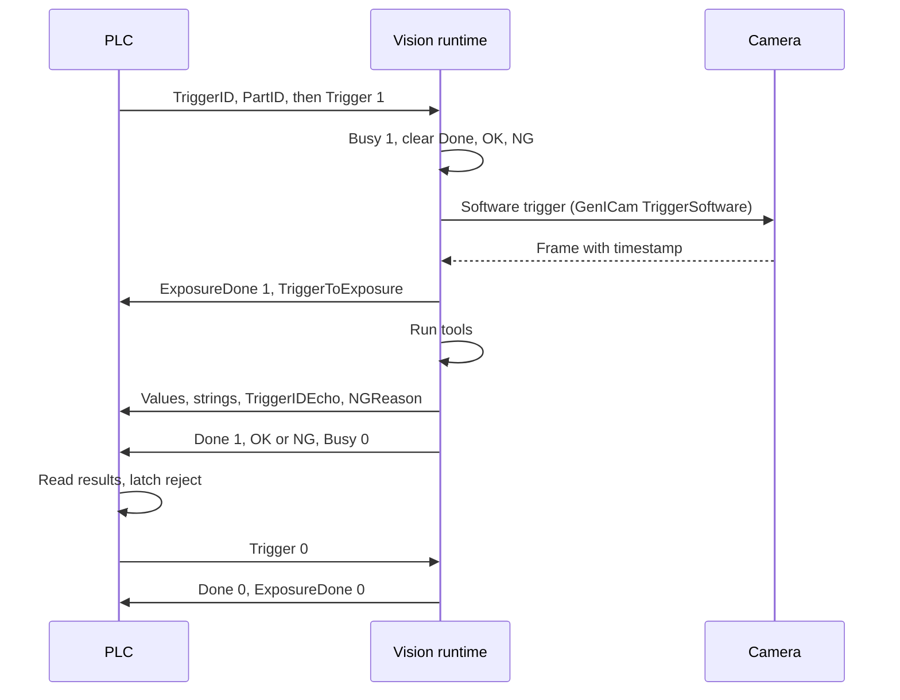
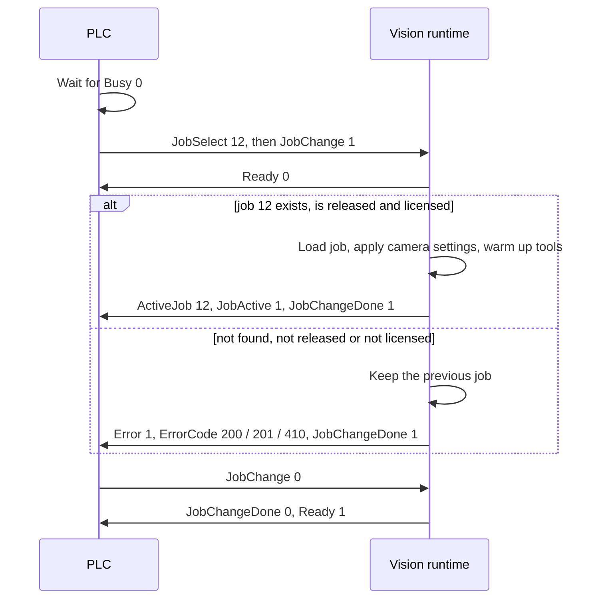
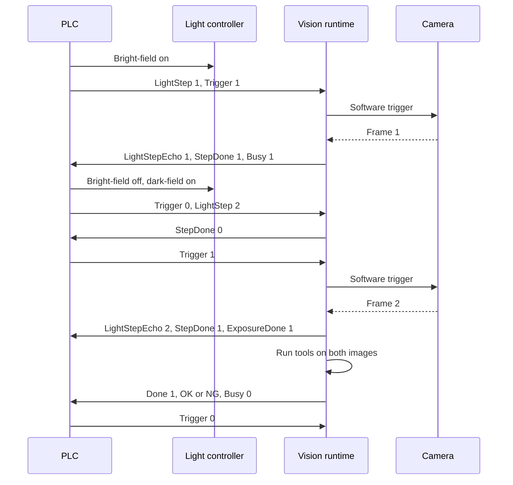
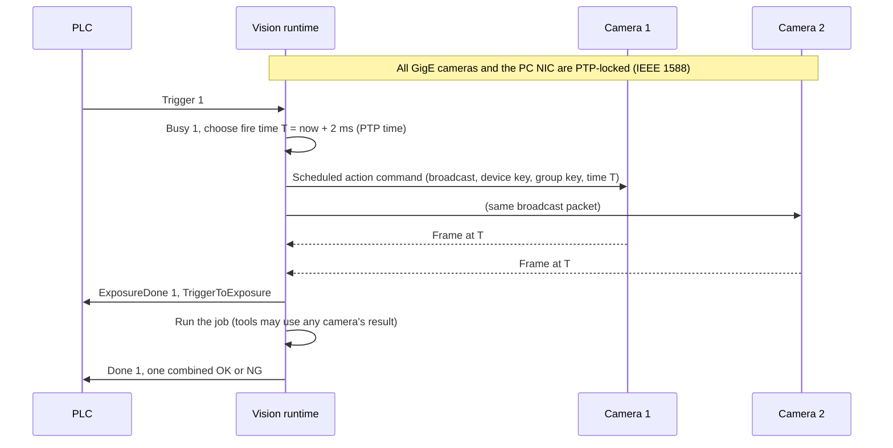
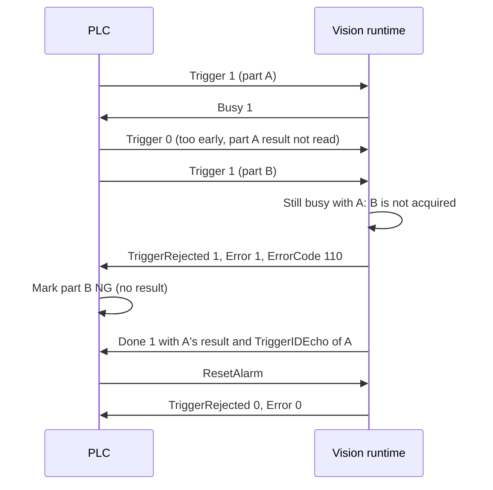
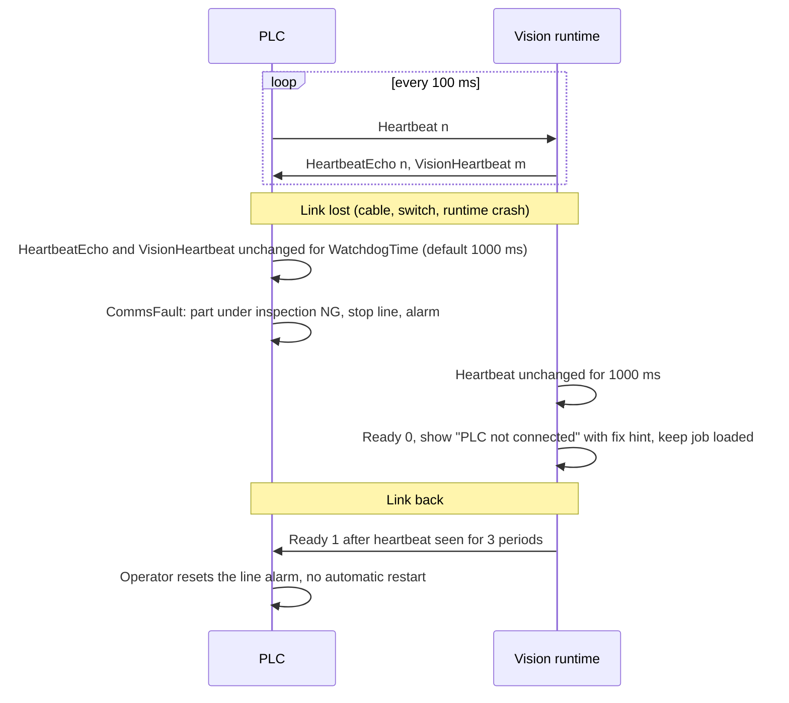

# PLC interface

This document specifies how VisionStudio talks to the machine. The PLC is the only machine
interface: it triggers inspections, selects jobs, switches lights, and receives OK/NG, values and
strings. No digital I/O, serial line or M8/M12 cable is used on the PC or the camera. Cameras are
fired by a software trigger when the PLC asks, and several cameras are synchronised with GigE
Vision action commands and PTP. This implements
[section 12 of the requirements](../REQUIREMENTS-VISION-SYSTEM.md#12-communication-data-and-security)
and the trigger rules in [section 8](../REQUIREMENTS-VISION-SYSTEM.md#8-jobs-and-cameras). Where
the PLC layer sits in the runtime is in [ARCHITECTURE.md](ARCHITECTURE.md); the mapping screen is
in [UI-UX-SPEC.md](UI-UX-SPEC.md); tests are in [TEST-ACCEPTANCE-PLAN.md](TEST-ACCEPTANCE-PLAN.md)
(`PLC-*`).

## 1. Principles

- **One handshake for every protocol.** The same two fixed-size data blocks (64 bytes in, 256
  bytes out) and the same rules are used whatever the PLC brand. Only the transport changes. A
  PLC engineer who has done it once on Siemens knows it on Rockwell.
- **The part is NG unless the vision system says OK in time.** A missing result, a comms loss,
  an error or a rejected trigger all mean NG for that part. The PLC function blocks enforce this.
- **The PLC owns the machine.** It decides when to trigger, which light is on, when to reject
  and when to stop the line. The vision system never drives machine outputs directly.
- **Nothing silent.** Every refused trigger, failed job change and comms problem sets `Error` with
  a code (section 9) and shows a plain-words message on the Run screen.
- **Encoder compensation lives in the PLC.** The vision system reports when the exposure
  happened relative to the trigger; the PLC turns that into a position.

## 2. Supported protocols

| Protocol | Licence | Vision system role | Data area | Update model | Device description delivered | Library (see requirements section 14) |
| --- | --- | --- | --- | --- | --- | --- |
| PROFINET IO | Base | IO device | Input module 64 bytes, output module 256 bytes (split into 4 × 64-byte submodules if the controller needs it) | Cyclic, 1–8 ms send clock | GSDML file | Commercial PROFINET device stack (open question) |
| EtherNet/IP | Base | Adapter (target) | Assembly 100 (O→T, 64 bytes), assembly 101 (T→O, 256 bytes) | Cyclic class 1 I/O, RPI 2–20 ms | EDS file | Own adapter on an open CIP stack (OpENer, BSD licence); libplctag is a scanner library and is not used for the adapter |
| Modbus TCP | Base | Server | Holding registers 0–31 (in), 100–227 (out); optional blocks of sections 3.3–3.7 | PLC polls; typical 10–20 ms | Register map PDF | libmodbus (LGPL, dynamic link) |
| Siemens S7 (PUT/GET) | Base | Client | Two DBs on the PLC (`VS_IN` 64 bytes, `VS_OUT` 256 bytes) | Vision polls `VS_IN`, writes `VS_OUT`; poll 5 ms default | DB sources for TIA Portal | Snap7 (LGPL) |
| Mitsubishi MC protocol (3E/4E binary) | Base | Client | D registers, configurable start (default D1000 in, D1100 out) | Vision polls; 5 ms default | GX Works3 label file | Own implementation |
| Omron FINS/TCP | Base | Client | DM area, configurable start (default D1000 in, D1100 out) | Vision polls; 5 ms default | Sysmac Studio data type | Own implementation |
| TCP/IP (plain) | Base | Server (client optional) | Same blocks as binary frames, or a line-based ASCII command set | Event driven | Protocol PDF | Own |
| OPC UA | Multi-Camera & Enterprise | Server | Same blocks as variables, plus results as typed nodes and methods (`Trigger`, `ChangeJob`) | Subscriptions, 10 ms min sampling | Information model (NodeSet2 XML) | open62541 (MPL 2.0) |
| MQTT | Multi-Camera & Enterprise | Client to a broker | Results published as JSON per inspection; no triggering | Event driven | Topic and payload spec | Eclipse Paho C (EPL/EDL) |
| SQL / MES | Multi-Camera & Enterprise | Client | Result rows to a customer table or stored procedure | Per inspection, buffered | Table template | ODBC |

Notes:

- MQTT and SQL/MES are data outputs only. They never trigger or change jobs.
- For the client protocols (S7, MC, FINS) the vision system polls the PLC, so the poll period
  adds to the trigger latency (section 6). For PROFINET and EtherNet/IP the PLC's cyclic update
  sets it.
- PROFINET device certification by PI is needed before selling PROFINET (open question).
- The TCP/IP ASCII set (`TRG`, `JOB 12`, `STATUS`) exists for test benches and simple PLCs;
  the binary block mode is the recommended one.
- The Modbus TCP server listens on every network card of the line PC unless `BindAddress` in
  `data/plc.json` names the address of the card on the PLC network (for example `192.168.10.5`);
  then the office network cannot reach it. An address that is not an IP address stops the PLC
  link with a message on the PLC page.

### 2.1 Modbus TCP server on a shared network

The PLC network also carries HMIs, scanners, service laptops and port scans. The Modbus TCP
server must keep serving the PLC whatever they send, and nothing they send may write a block.

- **Bad requests** get a Modbus exception and the connection stays open: an unknown function
  code (exception 1), a start address outside the blocks, a range across two blocks or a write
  to a block only the vision system writes (output, camera results, line settings: exception 2),
  a register count out of range, or a PDU whose length is not exactly what its function needs,
  such as a write one byte short or long or a byte count that disagrees with the register count
  (exception 3). Nothing is written.
- **Frames that are not Modbus TCP** close that connection, unanswered: a protocol identifier
  other than 0, or an MBAP length below 2 or above 254 (an HTTP request, a TLS hello, a stream
  out of step). Other connections are not touched.
- **Limits** (`ModbusServerOptions`, defaults for a PLC polling every 10–20 ms):

  | Limit | Default | What happens |
  | --- | --- | --- |
  | Connections | 8 | A new connection is always let in; the connection idle longest is closed, one that never wrote first. A PLC reconnecting after a cable pull gets in, and a flood of scans never pushes it out. |
  | Idle time | 60 s | A connection that sends no frame for this long is closed (one that connects and never sends). |
  | Frame time | 2 s | A frame once started must arrive in full, and its reply be taken, within this time (a partial frame, a slow sender, a client that never reads its replies). |

- Only a connection that wrote to the vision blocks counts as the PLC: it makes the link show
  connected, and its end is a link loss (section 5.6). An HMI or a scan that only reads, or whose
  writes were refused, does neither. A PLC connection closed by these limits is a link loss like
  any other.

## 3. Data blocks

The input block (PLC → vision, 64 bytes) and output block (vision → PLC, 256 bytes) have fixed
offsets. Offsets are in bytes from the start of the block. Bit `n.b` is bit `b` of byte `n`.

Byte order:

| Protocol | Multi-byte values (UINT16, UINT32, REAL, DINT) |
| --- | --- |
| PROFINET, S7 | Big-endian, as the PLC stores them |
| EtherNet/IP | Little-endian |
| Modbus TCP | Each register big-endian; 32-bit values low word first by default, switchable |
| MC, FINS | PLC native word order (little-endian words) |

Bits are always addressed as byte and bit (`0.3` = byte 0, bit 3), never as bits of a word, so
byte order does not move them. On word-addressed PLCs (Modbus, MC, FINS) byte 0 is the low byte
of the first word. The function blocks (section 8) hide all of this, so PLC programs use named
tags only. The vision side sets byte and word order per connection, with defaults per protocol.

### 3.1 PLC → Vision (input block, 64 bytes)

| Offset | Type | Name | Meaning |
| --- | --- | --- | --- |
| 0.0 | BOOL | `Trigger` | Rising edge starts an inspection (handshake mode). Hold until `Done` (section 4.1) |
| 0.1 | BOOL | `JobChange` | Rising edge loads the job in `JobSelect` |
| 0.2 | BOOL | `ResetAlarm` | Rising edge clears `Error` and `TriggerRejected` if the cause is gone |
| 0.3 | BOOL | `RunEnable` | 1 = machine in automatic; the vision system accepts triggers. 0 = triggers refused with code 111 |
| 0.4 | BOOL | `ResultAck` | Counter mode only: PLC has read the result for `TriggerID` (section 4.2) |
| 0.5 | BOOL | `SaveImage` | 1 with a trigger = save this part's images whatever the job's saving rule |
| 0.6 | BOOL | `StepAbort` | Abandon a multi-light sequence in progress (part is NG) |
| 0.7–1.7 | – | reserved | Write 0 |
| 2 | UINT16 | `Heartbeat` | PLC increments every 100 ms (any change counts). See section 5.6 |
| 4 | UINT16 | `JobSelect` | Job number 1–999 to load on `JobChange` |
| 6 | UINT16 | `LightStep` | 0 = single image. 1..8 = step of a multi-light sequence (section 5.3) |
| 8 | UINT16 | `TriggerID` | Counter mode: a new value is a new trigger. Handshake mode: any value, echoed back |
| 10 | UINT16 | `CameraMask` | Bit n = camera n+1 of the job. 0 = all cameras of the job |
| 12 | UINT32 | `ProductID` | Product variant or recipe within the job; 0 = the job's default |
| 16 | STRING[30] | `PartID` | Part serial or tracking ID from the PLC, stored with the result. S7 string layout: byte 16 max length (30), byte 17 actual length, bytes 18–47 ASCII |
| 48 | 4 × DINT | `UserIn1..4` | Free values the job can use (for example expected count, encoder count at trigger, a Check text line's expected number, section 3.7) |

### 3.2 Vision → PLC (output block, 256 bytes)

| Offset | Type | Name | Meaning |
| --- | --- | --- | --- |
| 0.0 | BOOL | `Ready` | Job loaded, Run mode, cameras OK, `RunEnable` seen: a trigger will be accepted |
| 0.1 | BOOL | `Busy` | A trigger was accepted and the inspection is not finished |
| 0.2 | BOOL | `Done` | Result valid for the last accepted trigger. Values and strings are already written |
| 0.3 | BOOL | `OK` | With `Done`: part passed |
| 0.4 | BOOL | `NG` | With `Done`: part failed, or could not be inspected. Exactly one of `OK` and `NG` is 1 when `Done` is 1 |
| 0.5 | BOOL | `Error` | A fault needs attention; `ErrorCode` says which. Cleared by `ResetAlarm` when the cause is gone |
| 0.6 | BOOL | `JobActive` | A job is loaded and the line runs it in PLC mode (0 while the line is stopped or runs free or from stored images, the job still loaded). `ActiveJob` holds its number |
| 0.7 | BOOL | `JobChangeDone` | Job change finished (successfully or not; check `Error`) |
| 1.0 | BOOL | `ExposureDone` | All images of this trigger (or this light step) are captured. The part may move |
| 1.1 | BOOL | `StepDone` | Multi-light: the image for `LightStepEcho` is captured; switch to the next light |
| 1.2 | BOOL | `TriggerRejected` | The last trigger was not accepted (overrun, not ready). Treat that part as NG |
| 1.3 | BOOL | `Warning` | Something needs a look soon (drift, disk nearly full, licence expiring). `WarningCode` says which. Never stops inspection |
| 1.4 | BOOL | `Simulation` | Images come from files, not cameras. The PLC must not run production with this set |
| 1.5–1.7 | – | reserved | 0 |
| 2 | UINT16 | `HeartbeatEcho` | Copy of the last `Heartbeat` received |
| 4 | UINT16 | `VisionHeartbeat` | Incremented by the vision runtime every 100 ms |
| 6 | UINT16 | `ErrorCode` | Section 9. 0 = none |
| 8 | UINT16 | `ActiveJob` | Number of the loaded job; 0 = none |
| 10 | UINT16 | `TriggerIDEcho` | `TriggerID` of the trigger these results belong to |
| 12 | UINT16 | `LightStepEcho` | Step whose image was last captured |
| 14 | UINT16 | `NGReason` | Number of the first failing tool in the job (1-based); 0 = none or OK |
| 16 | UINT32 | `InspectionCount` | Inspections since the runtime started |
| 20 | REAL | `CycleTime` | Trigger received to `Done`, ms |
| 24 | UINT32 | `TriggerToExposure` | Trigger received to exposure start (camera timestamp), µs. For encoder compensation |
| 28 | DWORD | `ToolPass` | Bit n = tool n+1 passed (first 32 tools in job order) |
| 32 | UINT16 | `LayoutVersion` | 1 for this layout. The function block checks it |
| 34 | UINT16 | `WarningCode` | Section 9. 0 = none |
| 36 | UINT32 | reserved | 0 |
| 40 | 20 × REAL | `Value1..20` | Result values chosen on the mapping screen (sizes in mm, angles, counts, scores) |
| 120 | STRING[66] | `Text1` | First mapped string (for example the decoded code). S7 string layout: max length byte, actual length byte, 66 ASCII/UTF-8 bytes |
| 188 | STRING[66] | `Text2` | Second mapped string (for example the OCR line) |

Strings longer than 66 bytes are cut and `WarningCode` 610 is set; longer texts go through OPC
UA, the Remote API or the results database. Values that are not available for this part (tool
did not run because an earlier tool failed) are written as NaN for REAL, and the mapping screen
can set a substitute value instead.

Consistency: the runtime writes values, strings, `TriggerIDEcho` and `NGReason` first and the
status bits last. On cyclic protocols (PROFINET, EtherNet/IP) all are in the same frame. On
polled protocols (S7, MC, FINS, Modbus) the runtime does two writes, data then status word, so
the PLC never sees `Done` with old data.

### 3.3 PLC → Vision (line diagnostics, 112 bytes)

Optional. Modbus holding registers 40–95 (other protocols: a third data area). The PLC counts what
each instrument does; Vision Studio shows each one as OK, misses sometimes, fault or not fitted
(Line & wiring page). Counters run from PLC power-up. Multi-byte values: low word first.

| Offset | Type | Name | Meaning |
| --- | --- | --- | --- |
| 0 | UINT16 | `LayoutVersion` | 3 |
| 2 | UINT16 | `PlcModel` | 1 AS228T-A, 2 AS332T-A, 3 AS218TX-A, 11 DVP12SE11T + DVP16SP11T |
| 4 | WORD | `Inputs` | Input terminals (AS: X0.0–X0.15; DVP slim: X0–X7 bits 0–7, X20–X27 bits 8–15) |
| 6 | WORD | `Outputs` | Output terminals, same numbering |
| 8 | WORD | `LineState` | bit 0 running, 1 jam, 2 bin full, 3 air low, 4 E-stop, 5 line stop, 6 reject fail, 7 tracking mismatch, 8 encoder fault, 9 trigger sensor stuck, 10 vision lost, 11 vision not ready, 12 drive fault, 13 drive not answering, 14 learning, 15 restarting after a jam |
| 10 | UINT16 | `PartsPerMinute` | Last full minute |
| 12 | DINT | `EncoderCount` | |
| 16–56 | 11 × UDINT | counters | trigger sensor, triggers sent, results, triggers missed, result time-outs, rejects commanded, rejects confirmed, rejects not confirmed, reject sensor, tracking mismatches, jams |
| 60 / 62 | UINT16 | `PulsesPerPartMin / Max` | Encoder pulses between parts this minute |
| 64 | UINT16 | `TriggerSensorOnMsMax` | Longest trigger sensor on time |
| 66 | UINT16 | `ConsecutiveNg` | |
| 68 | UDINT | `EncoderFaults` | Stops without pulses while running |
| 72 | UDINT | `VisionLossCount` | Vision heartbeat losses seen by the PLC |
| 76 | DINT | `LearnedDistance` | Encoder pulses camera 1 trigger sensor → reject sensor, learned on the first part |
| 80 / 84 | UDINT | `Camera2Sensor / Camera3Sensor` | Parts counted by the trigger sensors of cameras 2 and 3 (camera 1: offset 16) |
| 88 | UDINT | `NotInspected` | Parts rejected because a camera was not ready or did not answer |
| 92 | WORD | `BypassEcho` | The bypass bits the PLC is working with (section 3.4) |
| 94 | UINT16 | `CameraCountEcho` | The camera count the PLC is working with |
| 96 | DINT | `ProductLength` | Nominal product length in use, pulses (entered or learned) |
| 100 / 104 / 108 | UDINT | `TouchingGroups / LengthOut / SmallGaps` | Counters of section 3.6 cases |

### 3.4 Vision → PLC (line settings, 64 bytes)

Optional. Modbus holding registers 300–331, read-only for the PLC. Edited on the Line & wiring page;
the PLC takes them over when `Version` changes. Times in ms.

| Offset | Type | Name |
| --- | --- | --- |
| 0 | UINT16 | `LayoutVersion` (1) |
| 2 | UINT16 | `ConveyorHz` × 100 |
| 4 / 6 / 8 | UINT16 | `LightDelay`, `LightOn` (0 = on while running), `CameraDelay` |
| 10 | UINT16 | `RejectMode` 0 encoder distance, 1 reject sensor + delay |
| 12 | DINT | `RejectDistance` (pulses, manual value) |
| 16 | INT16 | `RejectOffset` (pulses, reject sensor → firing point) |
| 18 / 20 / 22 | UINT16 | `RejectDelay`, `RejectOn`, `VerifyWindow` |
| 24 / 26 | UINT16 | `JamTime`, `ResumeDelay` |
| 28 | UINT16 | `LearnMode` 1 = learn on the first part of every auto start |
| 30 / 32 | UINT16 | `MaxConsecutiveNg`, `StopOnRejectFail` |
| 34 | UINT16 | `RelearnNow` (one shot with a new version) |
| 36 | UINT16 | `Version` |
| 38 | WORD | `Bypass`: instruments this installation does not have; the PLC ignores them. bit 0 reject verification sensor, 1 jam sensor, 2 bin full sensor, 3 air pressure switch, 4 reject position sensor (fixed encoder distance, no learning, no tracking check), 5 E-stop status not wired, 6 no start / stop push buttons, 7 no line running / auto input |
| 40 | UINT16 | `CameraCount` 1–3 (section 3.5) |
| 44 | UDINT | `PulsesPerMetre`: encoder scale (0 = not calibrated; lengths in pulses only) |
| 48 | UINT16 | `ProductLengthMm`: nominal length along the conveyor (0 = learn: shortest of the first 5 products after every start) |
| 50 | UINT16 | `LengthTolerancePct` |
| 52 | UINT16 | `MinGapMm` (0 = off) |
| 54 | WORD | bit 0 reject touching products, bit 1 reject products out of length tolerance, bit 2 drive fault / overload input is NC (on = healthy) |
| 56 | UINT16 | `DriveType`: 0 VFD over RS-485, 1 VFD run by a PLC output (FWD), 2 direct-on-line contactor, 3 star-delta |
| 58 / 60 | UINT16 | `StarDeltaMs` (time in star), `ChangeoverMs` (star off → delta on) |
| 42 / 43 | BYTE | `Camera2Sensor`, `Camera3Sensor`: the trigger sensor (1–3) that fires camera 2 / 3. Its own number = its own sensor at its own place; a lower number = same place as that camera (e.g. front and back of the pack), triggered together with the same part number |

Bypasses are set only by a QA user (Line & wiring page). A bypassed instrument shows as
**bypassed** instead of being judged.

### 3.5 Camera channels (cameras at different places, one rejector)

When the cameras stand at different places along the conveyor, each one is fired when the part
reaches it, and its result belongs to that part. Cameras at the same place (for example two cameras
reading the front and back of the pack) share one trigger sensor: both channels are triggered in the
same scan with the same part number and the vision PC inspects them in parallel, so the reading time
is that of one camera. Which layout is used is a line setting (section 3.4, offsets 40–43). The PLC numbers every part at the camera 1
trigger sensor, keeps it in a queue with its encoder position, and gives each camera a pointer to
the next part it expects. Each camera's trigger sensor edge belongs to that camera's next part. The
single rejector fires when **any** camera said NOT OK or did not answer for the part.

PLC → vision, 16 bytes, Modbus holding registers 32–39:

| Offset | Type | Name |
| --- | --- | --- |
| 0 | WORD | bit *c* = `Trigger` of camera *c* (0 = camera 1) |
| 2 / 4 / 6 | UINT16 | `TriggerId` of camera 1 / 2 / 3 (the part number) |

Vision → PLC, 32 bytes, Modbus holding registers 228–243, 8 bytes per camera at 8 × *c*:

| Offset | Type | Name |
| --- | --- | --- |
| 0 | BYTE | bit 0 `Ready`, 1 `Busy`, 2 `Done`, 3 `Ok`, 4 `Ng`, 5 `TriggerRejected` |
| 2 | UINT16 | `TriggerIdEcho` |
| 4 | UINT16 | `NgReason` (number of the first failing tool) |
| 6 | UINT16 | `CycleMs` |

Each channel follows the four-phase handshake of section 4.1 on its own: the PLC sets `Trigger`
with the part number, the vision PC inspects that camera only with the active job's tools for it,
then sets `Done` with `Ok` or `Ng` and the echo; the PLC drops `Trigger`, the vision PC drops
`Done`. A trigger while that camera is busy is answered with `TriggerRejected`. Cameras never wait
for each other.

The PLC takes a channel's result for a part only when `Done` is set with that part's number in
`TriggerIdEcho`; the part is OK only with `Ok` set and `Ng` clear. `TriggerRejected`, or no such
answer within the result timeout (1 s in the Delta programs), makes the part NG at once ("not
inspected"); the channel takes its next part only after the vision PC dropped `Done` and
`TriggerRejected`. Each part the rejector fires for must then be seen by the reject verification
sensor within the verification window, one sensor edge per reject (Req 17.10 MRG-05).

### 3.6 PLC → Vision (part log, 96 bytes)

Optional. Modbus holding registers 400–447. Every product leaving the queue (at the firing point or
the reject sensor) is written by the PLC into the next of 8 records (ring), so the vision PC sees
every product even at 10 a second. The PLC writes the record first and its sequence number last.

| Offset in record (12 bytes) | Type | Name |
| --- | --- | --- |
| 0 | UINT16 | `Seq`: 1–65535, +1 per record (0 = empty) |
| 2 | UINT16 | `PartId` (the number given at the camera 1 sensor) |
| 4 | WORD | `Flags`: bit 0 rejected, 1 a camera NOT OK, 2 a camera did not answer, 3 passed a camera sensor unseen, 4 touching products, 5 length out of tolerance, 6 gap below the minimum (reported, not rejected), 7 first part after a start (learning) |
| 6 | UINT16 | `Length`, encoder pulses (max 65535) |
| 8 | UINT16 | `Gap` to the product before, pulses |
| 10 | WORD | bits 0–2 camera answered, 4–6 camera OK, 8–11 group size, 12–15 index in the group |

**Length, gap and touching products.** The PLC measures the encoder pulses while the camera 1 sensor
is on (length) and since it last went off (gap). A signal of about *n* ≥ 2 nominal lengths (beyond the
tolerance) means *n* products came touching: the first was inspected, the other *n* − 1 are put in
the queue behind it at equal spacing, marked touching and not inspected, and rejected (the first
too, when "reject touching" is on). The rejector valve stays on while products to reject follow
each other. Vision Studio converts pulses to mm with `PulsesPerMetre` and keeps every record in its
results log for the reports.

Wiring, programs and set-up for Delta PLCs: [PLC-DELTA-DVP.md](PLC-DELTA-DVP.md).

### 3.7 PLC → Vision (text block, 256 bytes)

Optional. Modbus holding registers 500–627. For expected texts a Check text line takes from the PLC
that are longer than `PartID` (a batch line, a serial with its dates). A line can also take
`PartID`, `ProductID` or one of `UserIn1..4` (printed as a decimal number; 0 = no value).

| Register | Type | Name |
| --- | --- | --- |
| 500 | UINT16 | `TextTriggerId`: the `TriggerID` of the trigger the strings belong to |
| 501–627 | bytes | The strings, two characters per register, wherever the job places them |

Each Check text line that takes `Text` from the PLC names in the job where its string lies:

| Setting | Values |
| --- | --- |
| `Register` | First register, 501–627 |
| `Length` | Most characters, 1–254 (1–252 for an S7 string) |
| `Encoding` | `Ascii`: one character per byte; a NUL ends it, trailing spaces are padding. `S7String`: byte max length, byte actual length, then the characters (as `PartID`) |
| `ByteOrder` | `HighFirst` (default: Siemens, Delta, most Modbus string moves) or `LowFirst`: which byte of a register holds the first of its two characters |

Handshake, in addition to section 4.1:

1. The PLC writes the strings, then `TextTriggerId` = the new `TriggerID`, then `TriggerID` and
   `Trigger = 1`. The vision PC takes the text block, with `UserIn1..4`, in the scan that sees the
   trigger; later writes do not change that part's check.
2. The strings are this part's only when `TextTriggerId` equals the trigger's `TriggerID`, the
   `TriggerID` is not 0, and that `TriggerID` was not taken before by the same trigger (the main
   trigger or a camera channel of section 3.5, which uses its own `TriggerId`). So with the text
   block every part needs a new `TriggerID`, also in handshake mode.
3. Line safety: a string that is stale (rule 2 not met), empty, longer than its S7 header allows,
   holds a byte that is not printable ASCII (0x20–0x7E), or lies outside the block makes that Check
   text line NOT OK (`explain.ocv.no_expected`, with the reason). The part is NG and the PLC gets
   `Ng` with the tool's `NgReason`, as for a missing `PartID`. Nothing is guessed.

Setup refuses a `Text` line without a place, or a place outside registers 501–627. Triggers from the
Remote API carry no text block, so such lines fail there.

## 4. Handshake modes

### 4.1 Handshake mode (default)

Four-phase level handshake. Simple and safe; one part at a time.

1. PLC waits for `Ready = 1` and `Busy = 0`, sets `TriggerID`, `PartID`, then `Trigger = 1`.
2. Vision sees the rising edge, sets `Busy = 1`, clears `Done`, `OK`, `NG`.
3. Vision sets `ExposureDone = 1` when all images are captured.
4. Vision writes results, then `Done = 1` with `OK` or `NG`, and `Busy = 0`.
5. PLC reads the results and sets `Trigger = 0`.
6. Vision sees `Trigger = 0` and clears `Done` and `ExposureDone`. Next trigger allowed.

Cost: two extra PLC cycles per part for steps 5 and 6. At a 4 ms cycle that limits the rate to
roughly one part every (inspection time + 3 cycles).

### 4.2 Counter mode (high speed)

For lines where the next part arrives before the PLC could finish the four-phase handshake.

- Each new `TriggerID` value is a trigger (no `Trigger` bit needed; `Trigger` must stay 0).
- The vision system queues up to 4 triggers per camera group. A fifth is rejected with code 110.
- Each result is published with its `TriggerIDEcho` and `Done` pulses for at least two PLC
  cycles (configurable). The PLC matches results to parts by ID, usually through a shift
  register.
- `ResultAck` with the same `TriggerID` lets the runtime publish the next queued result
  immediately instead of waiting the pulse time.
- A trigger ID with no result within the job's timeout (default 2 × the cycle-time target) is
  NG at the PLC.

## 5. Timing

### 5.1 Normal trigger cycle (handshake mode)

```
            ___________________________
Trigger  __|                           |_______________
              ___________________
Busy     ____|                   |_____________________
                     _______________________
ExposureDone _______|                       |__________
                                 ___________
Done     _______________________|           |__________
                                 ___________
OK / NG  _______________________|           |__________   (exactly one)
           ^  ^      ^           ^         ^ ^
           t0 t1     t2          t3        t4 t5

t0 PLC sets Trigger          t1 vision accepts, Busy (latency budget, section 6)
t2 exposure finished          t3 results written, Done + OK/NG, Busy off
t4 PLC drops Trigger         t5 vision drops Done, ExposureDone
```



### 5.2 Job change



- `JobChange` while `Busy = 1` is refused with code 203; the PLC must wait.
- A job change takes up to a few seconds for large AI models (target: ≤ 2 s for classical jobs,
  ≤ 10 s with AI models, to be measured in P1). The PLC holds the line or changes during a gap.
- A `ProductID` change within the same job needs no job change: it is read with every trigger.

### 5.3 Multi-light sequence

The job defines N light steps (for example bright-field then dark-field). The PLC switches the
light (directly or through an Ethernet light controller) between steps. Tools run after the last
step and may use any step's image.



- Steps must arrive in order 1..N. An out-of-order step is refused with code 113 and the part is
  NG. `StepAbort` drops a partial sequence.
- The light settle time is the PLC's responsibility (typical 0.1–1 ms for LED controllers). The
  function block has a `LightSettle` parameter.

### 5.4 Multi-camera synchronisation

One PLC trigger fires every camera in `CameraMask` (or the whole job).



- Scheduled action commands make the exposure start the same on every camera (target skew
  ≤ 10 µs with PTP lock, to be measured in P1). The 2 ms lead covers the network and the
  camera's command handling; it is configurable and measured by the built-in benchmark.
- Cameras without action-command or PTP support (most USB3 cameras): the runtime fires software
  triggers in turn, as fast as possible. The skew is measured and shown in the job's camera
  settings; if it exceeds the job's limit, the job cannot be released as "synchronised".
- If a PTP-locked camera loses lock, the runtime falls back to unscheduled action commands and
  sets `WarningCode` 620.
- Sequential job types (cameras at different stations) use one trigger per station with the
  same `PartID` or a shift register in the PLC; results are linked by `PartID`.

### 5.5 Trigger overrun



- A trigger is never queued silently in handshake mode. In counter mode the queue holds 4 and
  the fifth is rejected the same way.
- `Trigger` dropping before `Done` in handshake mode is allowed (the inspection completes and
  the result is published) but counted as a handshake violation in the diagnostics page.
- The Run screen shows "Parts arrive faster than the camera can check them" with the measured
  rate and the job's cycle time.

### 5.6 Comms loss and watchdog

Two-way heartbeat. Each side increments its counter every 100 ms and watches the other's.



- The PLC checks both `HeartbeatEcho` (the path PLC → vision → PLC) and `VisionHeartbeat` (the
  runtime is alive, not only the network stack). The function block raises `CommsFault` if
  either stops changing for `WatchdogTime`.
- `WatchdogTime` must be at least 5 × the heartbeat period plus the protocol update time. Range
  200–5000 ms.
- After a runtime crash the service restarts and reloads the last job (target ≤ 10 s,
  requirements section 13). The first output after restart has `ErrorCode` 502 so the PLC can
  log it.
- The runtime never sets `OK` for a part whose trigger arrived before the link loss and whose
  result could not be delivered. That part is NG at the PLC by the rule above.
  The runtime writes such a part as NG, with `NgReason` and `ErrorCode` 100. That covers the main
  trigger and the camera channels, and a connection that dropped only briefly: a heartbeat loss since
  the trigger (even if the heartbeat has come back since), or the end of a connection that wrote to
  the vision blocks (the PLC). A connection that only reads, such as an HMI or a Modbus poll tool,
  does not count.
  A loss noticed after the result was written (a pulled cable shows only when the watchdog runs
  out) turns a latched OK into NG 100 while the PLC still holds its trigger.
  Error 100 after a dropped connection stays until the PLC resets the alarm; after a heartbeat loss
  it clears when the heartbeat is back.
- A trigger refused during a comms loss (110 or 111) keeps `ErrorCode` 100: the first cause is
  what the PLC logs.
- The line PC records a part with the verdict the PLC got, not the inspection's. The PLC runtime
  hands each part to the station:
  - when the PLC drops its trigger after `Done` (it took the result);
  - when the result comes after the PLC already dropped its trigger (its result timeout, section 7
    state 10: the PLC made the part NG), recorded NG as reason `plc_not_taken`;
  - at a link or heartbeat loss, or when the runtime closes (also for a part still being
    inspected): a held OK is recorded NG 100, even if the PLC took it a moment before the loss
    was seen. When in doubt, NG.

  A part inspected OK that the PLC got as NG 100 is counted NG and logged with failing tool
  "PLC link" in `results.db`, as reason `plc_link_lost` in the runtime's results and counters,
  and to the plant server as NG ("PLC", "link_lost"), with the part id the PLC sent and the job
  and batch it was inspected with (requirements section 12). Its images are kept as NG images
  (reason `plc_link_lost`, `plc_not_taken`, or `plc_ng` for any other NG the PLC got) like any NG part's, and the plant server's result
  carries their image id: until the PLC's verdict is known the station holds a copy of each OK
  camera image it did not keep (camera frame buffers are reused for the next frames). The
  station counts parts in order, off the PLC thread, so the handshake never waits on the log.

## 6. Latency and jitter budget

The requirements accept that a software trigger over the PLC has more latency and jitter than a
hardware trigger, and require it to be measured in P1. All figures here are **targets** until P1
measures them.

| Segment | PROFINET / EtherNet/IP target | S7 / MC / FINS (polled) target | Notes |
| --- | --- | --- | --- |
| PLC task: sensor edge to `Trigger` set | 1 cycle (1–4 ms) | 1 cycle | Use a fast cyclic task or a hardware interrupt OB for the sensor |
| Network to the vision PC | ≤ 1 send clock or RPI (1–4 ms) | Poll period, 5 ms default (2 ms minimum) | Dedicated NIC for the PLC; no camera traffic on it |
| Runtime: edge seen to camera command sent | ≤ 0.5 ms | ≤ 0.5 ms | PLC thread at high priority, no allocation on the path |
| Software trigger to exposure start | ≤ 0.2 ms (camera dependent) | same | Measured per camera model |
| **Total trigger latency** | **≤ 6 ms typical, ≤ 10 ms max** | **≤ 10 ms typical, ≤ 15 ms max** | Targets |
| **Jitter (max − min over 10,000 triggers)** | **≤ 4 ms** | **≤ 6 ms** | Targets; dominated by the update cycle |

What jitter means on the line: at 1 m/s belt speed, 4 ms jitter is 4 mm of position variation.
The job's locator absorbs it within the field of view; the reject position is corrected by the
PLC encoder (below).

### 6.1 How it is measured in P1

- **Timestamp method.** The PLC writes its system time (or a free-running µs counter) into
  `UserIn1` when it sets `Trigger`. The runtime logs the receive time and the camera's exposure
  timestamp (PTP-synchronised to the PC). With the PLC also PTP-synced (or with the offset
  measured), the segments in the table are measured for every trigger.
- **Optical method** (independent check). A PLC fast output drives an LED bar with a 1 kHz
  binary counter placed in the camera's field of view, started at the same instruction that sets
  `Trigger`. The image shows the elapsed milliseconds directly. This is a test fixture on the
  PLC side only; the production system still has no wiring on the camera.
- **Volume.** 10,000 triggers per protocol and PLC brand, at 50% and 90% CPU load on the PC,
  with and without image saving. Report median, 99th percentile and maximum.
- The built-in benchmark shows the live latency histogram so integrators can check a machine on
  site. See [TEST-ACCEPTANCE-PLAN.md](TEST-ACCEPTANCE-PLAN.md) `PLC-LAT-*`.

### 6.2 Encoder compensation (in the PLC)

1. The PLC latches its encoder count `E0` in the same task that sets `Trigger` (and may send it
   in `UserIn2` for the record).
2. The vision system returns `TriggerToExposure` (µs) and, if the job measures part position,
   the offset of the part in the image along the conveyor (a mapped value, mm).
3. The PLC computes the part position at exposure: `E_exp = E0 + speed × TriggerToExposure`,
   and adds the measured image offset. The reject gate is timed from that position.
4. For variable-speed lines the PLC uses encoder counts directly: it records the encoder at the
   `ExposureDone` edge as a cross-check (this edge is later than the exposure by the readout and
   update time, so it is only a sanity check).

## 7. Mapping screen

The mapping screen ([UI-UX-SPEC.md](UI-UX-SPEC.md), "Communication") decides what goes into the
`Value1..20`, `Text1..2` and `UserIn1..4` slots and the protocol settings. Required behaviour:

- Lists the job's outputs (tool results, pass/fail, counts, decoded strings) by their
  operator-facing names and lets the engineer drag one onto a slot. The fixed handshake signals
  are shown but cannot be moved.
- Shows the slot's protocol address next to it (`DB201.DBD40`, `Assembly 101 byte 40`,
  `HR 120`, `D1120`), computed from the connection settings, so the PLC engineer can copy it.
- Shows live values for both blocks while connected, with changes highlighted for 1 s.
- **Test signal** button per output: forces the value or bit for 2 s (engineer role only, only
  in Teach mode, never while `RunEnable = 1`), so the PLC side can be checked without parts.
  The OK test signal never replaces a latched NG (a part's or a test's) that the PLC has not
  taken. The runtime enforces this, not the screen: the `PlcTestSignal` call of the runtime
  contract is refused for any role but Engineer or Admin in Vision Studio, while the line runs,
  while the PLC sets `RunEnable`, while a part is inspected or its result not yet taken, and for
  OK over a latched NG; each refusal says why. The signal (OK or NG with `Done`) goes back to 0
  after 2 s, or at once when `RunEnable` or a trigger comes up, so it never latches. WhoAmI's
  `may_test_plc` tells Vision Studio whether to show the OK and NG buttons; each asks "Is the
  machine safe?" first. A test signal is no part: it is not counted, logged or sent to the plant
  (requirements section 12, PLC-TS-01).
- Shows the heartbeat in both directions and the measured update period.
- Exports the map as CSV and as a PLC tag import file (TIA Portal, Studio 5000, GX Works3).
- Rejects a map where a value type does not fit (string into a REAL slot) with a plain message.

## 8. PLC function blocks

Delivered with the product, with source, so PLC engineers can read and adapt them. All three
share one interface.

| Platform | Deliverable | Transport |
| --- | --- | --- |
| Siemens S7-1200 / 1500 (TIA Portal V17+) | SCL function block `VS_Handshake`, PLC data types `VS_In_UDT`, `VS_Out_UDT`, example OB | PROFINET IO (preferred) or PUT/GET DBs |
| Rockwell ControlLogix / CompactLogix (Studio 5000 v32+) | Add-On Instruction `VS_Handshake`, UDTs, EDS file | EtherNet/IP class 1 |
| Mitsubishi iQ-R / iQ-F (GX Works3) | Function block `VS_Handshake` (ST), labels | MC protocol (vision as client) or CC-Link IE Field Basic (open question) |
| Omron NX/NJ (Sysmac Studio) | Function block, data types (P4) | FINS or EtherNet/IP |

### 8.1 Interface

| Direction | Name | Type | Meaning |
| --- | --- | --- | --- |
| In | `Enable` | BOOL | Run the block |
| In | `Mode` | INT | 0 handshake, 1 counter |
| In | `TriggerReq` | BOOL | Rising edge = inspect the current part |
| In | `PartID` | STRING[30] | |
| In | `JobNumber` | UINT | |
| In | `JobChangeReq` | BOOL | Rising edge = load `JobNumber` |
| In | `ProductID` | UDINT | |
| In | `LightSteps` | UINT | 0 or 1 = single image; 2..8 = sequence length |
| In | `LightSettle` | TIME | Wait after switching light before triggering |
| In | `ResetAlarm` | BOOL | |
| In | `WatchdogTime` | TIME | Default T#1s |
| In | `ResultTimeout` | TIME | Max trigger-to-`Done`; default T#500ms |
| Out | `Ready`, `Busy` | BOOL | |
| Out | `ResultValid` | BOOL | One-cycle pulse when a result is in |
| Out | `PartOK`, `PartNG` | BOOL | Latched until the next trigger. `PartNG` is also set on timeout, rejection, error or comms fault |
| Out | `LightStepReq` | UINT | Which light the PLC must switch on now |
| Out | `ExposureDone` | BOOL | Part may move |
| Out | `CommsFault` | BOOL | Watchdog expired: stop the line |
| Out | `Error` / `ErrorCode` | BOOL / UINT | |
| Out | `ActiveJob` | UINT | |
| Out | `Values` | ARRAY[1..20] OF REAL | |
| Out | `Text1`, `Text2` | STRING[66] | |
| Out | `CycleTime`, `TriggerToExposure` | REAL, UDINT | |
| InOut | `InBlock` | `VS_Out_UDT` | Vision → PLC area (I/O addresses or DB) |
| InOut | `OutBlock` | `VS_In_UDT` | PLC → vision area |

### 8.2 SCL sketch (handshake mode, single image)

```pascal
// Sketch only: the delivered block adds counter mode, light sequences and job change.
CASE #state OF
  0: // idle
    IF #TriggerReq AND NOT #trigPrev THEN
      IF #InBlock.Ready AND NOT #InBlock.Busy AND NOT #CommsFault THEN
        #OutBlock.TriggerID := #OutBlock.TriggerID + 1;
        #OutBlock.PartID := #PartID;
        #OutBlock.Trigger := TRUE;
        #tResult(IN := FALSE);
        #state := 10;
      ELSE
        #PartNG := TRUE;  #PartOK := FALSE;  #ResultValid := TRUE;  // not ready = NG
      END_IF;
    END_IF;

  10: // wait for result
    #tResult(IN := TRUE, PT := #ResultTimeout);
    IF #InBlock.Done AND #InBlock.TriggerIDEcho = #OutBlock.TriggerID THEN
      #PartOK := #InBlock.OK AND NOT #InBlock.NG;
      #PartNG := NOT #PartOK;
      #Values := #InBlock.Values;
      #ResultValid := TRUE;
      #OutBlock.Trigger := FALSE;
      #state := 20;
    ELSIF #tResult.Q OR #InBlock.TriggerRejected OR #CommsFault THEN
      #PartNG := TRUE;  #PartOK := FALSE;  #ResultValid := TRUE;
      #OutBlock.Trigger := FALSE;
      #state := 20;
    END_IF;

  20: // wait for vision to drop Done
    IF NOT #InBlock.Done THEN #state := 0; END_IF;
END_CASE;

// Watchdog, every cycle
#OutBlock.Heartbeat := #OutBlock.Heartbeat + 1;   // in a 100 ms cyclic interrupt in the real block
#wdog(IN := (#InBlock.VisionHeartbeat = #lastVisionHb) OR (#InBlock.HeartbeatEcho = #lastEcho),
      PT := #WatchdogTime);
#CommsFault := #wdog.Q OR (#InBlock.LayoutVersion <> 1);
#lastVisionHb := #InBlock.VisionHeartbeat;  #lastEcho := #InBlock.HeartbeatEcho;
#trigPrev := #TriggerReq;
```

The real block compares heartbeats against values sampled at each heartbeat period, not every
scan; the sketch shows the logic only.

## 9. Error and warning codes

`ErrorCode` sets `Error` and blocks triggers until `ResetAlarm` (unless noted). `WarningCode`
sets `Warning` only. The Run screen shows the same code with a plain-words message and a "What
do I do?" hint in the operator's language ([LOCALISATION.md](LOCALISATION.md)). The Remote API
uses the same numbers ([SDK-API.md](SDK-API.md)).

| Code | Kind | Meaning | Vision behaviour | What the PLC should do |
| --- | --- | --- | --- | --- |
| 0 | – | No error | | |
| 100 | Error | PLC heartbeat lost | `Ready` 0, job stays loaded; clears itself when the heartbeat returns; a trigger refused meanwhile does not replace it | Stop line (watchdog) |
| 101 | Error | Connection refused or PLC not reachable (client protocols) | Retries every 1 s | Check address, PUT/GET access |
| 102 | Error | Data block shorter than the layout | No data exchanged | Fix DB/assembly size |
| 103 | Error | `LayoutVersion` not supported by the PLC block | No data exchanged | Update the function block |
| 110 | Error | Trigger while busy (overrun) or counter-mode queue full | Trigger ignored, `TriggerRejected` | Part NG; slow down or shorten the job |
| 111 | Error | Trigger while not ready (no job, Teach mode, `RunEnable` 0, cameras not ready) | Trigger ignored, `TriggerRejected` | Part NG |
| 112 | Error | Handshake violation (`Trigger` held across two inspections, `Done` not acknowledged in counter mode) | Logged | Check PLC logic |
| 113 | Error | Light step out of order | Sequence dropped | Part NG |
| 120 | Error | Remote API trigger or job change refused: PLC has control | Request refused | – |
| 200 | Error | Job number not found | Previous job stays | Check `JobSelect` |
| 201 | Error | Job not released (draft or awaiting approval) | Previous job stays | Supervisor approves the job |
| 202 | Error | Job file damaged or password wrong | Previous job stays | Restore from version history |
| 203 | Error | Job change while busy | Refused | Wait for `Busy` 0 |
| 204 | Error | `ProductID` not defined in the job | Trigger refused | Check recipe numbers |
| 300 | Error | Camera not found at job load | Job not active | Check cable, power, IP |
| 301 | Error | Camera disconnected during run | `Ready` 0, reconnects automatically | Part NG; stop if repeated |
| 302 | Error | No frame within the acquisition timeout | Part NG | Check camera, exposure time |
| 303 | Error | Frame incomplete (packet loss) | Part NG; counted | Check NIC, jumbo frames, cable |
| 304 | Warning→Error | Synchronised job: camera skew above the job limit | Part NG | Check PTP |
| 305 | Error | Camera settings could not be applied | Job not active | Check camera model |
| 400 | Error | Tool failed internally | Part NG; tool and message logged | Report to support |
| 401 | Error | Inspection exceeded the cycle-time limit set in the job | Part NG | Faster PC tier or simpler job |
| 410 | Error | A tool in the job is not licensed | Job opens read-only, not active | Add the licence ([LICENSING.md](LICENSING.md)) |
| 411 | Error | Licence expired at load | As 410 | Renew |
| 412 | Error | Dongle missing at load | As 410 | Plug in the dongle |
| 500 | Error | Disk full: results cannot be stored | Inspection continues if the job allows, else not ready | Free space |
| 501 | Error | Results database write failed | Inspection continues; records buffered | Check database |
| 502 | Info | Runtime restarted after a crash | Set once after restart, clears on `ResetAlarm` | Log it |
| 600 | Warning | Score drift: results approaching limits | None | Clean lens, check light |
| 601 | Warning | Disk above 90% | None | |
| 602 | Warning | A licence expires in 14 days or less | None | Tell the supervisor |
| 603 | Warning | GPU not available, running on CPU | Slower | Check GPU driver |
| 610 | Warning | Mapped string longer than its slot, cut | None | Map to OPC UA or shorten |
| 620 | Warning | PTP lock lost on a camera | Unscheduled triggers used | Check PTP grandmaster |

## 10. Deliverables

- GSDML (PROFINET) and EDS (EtherNet/IP) files, versioned with the layout.
- Function blocks and data types for TIA Portal, Studio 5000 and GX Works3 (P1), Sysmac (P4),
  with a short PLC engineer's guide (one page per platform).
- A PLC simulator in the vision application (Teach mode) that drives the input block, for
  testing jobs without a PLC.
- Register and address map PDF for Modbus, MC and FINS.
- OPC UA NodeSet2 file and MQTT payload schema (P4).

## 11. Open questions

- [ ] Which PROFINET device stack (commercial licence and certification cost) and whether to
      certify in P1 or start with S7 PUT/GET plus EtherNet/IP.
- [ ] PLC brands first: Siemens, Rockwell and Mitsubishi are assumed (requirements section 15).
- [ ] Mitsubishi: is CC-Link IE Field Basic needed in addition to MC protocol?
- [ ] Is a 256-byte output block enough for multi-camera jobs with many measurements, or is a
      second optional 256-byte block needed in P4?
- [ ] Heartbeat period and default watchdog time to be confirmed with PLC engineers at the
      first customer.
- [ ] Does the PLC side need the PTP time of exposure as well as `TriggerToExposure`?
