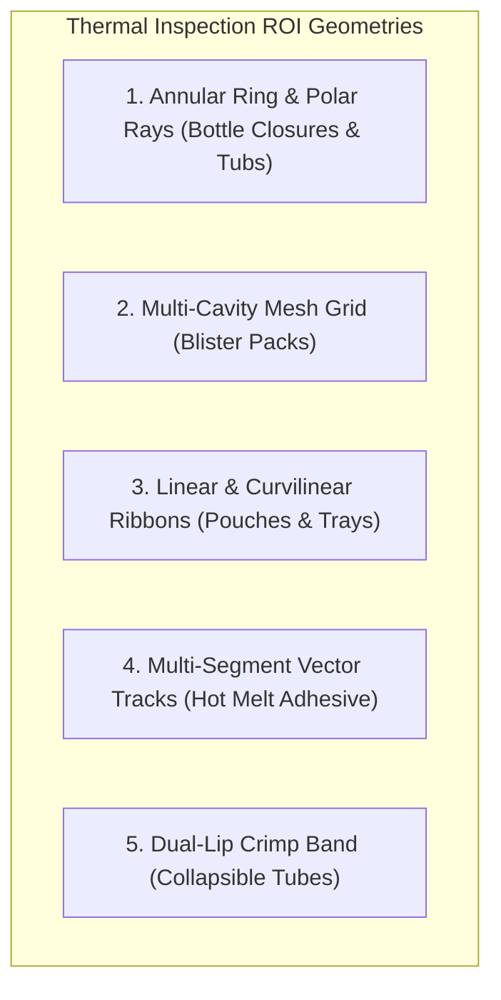
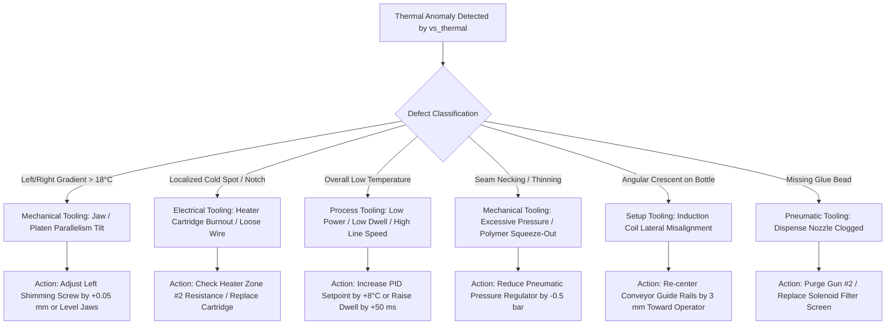

# Master Industrial Guide: Thermal Packaging Seal Inspection, ROI Geometry & Tooling Feedback

> **Antigravity Industrial Machine Vision Engineering Manual**  
> **Target Applications**: Pharmaceutical Blister Packs, Induction Bottle Closures, Flexible Retort Pouches, Hot Melt Cartons, Aseptic Bricks, Thermoformed MAP Trays, and Plastic Tube Crimps.  
> **Primary Goal**: Achieve 100% Hermetic Sealing Confidence · Non-Destructive In-Line Quality Control · Closed-Loop Machine Tooling Optimization.

---

## 1. Cross-Industry Packaging Taxonomy: Where Heat Sealing is Used

Thermal vision (Long-Wave Infrared, LWIR, $8 - 14\ \mu\text{m}$) enables non-destructive, sub-surface inspection of internal bonding layers that are **100% invisible to optical color and monochrome cameras**. 

```mermaid
flowchart TD
    subgraph Packaging_Industries ["Heat Sealing Across Industries"]
        Pharma["1. Pharmaceutical & Medical"]
        Food["2. Food & Beverage / Dairy"]
        FMCG["3. FMCG, Cosmetics & Chemicals"]
    end

    Pharma --> Blist["Medicine Blister Packs (Alu-Alu, PVC-Alu)"]
    Pharma --> Induct["Induction Bottle Cap Liners"]
    Pharma --> Sterile["Medical Device Sterile Barrier Pouches & IV Bags"]
    Pharma --> TubePharma["Ointment & Cream Collapsible Tubes"]

    Food --> Pouch["Flexible Retort / Stand-Up Pouches"]
    Food --> MAP["Thermoformed Trays (Modified Atmosphere Packaging)"]
    Food --> Aseptic["Aseptic Beverage Bricks (Tetra Pak / Combibloc)"]
    Food --> Flow["Flow-Wrap Candy / Snack Bars"]
    Food --> Cup["Yogurt / Butter Tub Foil Lids"]

    FMCG --> Glue["Hot Melt Adhesive Corrugated Cartons"]
    FMCG --> TubeCosmetics["Toothpaste / Cosmetic Plastic Crimp"]
    FMCG --> BagInBox["Bag-in-Box Liquid Bladders"]
```



### Complete Industry Heat Sealing Matrix

| Industry | Packaging Format | Heating Mechanism | Sealing Materials | Critical Failure Modes Detected by Thermal Vision |
|---|---|---|---|---|
| **Pharma** | **Blister Packs** (Tablets & Capsules) | Heated platen press or rotary heated knurled drums ($140^\circ - 185^\circ\text{C}$). | PVC / PVDC / Aclar forming film heat-sealed to hard-tempered Aluminum lid foil ($20\ \mu\text{m}$) coated with heat-seal lacquer. | • Cold notch between pocket and edge (loss of moisture barrier)<br>• Product/powder trapped in sealing flange<br>• Sealing roller heater element zone burnout<br>• Uneven drum pressure shimming |
| **Pharma** | **Bottle Closures** (Induction Seals) | High-frequency electromagnetic induction field ($50 - 450\text{ kHz}$) induces eddy currents in aluminum foil. | Multi-layer liner (Pulpboard + Wax + Aluminum Foil + Polymer bond layer: Surlyn, PE, or PET). | • Missing foil (completely cold)<br>• Partial crescent / cold gap (leak hazard)<br>• Scorched/overheated polymer ($> 110^\circ\text{C}$)<br>• Crooked cap / uneven induction coil distance |
| **Pharma & Med** | **Sterile Pouches & IV Bags** | Thermal impulse sealer or heated linear bars ($120^\circ - 160^\circ\text{C}$). | Tyvek heat-sealed to medical-grade PE/PET pouch; multi-layer polyolefin film. | • Micro-channel / pinhole leaks ($< 50\ \mu\text{m}$)<br>• Tyvek fiber pull / delamination<br>• Incomplete jaw closure / jaw misalignment |
| **Food & Dairy** | **Retort & Stand-Up Pouches** | Opposed heated pneumatic sealing jaws with silicone backing ($160^\circ - 210^\circ\text{C}$). | Laminated films: PET / Aluminum / Oriented Polyamide (OPA) / Cast Polypropylene (CPP). | • Cold channel void through seal<br>• Food sauce / fat / powder trapped in seam<br>• Jaw temperature drop from draft/exhaust<br>• Wrinkles / gusset foldover cold spots |
| **Food & Dairy** | **Thermoformed Trays** (MAP) | Perimeter contour sealing frame with vacuum / gas flush ($135^\circ - 175^\circ\text{C}$). | Rigid PP/PE or barrier PET tray sealed with flexible peelable barrier top web. | • Meat / liquid fat trapped on flange<br>• Perimeter seal void causing gas leak (spoilage)<br>• Sealing gasket degradation / low pressure spot |
| **Food & Dairy** | **Cup / Tub Lidding** (Yogurt, Butter) | Circular annular heated sealing heads ($170^\circ - 220^\circ\text{C}$, $0.3 - 0.8\text{ s}$). | Injected/thermoformed PS/PP cups sealed with pre-cut aluminum or PET die-cut lids. | • Lid off-center / partial rim bond<br>• Spilled yogurt/cream across lip causing cold void<br>• Seal head heater element burnout |
| **Beverage** | **Aseptic Bricks** (Tetra Pak) | High-frequency induction or heated jaws for transverse and longitudinal seams ($180^\circ - 240^\circ\text{C}$). | Paperboard / LDPE / Aluminum foil / mPE laminated composite liquid board. | • Delamination at corner flaps<br>• Incomplete liquid-barrier inner PE weld<br>• Jaw pressure gradient along cross-seam |
| **FMCG & Logistics** | **Hot Melt Cartons** (End-of-Line) | Hot melt dispensing nozzles apply beads at $145^\circ - 180^\circ\text{C}$; flap compressed. | Corrugated cardboard / solid bleached sulfate (SBS) paperboard with EVA / Metallocene / PUR glue. | • Clogged nozzle (missing glue bead)<br>• Broken / intermittent bead line<br>• Cold glue joint (open time exceeded before press)<br>• Glue misplaced outside compression zone |
| **Cosmetics** | **Plastic & Laminate Tubes** | Hot air nozzle inserts into tube end, heats inner PE layer ($220^\circ - 320^\circ\text{C}$), then chilled jaws clamp. | Mono or multi-layer PE, PBL (Plastic Barrier Laminate), or ABL (Aluminum Barrier Laminate). | • Crimp seam leak / ear crack<br>• Asymmetrical hot air delivery (one side cold)<br>• Tube end tilted / uneven insert depth |

---

## 2. How to Draw and Define Areas to Inspect (ROI Geometry)

In optical vision, ROIs are simple static rectangles. In **Thermal Packaging Vision**, ROIs must follow the **physical heat dissipation path** and mechanical tooling geometry.



### 1. Annular Ring & Polar Rays (Induction Bottles & Round Tubs)
- **Geometry**: Concentric circles defined by Center $(C_x, C_y)$, Inner Radius $R_{\text{in}}$, and Outer Radius $R_{\text{out}}$.
- **How to Draw in UI**:
  - The operator clicks the center of the bottle mouth (or clicks "Auto-Centroid", which finds the center of thermal mass).
  - A dual-ring overlay appears. The operator drags the inner circle to match the bottle neck inner diameter and outer circle to match the outer cap rim.
- **Inspection Algorithm**:
  - Unrolls the circular annulus into a rectangular Polar Coordinate Image $I(r, \theta)$ where $\theta \in [0^\circ, 360^\circ)$ and $r \in [R_{\text{in}}, R_{\text{out}}]$.
  - Casts 360 radial rays outward from center. Every ray computes peak temperature $T_{\text{ray}}(\theta)$ and radial width $W(\theta)$.
  - Any sector where $T_{\text{ray}}(\theta) < T_{\text{seal\_min}}$ for an angular span $> \Delta\theta_{\text{max}}$ triggers **Incomplete Seal (Leak)**.

```
       [ 0° Top ]
     . - ~ ~ ~ - .
   /       |       \       Annulus ROI between R_in and R_out:
 /     (R_in)        \     - Uniform heat ring: PASS
|  <--[Center]-->     |    - Cold sector (45°-90°): NG INCOMPLETE
 \     (R_out)       /     - Whole ring cold (<42°C): NG MISSING FOIL
   \       |       /
     ' - ~ ~ ~ - '
      [ 180° Bottom ]
```

---

### 2. Multi-Cavity Mesh Grid (Medicine Blister Packs)
- **Geometry**: Orthogonal grid array defined by Pocket Rows ($N_{\text{rows}}$), Columns ($N_{\text{cols}}$), Pocket Dimensions $(W_{\text{pock}}, H_{\text{pock}})$, Cavity Pitch $(P_x, P_y)$, and Perimeter Margin $M$.
- **How to Draw in UI**:
  - The operator draws a bounding rectangle around the entire blister card.
  - The tool asks: *"How many pockets?"* (e.g. $2 \times 5$ or $3 \times 7$).
  - The tool automatically generates:
    1. **Pocket Keep-Out Masks**: Tablets/capsules generate varying thermal reflections and must be masked out.
    2. **Inter-Pocket Sealing Ribs**: Grid lines between cavities.
    3. **Perimeter Sealing Border**: Continuous outer seal band around the entire card.
- **Inspection Algorithm**:
  - For each individual pocket $k$, the tool traces the closed perimeter contour around that specific cavity.
  - Computes the minimum barrier distance: the narrowest continuous hot seal path between pocket $k$ and the outside edge or adjacent pocket.
  - If minimum barrier width $< 1.5\text{ mm}$, triggers **Blister Moisture Barrier Breach**.

```
+-------------------------------------------------------+
|  [ Perimeter Sealing Border: Min 2.5 mm Hot Band ]   |
|  +---------+   +---------+   +---------+   +---------+|
|  | Pocket1 |---| Pocket2 |---| Pocket3 |---| Pocket4 ||
|  | (MASK)  |   | (MASK)  |   | (MASK)  |   | (MASK)  ||
|  +---------+   +---------+   +---------+   +---------+|
|       |             |             |             |     |
|  +---------+   +---------+   +---------+   +---------+|
|  | Pocket5 |---| Pocket6 |---| Pocket7 |---| Pocket8 ||
|  | (MASK)  |   | (MASK)  |   | (MASK)  |   | (MASK)  ||
|  +---------+   +---------+   +---------+   +---------+|
|  [ Inter-Pocket Ribs: Min 1.8 mm Hot Sealed Width ]  |
+-------------------------------------------------------+
```

---

### 3. Linear & Curvilinear Ribbon Profiles (Pouches & Trays)
- **Geometry**: Directional ribbon band defined by baseline center path (straight line or Bezier polyline) and transverse cross-width $W_{\text{ribbon}}$.
- **How to Draw in UI**:
  - The operator clicks the start point and end point of the pouch mouth seam (or traces the perimeter lip of a thermoformed tray).
  - Adjusts ribbon thickness handles to cover the entire jaw contact width plus $2\text{ mm}$ margin on either side.
- **Inspection Algorithm**:
  - At every step $s$ along the seam length (1-pixel intervals):
    Samples cross-sectional temperature profile $T_{\text{cross}}(u)$.
    Measures the continuous bonded seal width $W_{\text{seal}}(s)$ where $T \ge T_{\text{bond}}$.
  - Detects **Cold Channels (Pinhole leaks)**: $W_{\text{seal}}(s) == 0$.
  - Detects **Contamination**: Localized temperature drop $\Delta T > 12^\circ\text{C}$ accompanied by local width thinning.

---

### 4. Multi-Segment Vector Tracks (Hot Melt Adhesive Cartons)
- **Geometry**: Array of parallel or oriented line segments defined by Start $(X_1, Y_1)$, End $(X_2, Y_2)$, and bead width corridor.
- **How to Draw in UI**:
  - The operator selects bead count (e.g. 2 parallel lines) and drags the target tracks onto the carton flap.
- **Inspection Algorithm**:
  - Scans perpendicular to track vectors to locate actual bead centroids.
  - Measures bead continuity, total glue volume (thermal area integral), and gap length between dots/beads.

---

## 3. Radiometric Thermal Graphs & Nominal Temperatures

Thermal cameras output absolute temperature in Celsius ($^\circ\text{C}$) or Kelvin ($\text{K}$). Below are the engineering temperature curves for each packaging type.

### 1. Bottle Induction Cap Sealing Profile
- **Typical Materials**: Aluminum foil + Surlyn / Polyethylene / Wax laminate.
- **Target Sealing Temperature**: $70^\circ\text{C} - 88^\circ\text{C}$ at cap surface ($130^\circ - 160^\circ\text{C}$ internal at foil interface).
- **Ambient Temperature**: $22^\circ - 26^\circ\text{C}$.

```
Temperature (°C)
 110 |--------------------------------------------- [ Scorched / Overheated Limit ]
 100 |
  90 |          . - - - - - - - - - - - .
  80 |        /                           \         <-- GOOD SEAL: Flat plateau 75-85°C
  70 | - - - / - - - - - - - - - - - - - - \ - - -  [ Minimum Peel Bond: 65°C ]
  60 |      /        COLD GAP               \
  50 |     /       |========|                \
  40 | - -/ - - - - - - - - - - - - - - - - - \ - - [ Missing Foil Threshold: 42°C ]
  30 |   /          | Ambient |                \
  20 |_ /___________|  24°C   |_________________\___
      0°           90°       180°              360° Angle around Cap (θ)
                    ^
                    |-- Cold notch: 40° gap -> Rejection NG (Leak hazard)
```

---

### 2. Pouch Seam Cross-Sectional Profile
- **Typical Materials**: 3-ply PET/Alu/CPP (Retort) or PET/PE.
- **Sealing Jaw Temperature**: $175^\circ - 195^\circ\text{C}$.
- **Film Surface Temp immediately after jaw release**: $85^\circ - 110^\circ\text{C}$.

```
Temperature (°C)
 110 |               .-""""""""-.
 100 |              /   SEAM     \
  90 |             /    CORE      \
  80 | - - - - - -/ - - - - - - - -\- - - - - - - [ Minimum Hermetic Bond: 72°C ]
  70 |           /                  \
  60 |          /                    \
  50 |         /                      \
  40 |        /                        \
  30 |_______/                          \_______
      |<- Unsealed ->|<-- Seal Width -->|<- Unsealed ->|
                     |  Measured: 14mm  |
```

**Defect Profile: Product Contamination Trapped in Seam (e.g. Liquid Soup / Oil / Powder)**:
```
Seam Width
Across Pouch (mm)
 15 |=====================\        /==================== [ Nominal Seal Width: 14mm ]
 10 |                      \      /
  5 |                       \    /
  0 |________________________\__/__ [ COMPLETE COLD CHANNEL VOID = 0 mm: LEAK! ]
    0mm                     150mm                     300mm (Seam Length)
                              ^
                              |-- Trapped liquid droplet cooled film to 38°C -> REJECT
```

---

### 3. Medicine Blister Pack Sealing Profile
- **Typical Materials**: PVC ($250\ \mu\text{m}$) / Aluminum Foil ($20\ \mu\text{m}$).
- **Platen / Drum Temperature**: $155^\circ - 170^\circ\text{C}$.
- **Foil Surface Temp after sealing station**: $68^\circ - 85^\circ\text{C}$.

```
Thermal Profile Across Card (Transverse X-Axis):
Temperature (°C)
  85 |  /\    /\        /\    /\        /\    /\    <-- Heated Knurled Grid Ribs (78-84°C)
  70 | /  \  /  \      /  \  /  \      /  \  /  \
  55 |/    \/    \    /    \/    \    /    \/    \
  30 |   [POCKET] \__/   [POCKET] \__/   [POCKET]   <-- Cold Tablet Pockets (28-32°C)
     +------------+------+--------+------+-------+
      Cavity 1            Cavity 2        Cavity 3
```

---

### 4. Hot Melt Adhesive Bead Profile
- **Typical Materials**: EVA / Metallocene hot melt adhesive.
- **Dispenser Nozzle Temperature**: $160^\circ - 175^\circ\text{C}$.
- **Substrate Surface Temp at Camera**: $80^\circ - 120^\circ\text{C}$ (before flap fold) or $45^\circ - 65^\circ\text{C}$ (conducted through flap after press).

```
Temperature (°C)
 150 |       /\                  /\
 120 |      /  \                /  \         <-- Two Parallel Hot Glue Beads (135°C)
  90 | - - / - -\ - - - - - - -/ - -\ - - -  [ Minimum Tack Bonding: 75°C ]
  60 |    /      \            /      \
  30 |___/        \__________/        \_____ [ Cardboard Flap Ambient: 24°C ]
        Bead 1                Bead 2
```

---

## 4. Closed-Loop Machine Tooling Optimization Engine

When thermal inspection detects an NG defect, **telling the operator only "NG" is not enough**. The software must provide direct, actionable mechanical tooling advice to eliminate the root cause on the machine.



### Automated Diagnostic Translation Table

| Thermal Signature Observed | Root Cause on Packaging Machine | Exact Tooling & Maintenance Action Recommended by Software |
|---|---|---|
| **Pouch Seam / Blister: Left side hot ($95^\circ\text{C}$), Right side cold ($58^\circ\text{C}$)** | Sealing jaws or platen are mechanically non-parallel (jaw tilt). Right side lacks contact pressure. | 🔧 **Action**: Loosen jam nuts on the right-hand tie rod; adjust leveling shimming screw clockwise by **$+0.08\text{ mm}$**; verify jaw parallelism with feeler gauge. |
| **Blister Pack: Cavity #3 perimeter has persistent cold notch ($< 45^\circ\text{C}$)** | Burnt plastic / carbonized packaging film buildup on the sealing knurling platen at pocket #3, or cracked silicone gasket. | 🔧 **Action**: Stop machine; clean sealing drum pocket #3 with brass wire brush and silicone solvent; inspect cavity sealing ring for mechanical gouges. |
| **Blister Pack: One entire row of pockets is cold across all cards** | Individual heating cartridge burned out or open thermocouple loop in that specific heating zone. | 🔧 **Action**: Check electrical cabinet heater circuit breaker #4; measure resistance across cartridge pins (expected $\approx 48\ \Omega$; if $\infty$, cartridge is burned out). |
| **Bottle Induction: Heat ring is a crescent (e.g. hot from $0^\circ - 180^\circ$, cold from $180^\circ - 360^\circ$)** | Bottle is off-center relative to induction coil tunnel, or cap is cross-threaded/tilted. | 🔧 **Action**: Adjust conveyor stainless steel guide rails to shift bottle path **$3.5\text{ mm}$ toward drive side**; verify induction sealing coil height is $3 - 5\text{ mm}$ above cap top. |
| **Bottle Induction: All bottles show temperature drop over 20 minutes ($80^\circ\text{C} \to 55^\circ\text{C}$)** | Induction generator power supply drift, cooling water temperature rising, or line speed accelerated without power scaling. | 🔧 **Action**: Check induction sealer chiller unit; ensure water temp $< 25^\circ\text{C}$; raise induction power potentiometer by **$+6\%$** to match new line speed. |
| **Pouch: Seal seam has localized cold spot with liquid halo** | Product filling nozzle dripping or splashing liquid onto pouch mouth during fill stroke. | 🔧 **Action**: Check filling pump suck-back valve setting; lower fill nozzle bottoming height; increase nozzle dwell before pouch indexing. |
| **Pouch: Seam width thins out in the middle ($14\text{ mm} \to 6\text{ mm}$)** | Sealing jaw face is bowing outward under clamping pressure (insufficient jaw rigidity or worn center pivot pin). | 🔧 **Action**: Inspect jaw pivot pin for play ($> 0.1\text{ mm}$ wear); reduce pneumatic cylinder clamp pressure from **$6.0\text{ bar}$ to $4.8\text{ bar}$** to prevent jaw deflection. |
| **Hot Melt: Glue bead #2 completely missing** | Dispensing nozzle orifice clogged with charred adhesive, or solenoid valve failure. | 🔧 **Action**: Execute nozzle purge cycle on applicator head #2; if clogged, replace nozzle tip ($0.014\text{''}$); clean inline glue manifold filter screen. |
| **Hot Melt: Glue temperature at carton $< 60^\circ\text{C}$ (cold joint)** | Open time exceeded between glue gun and compression belt, or heated hose temperature setpoint dropped. | 🔧 **Action**: Increase heated hose zone #2 temperature by **$+10^\circ\text{C}$**; shorten distance between glue applicator and flap folding compression plow. |
| **Plastic Tube: Crimp ear has cold channel / ear crack** | Hot air heating nozzle insertion depth incorrect, or cooling jaw temperature too warm. | 🔧 **Action**: Re-zero tube lift servo height by **$+1.2\text{ mm}$**; ensure chilled water supply to crimp jaws is maintained at $12^\circ - 15^\circ\text{C}$. |

---

## 5. Software Architecture: Implementation in `vs_thermal` & VisionStudio

To integrate these advanced capabilities into the vision platform, we expand `vs_thermal` with two specialized inspection modes:
1. `vs_thermal_inspect_blister`: Multi-cavity grid moisture barrier validation.
2. `vs_thermal_inspect_tube`: Cylindrical collapsible tube crimp seam validation.
3. Automated `vs_thermal_tooling_diagnostic`: Translates thermal gradients directly into machine adjustments.

### Extended C API Specification (`engine/include/vs_thermal.h`)

```c
/* Diagnostic tooling recommendation struct */
typedef struct vs_thermal_tooling_advice {
    char    fault_code[32];         /* e.g. "TOOL_JAW_TILT_RIGHT" */
    char    recommended_action[256];/* e.g. "Shim right jaw leveling screw +0.08 mm" */
    float   asymmetry_metric;       /* Quantitative gradient (e.g. 24.5 deg C delta) */
    int32_t severity;               /* 1 = Warning / Tune Soon, 2 = Critical NG / Immediate Stop */
} vs_thermal_tooling_advice;

/* Blister Pack Multi-Cavity Parameters */
typedef struct vs_thermal_blister_params {
    int32_t struct_size;
    int32_t rows;                   /* Cavity rows (e.g. 2) */
    int32_t cols;                   /* Cavity cols (e.g. 5) */
    float   pocket_w_px;            /* Width of single tablet cavity */
    float   pocket_h_px;            /* Height of single tablet cavity */
    float   pitch_x_px;             /* Center-to-center horizontal pitch */
    float   pitch_y_px;             /* Center-to-center vertical pitch */
    float   min_barrier_width_px;   /* Minimum required hot seal width around each pocket */
    float   min_seal_temp_c;        /* Bond threshold (e.g. 68.0 deg C) */
    float   t_min_calib;
    float   t_max_calib;
} vs_thermal_blister_params;

typedef struct vs_thermal_blister_result {
    int32_t struct_size;
    int32_t verdict;                /* VS_THERMAL_PASS or VS_THERMAL_NG_SEAM_VOID */
    int32_t compromised_cavity_idx; /* Index of failed blister pocket (0-based) */
    float   min_barrier_width_px;   /* Narrowest seal width recorded across all pockets */
    float   worst_barrier_x;        /* Coordinate of worst moisture barrier leak */
    float   worst_barrier_y;
    vs_thermal_tooling_advice advice;/* Automated tooling adjustment guidance */
    float   time_ms;
} vs_thermal_blister_result;

/* API Functions */
VS_THERM_API void vs_thermal_default_blister_params(vs_thermal_blister_params* p);

VS_THERM_API int32_t vs_thermal_inspect_blister(
    const void* src,
    int32_t width,
    int32_t height,
    int32_t stride,
    int32_t format,
    const vs_thermal_blister_params* params,
    vs_thermal_blister_result* out_result);
```

---

## 6. Verification and Deployment Protocol

1. **Camera Placement**:
   Mount thermal camera at a $15^\circ - 30^\circ$ angle relative to normal if inspecting reflective foil to prevent the camera's own cooled sensor reflection from narcissus ghosting.
2. **Timing Trigger**:
   Trigger the camera within **$50 - 300\text{ ms}$** following induction sealing or jaw release, capturing the peak temperature gradient before thermal equilibrium dissipates.
3. **Line Safety Mandate**:
   Any temperature reading below the hermetic peel limit ($T < T_{\text{bond}}$) or any cold channel through the seal path triggers an immediate **fail-safe pneumatic reject signal** to the PLC diverter.
