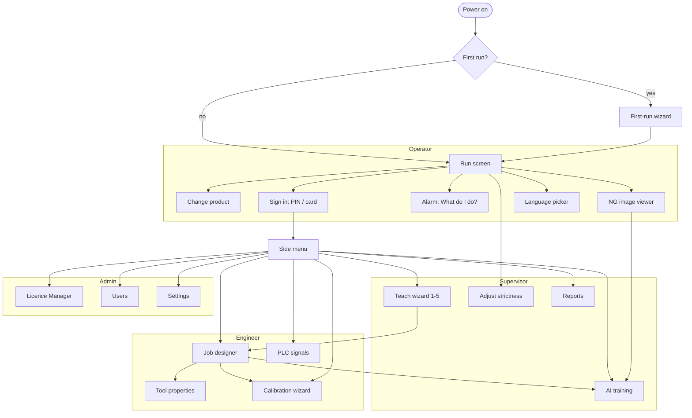

# UI and UX Specification

This document specifies every screen of the vision application: who sees it, how it is laid out, the exact English label of each control, how it looks in each machine state, and what each tap does. It turns sections 2, 6 and 7 of [the requirements](../REQUIREMENTS-VISION-SYSTEM.md) into a buildable design. The main user is a shop-floor operator in India who rarely uses a computer and may not read English, so the rules in section 1 override any wish for more features on a screen. Labels here are the English source strings; their keys and translations are defined in [LOCALISATION.md](LOCALISATION.md).

Related documents: [ARCHITECTURE.md](ARCHITECTURE.md) (UI and runtime as separate processes), [AI-DEEP-LEARNING.md](AI-DEEP-LEARNING.md) (assistant and training behaviour), [TOOL-SPECIFICATIONS.md](TOOL-SPECIFICATIONS.md) (tool settings), [PLC-INTERFACE.md](PLC-INTERFACE.md) (signals and handshake), [LICENSING.md](LICENSING.md) (licence states), [JOB-FILE-FORMAT.md](JOB-FILE-FORMAT.md) (versions and undo), [TEST-ACCEPTANCE-PLAN.md](TEST-ACCEPTANCE-PLAN.md) (usability test).

## 1. Design principles

From [section 2 of the requirements](../REQUIREMENTS-VISION-SYSTEM.md#2-users-and-design-rules) and [section 6](../REQUIREMENTS-VISION-SYSTEM.md#6-uiux-requirements):

1. **Pass/fail first.** The first thing on every screen answers "Is the part good?" Numbers come second.
2. **Grouped actions, many panels.** Owner, 2026-10-31: "Do not keep too big buttons and size for operators also as they also need so many things in one screen (we may provide keyboard and mouse also with touch screen). For engineers dense screen with all required option is good." The Run toolbar groups its actions (Line: Start, Stop; Product: Change product, Start batch; View: Parts, NG images; Help) and the screen may show many panels at once.
3. **One compact density for all roles, for touch, mouse and keyboard together** (owner, 2026-10-31). Controls are 32 px high (rows 28 px in tables and trees). Primary Run actions are 40 px high with icon and label. Nothing is smaller than 32 × 32 px to tap, with 6-8 px between targets. Body text is 13 px, small text 11-12 px, titles 15-16 px. The OK/NG word is 40 px in a result block about 120 px tall.
4. **Every action has a keyboard shortcut and a tooltip:** F5 Start, Shift+F5 Stop, F2 Change product, F3 Start batch, F4 Parts, F1 Help, Ctrl+S Save, Ctrl+Z / Ctrl+Y. Icon-only buttons are allowed in toolbars when they have a tooltip. Operator action buttons keep icon and label, and the label is never cut off (see the length rules in [LOCALISATION.md](LOCALISATION.md)).
5. **Status uses colour and shape together:** green with ✓ for OK, red with ✗ for NG, yellow with ! for warning, orange with a double square for a duplicate code, grey with a pause bar for stopped, blue with i for information. Colour is never the only signal.
6. **Plain words only on operator screens.** See the wording guide in section 6.
7. **Spoken guidance.** Every wizard step, alarm and error has a speaker button that reads the message in the user's language. Alarms can also be spoken automatically (setting).
8. **Errors say what to do.** Each message has the form "What is wrong. What to do." in at most two short sentences.
9. **Undo everywhere, confirm only destructive actions.** Delete, rollback, and stopping a running line ask once. Everything else can be undone.
10. **Start in Run.** The application opens in the last job in Run mode. If the plant allows, the operator role needs no login.
11. **One task per screen.** Wizards use one full screen per step, with Back and Next always in the same place.
12. **Show progress and time.** Anything that takes more than 1 second shows a progress bar; anything over 10 seconds shows time left and can be cancelled.
13. **The UI can close; inspection continues.** The UI is a separate process from the runtime service, so a frozen or closed UI never stops the line. On reconnect the UI shows the live state again.
14. **One application runs the line; the browser only watches** (owner, 2026-10-30). Every screen in this document is in Vision Studio, the Windows application. A browser on the plant network shows only the live dashboard and reports (section 4.17), with no control on any page. See [ARCHITECTURE.md](ARCHITECTURE.md) section 2.2.
15. **Charts that read at a glance** (owner, 2026-10-31: "more professional graphics and charts, graphs to be used for easy view and understanding"). One scale per chart, never two y-axes; thin marks (2 px lines, bars at most 24 px with a 2 px gap); the limit or budget drawn as a line with its value; the current value marked; a hover or tap tooltip on every mark; series colours from the chart palette in design/tokens, OK and NG colours kept for status; text in text colours, never in the series colour.


## 2. Common layout

Every full screen uses the same frame so that operators learn it once.

```text
+--------------------------------------------------------------------------------+
| File Edit View Job Run ...   Job: Whisky 750 ml   (status pill)   [Spk] [अ] [User] |  <- top bar with menu bar, 40 px
+--------------------------------------------------------------------------------+
| [ > Start ] [ || Stop ] | [ Change product ] [ Start batch ] | [ Parts ] | [ ? ]  |  <- toolbar, 40 px
+--------------------------------------------------------------------------------+
|                                                                                |
|                          screen content (panels)                               |
|                                                                                |
+--------------------------------------------------------------------------------+
| x, y, grey value   fps   runtime link   job version   user                      |  <- status bar, 24 px
+--------------------------------------------------------------------------------+
```

One compact density for every role (owner, 2026-10-31; principle 3). The menu bar is hidden for the Operator role.

| Element | Behaviour |
| --- | --- |
| Menu | The menu bar and the screens the current role may see (section 3). Hidden for the Operator role (owner, 2026-10-30). |
| Job name | The current product picture (small) and name. Tap: no action on Run screen (to avoid accidents); on other screens it returns to Run. |
| Status pill | Machine state with colour and shape (section 2.1). Tap opens "What do I do?" if there is an alarm. |
| Speaker | Reads the main message of the screen aloud. Long press: repeat slower. |
| Language | Script icon (e.g. "अ", "A", "ગ"). Opens the language picker. Changes language at once, without restart. |
| User | Shows role icon and name, or "Operator" when nobody is signed in. Tap: Sign in / Sign out. |
| Toolbar | Actions in groups, 40 px high; Run actions have icon and label, other toolbars may be icon-only with a tooltip. Each action has a keyboard shortcut (principle 4). Disabled buttons are shown faded with a lock or reason on tap, never hidden, so the layout does not move. |
| Status bar | 24 px: pointer position and grey value, zoom, fps, runtime link, job version, user. |

### 2.1 Global states

These states apply to every screen. The status pill and, where stated, a full-width banner show them. Priority is top to bottom: the highest active state wins the pill; all active alarms are listed in the alarm list.

| State | Status pill | Banner | Run screen effect |
| --- | --- | --- | --- |
| Idle (stopped) | Grey, pause bar, "Stopped" | None | Start enabled |
| Running | Green, play triangle, "Running" | None | Live image, counters update |
| Last part NG | Red frame on image, ✗ "NG" | None (not an alarm) | NG added to strip |
| Warning (advice, drift) | Yellow, !, "Check" | Yellow, one line, "What do I do?" | Keeps running |
| Alarm | Red, !, "Alarm" | Red, flashing border 2 Hz (no faster, for photosensitivity), "What do I do?" | Depends on alarm; PLC informed |
| No camera | Red, camera with ✗, "No camera" | "Camera not found. Check the camera cable and power." | Start disabled; image area shows a camera drawing with ✗ |
| PLC lost | Red, plug with ✗, "PLC not connected" | "PLC not connected. Check the network cable to the PLC." | Inspection stops taking triggers; PLC treats parts as NG by its watchdog ([PLC-INTERFACE.md](PLC-INTERFACE.md)) |
| Licence locked | Grey, lock, "Locked" | "This job needs the licence 'Read text'. Call your supervisor." | Job opens read-only; Start disabled |
| Runtime not reachable | Red, ✗, "Not connected" | "Please wait. Reconnecting to the inspection." | Last image greyed; reconnects automatically |

## 3. Navigation map



| Screen | Operator | Supervisor | Engineer | Admin |
| --- | --- | --- | --- | --- |
| Run, Change product, NG viewer, Alarm help | ✓ | ✓ | ✓ | ✓ |
| Sign in, Language picker | ✓ | ✓ | ✓ | ✓ |
| Adjust strictness (from Run) | — | ✓ | ✓ | ✓ |
| Teach wizard | — | ✓ | ✓ | ✓ |
| Reports | View summary only (plant option) | ✓ | ✓ | ✓ |
| AI training | — | Collect, label, validate | ✓ | ✓ |
| Job designer, Tool properties (Advanced) | — | — | ✓ | ✓ |
| Calibration wizard | — | — | ✓ | ✓ |
| PLC signals | — | — | ✓ | ✓ |
| Licence Manager | — | View | View | ✓ |
| Users | — | — | — | ✓ |
| Settings | Language, theme, text size only | Same | + job and image saving | All |

Higher roles see more screens; each higher role inherits all lower ones (section 12 of the requirements).

## 4. Screens

Each screen lists: purpose, who sees it, wireframe, controls, states and tap behaviour. Wireframes show layout at 1366 × 768; at 1920 × 1080 the image area grows and the side panels keep their width.

### 4.1 Run screen

**Purpose:** show whether parts are good, let the operator start, stop and change product, and say what to do when something goes wrong. **Who:** everyone; it is the home screen. It is a multi-panel screen (owner, 2026-10-31): camera image tiles (one per camera), the result block with counters, yield and cycle time, the per-tool results of the last part, batch and PLC status, and a bottom tab area (Overview, Parts list, Last bad parts, Alarms, Messages). Overview is the default tab and shows three charts: parts per minute for the last 60 minutes against the line speed, why parts were NG (bars, largest first) and the cycle-time spread of the last 300 parts against the budget with the p95 marked; the Speed panel adds a good-% trend line for the last 60 minutes. The Engineer and Admin get the Engineer workspace (section 4.19).

```text
+--------------------------------------------------------------------------------------+
| Whisky 750 ml        ( > Running )   batch B-114   PLC ✓          [Spk] [अ] [Operator]|  top bar 40 px
+--------------------------------------------------------------------------------------+
| [> Start F5][|| Stop ⇧F5] | [Change product F2][Start batch F3] | [Parts F4][NG] | [?] |  toolbar 40 px
+--------------------------------------------------------------------------------------+
| +--------------------------+ +--------------------------+ +------------------------+ |
| | Camera 1                 | | Camera 2                 | |  ✓ OK  (40 px word)    | |
| |      LIVE IMAGE          | |      LIVE IMAGE          | |  result block ~120 px  | |
| |  green (OK) / red (NG)   | |  overlays ✓ / ✗ per check| +------------------------+ |
| |  frame                   | |                          | | Good 12,480  Bad 37    | |
| +--------------------------+ +--------------------------+ | Total 12,517  99.7 %   | |
| | Last part checks: Find ✓ 8 ms | Read code ✓ 4 ms | Text ✓ 12 ms | Size ✓ 3 ms    | | Cycle 27 ms            | |
| +--------------------------------------------------------+ | Batch 4,210 / 10,000   | |
|                                                            | PLC: link ✓ ready ✓    | |
+--------------------------------------------------------------------------------------+
| [Last bad parts] [Parts list] [Alarms] [Messages]                                      |
| [ng1][ng2][ng3][ng4][ng5][ng6][ng7][ng8] ... (20)                                      |
+--------------------------------------------------------------------------------------+
| ! Image is getting darker. Clean the lens or check the light.     [ What do I do? ]  |  only when needed
+--------------------------------------------------------------------------------------+
| runtime link ✓   fps 10   job v7   Operator                                           |  status bar 24 px
+--------------------------------------------------------------------------------------+
```

The clickable mock-up is `design/prototypes/vision-studio/index.html`.

| Control | Label | Tap |
| --- | --- | --- |
| Start | "Start" | Starts inspection on PLC triggers. Disabled with reason if no camera, PLC lost, licence locked or job not released. |
| Stop | "Stop" | Asks "Stop checking parts? The machine will treat parts as bad." with "Yes, stop" / "No". Then stops. No reason is asked (owner, 2026-10-30). |
| Change product | "Change product" | Opens 4.2. Disabled while running if the plant setting "Stop before change" is on; then the tap says "Press Stop first." |
| Parts | "Parts" | Opens the list of every part's own result, newest first: time, OK / NG / same code with its shape, part or case code, why it failed, codes read, time to check (owner, 2026-10-30: each part is listed at any line speed, "as report is required"). "Bad only" hides good parts; "Hold the list" stops it moving so a row can be read. The newest 2,000 parts stay in the list; a row says where parts are missing from it (link lost, list fell behind). Every part is also kept in the results log for the reports. |
| Help | "Help" | Plays the short video for this screen and offers the speaker. |
| Result block | "OK" / "NG" | Tap: shows the last part's checks as a list with ✓ / ✗ and plain reasons. |
| Counters | "Good", "Bad", "Total", "Good %" | No action for Operator. |
| Reset counts | "Reset counts" | Supervisor and above. Confirm once. Counts per shift are still kept in reports. |
| NG strip | thumbnails with time | Tap opens 4.3 at that image. |
| Banner | message | "What do I do?" opens 4.4. |
| Strictness (Supervisor) | "Adjust strictness" in the result block menu | Opens the strictness slider per check with expected rejects in words (see [AI-DEEP-LEARNING.md](AI-DEEP-LEARNING.md) 2.3). Changes are a new job version and logged. |

| State | What changes |
| --- | --- |
| Idle | Image shows last frame dimmed, result block shows "Stopped" grey with pause bar. Start is the highlighted button. |
| Running | Live image at up to 10 fps for display (independent of inspection rate). Result block flips per part; at high rates (> 5 parts/s) it shows the worst result of the last 200 ms so it stays readable. |
| NG | Red frame for at least 1 s; failing check outlined red with ✗ and one word ("Code", "Size", "Text"). Optional beep (setting). |
| Alarm | Red banner with "What do I do?"; result block shows "Alarm" with "!". |
| No camera | Image area replaced by camera drawing with ✗ and the fix sentence. Start disabled. |
| PLC lost | Banner and pill; counters freeze; Start disabled until the PLC returns, then the job resumes automatically if it was running. |
| Licence locked | Image shows the last job image with a lock; Start disabled; banner names the licence. |

PLC job select: when the PLC selects a product, the product picture slides in with "Product changed by machine: Whisky 1 L" for 3 s.

### 4.2 Change product (by picture)

**Purpose:** pick the product to check without reading job names. **Who:** everyone.

```text
+--------------------------------------------------------------------------------------+
| [<- Back]   Change product                                       [Spk] [अ] [User]    |
+--------------------------------------------------------------------------------------+
|  [ Search ]  (keyboard icon; hidden for Operator unless enabled)                     |
|  +-----------+  +-----------+  +-----------+  +-----------+                           |
|  |  photo    |  |  photo    |  |  photo    |  |  photo    |   current product has a  |
|  |           |  |  ✓ now    |  |           |  |           |   thick blue border and  |
|  | Whisky 1L |  | Whisky750 |  | Rum 750   |  | Gin 375   |   "Now" tag              |
|  +-----------+  +-----------+  +-----------+  +-----------+                           |
|  +-----------+  +-----------+  ...  (scroll, 8 per page at 1366x768)                  |
+--------------------------------------------------------------------------------------+
|  [ <- Back ]                                    [ ✓ Use this product ]               |
+--------------------------------------------------------------------------------------+
```

| Control | Label | Tap |
| --- | --- | --- |
| Product tile | photo + short name (max 18 characters) + variant colour stripe | Selects (blue border). Second tap on the same tile = "Use this product". |
| Use this product | "Use this product" | Loads the job (progress bar with "Getting ready"), returns to Run in Idle. If the plant setting "Start after change" is on, starts. |
| Back | "Back" | Returns to Run, nothing changed. |
| Search | "Search" | Supervisor and above, or if enabled. Filters by name or code. Can also scan a barcode on the product with the camera: "Show the product code to the camera". |

States: if a job is not released, its tile is shown faded with "Not ready" and cannot be chosen by an Operator. If a job needs a missing licence, its tile has a lock. If the PLC owns job select (setting), the screen says "The machine chooses the product" and tiles are view-only.

### 4.3 NG image viewer

**Purpose:** show why a part was rejected, in pictures and plain words. **Who:** everyone; "Use for teaching" for Supervisor and above.

```text
+--------------------------------------------------------------------------------------+
| [<- Back]   Bad part 14:32:07                                  [Spk] [अ] [User]      |
+--------------------------------------------------------------------------------------+
| +----------------------------------------------------+ +--------------------------+  |
| |                                                    | | ✗ Text is wrong          |  |
| |   IMAGE (zoom with two fingers, double-tap = fit)  | |   Expected: 10/2026      |  |
| |   failing area outlined red; heatmap for AI        | |   Seen:     10/2O26      |  |
| |                                                    | | ✓ Code read              |  |
| |                                                    | | ✓ Label straight         |  |
| +----------------------------------------------------+ +--------------------------+  |
|  [<]  image 3 of 20  [>]          [ Show good part ]  (side-by-side with a good one) |
+--------------------------------------------------------------------------------------+
|  [ <- Back ]   [ Show good part ]   [ Use for teaching ]   [ Was OK ]                 |
+--------------------------------------------------------------------------------------+
```

| Control | Label | Tap |
| --- | --- | --- |
| Check list | each check with ✓ / ✗ and reason | Tap a check: zooms to its region on the image. |
| Previous / Next | arrows | Moves through the 20 stored NG images. |
| Show good part | "Show good part" | Splits the image area: this part left, a taught good part right, same zoom. |
| Use for teaching | "Use for teaching" | Supervisor+. Adds the image to the AI dataset or to the job image set as "bad". Asks "Is this part really bad?" Yes / No, it was good. |
| Was OK | "Was OK" | Operator may flag "I think this part was good" (once per part; not on a part a supervisor decided). Kept with who and when for the supervisor: shown with the part in the NG viewer, in the Learning screen's filter "Was OK" and in the Run screen's count; no change to the job, never learned from. The supervisor's decision clears it (AS-04k). |
| Zoom | − / + / whole picture | Mouse wheel zooms about the pointer, the right button drags (as in the Engineer workspace). |
| Supervisor review (owner, 2026-10-31) | "Accept: part is good", "Confirm NG" | Supervisor, QA, Engineer, Admin; also while the line runs. Keeps the part's full picture with the decision. A part the software found clearly bad asks "Look again before you accept it" with what was found, and offers "It is bad: Confirm NG" and "Accept, record only": such a part never teaches the job. |
| Bad parts waiting (AS-04i) | "12 bad parts wait for a review (3 marked Was OK)" | Supervisor and above, in the Run screen's Bad parts tab, whether the line runs or not. Opens the Learning screen on the bad parts (only those marked Was OK when there are any); with the learning session off, the NG viewer on the newest bad part. |
| Reviewed pictures (AS-04j) | Learning screen filter "Reviewed" | The decided pictures, newest first, full size, with the decision, who and when. Accept or Reject changes a decision by the same rules (the double-check, the second validation); "Remove decision" takes it out (the picture waits for a review again). A change or removal is an audit-trail event; Learn again before Apply. |
| Learn from reviews | "Learn from reviews" | Line stopped. Shows each setting it would change ("Batch: strictness 60 → 52 (accepts more)", in bold when it accepts more), the result now and with the change, and Apply when every confirmed bad part still fails. Apply saves a new job version. |
| Heatmap toggle (AI checks) | "Show where" | Shows or hides the heatmap. |

### 4.4 Alarm: "What do I do?"

**Purpose:** guide the operator to clear an alarm without calling an engineer where possible. **Who:** everyone.

```text
+--------------------------------------------------------------------------------------+
| [<- Back]   What do I do?                                      [Spk] [अ] [User]      |
+--------------------------------------------------------------------------------------+
|  ! PLC not connected                                                                 |
|  +------------------------------+   1. Check the network cable at the back of the PC |
|  |   picture or 10 s animation  |      is pushed in.                    [ Done ]     |
|  |   of the step                |   2. Check the PLC has power.          [ Done ]     |
|  +------------------------------+   3. Wait 30 seconds.                               |
|                                     Still not working?  Call: Ramesh (Maintenance)   |
|                                     ext. 214                                          |
+--------------------------------------------------------------------------------------+
|  [ <- Back ]       [ Try again ]       [ Call supervisor ]       [ Spk Read aloud ]   |
+--------------------------------------------------------------------------------------+
```

| Control | Label | Tap |
| --- | --- | --- |
| Step "Done" | "Done" | Ticks the step; the next step is highlighted and spoken. |
| Try again | "Try again" | Re-runs the check behind the alarm (reconnect camera or PLC, re-grab image). Shows ✓ "Fixed" and returns to Run if cleared. |
| Call supervisor | "Call supervisor" | Sends the alarm to the PLC "help request" bit and to the web HMI; shows "Supervisor called at 14:35". |
| Read aloud | "Read aloud" | Speaks the alarm and the current step. |

Alarm content comes from an alarm catalogue (code, severity, plain title, steps, picture, who to call). Plants can edit the contact line. Multiple alarms are listed with the worst first; each has its own page.

### 4.5 Sign in (PIN / RFID)

**Purpose:** identify the user and their role. **Who:** anyone moving above Operator, or every user if the plant requires login.

```text
+--------------------------------------------------------------------------------------+
|  Sign in                                                        [Spk] [अ]            |
+--------------------------------------------------------------------------------------+
|   [photo] Anita   [photo] Ramesh   [photo] Suresh   [photo] More...                  |
|                                                                                      |
|              Tap your card on the reader   ((( card icon )))                         |
|                       or enter your PIN                                              |
|                     [ * ][ * ][ _ ][ _ ]                                             |
|                     [1] [2] [3]                                                      |
|                     [4] [5] [6]           keys 56 x 56 px                            |
|                     [7] [8] [9]                                                      |
|                     [<x][0] [✓]                                                      |
+--------------------------------------------------------------------------------------+
|  [ <- Back ]                     [ Use password ]                                    |
+--------------------------------------------------------------------------------------+
```

| Control | Label | Tap |
| --- | --- | --- |
| User tiles | photo + first name | Selects the user; PIN pad then asks for their PIN. Plants can hide tiles (setting) for privacy. |
| PIN pad | digits, "Delete", "OK" | 4–8 digits. Digit order is fixed (not shuffled) for muscle memory. |
| Card reader | "Tap your card on the reader" | An RFID reader (USB keyboard-wedge or HID) signs in at once. |
| Use password | "Use password" | Shows a full keyboard for password or Windows account sign-in (Engineer, Admin). |
| Today's code | "Today's code (Support and OEM only)" | Under the password, hidden as it is typed and cleared after each try: Sundaram Support and OEM enter today's code for this machine, which opens their role for sorting and learning only (requirements AS-04h). Everyone else leaves it empty. |
| Back | "Back" | Returns without signing in. |

States: wrong PIN shows "PIN not right. Try again." with a shake; after 5 wrong attempts the user is locked for 5 minutes and the admin is notified in the audit trail. Auto sign-out after a plant-set idle time (default 10 minutes) returns to Operator.

### 4.6 Teach wizard (new job, steps 1–5)

**Purpose:** let a supervisor make a working job in under 15 minutes. **Who:** Supervisor and above.

Common frame for all steps:

```text
+--------------------------------------------------------------------------------------+
| [x Cancel]  New job   (1 Camera)-(2 Show part)-(3 What to check)-(4 Teach)-(5 Output)  |
|             step dots: done ✓ / current (big) / to do                [Spk] [अ]        |
+--------------------------------------------------------------------------------------+
|  instruction line, one sentence, spoken on entry                  [ ▶ Show me ] video |
|  step content                                                                         |
+--------------------------------------------------------------------------------------+
|  [ <- Back ]                       (step-specific 1-3 buttons)          [ Next -> ]   |
+--------------------------------------------------------------------------------------+
```

"Cancel" asks "Leave without saving? Your work is kept as a draft." Drafts reopen at the same step. "Show me" plays a 10–20 s animation for the step.

**Step 1 – Camera.** Instruction: "Choose the camera that sees the part."

```text
|  +-----------+  +-----------+                                                        |
|  | live thumb|  | live thumb|      Light: [====|-----] Good                          |
|  | Camera 1  |  | Camera 2  |      Sharp: [======|---] Turn focus slowly             |
|  |  ✓ chosen |  |           |                                                        |
|  +-----------+  +-----------+                                                        |
|  [ Auto setup ]                                                                      |
```

| Control | Label | Tap |
| --- | --- | --- |
| Camera tile | live thumbnail + "Camera 1" (+ model in small text) | Selects; multi-select allowed if Multi-Camera licence. |
| Auto setup | "Auto setup" | Runs auto exposure, gain and white balance; shows the light and sharpness bars. |
| Light bar, Sharp bar | "Light", "Sharp" | Live; the sentence under each bar says what to do (auto-light check). |
| Next | "Next" | Enabled when a camera is chosen and light is not "Too dark" / "Too bright". |

States: no camera found shows the "No camera" drawing with "Check the camera cable and power." and "Try again", plus "Use pictures from a folder" (simulator) for engineers.

**Step 2 – Show the part.** Instruction: "Put a good part under the camera and press Grab."

| Control | Label | Tap |
| --- | --- | --- |
| Grab | "Grab" | Takes a picture (software trigger). The AI outlines the part in blue and makes the locator. |
| Outline handles | corner dots | Drag to adjust the part outline if the AI got it wrong. |
| Try another | "Grab again" | Retakes. |
| Next | "Next" | Enabled when a part is outlined. |

Failure: "I could not find the part. Put it in the middle of the picture, or draw a box around it with your finger."

**Step 3 – What to check.** Instruction: "Tap what you want to check."

```text
| +------------------------------------------------------+ +-------------------------+ |
| |  image with numbered suggestion bubbles:             | | Toolbox (icon + name)  | |
| |   (1) Read this code?   (2) Check this text?         | | [Read code] [Check text]| |
| |   (3) Measure this hole?                             | | [Check size][Find part] | |
| |  tapped = solid colour with ✓; untapped = dashed     | | [Count]   [Check colour]| |
| +------------------------------------------------------+ | [Check defects] ...     | |
|  Chosen: Read code ✓, Check text ✓                       +-------------------------+ |
|  [ Say what to check ]  (only if language hint enabled)                              |
```

| Control | Label | Tap |
| --- | --- | --- |
| Suggestion bubble | "Read this code?" etc. | Tap toggles: creates or removes the tool (auto-learn). |
| Toolbox tile | operator tool names (icon + label) | Drag onto image (section 5) or tap then tap image. Locked tiles show a lock; tap offers "Try free for 30 days" or "Ask to buy". |
| Say what to check | "Say what to check" | Opens the optional language hint ([AI-DEEP-LEARNING.md](AI-DEEP-LEARNING.md) 2.6). |
| Next | "Next" | Enabled with at least one check. |

Each created check shows a small result tag on the image (✓ "Code: 8901234567890"). Expected text: for "Check text", a field "Text should be" is pre-filled with what was read, with "Date" and "Lot" format chips.

**Step 4 – Teach good (and bad).** Instruction: "Show me good parts, one by one. Then show bad parts if you have them."

```text
|  Good parts:  [■■■■■■■■■■■□□□□□□□□□]  11 of 10 needed ✓  (up to 30)                 |
|  Bad parts:   [■■□□□]  2 (optional)                                                  |
|  +-------------------+    Strictness:  Loose [----|----] Strict                       |
|  | last image        |    "About 1 good part in 16,000 may be rejected."             |
|  +-------------------+    Check size 1  ✓ all good parts pass                          |
|                           Check text    ✓                                              |
|  [ Add good part ]   [ Add bad part ]                                                |
```

| Control | Label | Tap |
| --- | --- | --- |
| Add good part | "Add good part" | Grabs and adds. Also triggered by the PLC trigger, so the operator can feed parts on the machine. |
| Add bad part | "Add bad part" | Grabs and adds as bad. |
| Strictness slider | "Loose" ... "Strict" | Moves k for all checks; sentence updates. "Advanced" shows per-check sliders and numbers. |
| Check rows | check name + ✓/✗ | Tap shows the values of all taught parts as dots against the band. |
| Remove last | "Remove last" (secondary) | Removes the last taught part. |

Warnings: "This bad part passes 'Check size 1'. Add another check or choose the bad area." Bad part passing is shown in yellow with "!".

**Step 5 – Output.** Instruction: "Choose what happens when a part is bad."

| Control | Label | Tap |
| --- | --- | --- |
| On bad part | "Reject the part" (on), "Sound the alarm" (off), "Red light on" (on) | Toggles; each maps to a PLC signal already set by the engineer ([PLC-INTERFACE.md](PLC-INTERFACE.md)). If the PLC map is empty: "Ask the engineer to set up the PLC signals." |
| Save pictures | "Save pictures": "Bad only" / "All" / "None" | Choice chips. |
| Product picture and name | "Product picture" (uses the step 2 image), "Product name" | Name needs a keyboard; a default name is proposed ("New product 7"). |
| Save & Run | "Save & Run" | Saves the job as version 1. If the plant needs approval, saves as "Waiting for approval" and says so; otherwise releases and opens Run. |
| Test first | "Test on saved pictures" (secondary) | Runs the job on the taught images and shows a pass/fail grid. |

### 4.7 Job designer

**Superseded by 4.19 (owner, 2026-10-31).** The job designer is now the Engineer workspace of section 4.19. The wireframe below shows the older layout; its behaviour rows that still apply (Save, Test on line, Templates, Versions, Release, Job menu) live in the menu and toolbar of 4.19.

**Purpose:** full editing of jobs, for engineers. **Who:** Engineer and Admin; Supervisor sees a simplified version (no flow wiring, no Advanced).

```text
+--------------------------------------------------------------------------------------------+
| [=] Job designer: Whisky 750 ml  v7 (draft)   [Undo][Redo]  [Image|Flow]  [Spk][अ][User]   |
+--------------------------------------------------------------------------------------------+
|Toolbox|                 IMAGE CANVAS                                   | Properties         |
| [Find |   tools drawn on image with ROI, results, ✓/✗                  | Read code 1        |
|  part]|   fixture axes from locator                                    |  Code type: Auto   |
| [Check|                                                                |  Codes: 1          |
|  size]|   (Flow view toggled: blocks and wires replace or split this)  |  Search area: ...  |
| [Read |                                                                |  [ Advanced ]      |
|  code]|                                                                |  Result: ✓ 8901..  |
| [Check|                                                                |  Time: 4.2 ms      |
|  text]|                                                                |                    |
|  ...  |                                                                |                    |
+-------+----------------------------------------------------------------+--------------------+
| Image set: [ok1✓][ok2✓][ok3✓][ng1✗][ng2✓!] ...  OK 48/48 pass · NG 11/12 caught  [Run all] |
+--------------------------------------------------------------------------------------------+
| Cycle time [Find 8ms|Read 4ms|Text 12ms|Size 3ms|.......]  27 ms of 50 ms target ✓        |
+--------------------------------------------------------------------------------------------+
| [ Save ]   [ Test on line ]   [ Templates ]   [ Versions ]   [ Release ]                   |
+--------------------------------------------------------------------------------------------+
```

| Area / control | Label | Behaviour |
| --- | --- | --- |
| Toolbox | icon + operator name per tool; group headers "Find", "Check", "Read", "AI", "Logic", "Output" | Drag onto canvas or flow (section 5). Locked tools show a lock. Search box at top ("Find a tool"). Advanced mode adds technical names in small text. |
| Canvas | – | Shows the current image with every tool's ROI and result. Tap a tool to select it; two-finger pan and pinch zoom; double-tap fits. |
| Image / Flow toggle | "Image", "Flow" | Flow view shows the tool chain as blocks with input and output ports; wires dragged from output to input. At ≥ 1600 px width, Flow can be docked beside the canvas. |
| Properties | tool name and 3–5 essential settings | See 4.8. |
| Undo / Redo | "Undo", "Redo" | Unlimited within the session; also Ctrl+Z / Ctrl+Y. |
| Image set panel | "Image set", "Run all", "Add pictures" | Runs the job on stored OK and NG images. Each thumbnail shows expected vs actual: ✓ correct, ✗ wrong, "!" correct but within 10% of a limit. Tap opens the image on the canvas. Summary sentence: "Passed 48 of 48 good. Caught 11 of 12 bad." |
| Cycle-time bar | "Cycle time" | Stacked bar per tool in ms against the target line. Turns yellow above 80% and red above 100% of target. Tap a segment selects the tool. |
| Save | "Save" | Saves a new draft version with an optional note. |
| Job menu (top bar) | "Open job", "Save as", "Reload", "Export", "Import" | Job saving and reload (owner, 2026-10-30). "Open job" picks a saved job from the list or a file. "Save as" saves under a new name. "Reload" asks "Drop the changes since the last save?" and loads the last saved version. Supervisors see Open job and Reload only. |
| Test on line | "Test on line" | Runs the draft on live triggers without outputs to the PLC (shadow mode) and shows results beside the released job's results. |
| Templates | "Templates" | "Check label and date", "Read code and verify text", "Measure part", "Count items", "Cap and seal check". |
| Versions | "Versions" | History list with user, time and note; "Compare" shows changed tools and settings side by side; "Restore" makes the old version the new draft. |
| Release | "Release" | Runs the image set; if all pass, asks for approval or e-signature as the plant requires, then releases to Run. |

States: running job on this PC is never edited in place; the designer always edits a draft copy. Licence-locked tools in an opened job are shown with a lock and "Needs licence: Read text"; the job can be viewed but not released.

### 4.8 Tool properties (essential and Advanced)

**Purpose:** let users change the few settings that matter, and engineers reach the rest. **Who:** Supervisor (essential only, tolerance and expected text), Engineer and Admin (all).

```text
+---------------------------+
| ✓ Check size 1     [Spk]  |
| Measures: hole width      |
|---------------------------|
| Good between              |
|  [ 9.95 ] and [ 10.05 ] mm|
| Strictness [---|----]     |
| Edge:  ( Dark to light v )|
| Search area: [Fit to part]|
|---------------------------|
| Result: 10.01 mm ✓        |
| [ Teach again ]           |
| [ Advanced  > ]           |
+---------------------------+
```

| Rule | Detail |
| --- | --- |
| Essential settings | 3–5 per tool, chosen per tool in [TOOL-SPECIFICATIONS.md](TOOL-SPECIFICATIONS.md). Always: what it checks (plain sentence), pass limits, and "Teach again". |
| Advanced | Switch "Advanced" reveals all parameters with technical names, numeric fields and units. Remembered per user. Hidden for Supervisor. |
| Live re-run | Every change re-runs the tool on the current image within 200 ms target and updates the canvas and cycle-time bar. |
| Units | mm or inch as the job sets; px when not calibrated, with the hint "Set real size to see mm." |
| Number entry | Numeric keypad pop-up with − / + steppers of sensible step size. |
| Teach again | Re-runs auto-learn on the current image. Undoable. |

### 4.9 Calibration wizard ("Set real size")

**Purpose:** turn pixels into mm. **Who:** Engineer and Admin.

| Step | Screen content | Controls (labels) |
| --- | --- | --- |
| 1 Choose method | Three tiles with pictures: "Checkerboard", "Dot grid", "Known size" (N-point). Advanced adds "Robot (hand-eye)" and "Join cameras". | "Next" |
| 2 Board details | Square size and count, pre-filled from the printed board's QR if present | "Square size (mm)", "Next" |
| 3 Capture | Live image with detected corners in green; coverage map showing which areas of the view have been covered; quality per shot ✓ / ✗ ("Board too tilted", "Board partly outside") | "Take picture" (needs 5–15), "Remove last", "Next" |
| 4 Result | Residual error in µm with a verdict: ✓ "Good (12 µm)", ! "Usable (45 µm)", ✗ "Not good, take more pictures"; distortion map | "Save", "Redo" |
| 5 Check | Measure a known part: user enters its true size, software shows measured size and difference | "Check with a part", "Finish" |

Calibration is saved with the camera and its version; jobs using it are flagged if it changes.

### 4.10 AI training screens

**Who:** Supervisor (collect, label, validate, deploy with approval) and Engineer (all). Behaviour is defined in [AI-DEEP-LEARNING.md](AI-DEEP-LEARNING.md) section 5.

**4.10.1 Collect.**

```text
+--------------------------------------------------------------------------------------+
| [<- Back]  Teach by example: Cap check (AI)                     [Spk] [अ] [User]     |
+--------------------------------------------------------------------------------------+
| live image                                 |  Good: 14 of 20  [■■■■■■■□□□]          |
|                                            |  Bad:   3        (optional)            |
|                                            |  [ Import folder ]                     |
+--------------------------------------------------------------------------------------+
|  [ ✓ Save good ]   [ ✗ Save bad ]   [ Label ]   [ Train ]   [ Models ]                |
+--------------------------------------------------------------------------------------+
```

"Train" is enabled once the minimum is reached; before that, tapping it says "Show me 6 more good parts first."

**4.10.2 Label.** Grid of images with pre-labels. Filter chips "Check me first", "All", "Good", "Bad". Per image: "Correct", box tool "Draw box", brush "Paint defect", eraser "Erase", class picker with colour + shape chips. Pinch to zoom; brush size slider. Undo/redo.

**4.10.3 Train.** One bar: "Training… about 6 minutes left." Buttons "Cancel" and "Run in background". Advanced shows a loss curve and settings. If the line becomes busy: "Training paused while the line is busy."

**4.10.4 Validate.**

```text
|  ✗ Missed 1 bad part          [see]                                                  |
|  ! Rejected 2 of 120 good parts [see]                                                |
|  ✓ Found 18 of 19 bad parts                                                          |
|  Strictness  Loose [-----|---] Strict   (sentences update live)                      |
|  [ Use this model ]   [ Teach more ]   [ Advanced: full table ]                      |
```

"see" opens the images with heatmaps. "Use this model" deploys (may require approval). "Teach more" returns to Collect.

**4.10.5 Models.** List of versions: version, date, who, results sentence, "In use" tag. Buttons "Use this version" (rollback, confirm once), "Compare", "Delete" (Engineer, confirm; never deletes the version in use).

### 4.11 Reports

The same reports are also shown, read-only, in the browser (section 4.17).

**Purpose:** shift results, trends and traceability. **Who:** Supervisor and above; Operator sees "My shift" only if enabled.

| Tab | Content | Controls |
| --- | --- | --- |
| "Shift" | Good, bad, total, good % for current and last 3 shifts; top 5 reasons for bad parts as a bar chart (Pareto) with plain names | "Print", "Save as PDF", "Save as Excel" |
| "Trends" | Measured values over time with limits; Cp/Cpk shown as a colour verdict ("Process is capable ✓") with numbers in Advanced; drift warnings | Time range chips "Shift", "Day", "Week"; check picker |
| "Find a part" | Search by code or time; shows image and all results | "Scan code" (camera), keyboard, date-time picker |
| "Operator flags" | Parts marked "Was OK" from the NG viewer (today in the Learning screen's filter "Was OK", AS-04k) | "Agree: was good" (adds to dataset as good), "No: was bad" |

Reports use the operator's language; CSV export uses English headers (see [LOCALISATION.md](LOCALISATION.md)).

### 4.12 PLC signals ("PLC mapping")

**Purpose:** connect job results to PLC tags and test them. **Who:** Engineer and Admin.

```text
+--------------------------------------------------------------------------------------+
| [<- Back]  PLC signals         PLC: Siemens S7-1500 192.168.0.10  ✓ Connected          |
+--------------------------------------------------------------------------------------+
| Signal            | Direction | PLC address      | Live value | Test                  |
| Trigger           | PLC -> PC | DB10.DBX0.0      |  0         |                        |
| Job number        | PLC -> PC | DB10.DBW2        |  7         |                        |
| Result OK         | PC -> PLC | DB11.DBX0.1      |  1 ✓       | [ Test signal ]        |
| Reject            | PC -> PLC | DB11.DBX0.2      |  0         | [ Test signal ]        |
| Hole width (mm)   | PC -> PLC | DB11.DBD4        |  10.01     | [ Test signal ]        |
| Heartbeat         | both      | DB11.DBX0.7      |  blinking  |                        |
+--------------------------------------------------------------------------------------+
| [ Add signal ]  [ Connection ]  [ Handshake ]  [ Import / Export ]  [ Save ]           |
+--------------------------------------------------------------------------------------+
```

| Control | Label | Tap |
| --- | --- | --- |
| Test signal | "Test signal" | Asks "This will send a signal to the machine. Is the machine safe?" ("Yes, send" / "No"). Then pulses the output (OK or NG with Done for 2 s, [PLC-INTERFACE.md](PLC-INTERFACE.md) section 7) and shows the read-back. Engineer and Admin only, and only in Teach: disabled while the line runs or the PLC sets RunEnable; a refusal from the runtime is shown with its reason. |
| Add signal | "Add signal" | Picks a result from a list of job outputs (drag also allowed from the job designer) and a PLC address. |
| Connection | "Connection" | Protocol, IP, rack/slot or path, timeout, heartbeat period. "Test connection" button. |
| Handshake | "Handshake" | Shows the standard handshake timing diagram and the sample PLC function blocks ([PLC-INTERFACE.md](PLC-INTERFACE.md)). |
| Import / Export | "Import / Export" | CSV of the map (English headers). |

Live values update at 10 Hz. Tag names are shown exactly as in the PLC and are never translated.

### 4.13 Licence Manager

**Purpose:** show and add licences. **Who:** Admin (all actions); Supervisor and Engineer view.

```text
+--------------------------------------------------------------------------------------+
| [<- Back]  Licences          PC ID: 7F3A-91C2-...   [ Copy ]                          |
+--------------------------------------------------------------------------------------+
| Tool                | Status              | Until        |                          |
| Base                | ✓ Active            | always       |                          |
| Find the part       | ✓ Active            | always       |                          |
| Read code           | ✓ Active            | 31 Mar 2027  |                          |
| Read text           | ! Trial, 12 days    | 10 Nov 2026  | [ Buy ]                  |
| Teach by example    | Lock Locked         | –            | [ Try 30 days ]          |
+--------------------------------------------------------------------------------------+
| [ Add licence ]   [ Activate offline ]   [ Move to another PC ]   [ Dongle ]           |
+--------------------------------------------------------------------------------------+
```

| Control | Label | Tap |
| --- | --- | --- |
| Add licence | "Add licence" | Field for `VS-<TOOL>-XXXXX-XXXXX-XXXXX` with live checksum check (✓ / ✗ "This number has a typing mistake"), or "Scan QR" with the camera. Activates online, no restart. |
| Activate offline | "Activate offline" | Shows a QR code and "Save request file"; then "Load response file". |
| Move to another PC | "Move to another PC" | Confirm twice (destructive). Releases online or writes a release file. |
| Dongle | "Dongle" | Shows dongle status. |
| Try 30 days | "Try 30 days" | Starts a trial after confirm; notes the watermark on saved images. |

Status uses colour + shape: green ✓ active, yellow ! trial or expiring within 14 days, grey lock locked, red ✗ expired. Details in [LICENSING.md](LICENSING.md).

### 4.14 Users

**Purpose:** manage people and roles. **Who:** Admin.

| Control | Label | Behaviour |
| --- | --- | --- |
| User list | photo, name, role icon, sign-in methods | Tap opens the user. |
| Add user | "Add user" | Name, photo (take with camera), role ("Operator", "Supervisor", "Engineer", "Admin"), PIN, card ("Tap the card now"), password, Windows account. |
| Reset PIN | "Reset PIN" | User sets a new PIN at next sign-in. |
| Disable | "Disable" | Confirm. Users are never deleted, so the audit trail keeps their name. |
| Plant options | "No sign-in for operators", "Sign out after (minutes)", "Show user photos on sign-in" | Toggles. |

### 4.15 Settings

| Group | Settings (labels) | Who |
| --- | --- | --- |
| Language | "Language" (grid of script icons with native names, e.g. "हिन्दी", "मराठी", "ગુજરાતી", "اردو"), "Speak alarms aloud", "Voice speed" | Everyone |
| Look | "Theme": "Light", "Dark", "High contrast"; "Text size": 100%–200% slider with preview; "Beep on bad part" | Everyone |
| Pictures | "Save pictures": all / bad only / every Nth / none; "Disk space limit" | Engineer |
| Code Reader | "Remember child codes" (default 10,000), "Remember case codes" (default 1,000), for duplicate checks (owner, 2026-10-23) | Admin |
| Line | "Start after product change", "Stop before product change", "PLC chooses the product" | Engineer |
| System | backups, updates ("Install update", "Go back to previous version"), date and time, remote web screen ("Allow viewing from tablets") | Admin |

Language change applies at once to all screens and to speech. A per-user language overrides the station default after sign-in, and returns to the station default at sign-out.

### 4.16 First-run / install wizard

**Purpose:** go from installation to a running job in under 30 minutes ([section 13](../REQUIREMENTS-VISION-SYSTEM.md#13-non-functional-requirements-and-better-than-cognex-targets)). **Who:** Admin or integrator, once per PC.

| Step | Title (label) | Content | Done when |
| --- | --- | --- | --- |
| 1 | "Choose language" | Language grid; the rest of the wizard follows it | A language is chosen |
| 2 | "Licences" | Checklist of parent tools; serial fields or "Scan QR"; "Activate offline"; "Skip, use free tools" | Activated or skipped |
| 3 | "Cameras" | Found cameras with thumbnails; network check per GigE camera (jumbo frames, link speed, IP in same subnet) with "Fix it" buttons where software can fix it | At least one camera, or "Use pictures from a folder" |
| 4 | "PLC" | Brand tiles (Siemens, Rockwell, Mitsubishi, Omron, Modbus, other); IP; "Test connection"; heartbeat check | Connected or "Set up later" |
| 5 | "Users" | Create admin; optional supervisor; operator sign-in option | Admin created |
| 6 | "Check this PC" | Runs the built-in benchmark and shows the hardware tier: "This PC is Standard (T2). Good for AI checks." | Benchmark finished |
| 7 | "First job" | "Make a new job" (opens Teach wizard), "Open a job file", "Use a template" | Any choice |

Each step can be revisited from Settings. The wizard resumes where it stopped after a restart.

### 4.17 Browser dashboard (view only)

**Purpose:** let supervisors, QA and managers watch the line and read reports from any PC or tablet on the plant network without touching the line. **Who:** any signed-in user; the role only limits which lines and reports they see. **Where:** `https://<line-pc>:<port>/` served by the runtime service on its own port (`Runtime:WebPort`, Hybrid 4).

| Page | Content | Controls |
| --- | --- | --- |
| "Live" | Same layout as the Run screen without the action bar: status pill, last image with result graphics, OK / NG counters, yield ring, cycle time, NG strip, active alarms with their "What do I do?" text, current job and product | Tap an NG image to view it larger; nothing else |
| "Trends" | Yield, cycle time, NG reasons per hour; the charts of the Run screen over a chosen range | Time range chips "Shift", "Day", "Week" |
| "Reports" | The tabs of section 4.11, read-only: "Shift", "Find a part", "Operator flags" (requirements 6.4 WEB-07), and "Files" (the report files the line PC wrote). The "Trends" tab of 4.11 (measured values with limits, Cp/Cpk) is not built yet; the Trends page shows parts, yield, cycle time, NG reasons and print quality | "Print", "Save as PDF", "Save as Excel" (Shift); search by code or time (Find a part) |
| "Audit trail" | Sign-ins, starts, stops, saves, signatures, job and product versions with field-by-field changes | Filters by date, user, kind |

Rules:

- No page has Start, Stop, Change product, Teach, a setting, a user or a licence control, and the runtime refuses such calls from a browser session (ARCHITECTURE.md section 2.2). A link "Open Vision Studio on the line PC to change this" stands where an engineer might expect a control.
- Same tokens, theme and language as Vision Studio (dark by default); the theme and language pickers are per browser.
- Live updates are pushed (no reload); if the runtime is not reachable the page shows the "Not connected" state of section 2.1.
- What a user sees (requirements 6.4 WEB-01..03), checked by the runtime on every call, not only by hiding tabs: Live and Trends for every role; Reports for Supervisor, QA, Engineer and Admin (an Operator sees the shift reports only when `Runtime:WebOperatorShiftReports` is on); Audit trail for QA and Admin. A user limited to other lines sees "You may not watch this line" and no page. A tab the role may not see is not shown.

### 4.18 Pages carried over from the old web applications

The code-reader Dashboard and the browser VisionStudio fold into Vision Studio (owner, 2026-10-30; ARCHITECTURE.md section 9). Each of their operating pages has a home here; those marked "to be designed" have no screen in this document yet.

| Old page | Where it goes in Vision Studio | Design |
| --- | --- | --- |
| Dashboard "Live" (where codes fail, why codes did not read, advice) | Run screen result details and the NG image viewer (4.1, 4.3) | To be designed: the "why not read" and advice panel |
| Dashboard "Products" (product master: code type, codes per case 12/24/45/48/96, GTIN, versions) | Products screen for Code Reader jobs, reached from Change product (Supervisor and above) | Own screen (owner, 2026-10-30); to be designed |
| Dashboard "Tuning" (tuning agent) | Teach wizard step 4 and the Code Reader tool properties (4.6, 4.8) | To be designed |
| Dashboard "Calibrate" (Auto calibrate, grading calibration) | Teach step 1 "Auto setup", a daily "Auto calibrate" on the Run screen for Supervisors that also learns from the line's good and bad images and tunes the tools (owner, 2026-10-30), and the Code Verify settings (4.6, 4.8) | To be designed: daily Auto calibrate and grading calibration |
| Dashboard "AI models" (candidates, promote) | AI training "Models" (4.10.5) | Designed |
| Dashboard "Admin" (duplicate check) | Settings, Code Reader (4.15) | Designed |
| Dashboard "Trends" and "Audit" | Reports and the browser dashboard (4.11, 4.17) | Designed |
| VisionStudio "Run" | Run screen (4.1) | Designed, built |
| VisionStudio "Teach" | Teach wizard and job designer (4.6, 4.7) | Designed |
| VisionStudio "Jobs" | Change product and job designer "Versions" (4.2, 4.7) | Designed |
| VisionStudio "Start batch" | Start batch screen, opened from the Run screen: product, batch and expected GTIN (requirements section 10) | Own screen (owner, 2026-10-30); to be designed |
| VisionStudio "Image test" | Job designer image set and "Test on saved pictures" (4.6, 4.7) | Designed |
| VisionStudio "PLC connection" | PLC signals (4.12) | Designed |
| VisionStudio "Line, wiring and instruments" (Delta DVP terminals, instrument bypass) | Wiring and instruments screen, reached from PLC signals ([PLC-DELTA-DVP.md](PLC-DELTA-DVP.md)) | Own screen (owner, 2026-10-30); to be designed |
| VisionStudio "Licence" | Licence Manager (4.13) | Designed |
| VisionStudio "Reports" | Reports (4.11) | Designed |

### 4.19 Engineer workspace (dense, VisionPro-style)

**Purpose:** build, test and release jobs on one dense screen with every option in reach. **Who:** Engineer and Admin. The Supervisor gets the same workspace with Properties limited to essential settings and no Toolbox. Owner, 2026-10-31: "For engineers dense screen with all required option is good." It replaces the wireframe of 4.7. The clickable mock-up is `design/prototypes/vision-studio/index.html`.

```text
+--------------------------------------------------------------------------------------------+
| File Edit View Job Run Tools Camera Window Help          Job: Whisky 750 ml v7   [User]    |  40 px
+--------------------------------------------------------------------------------------------+
| [Open][Save] [Undo][Redo] | [Run once][Run cont.][Live][Stop][Grab] | [Fit][100%] | [Teach] |
| [Try all pictures] [Release]                                                               |  40 px
+------------------+-------------------------------------------------+-----------------------+
| [Job][Toolbox]   | [Cam 1 Current][Cam 1 Last run][Cam 1 Last NG]  | Properties  [Essential|All]
| Job              |  [Find part image][Read code image] ...         | search [          ]   |
|  Camera 1        |                                                 | v Code                |
|   ✓ Find 8 ms    |           IMAGE DISPLAY                         |   Code type  Auto     |
|   ✓ Read 4 ms    |      zoom, pan, ROI handles,                    |   Codes      1        |
|   ✗ Text 12 ms   |      graphics on/off                            | v Search area  [Reset]|
|  Camera 2        |                                                 +-----------------------+
|   ...            |                                                 | Tool result           |
|  Inputs          |                                                 |  Value 8901...        |
|  Outputs         |                                                 |  Limit 0.80  Grade A  |
|  PLC             |                                                 |  Time 4.2 ms          |
+------------------+-------------------------------------------------+-----------------------+
| [Results][Image set][Cycle time][PLC I/O][Messages]                                        |
| tool        output        value     limit      result    ms                                |
+--------------------------------------------------------------------------------------------+
| x 1204  y 880  grey 142   zoom 100%   fps 10   runtime ✓   job v7   Engineer              |  24 px
+--------------------------------------------------------------------------------------------+
```

| Area | Contents |
| --- | --- |
| Menu bar | File, Edit, View, Job, Run, Tools, Camera, Window, Help. The Job menu holds "Open job", "Save as", "Reload", "Export", "Import" (4.7). |
| Toolbar | Open, Save, Undo, Redo, Run once, Run continuous, Live, Stop, Grab, Zoom fit / 100 %, Teach, Try all pictures, Release. Icon-only buttons have a tooltip and a shortcut (Ctrl+S, Ctrl+Z, Ctrl+Y, F5, Shift+F5). |
| Toolbar, "Grab" | Camera icon. Takes one picture with the selected camera while the line is stopped and keeps it with the camera's stored pictures. A camera with no pictures folder gets one under the runtime's data folder. On a camera with no tools it then runs "Find everything". |
| Toolbar, "Find everything" | Auto find on the whole picture. |
| Toolbar, "Find in a window" | Toggle. While on, the next window dragged on the picture asks auto find for what is in it. With no tool selected, a dragged window always does. |
| Suggestions strip | Under the picture, headed "Found on this picture". One card per suggestion with its summary and what it read, with field types; each card has "Accept" and "Not this", and the strip has "Accept all" and "None of these". Each suggestion is outlined and numbered on the picture. Accepted tools are added to the camera shown and tried at once. Another picture drops the suggestions. Requirements 17.5. |
| Left dock, tab "Job" | Tree: Job > Camera 1 / Camera 2 > tools, each with ✓ or ✗ and its time in ms, plus Inputs, Outputs and PLC. Selecting a node selects the tool. |
| Left dock, tab "Toolbox" | Searchable tool list in the groups Find, Check, Read, Measure, AI, Logic, Output. Drag onto the image or flow (section 5). Locked tools show a lock. Not shown to the Supervisor. |
| Centre | Tabbed image display, one tab per camera and per tool image, each with Current, Last run and Last NG. Zoom, pan, ROI handles, graphics on/off and a pixel readout. |
| Centre, zoom and pan (requirements AS-17) | Zoom out (−), a zoom slider, zoom in (+), "Fit" and "100 %" (one camera pixel per screen pixel) above the picture; zoom runs from Fit to 16×. Mouse wheel zooms about the pointer, two fingers pinch, and Ctrl+0 / Ctrl+1 are Fit / 100 %. The picture slides by dragging with the right or middle button, one finger with the Pan tool, the arrow keys, or the scroll bars that appear when zoomed in. An overview in the bottom-right corner of the picture shows the whole picture with the part on screen as a box; dragging the box moves the view. Above Fit the full-resolution picture is fetched without loss (GetImage, PNG) and only the reduced picture is shown until it arrives, with "Loading full picture…"; the zoom label says "full picture" once it is shown. |
| Centre, "Picture check" (AS-13) | Toolbar toggle "Picture check", on by itself after Grab in setup. Draws a 3 × 3 grid over the picture: the four corners and the centre carry a mark with the zone's sharpness and brightness, green when within what the job needs, yellow when close, red when not. A red or yellow zone gives one line of advice in the Messages dock and above the picture, for example "Top-left corner is blurred: focus the lens, or check that the camera is square to the part", "All corners darker than the centre: open the aperture a little or use a wider light", "Whole picture is soft and dull: clean the lens". In Live the marks update as the engineer turns the lens, with the best sharpness so far shown beside each one. Advice only: it never changes a tool or a result. |
| Centre, "Pixel check" (AS-14) | Each code and text line found on the picture shows its size in pixels in its label (for example "QR 2.1 px/module", "text 14 px high"). Below what its tool needs, the outline is yellow and the advice says by how much and what to change: "Needs 1.2× more pixels: camera 1.2× nearer, a 30 mm lens instead of 25 mm, or a camera with 1.5× the pixels". The tool shows "too few pixels" in the Job tree until the engineer presses "Accept as is" (recorded with the user and time). |
| Right dock, "Properties" | Categorised property grid with search, an "Essential / All" switch, units and a Reset per property (4.8). The Supervisor sees essential settings only. |
| Right dock, "Tool result" | Values, pass limits, grade and time of the selected tool. On top, a margin chart: the tool's score over the good pictures of the image set as a histogram, the pass limit as a red line with the failing side shaded, and this picture marked, with "safe margin" or "close to the limit". |
| Right dock, "Areas and values" (AS-15) | Collapsible panel at the top of the right dock, above Properties (a chevron on its header, Ctrl+Shift+A; it remembers whether it was open; beside the picture it would leave the picture too narrow at 1366 × 768). One row per tool line of the camera shown, in area order: area number (also on the picture), tool name, what it found (a code's data; each text line's text) and the suggested format (field type and pattern, for example "Expiry date, MM/YYYY", or a code's GS1 elements), with "Use this format" and a box to change it. A tool with several lines shows one row per line under it. Every area appears, however it was made: dragged from the toolbox (section 5), drawn as a box, or accepted from auto find; a suggestion not yet accepted shows greyed with "Accept" and "Not this". Selecting a row selects its area on the picture, and the other way round. Rows that fail or have no value yet are shown first in red. Rows refresh after each Run once or Try. |
| Camera menu, "Lens" (AS-16) | Lens type: Fixed (C or CS mount, focused by hand) or Autofocus (from the list of supported models). With Autofocus: "Auto focus" (focuses on the job's areas using the picture check's sharpness), a focus slider for the engineer, and the focus position saved with the product's camera settings. The lens is focused when the job loads, at Auto calibrate or on request, never during a running batch. A lens that does not report reaching its position makes the camera "in doubt": parts are NG and the line is told. Shown only once a lens model is integrated. |
| Bottom dock, "Results" | Table of every tool output of the last run. |
| Bottom dock, "Image set" | OK and NG pictures with expected vs actual, and "Run all" (as in 4.7). |
| Bottom dock, "Cycle time" | Stacked bar of each tool's time on this picture, and a trend line of trigger-to-result time per part (last 120 parts) with the budget line and the slowest part marked (yellow above 80 %, red above 100 % of the budget). |
| Bottom dock, "PLC I/O" | Live signals. |
| Bottom dock, "Messages" | Log with a level filter. |
| Status bar | Pointer x, y, grey value, zoom, fps, runtime link, job version, user. |
| Panels | Move, dock, float and hide any panel. The layout is saved per user. Window > "Reset layout" restores the default. |

States: as in 4.7, the running job is never edited in place; the workspace edits a draft copy.

## 5. Drag-and-drop rules

| Rule | Behaviour |
| --- | --- |
| Drop on image | Dropping a tool creates its ROI centred on the drop point. The ROI snaps to the nearest detected feature of the right kind within 80 px (edge for "Check size", circle for hole tools, code for "Read code", text block for "Check text"). A snapped ROI flashes once; if nothing is found, a default-size ROI is placed and the tool shows "!" with a hint. |
| Values after a drop | A dropped tool runs on the picture at once and its line appears in the "Areas and values" panel (4.19) with what it found and its suggested format, the same as a tool accepted from auto find (owner, 2026-10-31: "this is required for drag n drop also"). Many tools may be dropped on one picture. |
| Draw instead of drop | Tap a tool, then drag a box on the image: the ROI is the box, then snapped to features inside it. |
| Auto-wire fixture | Every new tool is fixtured to the nearest upstream locator automatically, shown by a thin line from the locator's axes. If there is no locator: "Add 'Find the part' so checks follow the part when it moves?" (Yes / No). |
| Auto-wire inputs | Dropping a tool that needs an input (e.g. "Distance" needs two points) highlights compatible outputs; tapping two features on the image wires them. |
| Flow view drag | Drag from an output port to an input port; incompatible ports are greyed out while dragging. Dropping on empty space opens a list of tools that accept that output. |
| Move and resize | One-finger drag moves the ROI; corner handles (10 px visible, 32 px touch area) resize; a rotate handle rotates. Two-finger gestures pan and zoom the image, never the ROI. |
| Delete | Drag to the bin icon, or select and press "Delete". No confirmation, because undo is available; a toast shows "Deleted. Undo". |
| Locked tool | Dragging a locked tool shows "This needs the licence 'Read text'." with "Try free for 30 days" and "Ask to buy". |
| Undo / Redo | Every create, move, resize, setting change, wire and delete is one undo step. History is unlimited within the session and survives a UI restart for the draft. |
| Keyboard and mouse | Same actions work with mouse and keyboard (Delete, Ctrl+Z, Ctrl+Y, Ctrl+C, Ctrl+V, arrow keys nudge 1 px, Shift+arrow 10 px). |

## 6. Wording guide

No technical words on Operator screens, and as few as possible on Supervisor screens. Technical names appear only in Advanced mode and in the SDK. The same rule applies to all languages; the glossary in [LOCALISATION.md](LOCALISATION.md) fixes the translated forms.

| Banned on operator screens | Use instead |
| --- | --- |
| PatMax, pattern match, alignment, locator | Find the part |
| Caliper, edge pair, gauge | Check size |
| Fixture, coordinate space | (not shown; it is automatic) / "Follow the part" in Supervisor screens |
| ROI, region of interest | Search area / box |
| Blob | Spot |
| OCR | Read text |
| OCV | Check text |
| Symbology | Code type |
| Decode / decode failure | Read code / "Code could not be read" |
| Threshold | Strictness / limit |
| Tolerance | Good between … and … |
| Exposure, gain | Light / brightness |
| Inference, model, neural network | AI check / "Teach by example" |
| Anomaly score | Unusual / how unusual |
| Confidence | How sure |
| Job, recipe | Product |
| Trigger | Part arrives / "Check part" |
| Handshake, heartbeat, watchdog | (not shown) / "PLC connection" |
| Timeout | "Took too long" |
| Exception, error code, stack trace | What went wrong in words + what to do (code in small grey text for service) |
| Calibration | Set real size |
| Inspection | Check |
| Yield | Good % |
| False reject | Good part rejected |
| Escape, false accept | Bad part missed |
| Deploy | Use this model |
| Rollback | Go back to the old one |
| Abort | Stop / Cancel |
| Invalid | Not right |

Message style: active voice, present tense, second person, under 12 words per sentence, no "please" in alarms (it slows reading), "please" allowed in waits ("Please wait").

## 7. Accessibility and display

| Requirement | Design |
| --- | --- |
| Themes | Dark (default, the SecureMe console look), Light, High contrast. All colours are design tokens shared with the browser dashboard; no hard-coded colours. |
| Contrast | Text at least 4.5:1 (WCAG AA) in Light and Dark; 7:1 in High contrast. Status colours are tested in all three themes and in daylight on a glossy panel. |
| Colour blindness | Status always has a shape (✓ ✗ ! ‖ i). OK/NG palette checked for deuteranopia and protanopia (red vs green differ in lightness as well as hue). |
| Font scaling | 100%–200% (text size setting). Layouts reflow: side panels collapse into tabs above 150%, toolbar labels wrap to two lines, never truncated with "…" on operator screens. |
| Minimum resolution | 1366 × 768 at 100% must show the whole Run screen without scrolling. Optimised for 15–24" touch panels with keyboard and mouse; designed at 1920 × 1080. |
| Touch | One compact density for touch, mouse and keyboard (owner, 2026-10-31): controls 32 px high, nothing smaller than 32 × 32 px to tap, 6-8 px between targets, primary Run actions 40 px high. No action needs hover or double-click. |
| Font | Body 13 px, small 11-12 px, titles 15-16 px, OK/NG word 40 px in a result block about 120 px tall. Top bar 40 px, toolbar 40 px, status bar 24 px. Faces (requirements 17.15 NXT-02): display Rajdhani (titles, buttons, the OK/NG word), body Noto Sans (all text, all 15 languages; scripts it lacks fall back to the system font), mono JetBrains Mono (every number, digits one width). All three are embedded (SIL OFL 1.1) and are the `typeface` tokens. |
| Feedback | Every tap gives visual feedback within 100 ms; optional click sound. Control states (NXT-03): hover shows corner brackets and a soft glow in the instrument colour `hud`; pressed moves down 1 px; keyboard focus shows a 2 px `hud` ring; disabled stays faded and keeps its tooltip with the reason; panels have 1 px frames. `hud` is for focus, hover and scan lines only, never a status. No action needs hover. |
| Sound | One meaning per sound, made in code (NXT-04): bad part (196 Hz square, 2 × 120 ms), alarm (660/880 Hz at 2 Hz), line starts (rising sweep), line stops (falling sweep), saved (three notes), good part (tick, off by default: good parts are silent), tap (blip), mouse over a button (tick, mouse only). Settings in Display: volume, each sound on or off, read alarms aloud (NXT-05). A sound or voice failure is silent. Reference: `design/prototypes/vision-studio-next/index.html`. |
| Motion | Animations under 300 ms, one short animation per part; flashing at most 2 Hz; a "Reduce motion" setting (Display) turns off non-essential animation (fades, glows, the press nudge), and Windows' own "Show animations" off does the same (NXT-06). |
| Speech | Speaker button on every screen; alarm speech can be automatic. See [LOCALISATION.md](LOCALISATION.md). |
| Reading level | Operator text is written for someone who reads slowly in their own language; icons and pictures carry the meaning. |
| Browser dashboard | Always view-only (section 4.17); Run screen layout without the action bar, scaled for tablets. |

## 8. Usability test plan (summary)

The full plan, scripts and pass criteria are in [TEST-ACCEPTANCE-PLAN.md](TEST-ACCEPTANCE-PLAN.md).

| Item | Plan |
| --- | --- |
| Participants | 10 shop-floor users who have never used the product, in at least 3 languages (e.g. Hindi, Marathi, Tamil), mixed literacy; no vision training |
| Task 1 (Run) | Start the line, read OK/NG, open a bad part and say why it is bad, change product by picture, clear a "PLC not connected" alarm with "What do I do?". Target: no help needed. |
| Task 2 (Teach) | Supervisor-level users build a label, date and code check with the Teach wizard. Target: ≤ 15 minutes per user ([section 13](../REQUIREMENTS-VISION-SYSTEM.md#13-non-functional-requirements-and-better-than-cognex-targets)). |
| Measures | Time per task, success without help, number of wrong taps, words the user did not understand, System Usability Scale in their language |
| Method | On the real touch panel at the line, observer silent, think-aloud in their language, screen and hand video recorded with consent |
| Exit | Each failed task gets a fix and a re-test with new participants. All results are targets until measured in the P2 test. |

## 9. Open questions

- ~~WPF or Avalonia for the UI~~: Avalonia (owner, 2026-10-30; [ARCHITECTURE.md](ARCHITECTURE.md) section 10).
- ~~Whether the Operator role may see the side menu at all~~: no, the Operator has only the Run screen family (owner, 2026-10-30).
- ~~Whether "Stop" by the operator should need a reason code~~: no (owner, 2026-10-30).
- Which RFID card technologies to support (125 kHz EM, 13.56 MHz MIFARE).
- Whether the product search by barcode on the Change product screen is wanted in the first release.
- ~~Big touch buttons on operator screens~~: no; one compact density for touch, keyboard and mouse (owner, 2026-10-31).
- ~~macOS support~~: no, Windows only (owner, 2026-10-31); [ARCHITECTURE.md](ARCHITECTURE.md) section 2.4.
- ~~Application name~~: Vision Studio, on screen, in the installer and in licences (owner, 2026-10-30).
- ~~Each part's own verdict at high part rates~~: yes, every part's result is listed and kept, because the report needs it (owner, 2026-10-30). The result block still shows the worst of the last 200 ms.
- ~~Which language comes first after English~~: not now (owner, 2026-10-30).
- ~~Where the daily "Auto calibrate" goes~~: on the Run screen, and it learns from the line's good and bad images to tune the tools (owner, 2026-10-30).
- ~~Own screens for Products, Start batch and Wiring and instruments~~: yes (owner, 2026-10-30); section 4.18.

## 10. Antigravity Next-Gen Tactical HUD & Tooling Suite Standard (2026-11-02)

Following the comprehensive UI/UX study and user-approved visual prototype (`antigravity-ui-ux-preview.html`), Vision Studio and Dashboard adopt the Antigravity Tactical Dark HUD standard to optimize industrial usability, 10-meter line visibility, and cross-discipline vision-to-mechanical corrective telemetry.

### 10.1 Tactical High-Contrast Dark HUD Architecture
- **Palette**: Anti-glare OLED-friendly dark background (`#0b0f19` / `#111827`) prevents operator eye fatigue under fluorescent factory lighting and avoids washing out on industrial resistive touchscreens.
- **10-Meter Verdict Banner**: Massive pass/fail indicator visible across noisy shop floors from 10 meters away. Combines shape and color (`✓ PASS` in `#10b981`, `✗ NG` in `#ef4444`, `‖ STOPPED` in `#475569`) with immediate cycle ms readout.
- **Real-Time Caliper Overlays**: Direct live dimension readouts on the live camera viewport (Seal Width 4.21 mm with tolerance band 4.0–4.5 mm, Pouch Skew 0.42°, Min Seal Temp 114.2°C).
- **Global Status HUD Pills**: Compact line health indicators (LINE RUNNING/STOPPED with pulse dot, Cycle Time, Yield / Read Rate, and 1-Click Claude Diagnostic export).

### 10.2 SplitWipe Comparative Defect Reviewer
- **Dual-Layer Comparative Canvas**: Replaces static defect tables with an interactive horizontal wipe slider that layers the Golden Reference (Pass) master directly over the Live Defected Part (NG).
- **Ergonomics**: Touch/mouse drag handle `↔` and preset buttons (0% Golden, 50% Split, 100% Live Defect) allow operators and QA inspectors to instantly identify subtle micro-defects (e.g. 0.34 mm hermetic pin-hole voids or hairline seal channels) without screen switching.

### 10.3 Physical Sealing Jaw Tooling Matrix
- **Closing the Vision-to-Mechanical Gap**: Translates abstract vision tool failures (e.g. `vs_thermal` error) into actionable physical machine adjustments for line mechanics.
- **8-Zone Thermal Grid**: Displays real-time temperatures for Zones 1–4 (Upper Jaw) and Zones 5–8 (Lower Jaw), highlighting thermal deficits (e.g. Zone 5 at 114.2°C vs nominal 145°C: -30.8°C deficit).
- **Surface Thermal Profile Curve**: Real-time SVG profile charting jaw temperature against the 140°C–150°C tolerance band with anomaly dip callouts.
- **Mechanical Action Prescription**:
  - *Cartridge Heater Check*: Resistance check on faulty zone heater cartridge / solid-state relay.
  - *Mechanical Leveling*: Upper jaw parallelism tilt correction (e.g. 0.18 mm tilt; retorque tie rods to 45 Nm).
  - *Dwell Time Adjustment*: Temporary PLC dwell extension from 220 ms to 260 ms during heater service.
  - *Cylinder Pressure Regulation*: Direct pressure prescription (e.g. +0.8 bar on Regulator 2).

### 10.4 Haystack 2D Latent Map & Active Learning Triage
- **Latent Space Projection**: Fast 2D RepViT deep learning embedding scatter plot separating Normal parts (green cluster), Drift candidates (amber cluster), and Anomaly Outliers (red dots).
- **One-Click Triage**: Operators click any outlier dot (e.g. 4.82 σ distance, 98.4% anomaly score) and immediately choose:
  - `✓ Add to Golden Set (Accept Variance)`: Suppresses false rejects for harmless natural variations.
  - `✗ Confirm Defect & Retrain`: Tags real defects to reinforce PatchCore anomaly models.

